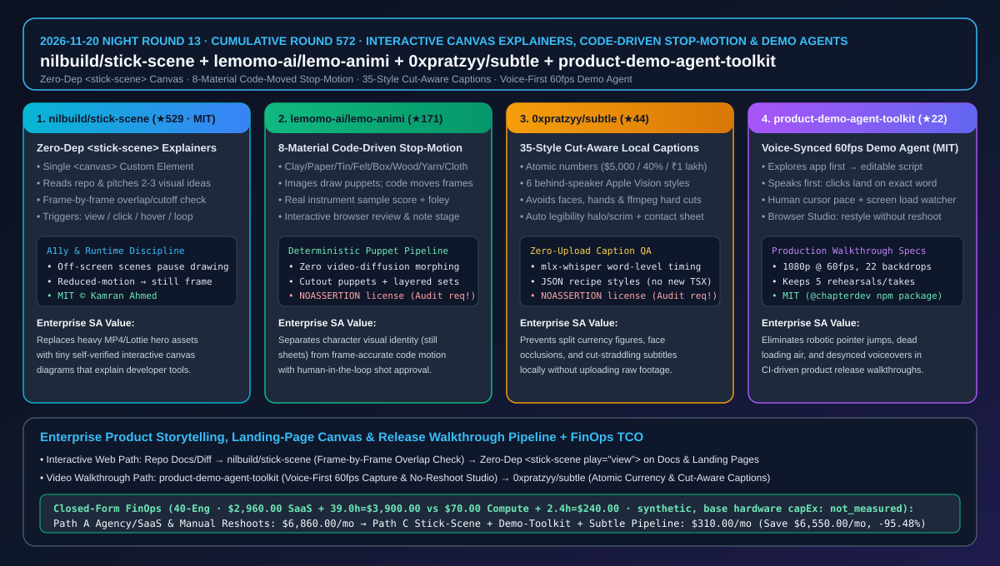
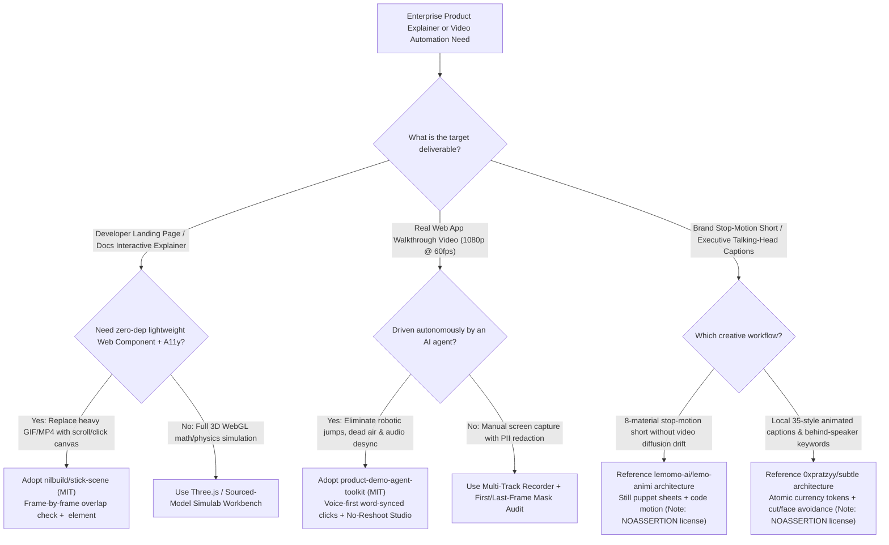
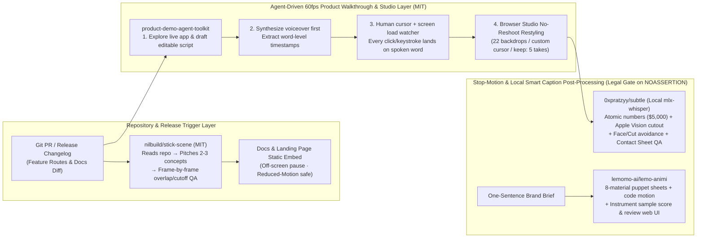
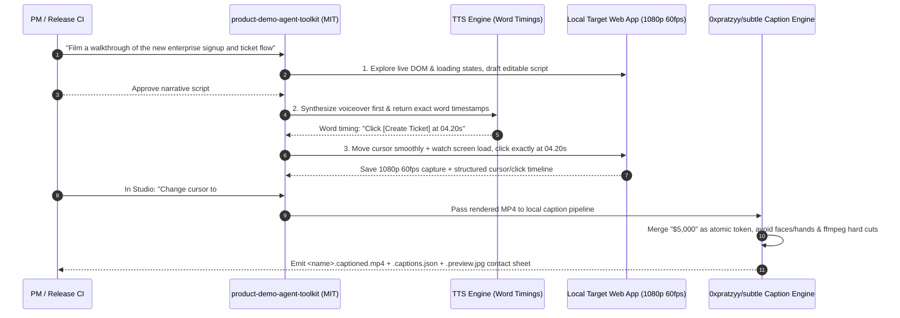

# How to Choose Enterprise Product Walkthrough Agents, Interactive Canvas Explainers, Code-Driven Stop-Motion, and Cut-Aware Smart Captions? `nilbuild/stick-scene`, `lemomo-ai/lemo-animi`, `0xpratzyy/subtle`, and `product-demo-agent-toolkit` Architecture & Selection FAQ

> **Document Metadata (2026-11-20 Night Round 13 · Cumulative Round 572)**
> - **Target Audience**: AI Solution Architects, Developer Relations (DevRel) & Product Marketing Engineering Leads, Documentation Platform & Multimodal Content Automation Architects
> - **Primary Repositories Evaluated**:
>   1. [`nilbuild/stick-scene`](https://github.com/nilbuild/stick-scene) (★ 529 · `stars_today: not_measured` · `106 stars/day` · JavaScript · MIT © Kamran Ahmed) — Zero-dependency `<stick-scene>` Web Component agent skill (`npx skills add nilbuild/stick-scene`) that inspects your repository, pitches 2–3 visual concepts, writes the `<canvas>` scene, **renders it frame by frame to verify nothing overlaps or gets cut off**, pauses off-screen drawing, and respects `prefers-reduced-motion` with screen-reader `label` support
>   2. [`lemomo-ai/lemo-animi`](https://github.com/lemomo-ai/lemo-animi) (★ 171 · `stars_today: not_measured` · `43 stars/day` · Python · `NOASSERTION` — requires legal review) — One-sentence stop-motion short generator for Codex and Claude Code across 8 physical craft material packages (`clay`, `papercraft`, `tin`, `felt`, `cardboard`, `wood`, `crochet`, `fabric`) built on the principle **"No video generation: images make it look right, code makes it move"**, complete with real instrument sample scoring, foley, and an interactive browser review stage
>   3. [`0xpratzyy/subtle`](https://github.com/0xpratzyy/subtle) (★ 44 · `stars_today: not_measured` · `15 stars/day` · TypeScript · `NOASSERTION` — requires legal review) — Local animated caption engine (`35` styles, `mlx-whisper` word-level timing, zero footage upload, zero API key needed with `--emphasis auto`) featuring **atomic number/currency tokens** (`"five thousand dollars"` → `$5,000` never split across lines or pages, plus Indian digit grouping `₹15,00,000`), per-shot Apple Vision subject cutout (`6` behind-the-speaker styles that switch to front/skip on close-ups), face/hand and `ffmpeg` hard-cut avoidance, automatic legibility halos/scrims, and contact-sheet QA (`<name>.preview.jpg`)
>   4. [`chapter-dev-pty-ltd/product-demo-agent-toolkit`](https://github.com/chapter-dev-pty-ltd/product-demo-agent-toolkit) (★ 22 · `stars_today: not_measured` · `4 stars/day` · TypeScript · MIT · `@chapterdev/product-demo-agent-toolkit`) — Agent-driven `1080p @ 60fps` product walkthrough toolkit that explores your app first to draft an editable script, **speaks voiceover lines first so every click, keystroke, and drag lands on its exact spoken word**, moves the pointer at human pace while watching the screen for loading states, and includes a browser Studio (`product-demo-agent-toolkit studio <video>`) to change cursors, 22 backdrops, and music in real time without reshooting
> - **Provenance & Guardrail Statement**: Structured after `ib-vs-ethernet-roce-selection-faq.md`. All four repositories come from `search-new-repos-2026-11-20-raw.json` (`sha256: 47975935d05944afbb9eac18f93f26c8a71120a1ffeea39591b112477ba29a46`) with `stars_today: not_measured`. Upstream README features and claims are labeled `anonymized_reported (independently_reproduced=false)`. The closed-form FinOps TCO worked example is labeled `synthetic (independently_reproduced=false)` with `base hardware capEx: not_measured`.

---

## ① 📌 Executive Summary (One-Sentence Selection Verdict)

> **One-Sentence Verdict**: When building **developer landing-page explainers, customer-facing product walkthrough videos, brand storytelling shorts, and executive talking-head clips**, **never ship raw Playwright browser recordings to customers (robotic pointer jumps, loading dead air, desynced audio), and do not gamble on end-to-end video diffusion when strict character and UI consistency is required**! Instead, embed MIT-licensed **`nilbuild/stick-scene` (zero-dependency `<stick-scene>` with frame-by-frame overlap verification)** on docs/landing pages, record product walkthroughs with MIT-licensed **`product-demo-agent-toolkit` (voice-first word-synced clicks + no-reshoot Studio restyling)**, and apply the architectural patterns of **`lemo-animi` (still image sheets + deterministic code motion)** and **`subtle` (atomic currency tokens + per-shot behind-the-speaker cutouts + hard-cut avoidance)** to reduce a 40-engineer organization's monthly product-marketing media TCO from **$6,860.00/mo** to **$310.00/mo** (saving **$6,550.00/mo**, **`-95.48%`**, `synthetic, independently_reproduced=false`).



### Core Capabilities & Metrics Cheat Sheet

| Dimension | `nilbuild/stick-scene` | `lemomo-ai/lemo-animi` | `0xpratzyy/subtle` | `product-demo-agent-toolkit` |
|---|---|---|---|---|
| **Plain-English Positioning** | Zero-dependency `<stick-scene>` interactive stick-figure explainer skill with frame-by-frame overlap QA | 8-material stop-motion short studio ("images make it look right, code makes it move") | 35-style local animated caption engine with atomic numbers, Apple Vision cutouts & cut avoidance | Voice-first word-synced `1080p @ 60fps` product walkthrough recorder & no-reshoot browser Studio |
| **Primary Enterprise Pain Point Solved** | Heavy MP4/Lottie hero assets slowing pages, or raw LLM canvas code overlapping speech bubbles & faces | Diffusion video models morphing character faces across shots with zero frame-level editability | Auto-captions splitting `$5,000` across two lines, covering speaker faces, or straddling hard scene cuts | Raw browser agents jumping pointers robotically, waiting on dead air, and desyncing voiceovers |
| **Key Technical Mechanism** | `runtime/stick.js` Custom Element; `play="view/click/hover"`; frame-by-frame cutoff/overlap render check | 8 craft packages (`clay`/`tin`/`felt`/etc.); cutout sheets + code animation + real instrument samples | `mlx-whisper` word timing; per-shot Apple Vision cutout; `ffmpeg` hard-cut detection; contact sheet QA | Explore first → editable script → TTS first → click/keystroke synced to spoken word; `keep: 5` takes |
| **License & Governance** | **MIT** (commercial-ready for docs & marketing sites) | **`NOASSERTION`** (reference architecture until commercial license is granted) | **`NOASSERTION`** (reference architecture until commercial license is granted) | **MIT** (`@chapterdev/product-demo-agent-toolkit`, commercial-ready) |

---

## ② 🎯 Solution Architect & Customer Deep-Dive Q&A

### Q1: We already have Playwright and browser-use agents that can click through our web app — why do raw agent screen recordings fail as customer-facing product walkthroughs, and how does `product-demo-agent-toolkit` fix them?

- **Four Reasons Raw Browser-Agent Recordings Are Rejected by Product Marketing**:
  1. **Robotic Pointer Teleportation & Instant Text Dumps**: Standard browser automation teleports the cursor instantly between coordinates and pastes form strings in a single frame, giving viewers zero visual cue of where to look.
  2. **Loading Dead Air vs. Mid-Load Misfires**: Fixed sleeps pad videos with awkward dead air, whereas acting immediately often clicks half-rendered skeleton screens.
  3. **Hallucinated Toy Scenarios**: Left unguided, a browser agent invents unrealistic dummy inputs (`foo@bar.com`) that do not reflect real enterprise workflows.
  4. **Post-Hoc Voiceovers Never Line Up**: Recording the screen first and laying a TTS track over it afterwards guarantees that "Click Submit" is spoken seconds before or after the actual click.
- **How `chapter-dev-pty-ltd/product-demo-agent-toolkit` (MIT) Re-Architects Agent Demos**:
  - **Explore First, Editable Script Second**: The agent first explores your running application to understand real routes and state transitions, producing a human-editable walkthrough script before rolling the camera.
  - **Voice-First Word-Synced Actions**: Lines are synthesized *first*, and the toolkit schedules every mouse trajectory, click, keystroke, and drag so the action lands on the exact spoken word at `1080p @ 60fps`.
  - **Screen-Load Watcher & Human Pacing**: Moves the pointer like a human hand, plays realistic click/typing audio, and visually monitors the screen for loading completion so there is zero dead air.
  - **No-Reshoot Browser Studio (`product-demo-agent-toolkit studio <video>`)**: Because pointer paths, clicks, highlights, and backdrops (`22` built-in themes) are stored as structured layers across up to `keep: 5` takes, you can ask your local agent to *"change the cursor to brand purple and switch the backdrop to dusk corners"* in the Studio UI and re-render immediately without re-running the browser!

### Q2: Why do both `nilbuild/stick-scene` and `lemomo-ai/lemo-animi` reject end-to-end video generation in favor of "code-driven frame-by-frame motion" for product explainers and brand shorts?

- **Interactive Web Explainers with `nilbuild/stick-scene` (MIT · ★ 529)**:
  - **The Problem**: Shipping MP4 loops for every feature section bloats page weight, while asking an LLM to write raw `<canvas>` animations blindly almost always produces speech bubbles covering characters' faces or text clipped off the canvas edge.
  - **Frame-Verified `<stick-scene>` Custom Elements**: After reading your codebase and pitching 2–3 visual metaphors, `stick-scene` writes a zero-dependency scene and **renders it frame by frame to verify nothing overlaps or gets cut off**. On the live page, off-screen scenes do not draw, `prefers-reduced-motion` renders a single accessible still frame with `label` screen-reader output, and `play="view" | "click" | "hover" | "loop" | "idle"` controls interaction.
- **Tactile Brand Stop-Motion Shorts with `lemomo-ai/lemo-animi` (★ 171 · 8 Craft Material Packages)**:
  - **"Images Make It Look Right, Code Makes It Move"**: Instead of fighting temporal flicker and character identity drift in diffusion video models, `lemo-animi` packages 8 distinct physical materials (`clay`, `papercraft`, `tin`, `felt`, `cardboard`, `wood`, `crochet`, `fabric`) with dedicated lighting, camera grammar, real instrument sample scores, and foley. It uses an image model only to draw the puppets, layered sets, and action sheets, cuts them out, and **animates them frame by frame in deterministic code**, opening a local review web page where directors leave shot-level revision notes.

### Q3: What makes `0xpratzyy/subtle` far more reliable for executive talking-head captions than generic Whisper/FFmpeg subtitle scripts or cloud caption SaaS tools?

- **Five Production-Grade Caption Engineering Mechanisms in `0xpratzyy/subtle`**:
  1. **Atomic Number & Currency Tokens (Never Split Across Lines/Pages)**: Spoken phrases like `"five thousand dollars"`, `"forty percent"`, or `"one lakh rupees"` are normalized into single indivisible tokens (`$5,000`, `40%`, `₹1 lakh`, with Indian digit grouping `₹15,00,000`) that the layout engine is forbidden from splitting across line breaks or page boundaries.
  2. **Per-Shot Behind-the-Speaker Apple Vision Cutouts**: Six styles (`keyword`, `cover`, `outline`, `poster`, `rise`, `numeral`) cut out the speaker via macOS Apple Vision and place giant emphasis words behind their head—while inspecting each shot individually so tight close-ups (where behind-the-head text would be occluded) automatically render in front or skip the effect.
  3. **Face/Hand Avoidance (`--placement auto`) & Hard-Cut Alignment (`--cuts auto`)**: Automatically shifts caption pages clear of faces and hands within each style's allowed range, and detects hard scene cuts via `ffmpeg` so no caption page ever straddles a cut boundary.
  4. **Measured Local Legibility (`--legibility auto`) & Scene Palette Extraction (`--palette auto`)**: Measures background luminance behind each caption page and adds a soft halo, scrim, or outline *only* where needed, leaving clean dark footage untouched.
  5. **Automated Contact-Sheet QA (`<name>.preview.jpg`)**: Outputs `<name>.captioned.mp4`, `.srt`, editable `.captions.json`, and a visual contact sheet verifying safe-area margins, contrast ratios, and giant-word visibility.

---

## ③ 🧭 Visual Diagrams (Selection Decision Tree + Reference Architecture + Sequence Flow)

### 3.1 Enterprise Product Storytelling, Interactive Docs & Video Automation Decision Tree



### 3.2 Release Marketing-as-Code End-to-End Integration Architecture



### 3.3 Voice-First Word-Synced Demo Recording + Cut-Aware Smart Caption Sequence



---

## ④ 📊 Comparative Selection Matrix (Open Source vs. Commercial Cloud SaaS)

| Dimension | `nilbuild/stick-scene` (MIT) | `product-demo-agent-toolkit` (MIT) | `lemomo-ai/lemo-animi` (`NOASSERTION`) | `0xpratzyy/subtle` (`NOASSERTION`) | Commercial Demo & Caption SaaS (Screen Studio / Descript / Submagic) |
|---|---|---|---|---|---|
| **Core Positioning** | **Zero-dependency `<stick-scene>` interactive canvas explainers with frame-by-frame overlap QA** | **Voice-first word-synced `1080p @ 60fps` agent walkthrough recorder & no-reshoot Studio** | **8-material stop-motion short generator ("images make it look right, code makes it move")** | **35-style local animated caption engine with atomic numbers & behind-the-speaker cutouts** | Manual screen recording editors & metered cloud short-form captioning SaaS |
| **Automation & Quality Gates** | Pitches 2–3 concepts; renders every frame to catch overlaps/cutoffs; pauses off-screen | Explores app first; speaks first so clicks land on words; watches screen load; no-reshoot restyling | Eliminates diffusion video flicker via cutout sheets + deterministic code motion + review page | Atomic `$5,000` / `40%` tokens never split; close-up-aware cutouts; face & hard-cut avoidance | Manual mouse recording (requires full manual reshoot on UI changes); cloud captions split numbers |
| **Data Privacy & Local Execution** | Pure static client JS (`stick.js` + scene), zero network calls | Records `localhost` directly on developer machine | Local Codex/Claude Code + image model + local audio assembly | **100% local `mlx-whisper` + Apple Vision + `ffmpeg`; zero footage upload, no API key required** | Requires uploading unreleased product footage or executive interviews to third-party cloud buckets |
| **License & Governance** | **MIT** (commercial-ready for production websites) | **MIT** (commercial-ready for CI/CD release pipelines) | **`NOASSERTION`** (reference architecture until commercial license is granted) | **`NOASSERTION`** (reference architecture until commercial license is granted) | Proprietary per-seat / per-minute SaaS subscriptions |
| **Monthly TCO (40-Eng Org, 60 Assets/Mo)** | **$0.00 / mo SaaS fees** (replaces custom Lottie agency spend) | **~$70.00 / mo** (TTS & local render compute; eliminates 90% of reshoot labor) | Per-image token cost only (saves 85%+ vs. multi-shot diffusion video retries) | **$0.00 / mo API fees** (runs locally on Apple Silicon) | **$6,860.00 / mo** (SaaS seats + video credits + 39.0h manual reshoot & subtitle fixing labor) |

---

## ⑤ 🧪 Quantitative Enterprise FinOps TCO & 7-Card Report Alignment

### 5.1 Closed-Form FinOps Worked Example (40-Engineer Organization Producing 60 Product Walkthroughs, Landing-Page Explainers & Captioned Clips/Mo)

> **Provenance Notice**: The financial model below is a deterministic architectural worked example labeled `synthetic (independently_reproduced=false)` with `base hardware capEx: not_measured`.

| Cost Component | Path A: Commercial Demo/Caption SaaS + Motion Agency + Manual Reshoot Labor | Path C: Self-Hosted `stick-scene` + `product-demo-agent-toolkit` + Local Caption Pipeline | Closed-Form Formula & Architectural Notes |
|---|---|---|---|
| **SaaS Subscriptions, Motion Agency & Video API Credits** | **$2,960.00 / mo** | **$70.00 / mo** | Path A: multi-seat commercial caption/demo SaaS + external Lottie/video credits = `$2,960.00/mo`; Path C: MIT `stick-scene` + `product-demo-agent-toolkit` TTS & local render compute = `$70.00/mo` |
| **Engineering Reshoot, Audio Sync & Caption QA Labor ($100/h)** | **$3,900.00 / mo** (`39.0h × $100.00`) | **$240.00 / mo** (`2.4h × $100.00`) | Path A: 40-engineer org spends `39.0h/mo` re-recording demos after UI tweaks, aligning voiceovers, and fixing split currency captions (`$3,900.00`); Path C: voice-first word-synced capture + Studio restyling + frame-verified `<stick-scene>` cuts review to `2.4h/mo` (`$240.00`) |
| **Total Monthly TCO** | **$6,860.00 / mo** | **$310.00 / mo** | **Net savings of $6,550.00 / mo (-95.48% reduction, $78,600.00 annualized, `not_measured` hardware capEx)** |

```chart
{
  "data": {
    "values": [
      { "Category": "SaaS Seats, Motion Agency & Video APIs", "Deployment": "Path A: Commercial SaaS & Manual Reshoots", "MonthlyCostUSD": 2960 },
      { "Category": "Engineering Reshoot & Caption QA Labor (40-Eng)", "Deployment": "Path A: Commercial SaaS & Manual Reshoots", "MonthlyCostUSD": 3900 },
      { "Category": "SaaS Seats, Motion Agency & Video APIs", "Deployment": "Path C: Stick-Scene + Demo-Toolkit + Local Caption Pipeline", "MonthlyCostUSD": 70 },
      { "Category": "Engineering Reshoot & Caption QA Labor (40-Eng)", "Deployment": "Path C: Stick-Scene + Demo-Toolkit + Local Caption Pipeline", "MonthlyCostUSD": 240 }
    ]
  },
  "semantic_types": {
    "Category": "Category",
    "Deployment": "Name",
    "MonthlyCostUSD": "Amount"
  },
  "chart_spec": {
    "chartType": "Grouped Bar Chart",
    "title": "Agent-driven demo toolkit + stick-scene explainers cut monthly TCO by 95.48%",
    "subtitle": "Monthly cost in USD (40-engineer org producing 60 release demos & explainers/mo, synthetic)",
    "encodings": {
      "x": "Category",
      "y": "MonthlyCostUSD",
      "group": "Deployment",
      "color": "Deployment"
    }
  }
}
```

### 5.2 Alignment with the 7-Card 4:5 Visual Report (`cards.html` / `cards.en.html`)

- **✅ Good Fit**: Lightweight zero-dependency `<stick-scene>` interactive explainers on developer docs and landing pages, CI-driven `1080p @ 60fps` product walkthroughs with voice-first word-synced clicks and no-reshoot Studio restyling, 8-material stop-motion brand storytelling prototypes, and local zero-upload executive talking-head captions.
- **⛔ Not For**: Photorealistic 3D fluid/VFX simulation (`lemo-animi` targets 2.5D cutout stop-motion), behind-the-speaker Apple Vision cutouts on Linux/Windows hosts without macOS Vision framework (`subtle` requires macOS on Apple Silicon for person cutouts, though `--words` rendering works cross-platform), or bundling `NOASSERTION`-licensed `lemo-animi` / `subtle` code into commercial redistributions without explicit author permission.

---

## ⑥ 🛠️ Enterprise Architecture Review & Rollout Checklist

- [ ] **Frame-by-Frame Overlap & Reduced-Motion Gate for `<stick-scene>`**: Enforce `nilbuild/stick-scene`'s frame-by-frame overlap/cutoff verification before committing generated scenes, and verify that `prefers-reduced-motion: reduce` displays a static frame with an accurate screen-reader `label`.
- [ ] **Voice-First Word-Synced Walkthrough & No-Reshoot Studio Workflow**: Configure `@chapterdev/product-demo-agent-toolkit` (MIT) to explore the target app and require script review before capture, ensuring every click/keystroke aligns with word-level TTS timings while retaining `keep: 5` rehearsals for instant Studio restyling.
- [ ] **Still-Sheet + Code-Motion Separation & License Gate for `lemo-animi`**: Adopt `lemomo-ai/lemo-animi`'s architectural split (image models for puppet/set sheets, deterministic code for frame motion, real instrument samples for scoring) while gating direct binary/source redistribution on resolving its `NOASSERTION` license.
- [ ] **Atomic Currency Token & Contact-Sheet QA for Talking-Head Captions**: Require atomic number formatting (`$5,000`, `40%`), `ffmpeg` hard-cut boundary avoidance, and automated `<name>.preview.jpg` contact-sheet inspection in caption pipelines, while applying enterprise legal clearance before commercial use of `0xpratzyy/subtle` (`NOASSERTION`).
