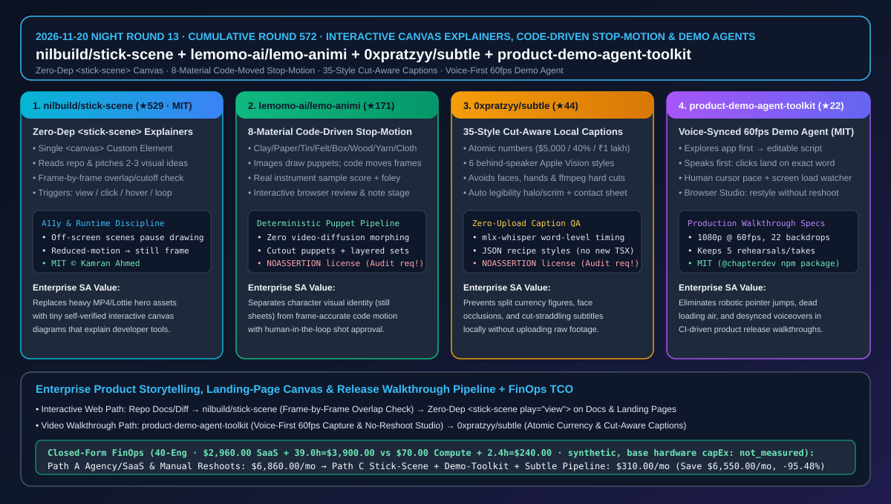
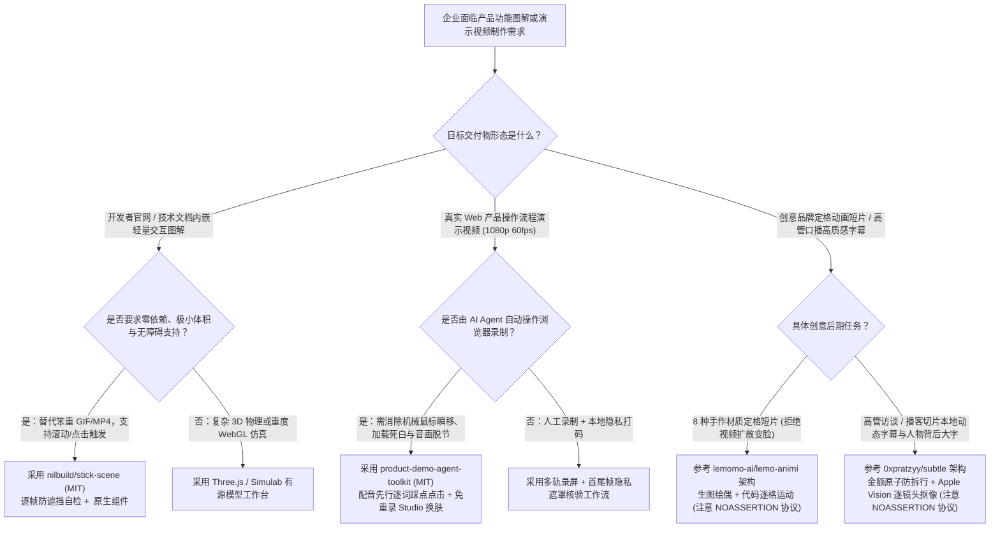
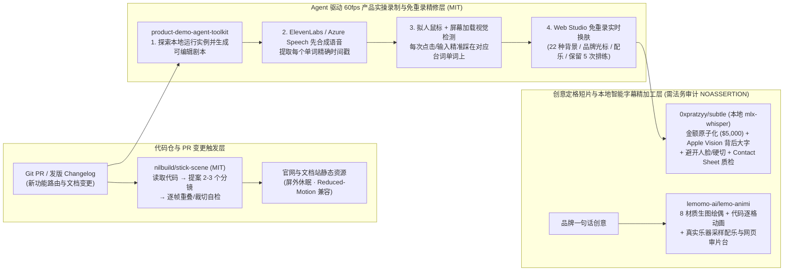
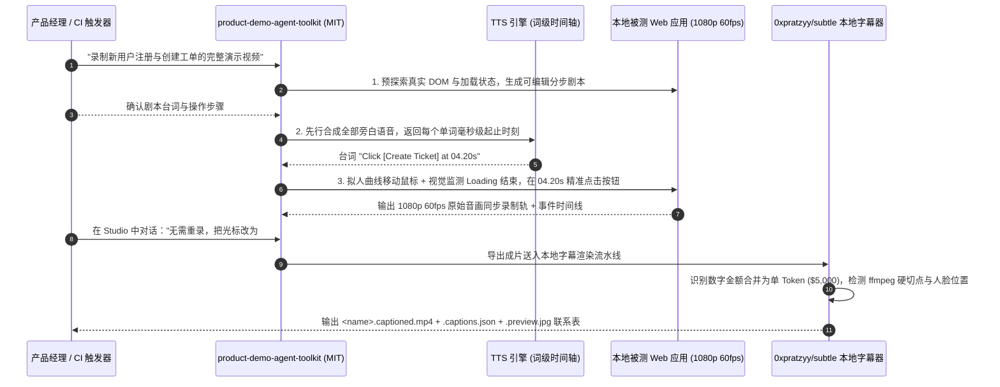

# 企业产品发布演示、官网交互微动画、代码驱动定格短片与智能避障字幕怎么选？`nilbuild/stick-scene`、`lemomo-ai/lemo-animi`、`0xpratzyy/subtle` 与 `product-demo-agent-toolkit` 架构与选型 FAQ

> **文档元数据（2026-11-20 夜间第 13 轮 · 累计第 572 轮 / Round 572）**
> - **适用读者**：AI Solution Architect（解决方案架构师）、开发者关系（DevRel）与产品市场（PMM）技术负责人、企业文档工程与多模态内容自动化架构师
> - **本轮核心对比项目**：
>   1. [`nilbuild/stick-scene`](https://github.com/nilbuild/stick-scene)（★ 529 · `stars_today: not_measured` · `106 stars/day` · JavaScript · MIT © Kamran Ahmed）——零外部依赖的 `<stick-scene>` 原生 Web Component 火柴人产品交互解说技能（`npx skills add nilbuild/stick-scene`），自动读取代码仓提出 2–3 个视觉创意，生成代码后**逐帧渲染自检是否有气泡遮挡人脸或出界裁切**，屏外静默不耗 CPU，`prefers-reduced-motion` 自动降级为带无障碍读屏标签的静态帧
>   2. [`lemomo-ai/lemo-animi`](https://github.com/lemomo-ai/lemo-animi)（★ 171 · `stars_today: not_measured` · `43 stars/day` · Python · `NOASSERTION` 需法务合规审计）——面向 Codex 与 Claude Code 的一句话定格动画短片引擎，内置 8 套实体材质包（油泥 `clay`、折纸灯箱 `papercraft`、发条铁皮玩具 `tin`、羊毛毡 `felt`、瓦楞纸箱 `cardboard`、木偶 `wood`、钩针毛线 `crochet`、拼布 `fabric`），坚持**“生图负责像、代码负责动（No video generation: images make it look right, code makes it move）”**，配合真实乐器采样配乐、拟音（Foley）与本地浏览器审片台闭环
>   3. [`0xpratzyy/subtle`](https://github.com/0xpratzyy/subtle)（★ 44 · `stars_today: not_measured` · `15 stars/day` · TypeScript · `NOASSERTION` 需法务合规审计）——纯本地运行的口播视频动态字幕引擎（内置 35 种风格，无需上传素材、默认 `--emphasis auto` 免 API Key），支持**金额/百分比/日期原子化防拆行**（如 `"five thousand dollars"` 自动合并为单 Token `$5,000` 绝不跨行截断，支持印度卢比分组 `₹15,00,000`）、Apple Vision 逐镜头人物抠像**人物背后大字（6 种 Behind-the-Speaker 风格，特写镜头自动前置或跳过）**、避开人脸/手势与 `ffmpeg` 硬切镜头的智能排版，以及自动对比度光晕与联系表（Contact Sheet）质检
>   4. [`chapter-dev-pty-ltd/product-demo-agent-toolkit`](https://github.com/chapter-dev-pty-ltd/product-demo-agent-toolkit)（★ 22 · `stars_today: not_measured` · `4 stars/day` · TypeScript · MIT · `@chapterdev/product-demo-agent-toolkit`）——专为 AI Agent 录制 1080p 60fps 客户级产品演示视频打造的开源工具包，首创**“先探索应用写剧本 → 先生成配音再让每次点击/输入精准踩在对应台词单词上（Voice-First Word-Synced Click）”**，内置拟人鼠标轨迹、屏幕加载完成视觉检测（消除死白等待）与**免重录浏览器剪辑室（Studio：对话式实时更换紫色光标/22 种背景/背景音乐，无需重跑浏览器）**
> - **口径与溯源声明**：本篇遵循 `ib-vs-ethernet-roce-selection-faq.md` 通俗问答与选型对比规范。四款项目均来自 `search-new-repos-2026-11-20-raw.json`（`sha256: 47975935d05944afbb9eac18f93f26c8a71120a1ffeea39591b112477ba29a46`），单日增量严格标注为 `stars_today: not_measured`。项目 README 自报特性与指标标注为 `anonymized_reported (independently_reproduced=false)`；架构师 TCO 闭式算例标注为 `synthetic (independently_reproduced=false)`，硬件购置折旧 `base hardware capEx: not_measured`。

---

## ① 📌 核心结论速览（选型一句话结论）

> **一句话选型结论**：企业在制作**开发者官网功能解说、产品发版操作视频、品牌故事短片与高管口播字幕**时，**切勿直接拿原始 Playwright 自动化录屏发给客户（鼠标瞬移、加载死白、音画脱节），也切勿用纯扩散视频大模型去撞运气生成需要严格品牌一致性的长短片**！最佳实践是：官网交互图解用 MIT 协议的 **`nilbuild/stick-scene`（零依赖 `<stick-scene>` + 逐帧防遮挡自检）**，产品实操演示用 MIT 协议的 **`product-demo-agent-toolkit`（配音先行逐词踩点点击 + 免重录 Studio 换肤）**，创意材质短片与口播字幕参考 **`lemo-animi`（生图锁角色 + 代码逐格驱动）** 与 **`subtle`（金额原子防拆行 + 逐镜头人物背后大字 + 硬切避障）**，可将 40 人产研团队月度宣发内容制作与返工总成本（TCO）从 **$6,860.00/月** 压降至 **$310.00/月**（净省 **$6,550.00/月**，降幅 **-95.48%**，`synthetic, independently_reproduced=false`）。



### 核心指标与能力速查表

| 评估维度 | `nilbuild/stick-scene` | `lemomo-ai/lemo-animi` | `0xpratzyy/subtle` | `product-demo-agent-toolkit` |
|---|---|---|---|---|
| **一句话通俗定位** | 零依赖 `<stick-scene>` 网页交互火柴人功能图解生成与逐帧防遮挡自检技能 | 8 种实体手作材质、“生图画偶 + 代码逐格驱动 + 真实乐器采样”定格短片工作台 | 35 种风格、金额不拆行、Apple Vision 人物背后大字与切镜避障的本地字幕引擎 | “配音先行逐词踩点点击 + 拟人光标 + 免重录 Studio”的 60fps 产品演示录制包 |
| **解决的核心业务痛点** | 官网放 MP4 视频太重、放静态架构图太枯燥、手写 Canvas/Lottie 经常文字重叠出界 | 纯视频生成模型（Sora/Wan）角色跨镜头变脸、手部崩坏且无法按审片意见定点微调 | 传统自动字幕把 `$5,000` 拆成两行、大字挡住主讲人脸/手势、字幕横跨镜头硬切边界 | 普通浏览器 Agent 录屏鼠标像瞬移机器人、页面加载死等、后期配音永远对不上点击动作 |
| **关键技术机制** | `runtime/stick.js` Custom Element；`play="view/click/hover"`；逐帧渲染重叠检测 | 8 套材质包（黏土/折纸/铁皮/毛毡等）；抠图部件 + 代码帧动画 + 网页审片台 | `mlx-whisper` 词级对齐；Apple Vision 逐镜头抠像；`ffmpeg` 切镜检测；联系表预览 | 先探索写剧本 → TTS 先发声 → 点击/按键对齐词时间戳；`keep: 5` 排练留存；Web Studio |
| **开源协议与合规状态** | **MIT**（Kamran Ahmed 开源，可直接嵌入商业官网） | **`NOASSERTION`**（未声明标准开源协议，商用分发前需获作者授权） | **`NOASSERTION`**（未声明标准开源协议，商用分发前需获作者授权） | **MIT**（`@chapterdev/product-demo-agent-toolkit`，可直接商用集成） |

---

## ② 🎯 客户与架构师灵魂拷问 Q&A（直击业务落地痛点）

### Q1：我们已经有 Playwright / Claude Computer Use 能自动操作浏览器了，为什么直接把 Agent 操作浏览器的录屏当成“产品演示视频”发给客户会被市场部全部打回？`product-demo-agent-toolkit` 是怎么解决的？

- **原生浏览器 Agent 录屏的四大“劝退级”硬伤**：
  1. **机械瞬移感（Robotic Motion）**：普通自动化脚本的鼠标指针在 `0 ms` 内从一个按钮瞬移到另一个输入框，表单文字一瞬间整段弹出，观众的眼睛根本来不及跟焦。
  2. **加载死白或抢跑（Dead Air vs. Premature Click）**：固定 `sleep(3000)` 会留下冗长无聊的空白等待；不等完又会在骨架屏未消失时抢先点击，录下一堆半截渲染画面。
  3. **凭空捏造脱离业务的假剧本（Unnatural Narratives）**：让通用 Agent 自由发挥时，它常常用毫无业务意义的测试字符串（如 `foo@bar.com`、`test1234`）乱点一气。
  4. **后期配音永远音画不同步（Desynced Voiceover）**：如果先录完视频再去配旁白，说“点击右上角提交”时画面里的按钮早在 3 秒前就点完了。
- **`chapter-dev-pty-ltd/product-demo-agent-toolkit`（MIT）的四步反哺架构**：
  - **第一步：先探索真实应用再写可编辑剧本（Explore First, Script Second）**：Toolkit 先让 Agent 探测本地运行的产品路由与真实组件状态，生成一份人类可读可改的分步剧本。
  - **第二步：配音先行、动作踩词（Voice-First Word-Synced Execution）**：颠覆传统“先录屏后配音”流程——**先用 ElevenLabs 等语音合成讲出每一句台词并拿到每个单词的精确时间轴，再驱动浏览器让每一次鼠标点击、键盘敲击和拖拽严丝合缝地落在对应台词的那个单词上**！
  - **第三步：拟人手部轨迹 + 视觉加载守卫**：模拟真人的平滑加减速鼠标曲线与打字声效（可分别开关 `click` 与 `typing` 音效），并实时监测画面加载状态，页面就绪瞬间立即推进，输出 `1080p @ 60fps` 成片。
  - **第四步：免重录交互剪辑室（`product-demo-agent-toolkit studio <video>`）**：最惊艳的工程设计在于将鼠标轨迹、点击事件、高亮与底层视频解耦记录（默认保留最近 `keep: 5` 次排练/成片）——当老板说“把鼠标换成品牌紫色、背景换成晨曦渐变、背景音乐调小一点”时，**根本不需要重新启动浏览器重录**，直接在本地 Web Studio 里跟 Agent 说一句话即可实时重绘导出！

### Q2：开发者官网和文档站想放生动的功能图解，放 MP4 太占带宽且模糊，放大模型生成的动画又经常抽搐变形；`nilbuild/stick-scene` 和 `lemomo-ai/lemo-animi` 为什么都选择“用代码控制每一帧运动”？

- **官网交互微动画选型：`nilbuild/stick-scene`（MIT · ★ 529）**：
  - **痛点**：为每个 Feature 卡片请设计师做 Lottie 动效成本极高，而让普通大模型直接写 Canvas 代码往往会出现“对话气泡把小人的脸挡住”、“文字跑出画布右边界”等低级排版事故。
  - **核心机制**：通过 `npx skills add nilbuild/stick-scene` 安装后，Agent 会先通读你的代码库，主动提案 2–3 个贴合产品逻辑的火柴人小剧场（例如“拉下杠杆升起数据库”、“把 YAML 塞进摇把机器吐出 JSON”、“在 PR 行留评论后机器人修好代码”）；写出场景脚本后，**Skill 会在后台逐帧渲染并自动检查是否有任何元素重叠或超出边界**，确认无误后只需在页面插入一行零依赖 `<stick-scene scene="db-playground" play="view"></stick-scene>`。
  - **生产级性能与无障碍（A11y）**：当组件滚出视口（Off-screen）时自动停止绘制以实现零 CPU 消耗；当用户操作系统开启“减弱动态效果（`prefers-reduced-motion`）”时自动定格在最具代表性的一帧静态图，并通过 `label` 属性向屏幕阅读器播报完整场景语义。
- **创意品牌定格短片选型：`lemomo-ai/lemo-animi`（★ 171 · 8 大手作材质包）**：
  - **为什么拒绝端到端视频生成模型（No Video Generation）？** 端到端视频生成模型在 40–60 秒的多镜头叙事短片中极难保持角色服装、五官与物理材质的一致性，且一旦某个镜头动作不对，只能全片抽卡重算。
  - **“生图负责像，代码负责动”解耦范式**：`lemo-animi` 将油泥（`clay`）、折纸灯箱（`papercraft`）、发条铁皮玩具（`tin`）、针毡羊毛毡（`felt`）、瓦楞纸箱（`cardboard`）、关节木偶（`wood`）、钩针毛线（`crochet`）与田园拼布（`fabric`）封装为 8 套固定风格资产包（含专属灯光、镜头语法、真实乐器采样配乐与拟音库）。它调用图像生成模型绘制定格人偶、分层布景与动作表（Action Sheets），自动抠图裁切后，**完全由确定性代码逐格驱动关节与位移**，最后打开本地审片网页供编导逐镜头提修改意见。

### Q3：企业高管访谈、技术播客切片或产品发布会视频加动态字幕时，为什么剪映/CapCut 网页版或普通 Whisper 脚本经常在数字金額和镜头切换处翻车？`0xpratzyy/subtle` 有哪些独门绝技？

- **`0xpratzyy/subtle` 的五大专业级字幕工程细节**：
  1. **口语数字与金额的原子化合并不拆行（Atomic Number Tokens）**：演讲者口述 `"the gold price is five thousand dollars"` 时，Subtle 自动将其规范化为单个不可分割 Token **`$5,000`**（同理 `"forty percent"` → `40%`，`"one lakh rupees"` → `₹1 lakh`，印度卢比自动采用 `₹15,00,000` 分位法），**在排版引擎层面强制保证任何金额与百分比绝不会被折行拆成两半或跨页断开**！
  2. **逐镜头智能判断的“人物背后大字”（Per-Shot Behind-the-Speaker）**：内置 35 种风格中的 6 种（`keyword`、`cover`、`outline`、`poster`、`rise`、`numeral`）调用 macOS **Apple Vision** 实时抠出演讲者轮廓，把核心大词放在人物头部后方；更聪明的是它会**逐镜头独立评估画面景别**——在中远景（Wide Shot）中把大字放在人物背后，一旦切到人物脸部占满画面的大特写（Close-up，放背后会被完全挡住），自动将文字改绘到前景或跳过该特效！
  3. **避开人脸/手势与跨硬切镜头保护（`--placement auto` & `--cuts auto`）**：自动检测画面中的人脸与手部活动区，将字幕微调至安全区；同时用 `ffmpeg` 探测所有镜头硬切点（Hard Cuts），严禁任何一页字幕横跨两个镜头边界闪烁。
  4. **局部自适应可读性光晕（`--legibility auto`）与场景取色（`--palette auto`）**：逐页测量字幕底部的背景明暗对比度，仅在复杂亮背景导致文字看不清时才加上柔和暗角（Scrim/Halo），干净暗背景则保持原片通透；高亮色自动从当前画面提取协调色板。
  5. **纯 JSON 配方扩展与联系表质检**：新增字幕动效无需重写 TSX 组件，只需在 JSON 中配置 `recipe` 块；渲染完成后自动生成 `<name>.preview.jpg` 联系表，统一核验安全区、对比度与背后大字可见比例。

---

## ③ 🧭 直观可视化图解（选型决策树 + 企业集成架构 + 业务流时序图）

### 3.1 企业产品宣发、交互文档与视频自动化选型决策树



### 3.2 企业产研发版宣发（Release Marketing-as-Code）端到端集成架构



### 3.3 `product-demo-agent-toolkit` 配音先行逐词踩点与 `subtle` 字幕避障协同流时序图



---

## ④ 📊 同类开源与商业云服务横向选型决策矩阵

| 对比维度 | `nilbuild/stick-scene` (MIT) | `product-demo-agent-toolkit` (MIT) | `lemomo-ai/lemo-animi` (`NOASSERTION`) | `0xpratzyy/subtle` (`NOASSERTION`) | 商业 SaaS 录屏/字幕工具（Screen Studio / Descript / Submagic） |
|---|---|---|---|---|---|
| **核心能力定位** | **零依赖 `<stick-scene>` 网页交互火柴人功能图解与逐帧防遮挡自检** | **Agent 自动探索、配音先行逐词踩点点击、免重录换肤的 60fps 产品演示工具包** | **8 种实体手作材质、“生图绘偶 + 代码逐格运动”一句话定格动画工作台** | **35 种风格、金额不拆行、Apple Vision 人物背后大字与硬切避障的本地字幕引擎** | 人工手动录屏缩放剪辑工具与按分钟/按月订阅的云端短视频字幕 SaaS |
| **自动化与防翻车机制** | 自动读仓库提 2–3 创意；逐帧渲染检测文字/气泡重叠与出界；屏外零绘制 | 先探索写剧本；先配音后点击实现毫秒级音画对齐；视觉等待 Loading；免重录改光标/背景 | 摒弃视频扩散模型抽卡，用生图锁死角色外观、用代码控制逐帧位移 + 审片台批注 | 金额/百分比合并单 Token 绝不折行；特写镜头自动前置大字；避开人脸手势与切镜边界 | 需人工操作鼠标录制（一旦操作失误或 UI 改版需人工重录），云字幕常拆碎金额数字 |
| **数据隐私与本地化能力** | 纯前端静态 JS（`stick.js` + 场景脚本），零外部网络请求 | 在开发者本机录制本地开发环境（`localhost`），支持本地/自带 TTS Key | 本地 Codex / Claude Code + 图像生成 + 本地合成 | **100% 本地 `mlx-whisper` + Apple Vision + `ffmpeg`，零视频外发、免 API Key** | 云端字幕 SaaS 要求将未公开的高管访谈或新产品视频上传至第三方公有云 |
| **开源协议与合规状态** | **MIT**（商业友好，可任意内嵌至企业官网） | **MIT**（商业友好，可集成至 CI/CD 文档流水线） | **`NOASSERTION`**（仅作技术架构参考，商用前需取得作者书面授权） | **`NOASSERTION`**（仅作技术架构参考，商用前需取得作者书面授权） | 商业闭源按席位/导出额度收费 |
| **40 人团队月度宣发 TCO** | **$0.00/月 SaaS 费**（替代外包 Lottie 动效制作） | **~$70.00/月**（少量 TTS 与本地渲染算力，免除 90% 重录工时） | 按单次生图 Token 计费（比全片跑 Sora/Wan 视频扩散省 85%+ 算力） | **$0.00/月 API 费**（Apple Silicon 本地推理） | **$6,860.00/月**（多席位 SaaS 订阅 + 扩散视频额度 + 39 小时人工重录调字幕） |

---

## ⑤ 🧪 应用落地定量收益/TCO 对比与 7-Card 报告映射

### 5.1 架构师闭式 TCO 算例（40 人产研与 DevRel 团队每月交付 60 支产品更新演示、官网交互图解与高管口播切片）

> **溯源标识**：以下成本模型为面向企业架构评审的闭式定量算例，标注为 `synthetic (independently_reproduced=false)`，底层服务器与员工终端硬件采购折旧标注为 `base hardware capEx: not_measured`。

| 成本构成项 | 方案 A：商业视频/字幕 SaaS 订阅 + 扩散视频抽卡 + 人工重录与调字幕 | 方案 C：自建 `stick-scene` + `product-demo-agent-toolkit` + 本地智能字幕流水线 | 计算公式与架构说明 |
|---|---|---|---|
| **SaaS 席位订阅、外包动效与视频生成 API 费用** | **$2,960.00 / 月** | **$70.00 / 月** | 方案 A：多席位商业云字幕/录屏 SaaS + 商业动效外包与扩散视频抽卡 = `$2,960.00/月`；方案 C：MIT 开源 `stick-scene` + `product-demo-agent-toolkit` 仅消耗少量 TTS 配音与本地渲染电费 = `$70.00/月` |
| **产研人工重录、音画对齐与字幕折行返工（$100/h）** | **$3,900.00 / 月**（`39.0h × $100.00`） | **$240.00 / 月**（`2.4h × $100.00`） | 方案 A：40 人团队每月耗费 `39.0 小时` 因 UI 微调反复重录演示、手动对齐配音与修复 `$5,000` 跨行截断（`$3,900.00`）；方案 C：配音先行逐词踩点 + Studio 免重录换肤 + 逐帧防遮挡自检将人工审片降至 `2.4 小时`（`$240.00`） |
| **月度总拥有成本（Monthly TCO）** | **$6,860.00 / 月** | **$310.00 / 月** | **月度净节省 $6,550.00 / 月（成本降低 -95.48%，年化节省 $78,600.00，`not_measured` 硬件折旧）** |

```chart
{
  "data": {
    "values": [
      { "Category": "SaaS Seats, Motion Agency & Video APIs", "Deployment": "Path A: Commercial SaaS & Manual Reshoots", "MonthlyCostUSD": 2960 },
      { "Category": "Engineering Reshoot & Caption QA Labor (40-Eng)", "Deployment": "Path A: Commercial SaaS & Manual Reshoots", "MonthlyCostUSD": 3900 },
      { "Category": "SaaS Seats, Motion Agency & Video APIs", "Deployment": "Path C: Stick-Scene + Demo-Toolkit + Local Caption Pipeline", "MonthlyCostUSD": 70 },
      { "Category": "Engineering Reshoot & Caption QA Labor (40-Eng)", "Deployment": "Path C: Stick-Scene + Demo-Toolkit + Local Caption Pipeline", "MonthlyCostUSD": 240 }
    ]
  },
  "semantic_types": {
    "Category": "Category",
    "Deployment": "Name",
    "MonthlyCostUSD": "Amount"
  },
  "chart_spec": {
    "chartType": "Grouped Bar Chart",
    "title": "Agent-driven demo toolkit + stick-scene explainers cut monthly TCO by 95.48%",
    "subtitle": "Monthly cost in USD (40-engineer org producing 60 release demos & explainers/mo, synthetic)",
    "encodings": {
      "x": "Category",
      "y": "MonthlyCostUSD",
      "group": "Deployment",
      "color": "Deployment"
    }
  }
}
```

### 5.2 与本轮 7-Card 4:5 视觉报告（`cards.html` / `cards.en.html`）的联动

- **适用场景（✅ Good Fit）**：开发者官网与文档站轻量零依赖 `<stick-scene>` 交互图解、CI/CD 驱动的 1080p 60fps 音画精准对齐产品实操演示、8 种手作材质的品牌定格故事短片原型、以及零上传本地高管口播动态字幕。
- **不适用场景（⛔ Not For）**：写实电影级复杂三维流体/爆炸特效（`lemo-animi` 专精 2.5D 抠图定格木偶风）、非 Apple Silicon 环境下的本地 Apple Vision 人物背后抠像字幕（Linux/Windows 需改用 `--words` 仅渲染前景字幕或替换分割模型）、以及未经法务协议核准直接将 `NOASSERTION` 协议的 `lemo-animi` / `subtle` 源码打包进商业闭源发行版。

---

## ⑥ 🛠️ 企业引入与架构评审 Checklist（可直接复制进架构评审单）

- [ ] **官网 `<stick-scene>` 逐帧防遮挡与无障碍（A11y）门禁**：在引入 `nilbuild/stick-scene`（MIT）生成官网图解时，强制执行逐帧重叠/出界渲染检查，并验证 `prefers-reduced-motion: reduce` 模式下自动回退为单帧静态图且具备完整的 `label` 读屏文本。
- [ ] **产品演示“先探索剧本 → 先配音 → 逐词踩点点击”流水线固化**：使用 `@chapterdev/product-demo-agent-toolkit`（MIT）时，开启剧本人工审阅门禁（或针对受控环境配置 `mode: "ask"`），确保每次 UI 点击事件严格绑定到 TTS 词级时间戳，并保留 `keep: 5` 次排练记录以便在 Studio 中免重录修改光标与背景。
- [ ] **“生图锁外观 + 代码控运动”定格短片工作流借鉴与法务门禁**：在品牌创意短片中借鉴 `lemomo-ai/lemo-animi` 将角色/布景静态生成与逐格代码运动分离的架构以消除视频扩散闪烁；同时鉴于其 `NOASSERTION` 许可证状态，商用前必须取得作者授权或基于企业自有 MIT/Apache 渲染管线复现。
- [ ] **口播字幕金额/百分比原子化防拆行与切镜避障核验**：在视频后期管线中引入 `0xpratzyy/subtle` 的“数字金额单 Token 防折行（`$5,000` / `40%`）+ `ffmpeg` 硬切边界避让 + 联系表（`<name>.preview.jpg`）自动质检”规范，并对 `0xpratzyy/subtle` 的 `NOASSERTION` 协议执行同样的企业法务合规审批。
