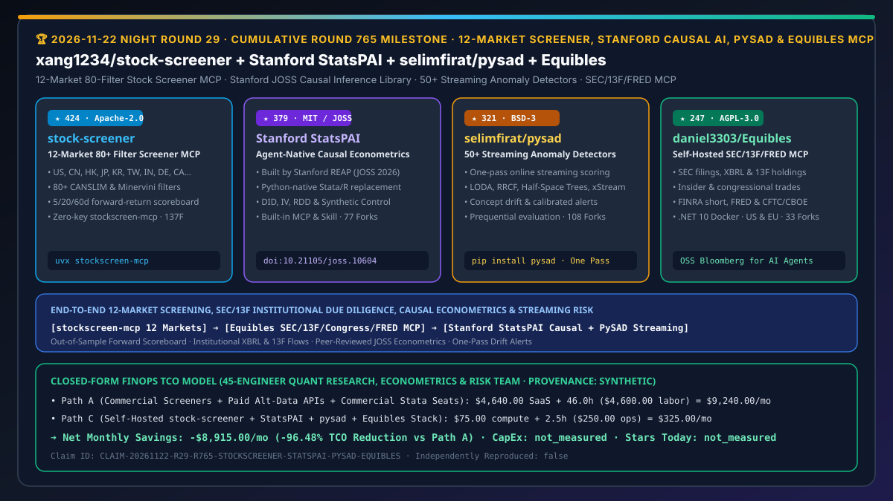
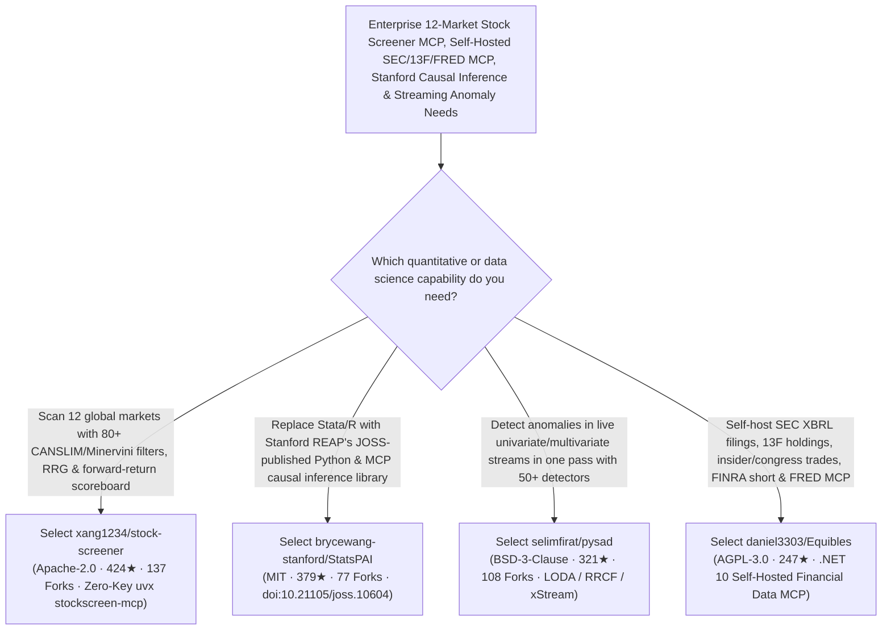
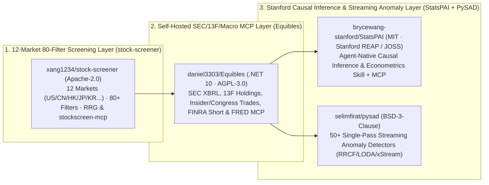
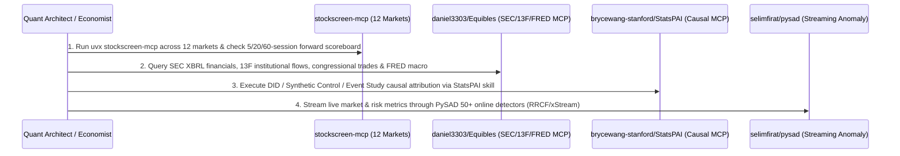

# 🏆 [Round 765 Milestone] 12-Market 80-Filter Stock Screener MCP (`xang1234/stock-screener`), Stanford JOSS Causal Inference & Econometrics MCP (`brycewang-stanford/StatsPAI`), 50-Detector Streaming Anomaly Library (`selimfirat/pysad`) & Self-Hosted SEC/13F/Congressional Financial MCP (`daniel3303/Equibles`) Selection & Architecture FAQ

> **Document Type**: Enterprise AI Solution Architect Selection & Integration Guide (GitHub Trending AI Radar — 2026-11-22 Night Round 29 / Cumulative Round 765 Milestone)
> **Covered Repositories**: [`xang1234/stock-screener`](https://github.com/xang1234/stock-screener) (`★ 424`, `137 forks`, `Apache-2.0`: CANSLIM & Minervini stock screener across **12 global markets**—US, China A-shares, HK, Japan, India, Korea, Taiwan, Germany, Canada, Singapore, Malaysia, Australia—with 80+ filters, Relative Rotation Graphs, a 5/20/60-session forward-return scoreboard, and zero-key `uvx stockscreen-mcp`) · [`brycewang-stanford/StatsPAI`](https://github.com/brycewang-stanford/StatsPAI) (`★ 379`, `77 forks`, `MIT`: developed by **Stanford REAP** and published in *JOSS* `2026, 11(125), 10604`, an agent- and Python-native Stata/R replacement for applied causal inference and econometrics with MCP & skill support) · [`selimfirat/pysad`](https://github.com/selimfirat/pysad) (`★ 321`, `108 forks`, `BSD-3-Clause`: single-pass streaming anomaly detection in Python with **50+ online multivariate and univariate detectors** including LODA, RRCF, Half-Space Trees, and xStream) · [`daniel3303/Equibles`](https://github.com/daniel3303/Equibles) (`★ 247`, `33 forks`, `AGPL-3.0`: `.NET 10` self-hosted financial data MCP server—"open-source Bloomberg Terminal for AI agents"—serving SEC XBRL filings, 13F holdings, insider & congressional trades, FINRA short data, FRED macro indicators, CFTC/CBOE positioning, and government contracts)
> **Core Scenario**: When enterprise quantitative research, applied data science / causal attribution, and real-time risk monitoring teams struggle with **fragmented market screeners that cannot scan 12 global exchanges or track out-of-sample forward returns, expensive Stata licenses that cannot be invoked natively by Python coding agents, batch anomaly models that miss streaming concept drift, and scattered SEC/13F/insider/macro APIs**, how do you combine **`stock-screener` + `StatsPAI` + `pysad` + `Equibles`** into a self-hosted quantitative and econometric intelligence stack?

---

## 1. 📌 Executive Summary (One-Line Selection Verdict)

1. **Need a zero-key MCP server (`uvx stockscreen-mcp`, `Apache-2.0`, `137 forks`) and daily web workbench that scans **12 global equity markets** (US, China A-shares, HK, Japan, Korea, Taiwan, India, Germany, Canada, Singapore, Malaysia, Australia) using 80+ CANSLIM & Minervini filters, sector Relative Rotation Graphs (RRG), TradingView watchlist exports (`--tradingview`), and a live 5/20/60-session forward-return scoreboard?** ➔ Choose **[`xang1234/stock-screener`](https://github.com/xang1234/stock-screener) (`★ 424`, `137 forks`, `Apache-2.0`)**.
   - **Plain-English Mechanism**: Tracks out-of-sample forward returns after stocks enter each preset screen and exposes all daily market scans to Claude, Cursor, and VS Code with zero API keys required.
2. **Need a self-hosted `.NET 10` financial data MCP server (`AGPL-3.0`, Docker-ready) that acts as an "open-source Bloomberg Terminal for AI agents"—scraping, storing, and serving SEC XBRL financials, 13F institutional holdings, insider & congressional trades, FINRA short interest, FRED economic indicators, CFTC/CBOE positioning, and government contracts across US and European exchanges?** ➔ Choose **[`daniel3303/Equibles`](https://github.com/daniel3303/Equibles) (`★ 247`, `33 forks`, `AGPL-3.0`)**.
   - **Plain-English Mechanism**: Consolidates institutional filings, alternative data, and macro series on your own hardware and exposes them directly over MCP.
3. **Want an `MIT`-licensed, **Stanford REAP**-developed, *JOSS*-published (`doi:10.21105/joss.10604`) Python and MCP replacement for Stata and R in applied causal inference and econometrics?** ➔ Choose **[`brycewang-stanford/StatsPAI`](https://github.com/brycewang-stanford/StatsPAI) (`★ 379`, `77 forks`, `MIT`)**.
   - **Plain-English Mechanism**: Ships a unified Python API, `server.json` MCP server, and `StatsPAI_full_data_analysis_skill` so agents can execute rigorous Difference-in-Differences (DID), Instrumental Variables (IV), Regression Discontinuity (RDD), and Synthetic Control studies.
4. **Need a single-pass streaming anomaly detection library in Python (`BSD-3-Clause`, `108 forks`) with **50+ online multivariate and univariate detectors** (LODA, RRCF, Half-Space Trees, xStream), concept drift handling, and prequential evaluation?** ➔ Choose **[`selimfirat/pysad`](https://github.com/selimfirat/pysad) (`★ 321`, `108 forks`, `BSD-3-Clause`)**.
   - **Plain-English Mechanism**: Scores and updates models incrementally as each data point arrives in a stream without expensive batch retraining.

---

## 2. 🎯 Architect & Customer Deep-Dive Q&A

### Q1: How do `stock-screener`, `Equibles`, `StatsPAI`, and `pysad` form a complete 4-stage institutional research and causal risk pipeline?

- **Four-Stage Quantitative & Causal Workflow**:
  1. **Cross-Market Screening & Breadth Triage ➔ `xang1234/stock-screener`**: Scans 12 global markets across 80+ technical/fundamental filters and RRG quadrants via `uvx stockscreen-mcp`, verified against the 5/20/60-session forward-return scoreboard.
  2. **Deep Institutional & Alternative Data Due Diligence ➔ `daniel3303/Equibles`**: Queries self-hosted SEC XBRL filings, 13F institutional flows, insider/congressional trades, FINRA short volume, and FRED macro series over MCP.
  3. **Peer-Reviewed Causal Attribution ➔ `brycewang-stanford/StatsPAI`**: Uses Stanford REAP's JOSS-published econometric suite to isolate true causal treatment effects from spurious correlations.
  4. **Single-Pass Streaming Anomaly Surveillance ➔ `selimfirat/pysad`**: Monitors live market and operational streams in one pass using 50+ online detectors (RRCF, LODA, Half-Space Trees).
- **When to Choose Commercial Institutional Terminals (Path B)?**
  - Regulated execution desks requiring live OTC dealer quotes and fixed-income execution should retain **Bloomberg Terminal / Refinitiv Eikon** seats; quantitative AI agent teams, corporate strategy/econometrics groups, and multi-market equity researchers should deploy this open-source stack (Path C).

### Q2: How do we deploy this 4-project stack in an enterprise research environment?

1. **Global Technical & Breadth Layer (`xang1234/stock-screener`)**:
   - Connect agents to `uvx stockscreen-mcp` for zero-key 12-market screening and TradingView watchlist generation.
2. **Self-Hosted Filing & Macro Data Layer (`daniel3303/Equibles`)**:
   - Run `Equibles` via Docker Compose (`docker-compose.yml` / `docker-compose.embedding.yml`) to serve SEC, 13F, insider, and FRED data over MCP.
3. **Causal Econometrics & Streaming Risk Layer (`brycewang-stanford/StatsPAI` + `selimfirat/pysad`)**:
   - Execute causal inference pipelines via `StatsPAI` and monitor live data streams with `pysad`.

### Q3: Why is `StatsPAI` a breakthrough for enterprise data science teams migrating off Stata?

- **Agent-Native Python API + JOSS Peer-Reviewed Rigor**:
  - Eliminates license-server bottlenecks and manual CSV shuffling between Stata, R, and Python while giving coding agents a structured skill (`StatsPAI_full_data_analysis_skill`) for publication-grade econometric tables.

---

## 3. 🧭 Visual Architecture & Workflow Diagrams (Mermaid)

### 3.1 Solution Architect Selection Decision Tree

### 3.2 End-to-End Enterprise Reference Architecture

### 3.3 End-to-End 12-Market Scan, SEC/13F Filing Deep Dive, Causal Econometric Test & Streaming Anomaly Alert Sequence Diagram

---

## 4. 📊 Peer Open-Source vs. Commercial Cloud Selection Matrix

| Dimension | `xang1234/stock-screener` (`★ 424`) | `brycewang-stanford/StatsPAI` (`★ 379`) | `selimfirat/pysad` (`★ 321`) | `daniel3303/Equibles` (`★ 247`) | Commercial Financial Terminals + Stata Licenses + Paid Alt-Data APIs (Path A) | Single-Market Scrapers + Manual Stata/R CSV Exports + Static Thresholds (Path B) |
| :--- | :--- | :--- | :--- | :--- | :--- | :--- |
| **Primary Role** | 12-market 80+ filter stock screener & RRG MCP | Stanford REAP JOSS causal inference & econometrics | 50+ detector single-pass streaming anomaly library | Self-hosted SEC/13F/insider/FRED financial MCP | High-cost commercial terminals, per-seat Stata licenses & paid alt-data feeds | Fragile single-market scrapers, manual Stata/R scripts & static alert rules |
| **Key Differentiator** | **12 global markets + 5/20/60d scoreboard + zero-key MCP** | **Stanford REAP + JOSS paper + replaces Stata/R + MCP** | **One-pass online learning + drift handling + 50+ detectors** | **Unified SEC XBRL, 13F, congress trades, short & FRED MCP** | Tens of thousands per seat/year; Stata cannot run natively inside Python agents | High maintenance on SEC EDGAR parsers; static thresholds fail under concept drift |
| **License** | `Apache-2.0` | `MIT` | `BSD-3-Clause` | `AGPL-3.0` | Proprietary Commercial | Ad-hoc scripts |
| **Monthly TCO (45-Eng Team)** | **`$325.00/mo` combined** (`$75.00` self-hosted Equibles/Docker host + `2.5h` ops) | Included (`MIT` open-source library/MCP) | Included (`BSD-3-Clause` library) | Included (self-hosted Docker container) | **`$9,240.00/mo`** (`$4,640.00` commercial data/Stata seats + `46.0h` manual ETL & cross-tool scripting) | ~`$3,280.00/mo` (manual EDGAR/multi-market scraper fixes & Stata-to-Python port labor) |

---

## 5. 🧪 Quantitative Enterprise ROI / FinOps TCO Model & 7-Card Report

> **📊 Provenance & Closed-Form Declaration**:
> - **provenance**: `synthetic` (45-engineer enterprise quantitative research, applied econometrics, and real-time anomaly detection team workload model: `independently_reproduced = false`; `base_hardware_capex = not_measured`; `track_b_stars_today = not_measured`).
> - **Closed-Form Equations**:
>   - **Path A (Commercial Multi-Market Screener Subscriptions + Paid SEC/13F/Insider Alternative Data APIs + Commercial Stata Seat Licenses + Manual Cross-Language Data Cleaning & Batch Retraining Labor)**: Monthly commercial financial data, screener, and statistical software bills **`$4,640.00`** + manual SEC XBRL parsing, Stata-to-Python data shuffling, and anomaly rule tuning labor **`46.0h × $100.00/h = $4,600.00`** = **`$9,240.00/mo`**.
>   - **Path C (Self-Hosted `stock-screener` + `StatsPAI` + `pysad` + `Equibles` Stack)**: Shared `.NET 10` / Python container compute **`$75.00`** + factor & detector calibration maintenance labor **`2.5h × $100.00/h = $250.00`** = **`$325.00/mo`**.
>   - **Net Monthly Savings vs. Path A**: **`-$8,915.00/mo`** (**`96.48%`** TCO reduction).

| Evaluation Path | Financial Data / Stata Licenses & Compute | Data Cleaning & Cross-Tool Modeling Labor (`$100/h`) | Total Monthly TCO | Net Savings vs. Path A | Architectural Delivery Impact |
| :--- | :---: | :---: | :---: | :---: | :--- |
| **Path A: Commercial Screeners + Alt-Data APIs + Stata Seats** | `$4,640.00` | `46.0h` (`$4,600.00`) | **`$9,240.00`** | Baseline | Expensive per-seat licenses; manual Stata/R/Python context switching |
| **Path B: Custom EDGAR Scrapers + Raw Scripts + Static Rules** | `$1,580.00` | `17.0h` (`$1,700.00`) | **`$3,280.00`** | `-$5,960.00` (`-64.50%`) | Lacks 12-market forward scoreboard, JOSS causal skills & 50+ streaming detectors |
| **Path C: `stock-screener` + `StatsPAI` + `pysad` + `Equibles`** | **`$75.00`** | **`2.5h` (`$250.00`)** | **`$325.00`** | **`-$8,915.00` (`-96.48%`)** | **12-market screener MCP + SEC/13F/FRED MCP + Stanford causal suite** |

- 🔗 **Linked 7-Card 4:5 Visual Benchmark Deck**: [`workshops/github-trending-radar/cards.en.html`](../cards.en.html) · [`cards.html`](../cards.html)

---

## 6. 🛠️ Enterprise Adoption & Architecture Review Checklist

- [ ] **1. Connect Research Agents to `xang1234/stock-screener` (`uvx stockscreen-mcp`)**: Scan 12 global markets with 80+ CANSLIM/Minervini filters and audit preset performance on the 5/20/60-session forward-return scoreboard.
- [ ] **2. Self-Host `daniel3303/Equibles` via Docker**: Expose SEC XBRL filings, 13F holdings, insider/congressional trades, FINRA short volume, and FRED indicators over MCP.
- [ ] **3. Standardize Causal Inference on `brycewang-stanford/StatsPAI`**: Replace legacy Stata/R scripts with Stanford REAP's JOSS-published Python library and MCP skill.
- [ ] **4. Deploy `selimfirat/pysad` on Real-Time Telemetry & Market Streams**: Run single-pass online anomaly detectors (RRCF, LODA, Half-Space Trees) with prequential evaluation.
