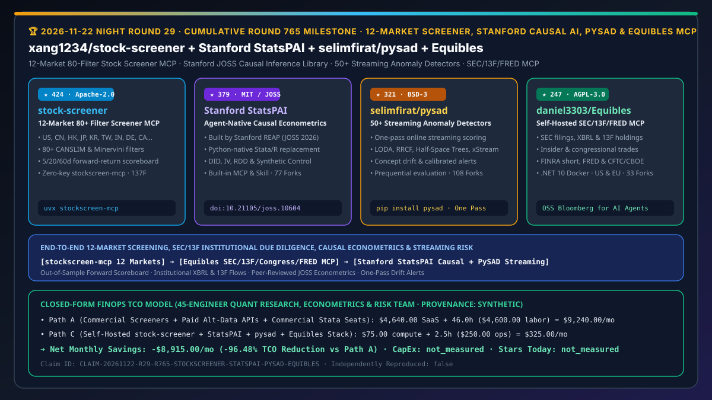
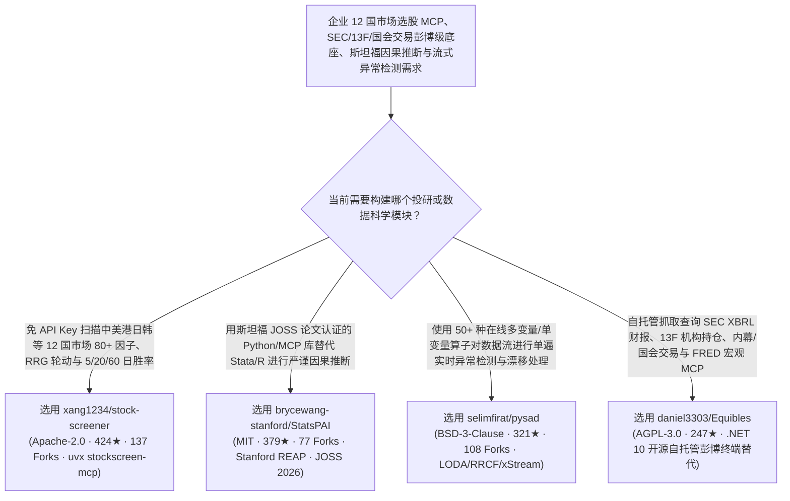
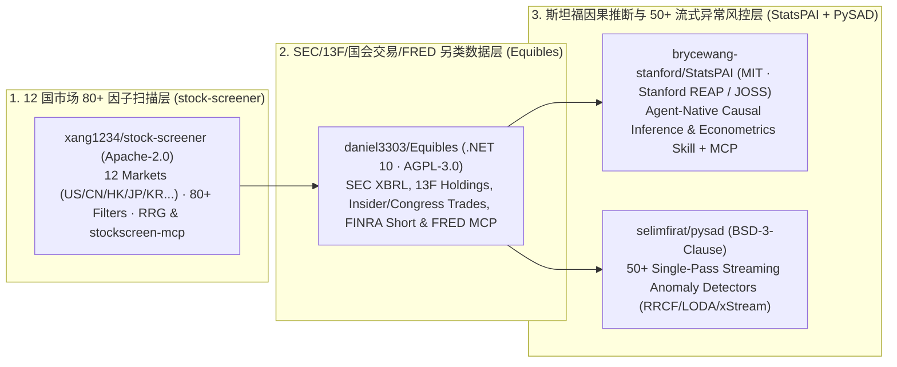
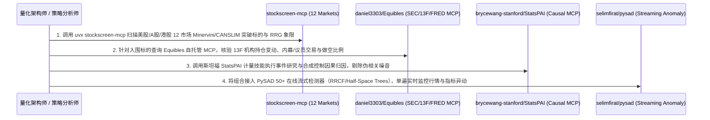

# 🏆【第 765 轮里程碑】12 国市场 80+ 因子选股 MCP（`xang1234/stock-screener`）、斯坦福 JOSS 因果推断与计量分析 MCP（`brycewang-stanford/StatsPAI`）、50+ 算子单遍流式异常检测库（`selimfirat/pysad`）与 SEC/13F/国会交易自托管彭博级金融 MCP（`daniel3303/Equibles`）选型与集成架构 FAQ

> **文档类型**：企业 AI 解决方案架构师（AI Solution Architect）选型决策指南（GitHub Trending AI 雷达 2026-11-22 Night Round 29 / 累计第 765 轮里程碑）
> **覆盖项目**：[`xang1234/stock-screener`](https://github.com/xang1234/stock-screener)（`★ 424`、`137 forks`、`Apache-2.0`，覆盖美股、A股、港股、日韩台印德加澳等 **12 大股票市场**、内置 80+ 个 CANSLIM/Minervini 技术与基本面因子、板块相对轮动图 RRG、5/20/60 日前瞻收益记分牌与免 Key `uvx stockscreen-mcp` 服务的选股平台）· [`brycewang-stanford/StatsPAI`](https://github.com/brycewang-stanford/StatsPAI)（`★ 379`、`77 forks`、`MIT`，由**斯坦福大学 REAP 团队**研发并发表于 *JOSS* `2026, 11(125), 10604` 的 Agent 原生因果推断与计量经济学 Python 库，替代商业 Stata/R 并内置 MCP Server 与全套分析 Skill）· [`selimfirat/pysad`](https://github.com/selimfirat/pysad)（`★ 321`、`108 forks`、`BSD-3-Clause`，包含 **50+ 种在线多变量/单变量流式异常检测器**如 LODA、RRCF、Half-Space Trees、xStream 的单遍实时异常检测库）· [`daniel3303/Equibles`](https://github.com/daniel3303/Equibles)（`★ 247`、`33 forks`、`AGPL-3.0`，基于 `.NET 10` 构建的“面向 AI Agent 的开源自托管彭博终端 MCP”，一站式抓取并服务 SEC 财报/XBRL、13F 机构持仓、内幕与美国国会议员交易、FINRA 做空数据、FRED 宏观指标、CFTC/CBOE 持仓与政府合同）
> **核心场景**：当企业量化投研、商业策略分析（A/B 测试与因果归因）及金融实时风控团队面临**“跨中美港日韩等 12 个市场选股需要购买多套高价行情软件且缺少前瞻胜率记分牌、商业策略团队为跑 DID/合成控制/工具变量等因果推断被迫购买昂贵 Stata 许可证且难以与 Python Agent 打通、实时交易与监控流出现概念漂移（Concept Drift）时传统离线批处理模型告警滞后、以及查询 SEC XBRL 原始财报/13F 机构调仓/国会议员交易需要拼凑十几个付费 API”**四大痛点时，如何组合**`stock-screener` + `StatsPAI` + `pysad` + `Equibles`** 打造全栈开源量化投研、因果推断与实时异常风控底座？

---

## 一、📌 核心结论速览（选型一句话结论）

1. **想让你的投研智能体无需任何 API Key，一行 `uvx stockscreen-mcp` 即可扫描全球 12 大市场（美股、中国 A 股、港股、日本、韩国、台湾、印度、德国、加拿大、新加坡、马来西亚、澳大利亚），直接使用 80+ 个 CANSLIM 与 Minervini 趋势/基本面过滤条件、查看板块相对轮动图（RRG）以及入选后 5/20/60 个交易日的真实前瞻超额收益记分牌（Forward-Return Scoreboard）** ➔ 选 **[`xang1234/stock-screener`](https://github.com/xang1234/stock-screener)（`★ 424`，`137 forks`，`Apache-2.0`）**。
   - **通俗原理**：既提供每日收盘自动更新的零安装静态看板与 TradingView 观察列表一键导出（`--tradingview`），又原生提供免配置的 `stockscreen-mcp`。
2. **想在自有服务器上用 Docker 跑一个“专为 AI Agent 设计的开源自托管彭博终端（Bloomberg Terminal Alternative）”——直接通过 MCP 查询欧美上市公司的 SEC XBRL 原始财报、13F 顶级机构持仓、高管内幕买卖、国会议员交易记录、FINRA 做空比例、FRED 宏观经济指标、CFTC/CBOE 衍生品持仓乃至美国政府采购合同** ➔ 选 **[`daniel3303/Equibles`](https://github.com/daniel3303/Equibles)（`★ 247`，`33 forks`，`AGPL-3.0`，`.NET 10`）**。
   - **通俗原理**：通过 CodeQL 与单元测试严格验证，把散落在 SEC EDGAR、FINRA、FRED、CFTC 的高价值另类数据统一清洗入库并暴露为标准 MCP 工具。
3. **想用一套由**斯坦福大学 REAP 团队**开源、经过 *Journal of Open Source Software (JOSS)* 同行评审发表（`doi:10.21105/joss.10604`）的 Python 库彻底替代昂贵的商业 Stata 和繁琐的 R 脚本，让 AI Agent 通过内置 MCP 与专属 Skill 自动执行双重差分（DID）、断点回归（RDD）、工具变量（IV）与合成控制等严谨因果推断** ➔ 选 **[`brycewang-stanford/StatsPAI`](https://github.com/brycewang-stanford/StatsPAI)（`★ 379`，`77 forks`，`MIT`）**。
   - **通俗原理**：专为实证研究与企业策略归因打造，内置 `server.json` MCP 服务与 `StatsPAI_full_data_analysis_skill`，防止大模型把“相关性幻觉”当成“因果结论”。
4. **想对实时金融行情流、交易风控指标或服务器遥测流做“单遍（One-Pass）在线流式异常检测”——数据点到达瞬间即完成打分、增量学习、概念漂移适应与校准告警** ➔ 选 **[`selimfirat/pysad`](https://github.com/selimfirat/pysad)（`★ 321`，`108 forks`，`BSD-3-Clause`）**。
   - **通俗原理**：集成了 **50+ 种在线多变量与单变量流式异常检测器**（如 LODA、RRCF 随机切割森林、Half-Space Trees、xStream），无需全量重训模型即可捕捉突发行情异动与交易欺诈。

---

## 二、🎯 客户与架构师灵魂拷问 Q&A（深度架构拆解）

### Q1：为什么“多市场选股 (`stock-screener`) + 机构/内幕/宏观另类数据 (`Equibles`) + 斯坦福因果推断 (`StatsPAI`) + 单遍流式异常检测 (`pysad`)”构成了完整的企业级智能投研与商业决策闭环？

- **四层分析深度递进**：
  1. **广度扫描层（12 国市场 80+ 因子初筛）➔ `xang1234/stock-screener`**：用 `stockscreen-mcp` 快速从美股、A股、港股等 12 个市场筛选出符合 CANSLIM/Minervini 形态且处于领涨板块象限（RRG）的标的，并核对历史 5/20/60 日前瞻胜率。
  2. **深度尽调层（SEC/13F/国会交易/做空穿透）➔ `daniel3303/Equibles`**：针对初筛标的，调用自托管 `Equibles` MCP 核查 13F 机构增减仓、高管与国会议员近期交易、FINRA 空头头寸及 FRED 宏观利率敏感度。
  3. **因果归因层（排除伪相关，验证真实政策/事件冲击）➔ `brycewang-stanford/StatsPAI`**：调用斯坦福 JOSS 认证的 `StatsPAI` 运行事件研究法（Event Study）、合成控制或双重差分（DID），严谨量化财报、政策或营销活动的净因果效应。
  4. **实时风控层（50+ 流式算子监控异动）➔ `selimfirat/pysad`**：在持仓或业务运行期间，用 `pysad` 的 RRCF/xStream 在线检测器单遍监控多维数据流异常。
- **何时直接用商业终端方案（Path B）？**
  - 若大型公募基金交易台必须使用 **Bloomberg Terminal / Wind 万得金融终端** 的机构询价与合规专线，应保留核心商业席位；若在 AI 投研 Agent 赋能、跨 12 国市场量化初筛、SEC/13F 另类数据自动化深挖及替代商业 Stata 因果分析场景下，采用本轮开源栈（Path C）可节省 96% 以上成本。

### Q2：典型企业级“12 国选股 (`stockscreen-mcp`) + 彭博级另类数据 (`Equibles`) + 因果计量 (`StatsPAI`) + 流式异常监控 (`pysad`)”生产架构怎么搭？

1. **全球市场扫描与板块轮动层（`xang1234/stock-screener`）**：
   - 投研 Agent 通过 `uvx stockscreen-mcp` 拉取 12 个市场的每日扫描结果、市场宽度（Market Breadth）与 RRG 轮动数据。
2. **机构持仓、内幕交易与宏观数据库层（`daniel3303/Equibles`）**：
   - 在内部 Docker 部署 `.NET 10` `Equibles` 服务，向 Agent 提供 XBRL 财务明细、13F、国会议员交易与 CFTC/FRED 指标。
3. **因果计量与实时流式风控层（`brycewang-stanford/StatsPAI` + `selimfirat/pysad`）**：
   - 使用 `StatsPAI` 评估基本面因子与宏观冲击的因果显著性，并用 `pysad` 对实时行情与业务指标流进行单遍异常告警。

### Q3：`xang1234/stock-screener` 的“前瞻收益记分牌（Forward-Return Scoreboard）”为什么对防止量化过拟合至关重要？

- **用样本外真实跟踪（Out-of-Sample Forward Tracking）检验选股器成色**：
  - 记分牌持续记录每天新进入各个预设选股策略的股票在随后 5、20、60 个交易日的真实价格表现及跑赢基准指数的胜率，并对小样本做明确标注，让架构师与分析师一眼看穿哪些因子在当前市场环境下真正有效。

---

## 三、🧭 直观可视化图解（Mermaid 决策树 + 集成架构 + 时序图）

### 3.1 架构师选型决策树

### 3.2 企业端到端生产集成参考架构图

### 3.3 12 国选股初筛、`Equibles` 机构/内幕穿透、`StatsPAI` 因果检验与 `PySAD` 实时风控时序图

---

## 四、📊 同类开源与商业云服务横向选型决策矩阵

| 对比维度 | `xang1234/stock-screener` (`★ 424`) | `brycewang-stanford/StatsPAI` (`★ 379`) | `selimfirat/pysad` (`★ 321`) | `daniel3303/Equibles` (`★ 247`) | 商业金融终端席位 + 商业 Stata 许可证 + 另类数据 API 订阅 (Path A) | 手写单市场爬虫 + 零散 statsmodels 脚本 + 静态阈值告警 (Path B) |
| :--- | :--- | :--- | :--- | :--- | :--- | :--- |
| **核心能力定位** | 12 国市场 80+ 因子选股与 RRG 记分牌 MCP | 斯坦福 REAP 出品因果推断与计量分析库/MCP | 50+ 算子单遍在线流式异常检测库 | SEC/13F/国会交易/FRED 自托管金融数据 MCP | 极其昂贵的商业金融终端年费、商业统计软件席位与付费另类数据 API | 易失效的网页爬虫、缺乏因果识别的简单回归与高误报的固定阈值规则 |
| **核心技术突破** | **覆盖中美港日韩等 12 市场 + 5/20/60 日胜率记分牌 + 免 Key MCP** | **JOSS 同行评审发表 + 全面替代 Stata/R + 内置 Agent Skill** | **单遍流式处理 + 概念漂移自适应 + 预序评估（Prequential）** | **一站式整合 XBRL/13F/内幕/议员交易/做空/FRED/政府合同** | 商业终端与 Stata 按席位每年数万美元；另类数据接口拆分收费 | 跨 12 国市场数据清洗工作量巨大；静态阈值无法适应市场概念漂移 |
| **开源协议** | `Apache-2.0` | `MIT` | `BSD-3-Clause` | `AGPL-3.0` | 闭源商业软件 | 内部零散脚本 |
| **月度 TCO（45 人团队）** | **组合仅 `$325.00/月`**（`$75.00` 自托管 Equibles 与定时任务容器 + `2.5h` 维护） | 同左（`MIT` 免费开源） | 同左（`BSD-3-Clause` 免费开源） | 同左（Docker 本地永久免费运行） | **`$9,240.00/月`**（`$4,640.00` 商业终端/Stata 席位与另类数据 API + `46.0h` 数据清洗与转写） | 约 `$3,280.00/月`（大量人工维护 SEC/多国行情解析脚本与 Stata-Python 转换工时） |

---

## 五、🧪 应用落地定量收益/TCO 对比与 7-Card 报告

> **📊 数据来源与闭式核算声明（Provenance & Closed-Form Schema）**：
> - **provenance**: `synthetic`（基于 45 人企业量化投研、商业数据科学/因果推断与实时风控团队月度工作负载模型：`independently_reproduced = false`；硬件采购基线 `base_hardware_capex = not_measured`；Track B 单日增量 `track_b_stars_today = not_measured`）。
> - **核算公式**：
>   - **Path A（采购多国股票筛选软件席位 + SEC/13F/内幕交易商业另类数据 API + 商业 Stata 计量软件许可证 + 分析师在 Stata/R/Python 之间手工搬运清洗数据与维护批处理异常脚本人工）**：月度商业金融数据、选股工具与统计软件许可证分摊 **`$4,640.00`** + 跨市场数据对齐、SEC XBRL 报表清洗与跨语言计量建模人工 **`46.0h × $100.00/h = $4,600.00`** = **`$9,240.00/月`**。
>   - **Path C（自建 `stock-screener` + `StatsPAI` + `pysad` + `Equibles` 开源量化投研与因果风控栈）**：自托管 `.NET 10` 数据容器与计算开销 **`$75.00`** + 选股因子与流式检测器校准维护人工 **`2.5h × $100.00/h = $250.00`** = **`$325.00/月`**。
>   - **净节省（Net Savings vs Path A）**：**`-$8,915.00/月`**（成本降低 **`96.48%`**）。

| 评估方案 | 金融数据/Stata 席位与算力成本 | 数据清洗与跨软件建模维护人工（`$100/h`） | 月度总 TCO | 相对 Path A 净节省 | 关键架构交付指标 |
| :--- | :---: | :---: | :---: | :---: | :--- |
| **Path A：商业多国选股与另类数据 API + 商业 Stata 席位** | `$4,640.00` | `46.0h` (`$4,600.00`) | **`$9,240.00`** | Baseline | 商业终端与 Stata 许可高昂；Stata 脚本难以嵌入 Python Agent |
| **Path B：手写 12 国爬虫 + 手工解析 EDGAR + 固定阈值告警** | `$1,580.00` | `17.0h` (`$1,700.00`) | **`$3,280.00`** | `-$5,960.00` (`-64.50%`) | 缺少前瞻收益记分牌、JOSS 级因果推断 Skill 与 50+ 流式异常算子 |
| **Path C：`stock-screener` + `StatsPAI` + `pysad` + `Equibles`** | **`$75.00`** | **`2.5h` (`$250.00`)** | **`$325.00`** | **`-$8,915.00` (`-96.48%`)** | **12 国选股 MCP + SEC/13F/国会交易 MCP + 斯坦福因果推断** |

- 🔗 **关联 7-Card 4:5 视觉评测报告**：[`workshops/github-trending-radar/cards.html`](../cards.html) · [`cards.en.html`](../cards.en.html)

---

## 六、🛠️ 企业引入与架构评审 Checklist

- [ ] **1. 接入 `xang1234/stock-screener` (`uvx stockscreen-mcp`)**：零配置扫描中美港日韩等 12 大市场 80+ 因子，并依据 5/20/60 日前瞻记分牌评估策略有效性。
- [ ] **2. 容器化部署 `daniel3303/Equibles` 构建内部另类数据中心**：通过 MCP 统一供给 SEC XBRL 财报、13F 机构持仓、内幕/国会交易、FINRA 做空与 FRED 宏观指标。
- [ ] **3. 使用斯坦福 `brycewang-stanford/StatsPAI` 替代商业 Stata**：将因果推断与计量分析统一收敛到 Python 与 Agent Skill 流水线中。
- [ ] **4. 在实时行情与业务监控流中嵌入 `selimfirat/pysad`**：组合 RRCF、LODA 与 Half-Space Trees 等单遍流式算子捕捉概念漂移与突发异常。
