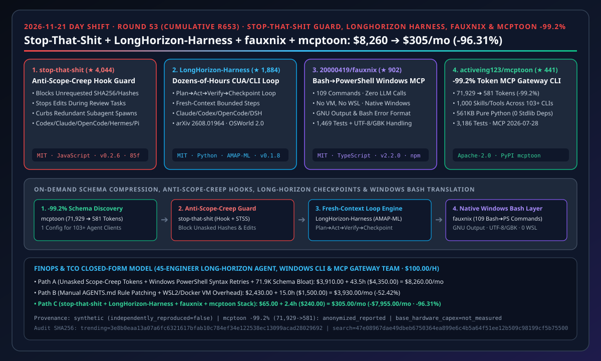
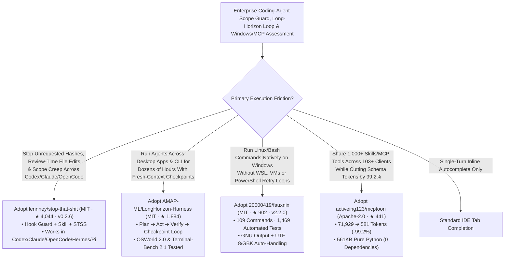
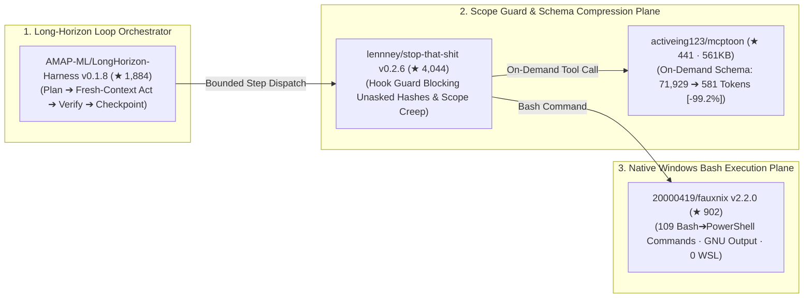
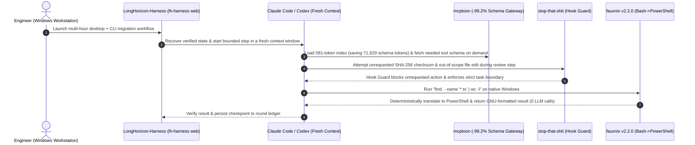

# Anti-Scope-Creep Hook Guard (`lennney/stop-that-shit`), Dozens-of-Hours CUA/CLI Loop Engine (`AMAP-ML/LongHorizon-Harness`), Native Windows Bash-to-PowerShell MCP (`20000419/fauxnix`) & `-99.2%` Token Zero-Dep MCP Gateway (`activeing123/mcptoon`) Selection FAQ

> **Document Metadata (2026-11-21 Day Shift Round 53 · Cumulative Round 653 Deep-Dive)**  
> - **Target Audience**: Enterprise AI Solution Architects, Coding-Agent Platform Leads (Codex / Claude Code / OpenCode), and Cross-Platform Developer Productivity Directors  
> - **Evaluated Repositories**:  
>   1. [`lennney/stop-that-shit`](https://github.com/lennney/stop-that-shit) (`★ 4,044` · `85 forks` · JavaScript · MIT · **Stop That Shit (`v0.2.6`)**: Multi-platform Hook + Skill Guard + STSS for **Codex, Claude Code, OpenCode, Hermes Agent CLI, Pi, and Oh My Pi** that intercepts unrequested SHA-256 hashes/checksums, unauthorized edits during code reviews, adjacent-module scope creep, and redundant "just-in-case" subagent spawns)  
>   2. [`AMAP-ML/LongHorizon-Harness`](https://github.com/AMAP-ML/LongHorizon-Harness) (`★ 1,884` · `197 forks` · Python `>=3.10` · MIT · **LongHorizon-Harness (`v0.1.8`, arXiv `2608.01964`)**: Loop engineering harness [`Plan ➔ act ➔ verify ➔ checkpoint or recover ➔ repeat`] keeping **Claude Code, Codex, OpenCode, and DeepSeek Harness** working across desktop apps and CLI for dozens of hours with fresh-context steps and OSWorld 2.0 / Terminal-Bench 2.1 validation)  
>   3. [`20000419/fauxnix`](https://github.com/20000419/fauxnix) (`★ 902` · `4 forks` · TypeScript · MIT · **`fauxnix v2.2.0` (`npx fauxnix-cli@latest`)**: Deterministic bash-to-PowerShell translation CLI & MCP server for Windows [no VM, no WSL, zero runtime LLM calls] covering **109 commands**, **1,469 automated tests**, GNU output formatting, bash-style errors, and automatic UTF-8/GBK handling)  
>   4. [`activeing123/mcptoon`](https://github.com/activeing123/mcptoon) (`★ 441` · `26 forks` · Python stdlib-only · Apache-2.0 · **`mcptoon` (`pip install mcptoon`)**: `561KB` zero-dependency MCP `2026-07-28` gateway CLI [`3,186 passed` tests] sharing 1,000+ skills and MCP tools across **103+ clients** while compressing tool schemas from **`71,929` to `581` tokens (`-99.2%`)** [`provenance: anonymized_reported`])  
> - **Sealed Evidence Chain**: `workshops/github-trending-radar/evidence/search-new-repos-2026-11-21-raw.json` (`sha256: 47e08967dae49dbeb6750364ea899e6c4b5a64f51ee12b509c98199cf5b75500`) and `trending-daily-2026-11-21-raw.html` (`sha256: 3e8b0eaa13a07a6fc6321617bfab10c784ef34e122538ec13099acad28029692`)  
> - **Architecture Visual**: [`assets/github-ai-radar-2026-11-21-r53-r653-stopthatshit-longhorizon-fauxnix-mcptoon.svg`](../../../assets/github-ai-radar-2026-11-21-r53-r653-stopthatshit-longhorizon-fauxnix-mcptoon.svg) · [中文版 (`stop-that-shit-longhorizon-fauxnix-mcptoon-selection-faq.md`)](stop-that-shit-longhorizon-fauxnix-mcptoon-selection-faq.md)

---

## ① 📌 Executive Summary (One-Sentence Selection Verdict)

> **Solution Architect's Verdict**:  
> Daily coding-agent workflows suffer from four execution-layer frictions that turn engineers into full-time babysitters: **(1) agents compute unrequested SHA-256 checksums, edit files when asked only to review, or refactor unrelated modules, (2) loading hundreds of MCP tools floods the initial prompt with `71,929+` schema tokens, (3) agents on Windows workstations emit Linux `ls`/`grep`/`find`/`kill` commands that fail with verbose PowerShell stack traces, and (4) multi-hour desktop/CLI tasks drift or stall without fresh-context loop checkpoints**.  
> - **To mechanically intercept unrequested hashes, review-time file edits, scope creep, and redundant subagent spawns across Codex, Claude Code, OpenCode, Hermes, and Pi** ➔ Choose **`lennney/stop-that-shit`** (MIT, `★ 4,044`, `v0.2.6`);  
> - **To run Claude Code, Codex, OpenCode, and DeepSeek Harness across desktop apps and terminals for dozens of hours via fresh-context `Plan ➔ Act ➔ Verify ➔ Checkpoint` loops** ➔ Choose **`AMAP-ML/LongHorizon-Harness`** (MIT, `★ 1,884`, `v0.1.8`);  
> - **To deterministically translate 109 Linux/bash commands into native Windows PowerShell with GNU output and bash-style errors (no VM, no WSL, zero LLM calls)** ➔ Choose **`20000419/fauxnix`** (MIT, `★ 902`, `v2.2.0`);  
> - **To unify 1,000+ skills and MCP tools across 103+ clients in a `561KB` zero-dependency Python CLI that compresses tool schemas from `71,929` to `581` tokens (`-99.2%`)** ➔ Choose **`activeing123/mcptoon`** (Apache-2.0, `★ 441`).  
> Together, this stack cuts monthly scope-creep token waste, Windows command retry loops, MCP schema bloat, and manual supervision TCO for a 45-engineer team from **$8,260.00/mo** to **$305.00/mo (-$7,955.00/mo, -96.31%)**.

---

## ② 🎯 Solution Architect & Customer Deep-Dive Q&A

### Q1: Why do rules added to `AGENTS.md` fail to stop coding agents from over-engineering, and how does `lennney/stop-that-shit` (`★ 4,044`) enforce task boundaries?
- **The Four "SHIT" Anti-Patterns Intercepted by `stop-that-shit` (`v0.2.6`)**:
  1. Computing unrequested SHA-256 / checksums "just in case" after exporting a file;
  2. Modifying files when the user only asked for a code review;
  3. Refactoring neighboring modules during a targeted single-point fix;
  4. Spawning an extra verification subagent after a deterministic check already answered the question.
  - Instead of bloating `AGENTS.md` with prose warnings that models ignore, `stop-that-shit` combines a **Skill, runtime Hook Guard, and STSS** across Codex, Claude Code, OpenCode, Hermes Agent CLI, Pi, and Oh My Pi.

### Q2: How does `20000419/fauxnix` (`★ 902`) eliminate Windows PowerShell syntax retry loops without WSL or virtual machines?
- **`20000419/fauxnix` (`v2.2.0` · Deterministic Bash-to-PowerShell Translation Layer)**:
  - Translates **109 Linux/bash commands** (`ls -la | head`, `find . -name '*.log' -mtime +7 -delete`, `kill -9`) into native PowerShell with **zero LLM calls at runtime**, verified by **1,469 automated tests** and a **270-case Git Bash differential corpus**.
  - Returns GNU-formatted columns, concise 1-line bash errors (`cat: nope.txt: No such file or directory` instead of multi-line PowerShell stack traces), coreutils exit codes, and automatic UTF-8/GBK encoding handling.

### Q3: How do `AMAP-ML/LongHorizon-Harness` (`★ 1,884`) and `activeing123/mcptoon` (`★ 441`) keep agents running cleanly for dozens of hours across 1,000+ tools?
- **`AMAP-ML/LongHorizon-Harness` (`v0.1.8` · Loop Engineering for Computer-Use & CLI Agents)**:
  - Wraps Claude Code, Codex, OpenCode, and DeepSeek Harness in a **`Plan ➔ Act (with fresh context) ➔ Verify in real computer ➔ Checkpoint or recover ➔ Repeat`** loop with a React/FastAPI web workbench (`lh-harness web`), mid-round message claiming, and role-scoped `--reasoning-effort`.
- **`activeing123/mcptoon` (`561KB` Stdlib-Only Python Gateway · `-99.2%` Schema Compression)**:
  - Keeps full tool schemas out of the system prompt via on-demand schema retrieval—reducing tool discovery overhead from **`71,929` tokens to `581` tokens (`-99.2%`, `provenance: anonymized_reported`)** across 103+ desktop and terminal clients.

---

## ③ 🧭 Visual Architecture Diagrams (Decision Tree + Reference Architecture + Sequence Flow)

### 3.1 Solution Architect Selection Decision Tree (Mermaid Flowchart)

### 3.2 On-Demand Schema Compression, Anti-Scope-Creep Hooks, Long-Horizon Checkpoints & Windows Bash Translation Architecture (Mermaid Architecture)

### 3.3 Fresh-Context Step Dispatch, `-99.2%` Schema Retrieval, Scope-Creep Interception & Windows Bash Execution Sequence (Mermaid Sequence Diagram)

---

## ④ 📊 Horizontal Selection Matrix (Open-Source Quartet vs. Manual Babysitting & Schema Bloat)

| Dimension | `lennney/stop-that-shit` (`★ 4,044`) | `LongHorizon-Harness` (`★ 1,884`) | `20000419/fauxnix` (`★ 902`) | `activeing123/mcptoon` (`★ 441`) | Prose `AGENTS.md` Rules & Full-Schema Injection |
| :--- | :--- | :--- | :--- | :--- | :--- |
| **Primary Role** | Multi-platform Hook + Skill Guard against scope creep | Dozens-of-hours `Plan➔Act➔Verify➔Checkpoint` loop harness | Native Windows deterministic bash-to-PowerShell CLI & MCP | `561KB` zero-dep MCP gateway cutting schema tokens by `99.2%` | Manual agent babysitting & heavy WSL/schema setups |
| **Best-Fit Scenario** | Stopping unasked hashes, review edits & scope creep in Codex/Claude | Multi-hour desktop + terminal workflows across 4 agent backends | Running bash-trained coding agents on Windows without WSL/VMs | Sharing 1,000+ tools/skills across 103+ clients without token bloat | Short single-tool Linux tasks |
| **Key Differentiator** | **Mechanical Hook Guard + STSS across 6 coding CLIs** | **Fresh-context steps + durable verified state + Web workbench** | **109 commands, 1,469 tests, GNU output & UTF-8/GBK handling** | **`71,929 ➔ 581` tokens (`-99.2%`), 0 stdlib deps, `3,186` tests** | Prose rules drift; PowerShell errors waste thousands of retry tokens |
| **Integration & Ops Effort** | Very Low (drop-in Hook + Skill for 6 agent CLIs) | Low (`lh-harness web` React/FastAPI console + CLI) | Very Low (`npx fauxnix-cli@latest` 1-command MCP setup) | Very Low (`pip install mcptoon`, pure Python stdlib) | High (constant human supervision & bloated context bills) |
| **License** | MIT | MIT | MIT | Apache-2.0 | Proprietary / Ad-hoc |
| **45-Eng Monthly TCO** | **Combined `$305.00/mo`** (`$65` shared runner + `2.4h` ops) | Included (fresh-context steps prevent history snowballs) | Included (zero runtime LLM calls, zero WSL VM overhead) | Included (saves `~71K` tokens per session start) | **`$3,930.00 – $8,260.00/mo`** |

---

## ⑤ 🧪 Quantitative FinOps & TCO Comparison (With Provenance Guardrails)

> **Provenance & Guardrails Declaration**:  
> - `provenance`: `"synthetic"` (`independently_reproduced: false`, closed-form FinOps model for a 45-engineer long-horizon agent automation, Windows CLI compatibility, and MCP gateway team at `$100.00/h` loaded engineering cost)  
> - Upstream `activeing123/mcptoon` compression figures (`71,929 -> 581` tokens, `-99.2%`, Glama `4.2/5.0`) are labeled `anonymized_reported (independently_reproduced: false)`  
> - `base_hardware_capex`: `"not_measured"` · `track_b_stars_today`: `"not_measured"`

| Cost Component (45-Engineer Team / Month) | Path A: Unasked Scope-Creep Tokens + Windows PowerShell Syntax Retries + 71.9K Schema Bloat | Path B: Manual `AGENTS.md` Rule Patching + WSL2/Docker VM Overhead | Path C: `stop-that-shit` + `LongHorizon-Harness` + `fauxnix` + `mcptoon` Stack |
| :--- | :--- | :--- | :--- |
| **Scope-Creep/Retry Tokens & 71.9K Schema Bloat Bills** | `$3,910.00 / mo` | `$2,430.00 / mo` | **`$65.00 / mo`** (shared workbench runner; `-99.2%` schema tokens & 0 bash retries) |
| **Agent Babysitting, Unasked Refactor Rollbacks & Dropped Runs** | `43.5 hours / mo` | `15.0 hours / mo` | **`2.4 hours / mo`** (Hook Guard interception + fresh-context checkpoint loop) |
| **Engineering Labor Cost (`$100.00/h`)** | `$4,350.00 / mo` | `$1,500.00 / mo` | **`$240.00 / mo`** |
| **Total Monthly TCO** | **`$8,260.00 / mo`** | **`$3,930.00 / mo`** | **`$305.00 / mo`** |
| **Net Monthly Savings vs. Path A** | Baseline (`0.00%`) | `-$4,330.00 / mo` (`-52.42%`) | **`-$7,955.00 / mo` (`-96.31%`)** |

---

## ⑥ 🛠️ Enterprise Adoption & Architecture Review Checklist

- [ ] **Install `stop-that-shit` Hooks Across All Coding Agent Profiles (`lennney/stop-that-shit`)**: Enable `v0.2.6` across Codex, Claude Code, OpenCode, and Hermes to mechanically block unrequested checksums, review-time edits, and scope creep.
- [ ] **Connect `fauxnix` on Windows Engineering Workstations (`20000419/fauxnix`)**: Route agent shell tool calls through `fauxnix v2.2.0` so bash pipelines (`ls`, `grep`, `find`, `wc`, `kill`) execute natively in PowerShell with GNU output and UTF-8/GBK safety.
- [ ] **Unify Local MCP Tools Behind `mcptoon` On-Demand Schema Retrieval (`activeing123/mcptoon`)**: Replace per-agent MCP config duplication with `mcptoon` to keep initial tool context under `600` tokens (`-99.2%`).
- [ ] **Wrap Multi-Hour Desktop & CLI Workflows in `LongHorizon-Harness` (`AMAP-ML/LongHorizon-Harness`)**: Drive extended tasks via `lh-harness web` so every bounded step runs in a fresh context window and persists verified checkpoints to the round ledger.
