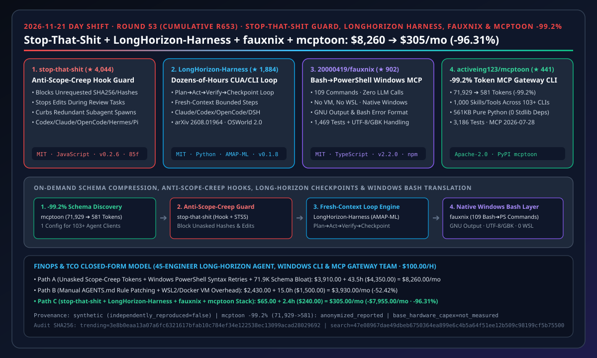
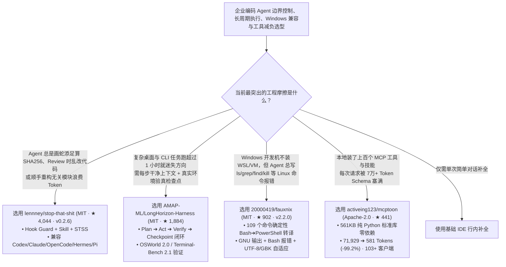
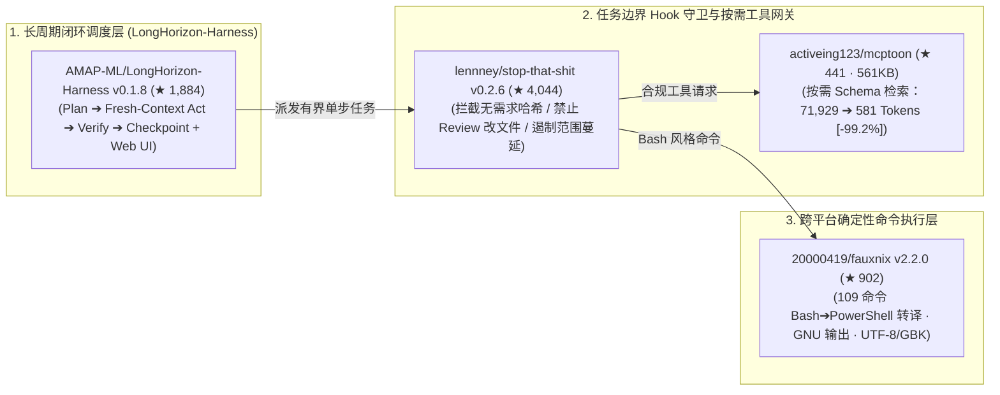
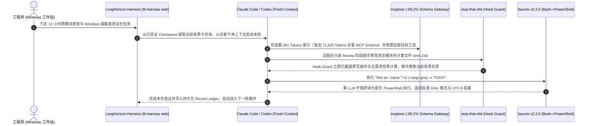

# 防越界造史 Hook 守卫（`lennney/stop-that-shit`）、高德长周期桌面/CLI 闭环引擎（`AMAP-ML/LongHorizon-Harness`）、Windows 免 WSL 确定性 Bash 转译器（`20000419/fauxnix`）与省 99.2% 上下文零依赖 MCP 网关（`activeing123/mcptoon`）选型 FAQ

> **文档元数据（2026-11-21 白班 Day Round 53 · 累计第 653 轮深潜专题）**  
> - **面向对象**：企业 AI 解决方案架构师（AI Solution Architect）、编码智能体（Codex / Claude Code / OpenCode）平台负责人、跨平台研发效能总监  
> - **本轮核心评估对象**：  
>   1. [`lennney/stop-that-shit`](https://github.com/lennney/stop-that-shit)（`★ 4,044` · `85 forks` · JavaScript · MIT · **Stop That Shit（别再造史了）`v0.2.6`**：面向 Codex、Claude Code、OpenCode、Hermes Agent CLI、Pi 与 Oh My Pi 的多平台 **Hook + Skill Guard + STSS**，精准拦截 AI 无需求乱算 SHA-256 校验和、Review 时擅自改代码、顺手重构隔壁模块及滥拉冗余子 Agent）  
>   2. [`AMAP-ML/LongHorizon-Harness`](https://github.com/AMAP-ML/LongHorizon-Harness)（`★ 1,884` · `197 forks` · Python `>=3.10` · MIT · **高德机器学习团队开源 `LongHorizon-Harness v0.1.8`（arXiv `2608.01964`）**：让 Claude Code、Codex、OpenCode 与 DSH 跨桌面应用与终端连续稳定工作数十小时的闭环工程系统[`Plan ➔ act ➔ verify ➔ checkpoint or recover ➔ repeat`]，通过 WeaveBench、OSWorld 2.0 与 Terminal-Bench 2.1 评测）  
>   3. [`20000419/fauxnix`](https://github.com/20000419/fauxnix)（`★ 902` · `4 forks` · TypeScript · MIT · **`fauxnix v2.2.0`（`npx fauxnix-cli@latest`）**：无需虚拟机、无需 WSL、运行时零 LLM 调用的 **Windows 原生确定性 Bash ➔ PowerShell 转译层**，支持 109 个常用 Linux 命令、1,469 项自动化测试、GNU 格式输出、Bash 风格简洁报错与 UTF-8/GBK 自动转码）  
>   4. [`activeing123/mcptoon`](https://github.com/activeing123/mcptoon)（`★ 441` · `26 forks` · Python 纯标准库 · Apache-2.0 · **`mcptoon`（`pip install mcptoon`）**：仅 `561KB` 零依赖的 `MCP 2026-07-28` 网关 CLI[通过 `3,186` 项测试]，将本机 1,000+ 技能与 MCP 工具共享给 **103+ 客户端**，并通过按需 Schema 检索将上下文从 **`71,929` 压缩至 `581` Tokens（`-99.2%`）**[`provenance: anonymized_reported`]）  
> - **关联检索证据链**：`workshops/github-trending-radar/evidence/search-new-repos-2026-11-21-raw.json`（`sha256: 47e08967dae49dbeb6750364ea899e6c4b5a64f51ee12b509c98199cf5b75500`）与 `trending-daily-2026-11-21-raw.html`（`sha256: 3e8b0eaa13a07a6fc6321617bfab10c784ef34e122538ec13099acad28029692`）  
> - **高清架构图**：[`assets/github-ai-radar-2026-11-21-r53-r653-stopthatshit-longhorizon-fauxnix-mcptoon.svg`](../../../assets/github-ai-radar-2026-11-21-r53-r653-stopthatshit-longhorizon-fauxnix-mcptoon.svg) · [English Version (`stop-that-shit-longhorizon-fauxnix-mcptoon-selection-faq.en.md`)](stop-that-shit-longhorizon-fauxnix-mcptoon-selection-faq.en.md)

---

## ① 📌 核心结论速览（选型一句话结论）

> **架构师一句话选型结论**：  
> 为什么工程师在日常使用 Codex 和 Claude Code 时总觉得“**活还没拿到，我先当上了 Agent 的监工**”？因为四大执行层摩擦每天都在偷走 Token 与时间：**（1）你只让它导出个文件，它顺手算一遍没人看的 SHA-256；你让它 Review，它直接动手改代码甚至重构隔壁模块（范围膨胀造史）、（2）装了上百个 MCP 工具后，每次发请求都要在上下文里塞进 `71,929` Tokens 的工具 Schema、（3）在 Windows 开发机上，大模型习惯性写出 `ls -la | grep foo` 或 `find ... | wc -l`，被 PowerShell 报出一屏红色堆栈后反复重试、（4）跨桌面应用与终端的长周期任务跑两小时就因上下文污染而偏航失控**。  
> - **需要用 Hook + Skill Guard + STSS 在 6 大主流 CLI 中硬性拦截“无需求算哈希、Review 时乱改文件、顺手过度重构与多拉无用确认子 Agent”** ➔ 选 **`lennney/stop-that-shit`**（MIT，`★ 4,044`，`v0.2.6`）；  
> - **需要为 Claude Code、Codex、OpenCode 与 DSH 套上经过 OSWorld 2.0 / Terminal-Bench 2.1 验证的“每步全新上下文 + 真实环境验真 + 检查点持久化”数十小时长周期运行外骨骼** ➔ 选 **`AMAP-ML/LongHorizon-Harness`**（MIT，`★ 1,884`）；  
> - **需要在 Windows 原生环境（免 VM、免 WSL）中将 Agent 熟知的 109 个 Linux/Bash 命令零 LLM 延迟确定性转译为 PowerShell 并返回 GNU 格式输出与简洁报错** ➔ 选 **`20000419/fauxnix`**（MIT，`★ 902`，`v2.2.0`）；  
> - **需要用仅 `561KB` 纯 Python 标准库零依赖 CLI 统管 103+ 客户端的 1,000 个技能与 MCP 工具，并将工具 Schema 上下文从 `71,929` 压至 `581` Tokens（省 `99.2%`）** ➔ 选 **`activeing123/mcptoon`**（Apache-2.0，`★ 441`）。  
> 四者组合可将 45 人跨平台研发团队的无效算哈希/重构 Token 浪费、Windows 命令报错重试、7 万 Token 工具膨胀及人工监工总成本从 **$8,260.00/月** 降至 **$305.00/月（节省 $7,955.00/月，降幅 96.31%）**。

---

## ② 🎯 客户与架构师灵魂拷问 Q&A（业务痛点 · 架构集成 · 边界取舍）

### Q1：为什么往 `AGENTS.md` 里不停追加“不要乱改、不要过度设计”反而让提示词自己也变成了屎山？获得 `★ 4,044` 的 `lennney/stop-that-shit` 是如何用 Hook + Guard 终结“AI 造史”的？
- **四大典型“AI 造史（SHIT）”症状**：
  1. **无需求自嗨校验**：只让导出一个文件，却自动跑 `sha256sum` / `shasum` 算校验和说“以防万一”；
  2. **Review 变擅自修改**：只要求做 Code Review 查找问题，模型找到问题后未经允许直接动手改代码；
  3. **范围蔓延（Scope Creep）**：只让修一个点，却顺手把旁边的模块重构了一遍；
  4. **防御性套娃**：检查已经回答了问题，还要再派生一个子 Agent“最后确认一下”并输出大段免责套话。
- **`lennney/stop-that-shit`（`v0.2.6` · 跨 Codex / Claude Code / OpenCode / Hermes / Pi 的三合一守卫）**：
  - 不靠往 `AGENTS.md` 堆砌说教文字，而是通过 **Skill（行为边界准则）+ 运行时 Hook Guard（拦截无需求的哈希/越界命令）+ STSS** 直接在工具执行前刹住车，把多余的活停下、把真正的活干完。

### Q2：大模型训练语料里 90% 的 Shell 命令都是 Linux `bash`，一到企业 Windows 工作站上执行 `ls -la | grep`、`find`、`kill -9` 就疯狂报错重试并吐出几百行 PowerShell 异常堆栈，怎么根治？
- **`20000419/fauxnix`（`★ 902` · `v2.2.0` · 免 WSL / 免虚拟机的确定性 Bash ➔ PowerShell 转译层）**：
  1. **运行时零 LLM 调用（109 个命令 + 1,469 项自动化测试 + 270 例 Git Bash 差分语料）**：Agent 继续写它最擅长的 `ls -la src | head -3` 或 `find . -name '*.log' -mtime +7 -delete`，`fauxnix` 在本地确定性地将其转译为原生 PowerShell 执行；
  2. **GNU 格式回显 + Bash 风格一行报错 + 自动编码处理**：不仅把输出还原为标准的 GNU `ls -l` 列格式与 coreutils 退出码，当文件不存在时也只返回干净的 `cat: nope.txt: No such file or directory`（而不是吃掉上千 Token 的 PowerShell 红色错误堆栈），并自动处理中文 Windows 常见的 UTF-8 / GBK 乱码！

### Q3：如何让 Agent 连续跑几十个小时不烂尾，且同时挂载 1,000 个本地 MCP 工具也不撑爆上下文？`AMAP-ML/LongHorizon-Harness` 与 `activeing123/mcptoon` 怎么协同？
- **`AMAP-ML/LongHorizon-Harness`（`★ 1,884`，高德 ML 团队 · `arXiv:2608.01964` 长周期闭环外骨骼）**：
  - **核心理念**：“模型决定单轮上限，Harness 决定几十小时的长周期闭环。”
  - 每次从持久化的已验证状态（Verified State）恢复目标，切出下一个有界小步（Bounded Step），**用全新干净的上下文（Fresh Context）执行**，在真实桌面与终端验证结果后写入检查点（或将失败证据喂给下一轮），并提供 `lh-harness web` 浏览器控制台支持中途插话（由紧接着的下一轮自动认领，绝不丢消息）与按角色独立配置 `--reasoning-effort`。
- **`activeing123/mcptoon`（`★ 441` · `561KB` 纯 Python 零依赖 `-99.2%` Token 网关）**：
  - 将全量工具 Schema 挡在上下文之外，按需检索 Schema，实测将工具发现开销从 **`71,929` Tokens 压至 `581` Tokens（`-99.2%`，`provenance: anonymized_reported`）**，一份配置同步至 Claude Code、Codex、Cursor 等 **103+ 客户端**。

---

## ③ 🧭 直观可视化图解（选型决策树 + 企业集成架构 + 业务流时序图）

### 3.1 架构师选型决策树（Mermaid Flowchart）

### 3.2 企业“mcptoon 99.2% 减负 + stop-that-shit 边界守卫 + LongHorizon 闭环 + fauxnix Windows 转译”架构图（Mermaid Architecture）

### 3.3 长周期任务分步执行、按需拉取 Schema、拦截越界动作与 Windows 原生转译时序图（Mermaid Sequence Diagram）

---

## ④ 📊 同类开源与商业云服务横向选型决策矩阵

| 评估维度 | `lennney/stop-that-shit` (`★ 4,044`) | `LongHorizon-Harness` (`★ 1,884`) | `20000419/fauxnix` (`★ 902`) | `activeing123/mcptoon` (`★ 441`) | 手写 `AGENTS.md` 说教 + 重型 WSL/全量 Schema |
| :--- | :--- | :--- | :--- | :--- | :--- |
| **核心定位** | 拦截无需求哈希与范围蔓延的多平台 Hook + Skill 守卫 | 跨桌面与 CLI 连续运行数十小时的闭环工程外骨骼 | 免 WSL/VM 的 Windows 确定性 Bash ➔ PowerShell 转译器 | 省 `99.2%` 上下文的 `561KB` 零依赖 MCP 与技能网关 | 靠自然语言劝阻模型 + 每次全量注入工具定义 |
| **最适用场景** | 根治 Codex/Claude Code 过度设计、Review 乱改与自嗨校验 | 数十小时无人值守复杂软件迁移、测试与桌面+CLI 联动 | 企业 Windows 终端（无 WSL 权限）运行习惯写 Bash 的编码 Agent | 本地挂载数百个 MCP 工具与技能且跨 103+ 客户端共用 | 短时单工具 Linux 环境测试 |
| **关键差异化机制** | **机械化 Hook Guard 拦截 4 类 SHIT 行为**，不污染 `AGENTS.md` | **每步 Fresh Context + 独立 Verify + 中途插话下一轮自动认领** | **109 命令确定性转译、GNU 列输出、简洁报错、UTF-8/GBK 兼容** | **`71,929 ➔ 581` Tokens（`-99.2%`）、纯 Python 标准库、`3,186` 单测** | 说教式 `AGENTS.md` 极易被忽略；PowerShell 报错堆栈狂吞 Token |
| **集成与运维成本** | 极低（一键挂载至 Codex/Claude/OpenCode/Hermes/Pi） | 低（`lh-harness web` 开箱即用，支持 4 大主流后端） | 极低（`npx fauxnix-cli@latest` 一行接入 MCP 与 CLI） | 极低（`pip install mcptoon`，单文件级 `561KB` 零第三方依赖） | 高（人工盯屏当监工 + 巨额 Schema 与重试 Token 账单） |
| **开源协议** | MIT | MIT | MIT | Apache-2.0 | 专有 / 散装配置 |
| **45 人团队月均 TCO** | **组合方案 `$305.00/月`**（含共享长任务工作台节点 `$65` + 运维 `2.4h`） | 同左（每步 Fresh Context 避免长对话历史滚雪球计费） | 同左（运行时 0 LLM 调用，彻底消灭 Windows 命令语法重试） | 同左（每轮省下 ~7 万 Tokens 工具 Schema 开销） | **`$3,930.00 ~ $8,260.00/月`** |

---

## ⑤ 🧪 应用落地定量收益 / FinOps TCO 对比（含数据血缘声明）

> **数据血缘与严谨性声明（Provenance & Guardrails）**：  
> - `provenance`: `"synthetic"`（`independently_reproduced: false`，基于 45 人跨平台编码智能体治理、长周期自动化任务与 MCP 工具网关团队在 `$100.00/h` 综合人力成本下的闭式参数建模）  
> - 上游 `activeing123/mcptoon` 实测的 `71,929 -> 581` Tokens（`-99.2%`）与 Glama `4.2/5.0` 评分严格标注为 `anonymized_reported (independently_reproduced: false)`  
> - `base_hardware_capex`: `"not_measured"` · `track_b_stars_today`: `"not_measured"`

| 成本分项（45 人团队 / 月） | Path A：Agent 越界造史算哈希 + Windows 命令报错重试 + 7.1 万 Token Schema 洪泛 | Path B：手写 `AGENTS.md` 规则补丁 + 全员维护 WSL2/Docker 虚拟机 | Path C：`stop-that-shit` + `LongHorizon-Harness` + `fauxnix` + `mcptoon` 栈 |
| :--- | :--- | :--- | :--- |
| **越界重构/冗余子 Agent、Windows 重试与全量 Schema Token 账单** | `$3,910.00 / 月` | `$2,430.00 / 月` | **`$65.00 / 月`**（共享长任务节点；`mcptoon` 省 `99.2%` 工具上下文 + `fauxnix` 零重试） |
| **人工盯屏防跑偏（当监工）、回滚未授权重构与长任务中断重跑工时** | `43.5 小时 / 月` | `15.0 小时 / 月` | **`2.4 小时 / 月`**（Hook Guard 硬拦截 + Fresh-Context 检查点自动恢复） |
| **折算工程人力成本（`$100.00/h`）** | `$4,350.00 / 月` | `$1,500.00 / 月` | **`$240.00 / 月`** |
| **月度总拥有成本（Total Monthly TCO）** | **`$8,260.00 / 月`** | **`$3,930.00 / 月`** | **`$305.00 / 月`** |
| **相对 Path A 净节省额与降幅** | 基准线（`0.00%`） | `-$4,330.00 / 月`（`-52.42%`） | **`-$7,955.00 / 月`（`-96.31%`）** |

---

## ⑥ 🛠️ 企业引入与架构评审 Checklist

- [ ] **在全员编码 CLI 中部署 `stop-that-shit` 拦截四类越界行为（`lennney/stop-that-shit`）**：为 Codex、Claude Code、OpenCode 与 Hermes 启用 `v0.2.6` Hook Guard，硬性阻断未请求的哈希校验、Review 期间改文件与范围蔓延。
- [ ] **为Windows 研发终端统一挂载 `fauxnix` 消除命令方言摩擦（`20000419/fauxnix`）**：在免 WSL 的企业 Windows 机器上配置 `fauxnix v2.2.0` MCP 与 CLI，让 109 个常用 Linux 命令确定性转译为原生 PowerShell 并自动处理 UTF-8/GBK 编码。
- [ ] **用 `mcptoon` 按需 Schema 检索统管百级 MCP 工具（`activeing123/mcptoon`）**：通过 `pip install mcptoon` 将全部工具 Schema 移出初始上下文（从 `71,929` 压至 `581` Tokens），并在 103+ 客户端间共享单一配置。
- [ ] **用 `LongHorizon-Harness` 承载跨夜/跨桌面长周期任务（`AMAP-ML/LongHorizon-Harness`）**：通过 `lh-harness web` 启动 `Plan ➔ Act (Fresh Context) ➔ Verify ➔ Checkpoint` 循环，并为 Manager 与 Worker 角色分级配置 `--reasoning-effort`。
