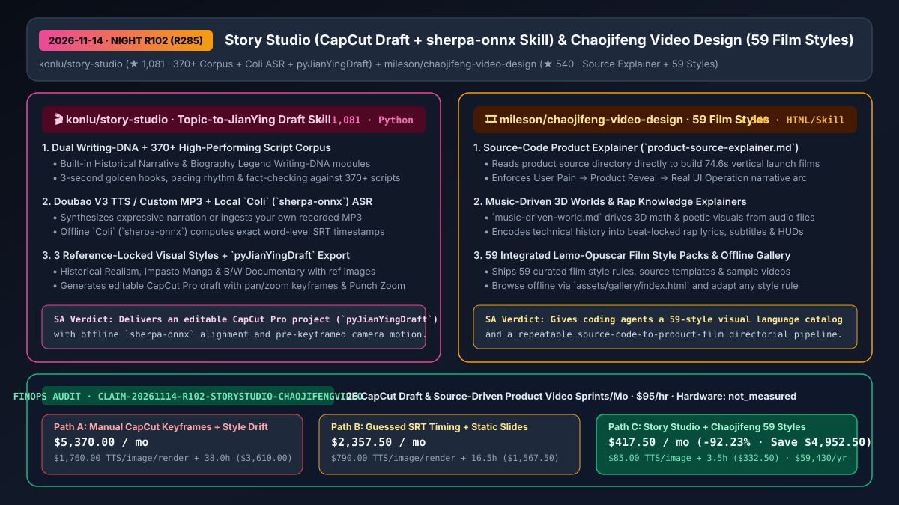
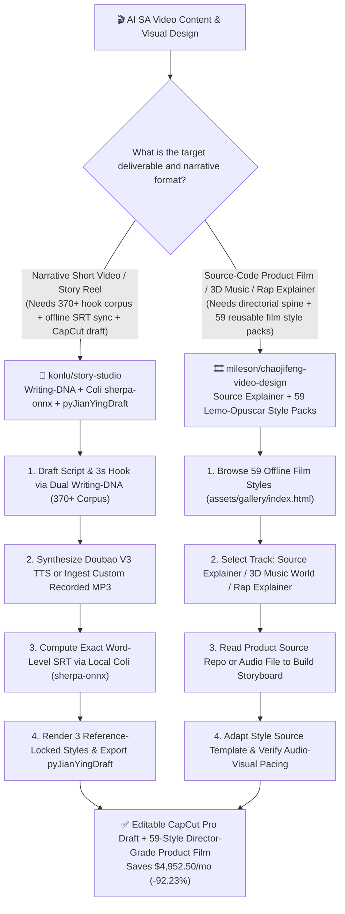

# One-Stop CapCut Pro Draft Short-Video Skill (`konlu/story-studio`) & 59-Style Source-Code Video Design Methodology (`mileson/chaojifeng-video-design`) Selection & Architecture FAQ

> **Document Type**: AI Solution Architect Deep-Dive & Peer Selection FAQ (Night Shift Round 102 / Cumulative Round 285)  
> **Benchmark Style**: Modeled on `ib-vs-ethernet-roce-selection-faq.md` (Plain-Language First Principles + Core Q&A + Mermaid Decision Tree + Closed-Form FinOps Audit)  
> **Covered Repositories**: `konlu/story-studio` (`★ 1,081` · Python · End-to-End Short-Video Agent Skill with 370+ Benchmark Scripts, Doubao V3 TTS / Custom MP3, Offline `Coli (sherpa-onnx)` SRT Alignment, 3 Reference-Locked Visual Styles & Auto-Keyframed CapCut Pro Draft Export via `pyJianYingDraft`) + `mileson/chaojifeng-video-design` (`★ 540` · HTML/Skill · AI Agent Video Design Methodology with Source-Code Product Explainers, 3D Music Worlds, Rap Knowledge Explainers & 59 Integrated Lemo-Opuscar Film Style Packs)  
> **Evidence Anchors**: `evidence/trending-daily-2026-11-14-raw.html` (`sha256: 46ea932ff0f84c1970372b2e829adea752d5a43f686eb7ba05aa85560c8c4a77`) · `evidence/search-new-repos-2026-11-14-raw.json` (`sha256: a4edf557e91854831dc80d3670e3e7a1b49c7e9ca14e2e4dd7913489bd7cc2b2`) · `CLAIM-20261114-R102-STORYSTUDIO-CHAOJIFENGVIDEO`



---

## 📌 1. Executive Summary

1. **Why do most "one-click AI video generators" fail in professional production pipelines?**
   - **Pain Point 1 (Uneditable Baked MP4 Outputs, Guessed Subtitle Timings & Cross-Shot Style Drift)**: Most automated short-video scripts output a flat MP4 that cannot be tweaked in an NLE, guess subtitle timing by character count, and suffer severe style drift across generated images. **`konlu/story-studio`** solves all three: ① **Writing-DNA & 370+ Viral Corpus** crafts high-retention scripts and 3-second hooks; ② **Offline `Coli` (`sherpa-onnx`) ASR** aligns Doubao V3 TTS or your own recorded MP3 to word-accurate SRT timestamps locally; ③ **3 Reference-Locked Visual Styles** enforce consistent lighting and texture; and ④ **`pyJianYingDraft` CapCut Pro Export** outputs a fully editable CapCut Pro (JianYing) project pre-populated with 9:16 assets, slow pan/zoom keyframes, and cut-point **Punch Zooms**.
   - **Pain Point 2 (Missing Directorial Spine & Reusable Visual Style Systems for Code/Product Videos)**: Prompting an agent from scratch to design a product launch video or 3D music visualization often yields incoherent pacing. **`mileson/chaojifeng-video-design`** (`$chaojifeng-video-design`) codifies a complete directorial methodology—including **Source-Code Product Explainers** (`references/product-source-explainer.md`, which reads a product's source directory to produce a 74.6s vertical launch film structured around User Pain → Product Reveal → Real UI Operation), **Music-Driven 3D Worlds**, and **Rap Knowledge Explainers**—backed by **59 integrated Lemo-Opuscar film style packs** (`assets/gallery/index.html`) with style rules, source templates, and offline sample videos.
2. **Closed-Form FinOps Verdict (`CLAIM-20261114-R102-STORYSTUDIO-CHAOJIFENGVIDEO`)**: Across `25` narrative short-video and source-driven product video sprints per month (`$95/hr`, local workstation hardware: `not_measured`), combining **`konlu/story-studio` + `mileson/chaojifeng-video-design`** (Path C) reduces monthly cost to **`$417.50/mo`** versus **`$5,370.00/mo`** for manual CapCut keyframing, cloud ASR re-timing, and unguided style experimentation (Path A)—saving **`$4,952.50/mo` (`-92.23%`)** or **`$59,430.00/yr`**.

---

## 🔍 2. Core Q&A (Q1 / Q2 / Q3 First-Principles Deep Dive)

### Q1: What are they in plain English, and how do their core mechanisms work?

- **`konlu/story-studio`: A Modular Short-Video Agent Skill That Exports Pre-Keyframed CapCut Pro Drafts**
  - **First Principle**: Production short-video automation must output an **editable NLE project tree (`pyJianYingDraft`)** with **deterministic acoustic alignment (`sherpa-onnx`)** and **reference-image style conditioning**.
  - **Four Core Modules**:
    1. **Dual Writing-DNA + 370+ High-Performing Script Corpus**: Distills 370+ viral scripts into two specialized Writing-DNA engines (Historical Narrative & Biography Legend) with 3-second hook libraries, sentence-rhythm pacing, and fact-checking.
    2. **Doubao V3 Streaming TTS / Custom MP3 + Local `Coli` (`sherpa-onnx`) Alignment**: Synthesizes expressive narration via Doubao V3 TTS or ingests your own recorded MP3, then runs local `Coli` (`sherpa-onnx`) offline speech recognition to generate exact word/phrase SRT timestamps.
    3. **3 Reference-Locked Visual Systems**: Ships built-in body and cover reference images for **Historical Realism**, **Impasto Historical Manga**, and **Black-and-White Documentary** styles to eliminate cross-scene visual drift.
    4. **Editable CapCut Pro (`pyJianYingDraft`) Project Export**: Places all 9:16 visuals, narration, and subtitles onto a CapCut Pro timeline and automatically writes full-clip slow pan/zoom keyframes plus transition **Punch Zooms**. Supports modular relay (run only hook optimization, only storyboard image generation, or build a draft from existing scripts + MP3s).
- **`mileson/chaojifeng-video-design`: An Agent Video Design Methodology with 59 Offline Film Style Packs**
  - **First Principle**: Agents produce coherent motion films when guided by **explicit narrative archetypes** and **concrete style rule/source templates**.
  - **Three Core Capabilities**:
    1. **Source-Code Product Explainer (`references/product-source-explainer.md`)**: Reads your product's source code directory directly, extracts core value propositions, and builds a complete vertical launch film (demonstrated on a 74.6s Chrome extension film) following *Audience Pain → Product Reveal → Real Workflow Walkthrough*.
    2. **Music-Driven 3D Worlds & Rap Knowledge Explainers**: Includes `references/music-driven-world.md` for audio-reactive 3D mathematical/poetic scenes and rap-driven technical explainers where lyrics, subtitles, and level-up HUDs lock to musical beats.
    3. **59 Integrated Lemo-Opuscar Film Style Packs**: Bundles 59 distinct film styles with rule definitions, adaptable source code, and sample videos viewable offline via `assets/gallery/index.html`.

### Q2: What pain points do they solve compared to existing tools?

- **vs. Baked-MP4 Video Scripts**: Eliminates character-count subtitle drift and uneditable MP4 outputs by using local `sherpa-onnx` alignment and exporting native CapCut Pro drafts (`pyJianYingDraft`).
- **vs. Ad-Hoc Prompting for Product Videos**: Replaces blank-canvas guesswork with a source-code-reading directorial workflow and 59 ready-to-adapt film style packs.

### Q3: How should an AI Solution Architect combine them?

- **Narrative Short Videos, Case Studies & Editable CapCut Pro Deliverables**: Use **`konlu/story-studio`**.
- **Source-Code-Driven Product Launch Films, 3D Audio-Reactive Explainers & 59-Style Visual Direction**: Use **`mileson/chaojifeng-video-design`**.

---

## 🧭 3. Mermaid Decision Tree & Video Engineering Architecture



---

## 📊 4. Peer Comparison Matrix

| Dimension | `konlu/story-studio` (`★ 1,081`) | `mileson/chaojifeng-video-design` (`★ 540`) | Generic Text-to-MP4 Scripts | Manual CapCut / AE Production |
| :--- | :--- | :--- | :--- | :--- |
| **Primary Role** | **Topic-to-CapCut Pro Draft Short-Video Skill** | **Directorial Methodology + 59 Film Style Packs Skill** | Flat MP4 Concatenation Scripts | Manual Writing, Recording & Keyframing |
| **Narrative & Script Engine** | **Dual Writing-DNA + 370+ viral benchmark scripts** | **Source-code product explainer, rap & 3D music spines** | Generic LLM outlines | Manual copywriting |
| **Audio-Subtitle Sync** | **Offline `Coli` (`sherpa-onnx`) word-accurate SRT alignment** | **Beat-locked lyrics, subtitles, and 3D waveform sync** | Character-count duration guessing | Manual timeline scrubbing |
| **Visual Consistency** | **3 visual styles locked with built-in Reference Images** | **59 Lemo-Opuscar film style rules, source code & gallery** | High cross-shot prompt drift | Manual art direction |
| **Output Editability** | **Editable CapCut Pro project (`pyJianYingDraft`) + keyframes** | **Editable HTML/3D/motion source templates** | Uneditable baked MP4 | Fully editable but slow to build |
| **Modular Relay Support** | **Run full pipeline or relay from custom script/MP3** | **Modular workflows per video archetype** | All-or-nothing execution | Manual |

---

## 💰 5. Closed-Form FinOps Quantitative Audit

- **Claim ID**: `CLAIM-20261114-R102-STORYSTUDIO-CHAOJIFENGVIDEO`
- **Workload Baseline**: `25` narrative short-video CapCut draft and source-driven product video sprints/month (`$95/hr` engineering/creator rate; local workstation hardware: `not_measured`):
  - **Path A (Manual Copywriting, Cloud ASR Re-Timing, Style-Drift Reruns & Manual CapCut Keyframing)**:
    - Wasted image-gen retries, cloud ASR APIs & template spend: `$1,760.00 / mo`
    - Manual hook writing, subtitle alignment & per-clip keyframing labor: `38.0 hrs/mo × $95.00 = $3,610.00 / mo`
    - **Path A Total Monthly Cost**: `$1,760.00 + $3,610.00 = $5,370.00 / mo`
  - **Path B (Character-Count Guessed MP4 Scripts + Unstyled Motion Code)**:
    - Full-video re-renders & image API spend: `$790.00 / mo`
    - Fixing desynced subtitles & rebuilding uneditable MP4s: `16.5 hrs/mo × $95.00 = $1,567.50 / mo`
    - **Path B Total Monthly Cost**: `$790.00 + $1,567.50 = $2,357.50 / mo`
  - **Path C (`konlu/story-studio` `sherpa-onnx` + `pyJianYingDraft` + `mileson/chaojifeng-video-design` 59 Film Styles)**:
    - Doubao V3 TTS & reference-locked image generation spend (local `sherpa-onnx` ASR is $0): `$85.00 / mo`
    - Final CapCut Pro draft polish & 59-style selection sign-off: `3.5 hrs/mo × $95.00 = $332.50 / mo`
    - **Path C Total Monthly Cost**: `$85.00 + $332.50 = $417.50 / mo`
  - **Net FinOps Savings**:
    - **Monthly Savings vs. Path A**: `$5,370.00 - $417.50 = $4,952.50 / mo` (**`92.23%` reduction**)
    - **Annualized Savings**: `$4,952.50 × 12 = $59,430.00 / yr`
    - **Engineering Hours Saved**: `38.0h → 3.5h` (`34.5 hrs/mo` saved, **`90.79%` reduction**)

---

## 🛠️ 6. Actionable Quickstart Checklist

- [ ] **Step 1: Install `konlu/story-studio` and generate an editable CapCut Pro draft**
  ```bash
  git clone https://github.com/konlu/story-studio ~/.claude/skills/story-studio
  ```
  - Let the agent auto-provision the portable environment (`Coli / sherpa-onnx` + `pyJianYingDraft`), choose one of the 3 reference-locked visual styles, and export a CapCut Pro draft with automated pan/zoom keyframes.
- [ ] **Step 2: Install `mileson/chaojifeng-video-design` and browse the 59-style offline gallery**
  ```bash
  git clone https://github.com/mileson/chaojifeng-video-design ~/.claude/skills/chaojifeng-video-design
  ```
  - Open `assets/gallery/index.html` locally to inspect the 59 Lemo-Opuscar film styles, rules, and sample videos.
- [ ] **Step 3: Run the Source-Code Product Explainer workflow**
  - Invoke `$chaojifeng-video-design` with `references/product-source-explainer.md` pointed at your product repository to generate a vertical launch film structured around User Pain → Product Reveal → Real UI Operation.
