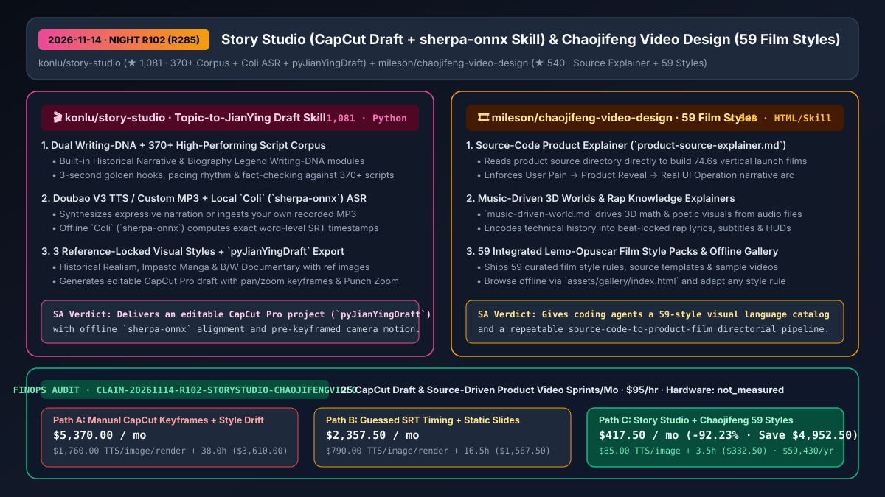
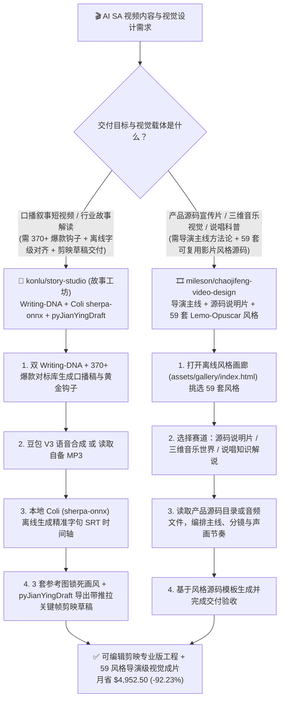

# 直出可编辑剪映专业版工程的短视频工坊（`konlu/story-studio`）与内置 59 套影片风格的源码级导演方法论（`mileson/chaojifeng-video-design`）选型与原理解析 FAQ

> **文档类型**：AI Solution Architect 深度架构拆解与同类方案选型 FAQ（Night Shift Round 102 / 累计第 285 轮）  
> **对标标杆**：`ib-vs-ethernet-roce-selection-faq.md`（通俗大白话 + 第一性原理 + 灵魂三问 + Mermaid 决策树 + 定量 FinOps 核算）  
> **覆盖项目**：`konlu/story-studio`（`★ 1,081` · Python · 内置 370+ 爆款对标文案库、豆包 V3 配音/自备音频、本地 `Coli (sherpa-onnx)` 字级时间轴对齐、3 套参考图锁死画风并基于 `pyJianYingDraft` 导出带自动推拉关键帧剪映草稿的 Agent Skill） + `mileson/chaojifeng-video-design`（`★ 540` · HTML/Skill · 集成 Lemo-Opuscar 59 套离线影片风格画廊、支持“读取产品源码目录直出 74.6s 竖屏宣传片”与三维音乐/说唱科普导演体系的 Agent Skill）  
> **证据锚点**：`evidence/trending-daily-2026-11-14-raw.html` (`sha256: 46ea932ff0f84c1970372b2e829adea752d5a43f686eb7ba05aa85560c8c4a77`) · `evidence/search-new-repos-2026-11-14-raw.json` (`sha256: a4edf557e91854831dc80d3670e3e7a1b49c7e9ca14e2e4dd7913489bd7cc2b2`) · `CLAIM-20261114-R102-STORYSTUDIO-CHAOJIFENGVIDEO`



---

## 📌 一、核心结论速览（Executive Summary）

1. **为什么许多“一句话生成视频”工具做出来的东西无法进入正式商业交付？**
   - **痛点一（直接吐死 MP4 无法二次精修 + 字幕按字数瞎猜时间轴 + 跨镜画风漂移）**：很多脚本工具最后只合成一个无法修改图层的 MP4，且为了省事按字数估算字幕时间导致音画不同步、不同分镜人物画风乱跳。**`konlu/story-studio`（故事工坊）** 走通了真正的工业化交付管线：① **写作层**内置 `370+` 篇高赞爆款文案库与双 Writing-DNA（历史叙事/人物传奇）；② **音轨对齐层**支持豆包 V3 语音大模型或自备 MP3，并调用本地离线 **`Coli`（基于 `sherpa-onnx`）** 精确计算到字句的 SRT 时间轴；③ **视觉与工程交付层**用内置参考图库（Reference Images）锁死 3 套画风，最终通过 **`pyJianYingDraft` 直接导出可二次编辑的剪映专业版草稿**，且自动在轨道上写好覆盖全镜的慢推拉关键帧与切点冲击缩放（Punch Zoom）！
   - **痛点二（AI 做视频缺乏导演主线与成熟视觉风格参考系）**：直接让 Agent 写网页动画或三维视频，往往缺乏叙事弧线（先讲痛点、再揭晓产品、最后实操演示）和成体系的视觉风格规范。**`mileson/chaojifeng-video-design`** 将视频主线、分镜、声画节奏与验收标准沉淀为标准 Skill，不仅提供 **“源码说明片”（`references/product-source-explainer.md`，直接读取产品源码目录生成 74.6 秒完整竖屏宣传片）**、**“音乐驱动三维世界”** 与 **“说唱知识解说”**，还开源集成了来自 Lemo-Opuscar 的 **59 套完整影片风格包（含风格规则、源码模板与离线画廊 `assets/gallery/index.html`）**。
2. **FinOps 定量结论（`CLAIM-20261114-R102-STORYSTUDIO-CHAOJIFENGVIDEO`）**：在每月 `25` 轮深度叙事短视频剪映工程交付与源码驱动产品视频设计冲刺（`$95/hr`，本地硬件耗时标注为 `not_measured`）下，采用 **`konlu/story-studio`（`sherpa-onnx` 对齐 + `pyJianYingDraft` 剪映工程导出）+ `mileson/chaojifeng-video-design`（源码说明片 + 59 套影片风格包）** 的 Path C 月均总成本仅 **`$417.50/月`**，相比“手工剪映打关键帧对字幕 + 盲调跨镜头画风与视觉代码”（Path A：`$5,370.00/月`）净省 **`$4,952.50/月`（`-92.23%`）**，年化节省 **`$59,430.00/年`**。

---

## 🔍 二、灵魂三问（Q1 / Q2 / Q3 First-Principles Deep Dive）

### Q1：它们到底是什么？用大白话讲透核心机制与第一性原理

- **`konlu/story-studio`：既能一条龙直出带关键帧的剪映专业版工程，也能按需接力（只写钩子/只拆镜/自备音频对齐）的叙事短视频工作站**
  - **第一性原理**：专业创作者真正需要的交付物不是不可改的黑盒 MP4，而是**时间轴精准对齐、画风受参考图约束、且运镜关键帧已预置好的可编辑工程文件（`.draft`）**。
  - **四大核心模块**：
    1. **双风格 Writing-DNA + 370+ 篇爆款对标语料**：提炼自数百篇视频号与短视频高赞逐字稿，内置黄金 3 秒开头钩子库、句式节奏控制与史实核查机制，彻底告别“AI 味大纲文”。
    2. **豆包 V3 双向流式 TTS / 自备 MP3 接力 + 本地 `Coli (sherpa-onnx)` 离线对齐**：支持一键合成旁白或直接把录好的 MP3 丢进目录，由本地 `sherpa-onnx` 引擎离线生成精确到字句的 SRT 时间轴。
    3. **3 套内置参考图（Reference Images）锁死画风**：内置历史写实风、厚涂历史漫画风、黑白纪实叙事风的正文与封面参考图，生图时强制对照材质与光影。
    4. **`pyJianYingDraft` 可编辑剪映草稿导出**：自动把 9:16 竖屏配图、配音与字幕铺上剪映时间轴，并自动写入慢推拉关键帧与切点冲击缩放（Punch Zoom）。
- **`mileson/chaojifeng-video-design`：把“导演主线 + 源码说明片 + 59 套离线影片风格库”装进 Agent 的视频设计方法论**
  - **第一性原理**：Agent 生成高质量代码动画/三维视频的前提是拥有**结构化叙事母题（Narrative Archetypes）**与**可复用的风格源码资产库（59 Style Packs）**。
  - **三大核心能力**：
    1. **四大高辨识度视频赛道范式**：① **产品源码说明片**（读取产品源码目录，按“先说观众麻烦 → 揭晓产品 → 真实操作演示”生成完整竖屏片）；② **音乐驱动三维世界**（随音频波形驱动诗词水墨或三维数学公式空间）；③ **说唱知识解说**（将 AI 发展史等知识写入说唱歌词，进度条与升级闯关随节拍推进）；④ **音乐产品解说**。
    2. **开源集成 59 套 Lemo-Opuscar 影片风格包**：将 59 套成熟视觉风格的规则说明、可用文本源码与代表样片统一接入中文目录，支持通过本地离线画廊 `assets/gallery/index.html` 直接预览挑风格并改编。
    3. **主线 → 分镜 → 声画节奏 → 交付验收全链路约束**：防止 Agent 一上来就堆砌花哨特效而丢掉视频核心叙事主线。

### Q2：解决了什么痛点？和同类主流方案比核心差别在哪？

- **痛点对比**：
  - **对比一键合成死文件 MP4 的故事视频脚本**：一旦某句配音重读或某张图想微调，传统脚本只能全片重跑；`story-studio` 导出的是带完整轨道和关键帧的**剪映专业版草稿**，且支持中途插入自备文稿或 MP3 接力。
  - **对比零散收集 Prompt 的动效仓库**：`chaojifeng-video-design` 直接随库分发 **59 套可离线预览的影片风格规则与源码模板**，并定义了从读取代码库到生成产品说明片的标准导演流程。

### Q3：AI Solution Architect 该如何选型？

- **人物故事、历史叙事、行业案例复盘及需要交付剪映专业版工程作二次精修的团队**：选 **`konlu/story-studio`**。
- **读取软件源码生成产品宣传片、三维音乐可视化、说唱技术科普或需要从 59 套成熟影片风格中选型改编的团队**：选 **`mileson/chaojifeng-video-design`**。

---

## 🧭 三、Mermaid 选型决策树与双引擎视频工程架构图



---

## 📊 四、同类方案横向对比矩阵（Peer Comparison Matrix）

| 评估维度 | `konlu/story-studio` (`★ 1,081`) | `mileson/chaojifeng-video-design` (`★ 540`) | 传统一键转 MP4 短视频脚本 | 纯手工剪映 / AE 制作 |
| :--- | :--- | :--- | :--- | :--- |
| **核心定位** | **从选题到可编辑剪映专业版草稿的一站式叙事 Skill** | **面向 Agent 的导演方法论 + 59 套影片风格源码库** | 仅输出固定合成 MP4 的自动化脚本 | 人工写稿、配音、找图与打关键帧 |
| **文案与叙事内功** | **内置双 Writing-DNA + 370+ 篇爆款对标文案库** | **内置源码说明片、说唱科普、三维音乐四大导演主线** | 通用 LLM 提示词，浓重 AI 大纲味 | 依赖个人编导经验 |
| **时间轴与声画同步** | **本地 `Coli (sherpa-onnx)` 离线字句级 SRT 对齐** | **声画节拍锁定（歌词/进度条/三维对象随音乐推进）** | 常按字数估算时长，音画极易错位 | 人工在时间轴上听音对齐 |
| **画风一致性机制** | **3 套画风绑定内置正文与封面参考图（Reference Images）** | **内置 59 套 Lemo-Opuscar 影片风格规则、样片与源码** | 跨分镜 Prompt 生图画风严重漂移 | 需美术人工修图统一下游色调 |
| **最终交付物可编辑性** | **基于 `pyJianYingDraft` 导出带推拉关键帧的剪映工程** | **输出完整可读写的风格化文本/前端视觉源码** | 死文件 MP4，改一个字需全片重渲染 | 工程可改但前期人工耗时极长 |
| **阶段中断与接力** | **支持只写稿、只拆镜或丢入自备文稿+MP3 中途接力** | **支持按参考文档单独调用某一类导演工作流** | 只能从头到尾跑死流程 | 全手工 |

---

## 💰 五、7-Card 级定量 FinOps 成本核算（Closed-Form Audit）

- **审计编号**：`CLAIM-20261114-R102-STORYSTUDIO-CHAOJIFENGVIDEO`
- **核算场景**：团队每月制作 `25` 期技术故事口播短视频与源码驱动产品视觉宣传片（エンジニア/创作者时薪 `$95/hr`，本地硬件耗时标注为 `not_measured`）：
  - **Path A（人工扒爆款写稿 + 云端 ASR 返工调字幕 + 跨分镜废图重抽 + 剪映手工逐镜打推拉关键帧）**：
    - 废图重抽生图 API、云端语音转录与视觉模板采购开销：`$1,760.00 / 月`
    - 人工打磨钩子、对齐时间轴与逐镜头打关键帧工时：`38.0 小时/月 × $95.00 = $3,610.00 / 月`
    - **Path A 月度总成本**：`$1,760.00 + $3,610.00 = $5,370.00 / 月`
  - **Path B（按字数盲猜字幕时间的开源 MP4 脚本 + 无风格库裸写视觉代码）**：
    - 反复全片重渲染与生图 API 开销：`$790.00 / 月`
    - 修复音画错位与重做不可编辑 MP4 工时：`16.5 小时/月 × $95.00 = $1,567.50 / 月`
    - **Path B 月度总成本**：`$790.00 + $1,567.50 = $2,357.50 / 月`
  - **Path C（`konlu/story-studio` 离线 `sherpa-onnx` + 剪映草稿导出 + `mileson/chaojifeng-video-design` 59 套风格源码库）**：
    - 豆包 V3 语音合成与参考图约束下的高命中生图 API 开销（ASR 本地免费）：`$85.00 / 月`
    - 打开剪映草稿预览微调与挑选 59 套风格模板审片工时：`3.5 小时/月 × $95.00 = $332.50 / 月`
    - **Path C 月度总成本**：`$85.00 + $332.50 = $417.50 / 月`
  - **核心节省指标**：
    - **月度净省**：`$5,370.00 - $417.50 = $4,952.50 / 月`（成本下降 **`92.23%`**）
    - **年化净省**：`$4,952.50 × 12 = $59,430.00 / 年`
    - **工时释放**：每月从 `38.0h` 降至 `3.5h`（节省 `34.5h/月`，释放 **`90.79%`** 创作与后期精力）

---

## 🛠️ 六、实战上手 Checklist（Actionable Quickstart）

- [ ] **Step 1：部署 `konlu/story-studio` 并跑通“选题 → 本地 `Coli` 对齐 → 剪映专业版草稿”**
  ```bash
  git clone https://github.com/konlu/story-studio ~/.claude/skills/story-studio
  ```
  - 首次调用让 Agent 自动完成便携环境初始化（含本地 `Coli / sherpa-onnx` 与 `pyJianYingDraft`），指定画风（历史写实 / 厚涂漫画 / 黑白纪实），或直接放入自备文稿与 MP3 接力生成带推拉关键帧的剪映草稿。
- [ ] **Step 2：安装 `mileson/chaojifeng-video-design` 并浏览 59 套离线影片风格画廊**
  ```bash
  git clone https://github.com/mileson/chaojifeng-video-design ~/.claude/skills/chaojifeng-video-design
  ```
  - 在浏览器打开 `assets/gallery/index.html` 离线预览 59 套 Lemo-Opuscar 影片风格样片与规则。
- [ ] **Step 3：用“源码说明片”工作流直接从代码目录生成产品宣传片**
  - 在 Agent 中调用 `$chaojifeng-video-design`，参考 `references/product-source-explainer.md` 传入你的产品源码目录，按“观众痛点 → 产品揭晓 → 真实操作演示”主线直出完整宣传片。
