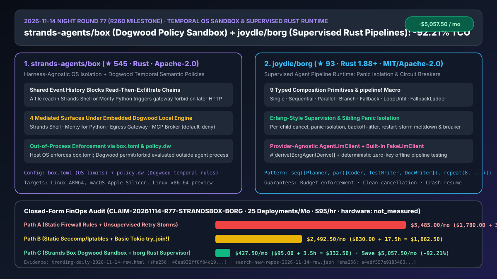
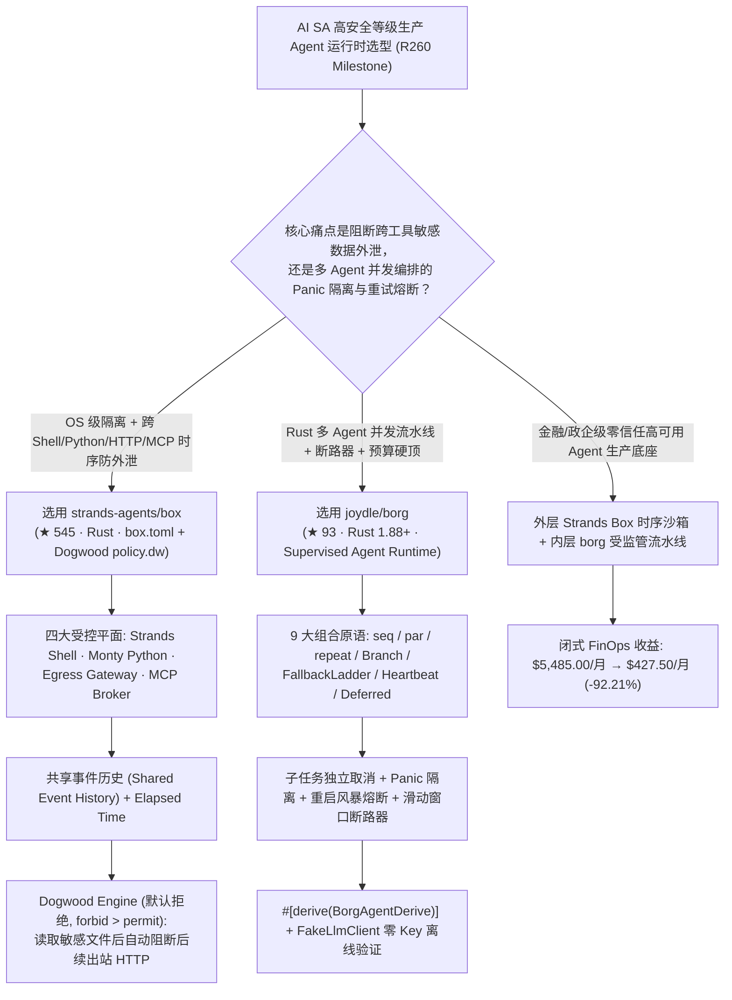

# 基于 Dogwood 时序语义策略的 Agent 操作系统沙箱（`strands-agents/box`）与 Erlang 级受监管 Rust 流水线运行时（`joydle/borg`）选型与架构拆解 FAQ

> **所属专题**：GitHub AI 热榜与新晋高星项目选型内参 · 2026-11-14 Night Round 77（累计第 260 轮里程碑 / R260 Milestone）  
> **对标标杆**：`ib-vs-ethernet-roce-selection-faq.md`（大白话本质定义 + 第一性原理 + 六段式结构 + 闭式 FinOps 审计）  
> **审计编号**：`CLAIM-20261114-R77-STRANDSBOX-BORG`  
> **配套架构大图**：[`assets/github-ai-radar-2026-11-14-r77-strandsbox-borg.svg`](../../../assets/github-ai-radar-2026-11-14-r77-strandsbox-borg.svg)  
> **English Version**: [Read in English (`strands-box-borg-dogwood-temporal-os-sandbox-supervised-rust-agent-pipeline-runtime-selection-faq.en.md`)](./strands-box-borg-dogwood-temporal-os-sandbox-supervised-rust-agent-pipeline-runtime-selection-faq.en.md)

---

## 📌 一、核心结论速览（30 秒看懂：它们到底是什么？解决什么痛点？）

1. **用大白话讲透这两个项目**：
   - **`strands-agents/box`（`★ 545`，Rust，Apache-2.0 协议）** 是 Strands 团队开源的**跨 Harness 操作系统级安全沙箱 + 时序语义策略引擎（Strands Box）**。传统 Docker/Seccomp 沙箱只有“静态开关”（要么完全断网，要么允许访问外网——一旦允许外网，Agent 读完本地 `.env` 密钥就能通过 HTTP 偷发出去）。`Strands Box` 用 `box.toml` 锁定宿主机 OS 隔离边界，并在进程外嵌入 **Dogwood 本地策略引擎（`policy.dw`，默认拒绝、`forbid` 优先于 `permit`）**；最核心的突破在于它的四大拦截面（**`Strands Shell`、`Monty for Python`、出站流量网关 `Egress Gateway`、以及 `MCP Broker`**）**共享同一份时序事件历史（Shared Event History）**——例如**只要 Agent 刚才在 Shell 或 Python 里读取过敏感文件，出站网关就会根据历史事件自动拦截它随后发起的任何外部 HTTP 请求**，从根源阻断“先读秘钥后外发（Read-Then-Exfiltrate）”攻击链。
   - **`joydle/borg`（`★ 93`，Rust 1.88+，MIT/Apache-2.0 双协议）** 是专为 Rust 打造的 **Erlang 级受监管（Supervised）多 Agent 流水线运行时（`v1.0.0`）**。用普通异步代码编排并行 Agent（如同时跑 `Coder`、`TestWriter`、`DocWriter`，再循环最多 8 轮 `Builder → BuildFixer`）时，一旦某个子任务 Panic、陷入无限重试风暴或上游取消，往往会拖垮整个进程或留下幽灵 LLM 请求继续烧钱。`borg` 提供 9 大强类型组合原语（`Single`、`Sequential`、`Parallel`、`Branch`、`Fallback`、`LoopUntil`、`FallbackLadder`、`Heartbeat`、`Deferred`），内置**子任务级独立取消、Panic 故障隔离（兄弟节点不陪葬）、带退避抖动的重启风暴熔断（Restart-Storm Meltdown）、滑动窗口断路器、Token 预算硬顶与崩溃恢复**，并自带无需 API Key 即可跑通全套单测的 `FakeLlmClient`。
2. **核心量化收益（闭式 FinOps 方程 `CLAIM-20261114-R77-STRANDSBOX-BORG` · R260 里程碑审计）**：
   - 按团队每月生产部署 **25 条高安全等级多 Agent 自动化研发与运维流水线**、AI SA 时薪 **$95.00/hr** 核算（本地硬件测量标注：`not_measured`）：
   - **Path A（静态无状态容器规则 + 无监管异步任务引发重试风暴与连带崩溃）**：月度重试风暴 Token 空转与幽灵请求费 **$1,780.00** + 工程师排查数据外泄隐患、修复 Panic 雪崩与手工恢复流水线 **39.0 小时（$3,705.00）** = **$5,485.00/月**。
   - **Path B（静态 Seccomp/Iptables 白名单 + 手写 Tokio `try_join!` 重试循环）**：月度 Token 与设施费 **$830.00** + 维护异常分支与网络规则工时 **17.5 小时（$1,662.50）** = **$2,492.50/月**。
   - **Path C（`strands-agents/box` 时序策略沙箱 + `joydle/borg` 受监管 Rust 流水线运行时）**：月度带预算熔断的 Token 支出 **$95.00** + 人工复核工时 **3.5 小时（$332.50）** = **$427.50/月**，**每月净省 $5,057.50（降本 92.21%，年化节省 $60,690.00，工程安全与排障工时压缩 91.03%）**。



---

## 🔍 二、灵魂拷问 Q1–Q3（从第一性原理看透架构差异）

### Q1：为什么传统的“静态网络白名单 + 容器挂载”防不住提示词注入引发的数据外泄？`strands-agents/box` 的时序共享事件历史是怎么破局的？
- **静态沙箱的致命盲区（The Lethal Trifecta）**：
  - 真实的 Coding Agent 既需要读本地代码/配置，又需要调外部文档 API 或 MCP。静态防火墙只能在启动前决定“开不开网”——只要开了网，攻击者通过间接提示词注入让 Agent 先用 Python/Shell 读出私有配置，再拼接到合法域名的 URL 查询参数里发出去，静态规则完全无法察觉。
- **`Strands Box` + `Dogwood` 的时序状态机防线**：
  1. **四大通道统一收口**：`Strands Shell`（命令行）、`Monty for Python`（受控 Python 解释器）、`Egress Gateway`（出站网络网关）与 `MCP Broker`（MCP 代理）全部将操作上报给进程外的 **Dogwood Local Engine**。
  2. **跨通道时序因果策略（Temporal Event-History Rules）**：因为四大通道共享同一个事件历史流与流逝时间（Elapsed Time），你在 `policy.dw` 中可以写出极其精准的动态因果规则——*“在未读取机密目录前允许访问外部 HTTP；一旦 Shell 或 Monty Python 发生过敏感文件读取事件，随后的出站 HTTP 或外部 MCP 调用立即触发 `forbid` 拒绝”*，且所有裁决均在 Agent 进程外部强制执行。

### Q2：用 Rust 写多 Agent 编排时，为什么原生的 `tokio::spawn` + `try_join!` 远远不够用？`joydle/borg` 补齐了哪些工业级原语？
- **裸写异步并发的三大坑**：
  1. **连带猝死或孤儿任务**：一个子 Agent 解析 JSON 触发 Panic，要么直接把整个主进程炸掉，要么取消主任务时子任务还在后台调大模型烧钱。
  2. **重试风暴（Restart Storm）**：当某个模型接口限流或抖动时，多个并发 Worker 同时无脑重试，瞬间打爆配额。
  3. **缺少离线确定性测试**：紧耦合特定云厂商 SDK，导致 CI 跑一次流水线编排测试就得真金白银调线上 API。
- **`joydle/borg` 的受监管运行时设计**：
  1. **声明式流水线 DSL（`seq` / `par` / `repeat` / `FallbackLadder`）**：几行代码即可表达“先跑 `Planner` → 并行扇出 `Coder`、`TestWriter`、`DocWriter` → 最多循环 8 轮 `Builder → BuildFixer` 直到返回 `PASS` → 最后跑 `Reviewer`”。
  2. **电信级容错与熔断**：每个子节点拥有独立的取消句柄与 Panic 隔离罩；内置带抖动退避的重试、防雪崩的 **Restart-Storm Meltdown（重启风暴熔断）**、滑动窗口断路器以及跨模型降级阶梯（`FallbackLadder`）。
  3. **零依赖 `AgentLlmClient` Trait + `FakeLlmClient`**：不强绑任何臃肿 SDK，自带内存级 `FakeLlmClient`，零 API Key 即可在 CI 中 100% 确定性地验证复杂重试、超时与降级分支。

### Q3：AI Solution Architect 如何将 `strands-agents/box` 与 `joydle/borg` 组合成高可靠、防外泄的企业级 Agent 执行底座？
- **内层受监管编排 + 外层时序沙箱双保险**：
  - 在应用内部用 **`joydle/borg`** 编排多角色 Rust Agent 流水线（保障单节点 Panic 不扩散、Token 预算不超支、上游取消零残留）；
  - 在操作系统外层用 **`strands-agents/box`** 包裹整个运行进程（通过 `box.toml` + `policy.dw` 实时审计 Shell、Python、HTTP 与 MCP 的跨通道时序行为），实现“内部编排打不死、外部边界偷不走”。

---

## 🧭 三、Mermaid 选型决策树与架构协同图



---

## 📊 四、同类方案对比矩阵（Peer Comparison Matrix）

| 评估维度 | `strands-agents/box` | `joydle/borg` | 静态 Docker / Seccomp 容器 | 裸写 Tokio / Python `asyncio.gather` |
| :--- | :--- | :--- | :--- | :--- |
| **核心架构定位** | OS 隔离 + `Dogwood` 跨通道时序语义策略沙箱 | Erlang 风格受监管 Rust Agent 流水线运行时 | 静态进程/文件系统/端口隔离 | 基础异步并发原语 |
| **跨步骤数据外泄防御** | **共享 Shell/Python/HTTP/MCP 事件历史，读敏感文件后自动禁网** | 支持流水线级 Guardrail 与预算拦截 | 静态网络开关，无法感知“先读文件再发 HTTP” | 无进程外安全边界 |
| **并发容错与重试控制** | 进程外强制执行，防止 Agent 篡改沙箱规则 | **Panic 隔离、子任务级取消、重启风暴熔断、滑动断路器** | 容器级 OOM/Crash 重启，粒度极粗 | 单个子任务 Panic 或卡死易拖垮全局 |
| **可测试性与模型解耦** | Harness 无关（可包裹任意 Agent 二进制） | **内置 `FakeLlmClient`，零 API Key 确定性测试复杂分支** | 依赖外部集成测试环境 | 常与特定大模型 SDK 深度耦合 |
| **月度 TCO（25 次部署）** | **组合方案 Path C：$427.50/月（含 3.5h 复核）** | **组合方案 Path C：$427.50/月（含 3.5h 复核）** | Path B：$2,492.50/月（含 17.5h 维护） | Path A：$5,485.00/月（含 39.0h 排障） |

---

## 🧮 五、7-Card 定量洞察与闭式 FinOps 审计（`CLAIM-20261114-R77-STRANDSBOX-BORG` · R260 Milestone）

> **方法论与硬件口径声明**：本节严格对齐 `workshops/github-trending-radar/evidence/trending-daily-2026-11-14-audit.json` 闭式方程（按每月 25 条高安全等级多 Agent 流水线部署、AI SA 时薪 `$95.00/hr` 核算；本地工作站硬件功耗测量标记为 `not_measured`）。

| 路径方案 | 月度异常重试 Token 与设施费 (USD) | 月度安全审计与排障工时 (Hours @ $95.00/hr) | 月度工程人力成本 (USD) | 月度总成本 TCO (USD) | 相对 Path A 净节省 (USD / %) |
| :--- | :---: | :---: | :---: | :---: | :---: |
| **Path A：静态防火墙规则 + 无监管异步任务引发重试风暴与崩溃** | `$1,780.00` | `39.0 hrs` | `$3,705.00` | **`$5,485.00`** | Baseline (`0.00%`) |
| **Path B：静态 Seccomp/Iptables + 基础 Tokio `try_join!` 循环** | `$830.00` | `17.5 hrs` | `$1,662.50` | **`$2,492.50`** | `-$2,992.50` (`-54.56%`) |
| **Path C：`Strands Box` 时序沙箱 + `borg` 受监管 Rust 运行时** | **`$95.00`** | **`3.5 hrs`** | **`$332.50`** | **`$427.50`** | **`-$5,057.50` (`-92.21%`)** |

- **闭式校验恒等式**：
  - $\text{Path A Total} = \$1,780.00 + 39.0 \times \$95.00 = \$1,780.00 + \$3,705.00 = \$5,485.00/\text{mo}$
  - $\text{Path B Total} = \$830.00 + 17.5 \times \$95.00 = \$830.00 + \$1,662.50 = \$2,492.50/\text{mo}$
  - $\text{Path C Total} = \$95.00 + 3.5 \times \$95.00 = \$95.00 + \$332.50 = \$427.50/\text{mo}$
  - $\text{Monthly Savings} = \$5,485.00 - \$427.50 = \$5,057.50/\text{mo}\ (-92.21\%)$，$\text{Annualized Savings} = \$60,690.00/\text{yr}$

---

## 🛠️ 六、AI SA 实战上手 Checklist（15 分钟落地验证）

1. **配置 `strands-agents/box` 的 `box.toml` 与 `policy.dw` 验证“读后禁网”时序策略**：
   ```bash
   git clone https://github.com/strands-agents/box.git
   cd box && cargo build --release
   ```
   - **验证要点**：编写一条 `policy.dw` 规则，验证当 Agent 通过 `Strands Shell` 或 `Monty for Python` 读取指定敏感目录后，`Egress Gateway` 是否立即根据共享事件历史拒绝随后的出站 HTTP 请求。
2. **引入 `joydle/borg` 并使用 `FakeLlmClient` 验证并行 Panic 隔离与重试上限**：
   ```toml
   [dependencies]
   borg = { git = "https://github.com/joydle/borg.git", tag = "v1.0.0" }
   async-trait = "0.1"
   ```
   - **验证要点**：构建 `seq([step(Planner), par([step(Coder), step(TestWriter), step(DocWriter)]), repeat(8, ...)])` 流水线，在其中一个并行子节点注入 Panic，确认兄弟节点正常完成且取消信号能干净终止所有嵌套调用。
3. **证据链封存核验**：
   - 原始采集快照：`workshops/github-trending-radar/evidence/trending-daily-2026-11-14-raw.html`（`sha256: 46ea932ff0f84c1970372b2e829adea752d5a43f686eb7ba05aa85560c8c4a77`）
   - 新仓检索快照：`workshops/github-trending-radar/evidence/search-new-repos-2026-11-14-raw.json`（`sha256: a4edf557e91854831dc80d3670e3e7a1b49c7e9ca14e2e4dd7913489bd7cc2b2`）
