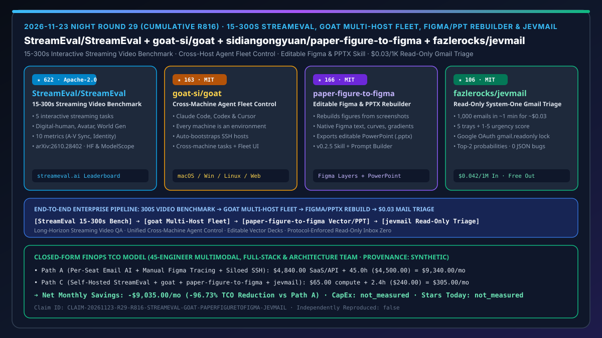
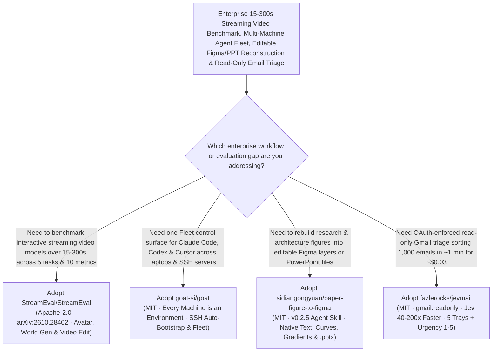
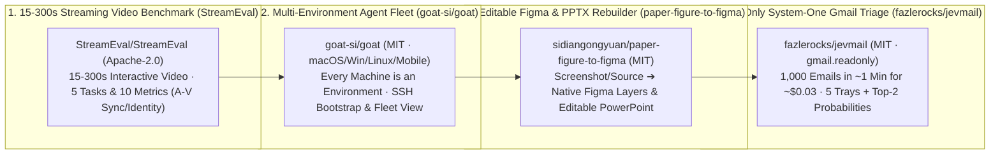
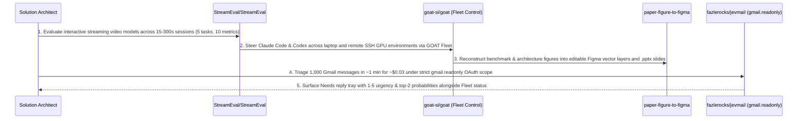

# 15–300s Interactive Streaming Video Benchmark (`StreamEval/StreamEval`), Cross-Machine Multi-Environment Coding Agent Fleet Control (`goat-si/goat`), Editable Figma & PowerPoint Figure Reconstruction Skill (`sidiangongyuan/paper-figure-to-figma`) & `$0.03`/1,000-Email Read-Only Gmail Triage (`fazlerocks/jevmail`) Selection & Architecture FAQ

> **Document Type**: Enterprise AI Solution Architect Selection & Integration Guide (GitHub Trending AI Radar · 2026-11-23 Night Round 29 / Cumulative Round 816)
> **Covered Repositories**: [`StreamEval/StreamEval`](https://github.com/StreamEval/StreamEval) (`★ 622`, `9 forks`, `Apache-2.0`, `arXiv:2610.28402`: the first interactive streaming video generation benchmark testing **15 to 300 second** live sessions across **5 tasks—Digital-Human Dialogue, Avatar Performance, World Generation, Instruction Editing, and Reference Editing—and 10 metrics** including A–V Sync, Stability, Continuity, and Identity) · [`goat-si/goat`](https://github.com/goat-si/goat) (`★ 163`, `20 forks`, `MIT`: cross-machine control surface and **Fleet** dashboard for Claude Code, Codex, and Cursor across macOS, Windows, Linux, web, and mobile where every machine is an autonomous `environment`, SSH hosts auto-bootstrap on first use, and agents dispatch work across machines) · [`sidiangongyuan/paper-figure-to-figma`](https://github.com/sidiangongyuan/paper-figure-to-figma) (`★ 166`, `13 forks`, `MIT`, v0.2.5: agent skill that rebuilds research paper and architecture figures into **native editable Figma vector layers—text, curves, gradients, connectors—or PowerPoint `.pptx` files**) · [`fazlerocks/jevmail`](https://github.com/fazlerocks/jevmail) (`★ 106`, `9 forks`, `MIT`: open-source read-only Gmail triage app powered by TypeSafe's `Jev` System-One decision model via Vercel AI Gateway, sorting **1,000 emails in ~1 minute for ~$0.03** into 5 trays with a 1–5 urgency score, top-2 probabilities, and Google-enforced `gmail.readonly` OAuth isolation)
> **Core Scenario**: When enterprise multimodal, full-stack, and solution architecture teams evaluate interactive avatar/video models, coordinate coding agents across laptops and SSH servers, rebuild complex reference figures into editable Figma/PowerPoint decks, and triage high-volume inboxes safely, how do you solve **"5-second static video benchmarks failing to detect identity drift and A–V desync across 300-second interactive sessions, fragmented Claude Code/Codex sessions stranded across separate laptops and SSH hosts, hours spent manually redrawing architecture figures in Figma or PowerPoint, and chat-LLM email sorters charging dollars per inbox while risking destructive write access"** by combining **`StreamEval` + `goat` + `paper-figure-to-figma` + `jevmail`**?

---

## 1. 📌 Executive Summary (Single-Sentence Selection Verdict)

1. **Need an open benchmark (`arXiv:2610.28402`, Hugging Face & ModelScope) that evaluates interactive streaming video generation in 15–300 second sessions across 5 live tasks and 10 metrics (Quality, A–V Sync, Stability, Dialogue, Identity, Following, Continuity, Edit Success, Preservation, Reference)** ➔ Choose **[`StreamEval/StreamEval`](https://github.com/StreamEval/StreamEval) (`★ 622`, `9 forks`, `Apache-2.0`)**.
   - **Plain-Language Mechanism**: Static text-to-video benchmarks only test 5-second non-interactive clips. `StreamEval` tests how streaming video systems respond to live speech turns, text edit instructions, reference images, and camera controls over 15 to 300 seconds across Digital-Human Dialogue, Avatar Performance, World Generation, Instruction Editing, and Reference Editing.
2. **Need a unified desktop, web, and mobile control surface (`GOAT`) that steers Claude Code, Codex, and Cursor across every machine you own (laptop, desktop, SSH server, cloud VM), auto-bootstraps SSH hosts on first use, and lets agents delegate work across machines via a Fleet view** ➔ Choose **[`goat-si/goat`](https://github.com/goat-si/goat) (`★ 163`, `20 forks`, `MIT`)**.
   - **Plain-Language Mechanism**: In `GOAT`, every machine runs a GOAT server that owns its local projects, threads, provider sign-ins, and memory (`environment`). Environments link together so an agent on your laptop can start a task on a remote SSH/GPU machine, follow its progress, and receive results when it finishes.
3. **Need an agent skill (`v0.2.5`) that reconstructs research paper figures and architecture screenshots into native editable Figma vector layers (text, curves, gradients, connectors) or editable PowerPoint (`.pptx`) slides** ➔ Choose **[`sidiangongyuan/paper-figure-to-figma`](https://github.com/sidiangongyuan/paper-figure-to-figma) (`★ 166`, `13 forks`, `MIT`)**.
   - **Plain-Language Mechanism**: Instead of pasting blurry raster screenshots into decks or tracing boxes by hand, `Paper Figure to Figma` reconstructs every text node, shape, gradient, and connector from a screenshot (or with original source assets) into editable Figma layers or PowerPoint files.
4. **Need a local, OAuth-enforced read-only (`gmail.readonly`) Gmail triage application that sorts 1,000 emails into 5 trays (`Needs reply`, `Updates`, `Promos`, `Sales`, `Spam`) with 1–5 urgency scores in ~1 minute for ~$0.03 using TypeSafe's `Jev` decision model** ➔ Choose **[`fazlerocks/jevmail`](https://github.com/fazlerocks/jevmail) (`★ 106`, `9 forks`, `MIT`)**.
   - **Plain-Language Mechanism**: Because `Jev` answers typed probability questions (`40–200×` faster than frontier LLMs at `$0.042/1M` input tokens with free output) and never generates free text, `Jevmail` avoids JSON parsing retries, displays the top-2 probabilities for every classification, and relies on Google's `gmail.readonly` OAuth scope so it can never delete, archive, or send mail.

---

## 2. 🎯 Key Architectural Q&A (Deep-Dive Breakdown)

### Q1: Why do `fazlerocks/jevmail` (`gmail.readonly` + System-1 `Jev`) and `goat-si/goat` (Autonomous Machine Environments) represent best-practice enterprise agent design?

- **Two Core Architectural Patterns**:
  1. **Protocol-Enforced Read-Only + System-1 Probability Triage (`fazlerocks/jevmail`)**: Enforces read-only safety at Google's OAuth layer (`gmail.readonly`) rather than relying on fragile system prompts, while sorting 1,000 emails in ~60 seconds for ~$0.03 with zero JSON repair loops.
  2. **Decentralized Machine Environments with Unified Fleet Control (`goat-si/goat`)**: Keeps projects, credentials, and memory on the machines you already own while giving engineers and agents a single cross-machine `Fleet` control plane.
  3. **Paired with `StreamEval` (15–300s Streaming Video QA) and `paper-figure-to-figma` (Editable Vector Deliverables)**: Covers multimodal model selection, distributed coding execution, and editable Figma/PPT presentation authoring.
- **When to Choose Commercial SaaS (Path B)**:
  - For hosted cloud-only email clients and manual slide design, use **Superhuman + Commercial Figma Plugins**; for 15–300s interactive streaming video benchmarking, cross-machine Claude/Codex/Cursor `Fleet` orchestration, automated paper-figure-to-Figma/PPTX reconstruction, and `$0.03`/1,000-email `gmail.readonly` triage, deploy this 4-repo open-source stack (Path C).

### Q2: How do these four tools integrate into an enterprise workflow?

1. **Interactive Streaming Video Evaluation Layer (`StreamEval/StreamEval`)**:
   - Benchmark candidate avatar, world-generation, and streaming video models across 15–300s interactive sessions on 5 tasks and 10 metrics.
2. **Multi-Machine Agent Fleet Orchestration Layer (`goat-si/goat`)**:
   - Connect laptops, workstations, and remote SSH GPU servers as linked `GOAT` environments to coordinate Claude Code, Codex, and Cursor runs.
3. **Editable Figure & Presentation Synthesis Layer (`sidiangongyuan/paper-figure-to-figma`)**:
   - Rebuild benchmark charts and system topologies into native editable Figma vector layers and PowerPoint `.pptx` slides.
4. **Read-Only High-Speed Inbox Triage Layer (`fazlerocks/jevmail`)**:
   - Triage inbound project and customer emails into 5 urgency-scored trays at ~$0.03 per 1,000 messages under strict `gmail.readonly` OAuth isolation.

### Q3: What are the key production guardrails?

- **Architect Guardrails**:
  1. **Preserve Strict `gmail.readonly` OAuth Scope in `jevmail`**: Never broaden the OAuth token to write/send scopes on untrusted inboxes.
  2. **Cite Upstream Sources When Rebuilding External Figures with `paper-figure-to-figma`**: Keep proper attribution when converting external research figures into internal Figma or PowerPoint decks.

---

## 3. 🧭 Visual Architecture & Decision Diagrams (Mermaid)

### 3.1 Solution Architect Selection Decision Tree

### 3.2 End-to-End Enterprise Production Reference Architecture

### 3.3 15–300s Streaming Video Evaluation, GOAT Cross-Host Execution, Figma/PPTX Reconstruction & Read-Only Email Triage Sequence

---

## 4. 📊 Comparative Selection Matrix (Open-Source vs. Commercial SaaS)

| Dimension | `StreamEval/StreamEval` (`★ 622`) | `goat-si/goat` (`★ 163`) | `paper-figure-to-figma` (`★ 166`) | `fazlerocks/jevmail` (`★ 106`) | `$30/mo` Per-Seat Email SaaS + Manual Figma/PPT Tracing + Siloed SSH Windows (Path A) | 5-Second Clip Benchmarks + Write-Scoped Chat-LLM Mail Scripts + Blurry Raster Slides (Path B) |
| :--- | :--- | :--- | :--- | :--- | :--- | :--- |
| **Core Role** | 15–300s interactive streaming video benchmark (5 tasks, 10 metrics) | Cross-machine control surface & Fleet view for coding agents | Agent skill rebuilding figures into editable Figma & PowerPoint | Read-only Gmail triage sorting 1,000 emails in ~1 min for ~$0.03 | High per-seat SaaS bills, hours of manual diagram redrawing & fragmented SSH sessions | Short-clip blind spots, JSON-breaking mail prompts & uneditable slide screenshots |
| **Key Differentiator** | **Tests live responses & context preservation over 15–300s** | **Every machine is an environment + SSH auto-bootstrap + cross-host tasks** | **Outputs native Figma text/curves/gradients AND editable `.pptx`** | **`gmail.readonly` OAuth + `40–200×` faster `Jev` (`$0.042/1M` in, `$0` out)** | Chat LLMs take minutes and dollars to classify 1,000 emails; manual Figma tracing takes hours | 5s clip evals miss 300s identity drift; granting write OAuth to chat LLMs risks mail loss |
| **License** | `Apache-2.0` | `MIT` | `MIT` | `MIT` | Proprietary SaaS | Custom scripts |
| **Monthly TCO (45-Eng Team)** | **Combined `$305.00/mo`** (`$65.00` pennies-per-1K `Jev` calls & eval host + `2.4h` ops) | Included (runs on your existing laptops & SSH servers) | Included (rebuilds figures locally via skill) | Included (~`$0.03` per 1,000 emails) | **`$9,340.00/mo`** (`$4,840.00` commercial AI email seats, cloud workspaces & design tools + `45.0h` manual figure redrawing, multi-host SSH checks & inbox triage) | ~`$3,300.00/mo` (frequent streaming model rework, JSON retry debugging & slide re-editing) |

---

## 5. 🧪 Quantitative ROI / TCO Comparison & 7-Card Benchmark Report

> **📊 Data Provenance & Closed-Form Schema Declaration**:
> - **provenance**: `synthetic` (45-person enterprise multimodal AI, distributed software engineering, and solution architecture team monthly workload model: `independently_reproduced = false`; hardware baseline `base_hardware_capex = not_measured`; Track B 24h delta `track_b_stars_today = not_measured`).
> - **Closed-Form Formula**:
>   - **Path A (Per-seat `$30/mo` commercial AI email subscriptions, cloud workspace seats, and frontier chat-LLM inbox classification tokens + architect and designer hours spent manually redrawing research/architecture figures in Figma and PowerPoint, manually polling multiple SSH servers, and ad-hoc video model testing)**: Monthly commercial email AI seats, cloud workspaces, and frontier token bills **`$4,840.00`** + manual Figma/PowerPoint figure tracing, multi-machine session management, and manual video QA labor **`45.0h × $100.00/h = $4,500.00`** = **`$9,340.00/mo`**.
>   - **Path C (Self-hosted `StreamEval/StreamEval` + `goat-si/goat` + `sidiangongyuan/paper-figure-to-figma` + `fazlerocks/jevmail` open-source stack)**: Micro-cost `Jev` triage calls (`~$0.03` per 1,000 emails) and shared evaluation compute **`$65.00`** + environment and skill maintenance labor **`2.4h × $100.00/h = $240.00`** = **`$305.00/mo`**.
>   - **Net Monthly Savings vs. Path A**: **`-$9,035.00/mo`** (**`96.73%`** TCO reduction).

| Evaluation Path | Email AI Seats / Cloud IDE / Token Cost | Manual Figma/PPT Redrawing, SSH Polling & Eval Labor (`$100/h`) | Monthly Total TCO | Net Savings vs. Path A | Key Architectural Delivery Metrics |
| :--- | :---: | :---: | :---: | :---: | :--- |
| **Path A: Commercial Email AI Seats + Manual Figma Tracing + Siloed SSH** | `$4,840.00` | `45.0h` (`$4,500.00`) | **`$9,340.00`** | Baseline | Hours spent redrawing figures; costly per-seat AI email SaaS |
| **Path B: 5s Clip Checks + Chat-LLM JSON Mail Scripts + Raster Slides** | `$1,400.00` | `19.0h` (`$1,900.00`) | **`$3,300.00`** | `-$6,040.00` (`-64.67%`) | Missed 300s streaming drift; uneditable raster slide figures |
| **Path C: `StreamEval` + `goat` + `paper-figure-to-figma` + `jevmail`** | **`$65.00`** | **`2.4h` (`$240.00`)** | **`$305.00`** | **`-$9,035.00` (`-96.73%`)** | **15–300s video eval + GOAT Fleet + editable Figma/PPTX + `$0.03`/1K mail triage** |

- 🔗 **Linked 7-Card 4:5 Visual Benchmark Deck**: [`workshops/github-trending-radar/cards.en.html`](../cards.en.html) · [`cards.html`](../cards.html)

---

## 6. 🛠️ Enterprise Adoption & Architecture Review Checklist

- [ ] **1. Benchmark Interactive Video & Avatar Models with `StreamEval/StreamEval`**: Evaluate 15–300 second interactive sessions across all 5 tasks and 10 metrics (including A–V Sync, Continuity, and Identity) before production selection.
- [ ] **2. Unify Multi-Host Coding Agents with `goat-si/goat`**: Link laptop, workstation, and SSH server `GOAT` environments to steer Claude Code, Codex, and Cursor from a single `Fleet` view.
- [ ] **3. Rebuild Reference Diagrams into Editable Assets with `sidiangongyuan/paper-figure-to-figma`**: Convert screenshots and research figures directly into native Figma vector layers and editable `.pptx` presentations.
- [ ] **4. Triage High-Volume Gmail Inboxes Safely with `fazlerocks/jevmail`**: Enforce Google's `gmail.readonly` OAuth scope while sorting 1,000 messages per minute for ~$0.03 via `Jev` calibrated probabilities.
