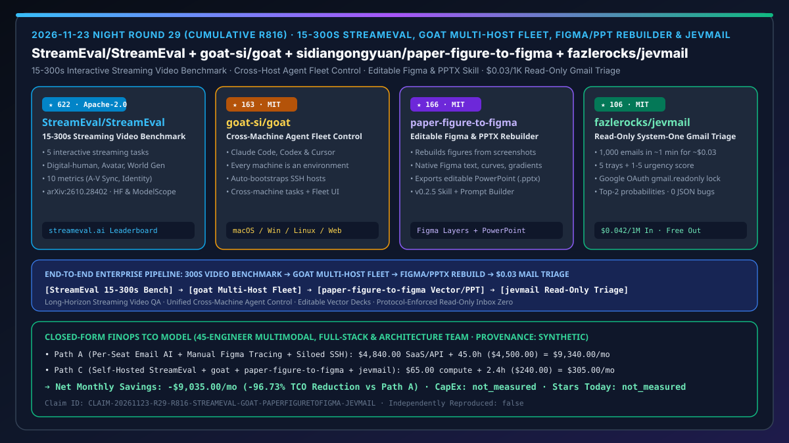
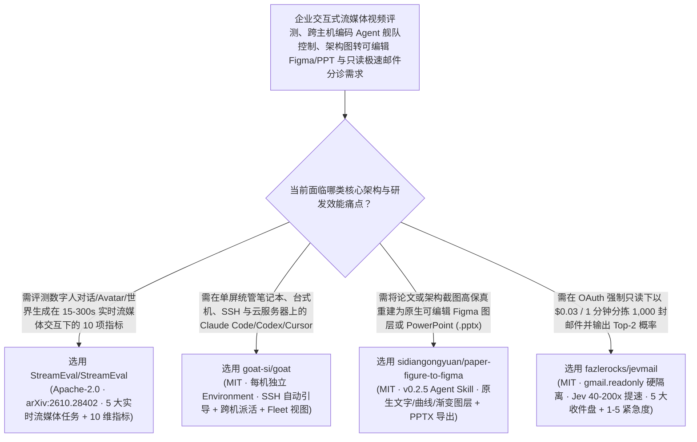
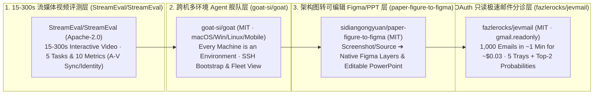
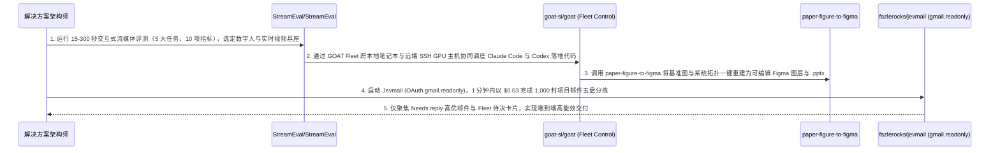

# 15–300 秒交互式流媒体视频生成 5 任务 10 指标基准（`StreamEval/StreamEval`）、跨笔记本/SSH/云主机的 Claude/Codex/Cursor 统一舰队控制面（`goat-si/goat`）、将论文与架构截图重建为原生可编辑 Figma 图层与 PPT 的技能（`sidiangongyuan/paper-figure-to-figma`）与 3 美分 1 分钟分拣千封邮件的 OAuth 只读 Gmail 概率分诊台（`fazlerocks/jevmail`）选型与集成架构 FAQ

> **文档类型**：企业 AI 解决方案架构师（AI Solution Architect）选型决策指南（GitHub Trending AI 雷达 2026-11-23 Night Round 29 / 累计第 816 轮）
> **覆盖项目**：[`StreamEval/StreamEval`](https://github.com/StreamEval/StreamEval)（`★ 622`、`9 forks`、`Apache-2.0`、`arXiv:2610.28402`：业界首个**交互式流媒体视频生成评测基准**，在长达 **15–300 秒**的实时交互会话中围绕**数字人对话、Avatar 表演、世界生成、指令编辑与参考图编辑 5 大任务及 10 项指标**评测实时流媒体视频模型）· [`goat-si/goat`](https://github.com/goat-si/goat)（`★ 163`、`20 forks`、`MIT`：跨 macOS / Windows / Linux / 手机端的 **Claude Code、Codex 与 Cursor 多环境统一舰队控制面 `GOAT`**，每台机器拥有独立的 `Environment`，首次连接 SSH 主机自动下发运行时，支持跨机互相派活与 `Fleet` 全景监控）· [`sidiangongyuan/paper-figure-to-figma`](https://github.com/sidiangongyuan/paper-figure-to-figma)（`★ 166`、`13 forks`、`MIT`：把**顶会论文配图或复杂架构截图高保真重建为原生可编辑 Figma 矢量图层（文字/曲线/渐变/连线）与 PowerPoint (`.pptx`) 幻灯片**的智能体技能）· [`fazlerocks/jevmail`](https://github.com/fazlerocks/jevmail)（`★ 106`、`9 forks`、`MIT`：基于 Google OAuth 层强制只读 `gmail.readonly` 与 TypeSafe `Jev` 系统一决策模型的**本地 Gmail 极速分诊引擎**，**1 分钟内分拣 1,000 封邮件仅需约 `$0.03`（3 美分）**，零 JSON 解析报错并透明展示 Top-2 概率）
> **核心场景**：当企业架构师与多模态应用团队评测实时数字人/交互视频底座、统管多台远程开发机上的编码 Agent、将外部学术/竞品架构图转化为内部可编辑 PPT/Figma 汇报资产，以及低成本安全分拣高管海量工作邮件时，面对**“传统单镜头 5 秒视频榜单测不出 300 秒实时交互数字人的音画同步退化与身份漂移、笔记本与多台云服务器上的 Claude Code / Cursor 会话各自孤立、设计师花数小时在 Figma/PPT 里一笔笔临摹论文架构图、以及用聊天大模型分类 1,000 封邮件既要修补破损 JSON 又要花掉几美元且害怕第三方 AI 越权删发邮件”**四大痛点，如何通过 **StreamEval + GOAT + Paper-Figure-to-Figma + Jevmail** 构建高效工程闭环？

---

## 一、📌 核心结论速览（选型一句话结论）

1. **想在企业引入实时数字人客服、实时互动虚拟直播或流式世界模型前，用一套开源、客观的 15–300 秒长时交互基准（覆盖 5 大交互任务与 10 项核心指标）检验模型在连续追问与运镜控制下的稳定性与音画同步** ➔ 选 **[`StreamEval/StreamEval`](https://github.com/StreamEval/StreamEval)（`★ 622`，`9 forks`，`Apache-2.0`，`arXiv:2610.28402`）**。
   - **通俗原理**：过去的视频评测（如 VBench）只测“给一句静态提示词生成一段 5 秒短视频”，完全无法检验模型在长达 **15 到 300 秒**的流媒体交互中收到用户新语音/新运镜指令时的响应能力。`StreamEval` 在 Hugging Face 与 ModelScope 完全开源评测数据与打分器，围绕 **Digital-Human Dialogue（数字人对话）、Avatar Performance（虚拟人表演）、World Generation（实时世界生成）、Instruction Editing（实时指令编辑）与 Reference Editing（参考图编辑）** 五大场景，从画质、A–V 音画同步、稳定性、身份保持（Identity）与连续性等 10 个维度给出量化体检。
2. **想在桌面客户端、浏览器或手机屏幕上统一掌控你所有机器（办公笔记本、家里台式机、SSH 远端开发机、云端 GPU 实例）上正在运行的 Claude Code、Codex 与 Cursor，并让一台机器上的 Agent 自动给另一台机器派活** ➔ 选 **[`goat-si/goat`](https://github.com/goat-si/goat)（`★ 163`，`20 forks`，`MIT`）**。
   - **通俗原理**：在 `GOAT` 架构中，**每一台机器都是一个自治环境（Environment）**，独立持有该机器上的项目、会话线程、模型登录态与记忆；当你首次连接一台新 SSH 服务器时，`GOAT` 会自动为其引导安装远端运行时；不同环境之间可互连，笔记本上的 Agent 可以直接在远端 GPU 主机上拉起子任务并在完成后收到通知，而 **Fleet（舰队视图）** 让你一眼看清所有机器上哪个任务在跑、哪个任务正等你拍板。
3. **想把 PDF 论文、技术白皮书或竞品报告里的复杂系统架构截图，一键还原为“每一个文字框、每一条贝塞尔曲线、每一个渐变色块都能在 Figma 或 PowerPoint 里自由拖拽修改”的原生矢量工程文件** ➔ 选 **[`sidiangongyuan/paper-figure-to-figma`](https://github.com/sidiangongyuan/paper-figure-to-figma)（`★ 166`，`13 forks`，`MIT`，v0.2.5）**。
   - **通俗原理**：直接把论文截图贴进客户汇报 PPT 不仅模糊而且没法改字，而普通图像矢量化工具只会生成一堆碎路径。该 Agent Skill（支持截图直转与附带原始素材辅助重建双模式）能精准解构参考图中的文本层级、几何形状、渐变与连接线，直接输出**原生可编辑的 Figma 图层或标准 `.pptx` 演示文稿**，并提供在线 Prompt Builder 与离线 Demo。
4. **想在 100% 本地只读、Google OAuth 协议层硬性禁止删信/发信/改标签（`gmail.readonly`）的安全前提下，仅花 1 分钟与 3 美分（`$0.03`）就把 1,000 封积压邮件精准分进 5 大收件盘并打上 1–5 级紧急度** ➔ 选 **[`fazlerocks/jevmail`](https://github.com/fazlerocks/jevmail)（`★ 106`，`9 forks`，`MIT`）**。
   - **通俗原理**：用传统聊天 LLM 给邮件分类需要拼长 Prompt、解析极易出错的 JSON 并为输出 Token 买单。`Jevmail` 通过 Vercel AI Gateway 调用 TypeSafe `Jev` 系统一决策模型（速度比前沿大模型快 **40–200 倍**，输入仅 `$0.042/百万 Token` 且**输出完全免费**）：对每封邮件一次性并发回答三个强类型问题（归入 **Needs reply / Updates / Promos / Sales / Spam** 哪一盘？1–5 级紧急度多少？是否真人为你手写？），界面直接展示 Top-2 概率并支持人工纠偏留痕，彻底零 JSON 报错！

---

## 二、🎯 客户与架构师灵魂拷问 Q&A（深度架构拆解）

### Q1：为什么在处理千封级企业邮件分诊（`jevmail`）和跨机多 Agent 调度（`goat`）时，“权限最小化（`gmail.readonly`）”和“环境状态本地自治（Every Machine is an Environment）”是架构师最看重的安全基石？

- **两大企业级安全与可扩展性设计亮点**：
  1. **OAuth 协议层物理只读，而非靠 Prompt 软约束（`fazlerocks/jevmail`）**：许多 AI 邮件助手申请了完整的邮箱读写权限，一旦遭遇邮件正文间接提示词注入就可能误删重要合同邮件或冒名外发；`jevmail` 仅向 Google 申请唯一的 `gmail.readonly` Scope，Google 服务器在协议层直接拒绝任何修改、归档或发信请求。
  2. **跨机器环境解耦与首次 SSH 自动引导（`goat-si/goat`）**：不用把所有服务器的代码和密钥集中同步到第三方云平台，每台机器的 `GOAT` Server 自己管自己的登录态与上下文，客户端随时按需接入并通过 `Fleet` 视图全局调度。
- **何时直接选用商业 SaaS（Path B）？**
  - 若团队仅需在网页端用现成模板画简单流程图且使用 Superhuman 商业客户端，可直接使用 **商业邮件客户端 + Figma 商业插件**；若需对 15–300 秒实时流媒体数字人做 10 指标严苛评测、跨多台自有开发机/SSH 服务器统一调度 Claude/Codex 舰队、把论文架构图一键重建为可编辑 Figma/PPT、或以 `$0.03/千封` 零写权限安全分拣邮箱，则采用本轮四合一开源栈（Path C）。

### Q2：典型企业级“流媒体数字人评测 (`StreamEval`) ➔ 跨机舰队开发 (`goat`) ➔ 论文/架构图转可编辑 Figma/PPT (`paper-figure-to-figma`) ➔ 只读极速邮件分诊 (`jevmail`)”架构怎么搭？

1. **15–300 秒交互式流媒体视频基准评测层（`StreamEval/StreamEval`）**：
   - 针对数字人对话、Avatar 表演与实时世界生成候选模型，运行 5 大任务与 10 项指标评测，筛选出长时交互不崩坏的视觉底座。
2. **跨笔记本/SSH/云主机多环境编码舰队控制层（`goat-si/goat`）**：
   - 通过 `GOAT` 将本地开发机与远端 GPU 训练/推理服务器连接为互联 `Environment`，在 `Fleet` 面板统一指挥 Claude Code、Codex 与 Cursor 跨机协同开发。
3. **高保真架构图转可编辑 Figma 与 PPT 交付层（`sidiangongyuan/paper-figure-to-figma`）**：
   - 调用 `paper-figure-to-figma` 技能将论文配图与系统草图重建为原生 Figma 矢量图层与可编辑 PowerPoint 汇报片。
4. **OAuth 只读保护下的 3 美分千封邮件极速分诊层（`fazlerocks/jevmail`）**：
   - 以 `gmail.readonly` 最小权限结合 `Jev` 系统一模型，在 1 分钟内完成千封客户与项目邮件的五盘分拣及 1–5 级紧急度打分。

### Q3：这套架构的落地红线与注意事项是什么？

- **架构师落地红线**：
  1. **严禁扩大 `jevmail` 的 OAuth 权限范围**：在企业内部二次开发部署时，必须保持单一的 `readonly` 权限边界，将分诊结果作为只读视图呈现给人工处理。
  2. **`paper-figure-to-figma` 用于企业内部架构学习与自有资产重制**：重建外部学术论文图表用于技术分享时，应在幻灯片显著位置保留原论文引用出处。

---

## 三、🧭 直观可视化图解（Mermaid 决策树 + 集成架构 + 时序图）

### 3.1 架构师选型决策树

### 3.2 企业端到端生产集成参考架构图

### 3.3 流媒体数字人选型评测、GOAT 跨机舰队开发、Figma/PPT 架构图重建与千封邮件 3 美分只读分诊时序图

---

## 四、📊 同类开源与商业云服务横向选型决策矩阵

| 对比维度 | `StreamEval/StreamEval` (`★ 622`) | `goat-si/goat` (`★ 163`) | `paper-figure-to-figma` (`★ 166`) | `fazlerocks/jevmail` (`★ 106`) | 传统聊天 LLM 逐封解析邮件 JSON + 人工美工重画 PPT 架构图 + 多窗口手工切 SSH (Path A) | 仅测 5 秒静态短视频 + 索要全量邮箱写权限的高危插件 + 模糊截图直接贴 PPT (Path B) |
| :--- | :--- | :--- | :--- | :--- | :--- | :--- |
| **核心能力定位** | 15–300 秒交互式流媒体视频生成 5 任务 10 指标基准 | 跨笔记本/台式机/SSH/云主机的多 Agent 舰队控制面 | 将论文/架构图重建为可编辑 Figma 矢量层与 PPT 的技能 | 基于 `gmail.readonly` 与 `Jev` 的 3 美分千封邮件分诊台 | 高昂的邮件长文本生成账单、数小时的美工描图工时与割裂的多机终端切换 | 无法反映长时流媒体崩溃的片面评测、极易误删邮件的越权脚本与不可改的死图片 |
| **核心技术突破** | **首创 15–300s 实时指令/语音交互评测，覆盖音画同步与身份保持** | **每机独立 Environment + SSH 首次自动装运行时 + 跨机派活 + Fleet** | **同时支持原生 Figma 图层（文字/曲线/渐变）与可编辑 `.pptx` 导出** | **1,000 封邮件 ~1 分钟仅 `$0.03`、零 JSON 报错、OAuth 层强制只读** | 用通用聊天模型分类 1,000 封邮件需数美元且慢 40–200 倍；外包重绘一张复杂架构图需半天 | 5 秒静态视频测试测不出第 60 秒的人脸崩坏；给 AI 邮件写权限存在严重安全合规隐患 |
| **开源协议** | `Apache-2.0` | `MIT` | `MIT` | `MIT` | 闭源商业 SaaS | 内部脆弱脚本 |
| **月度 TCO（45 人团队）** | **组合仅 `$305.00/月`**（`$65.00` 极低频 Jev 分拣费与评测调度容器 + `2.4h` 维护） | 同左（复用自有开发机与 SSH 服务器） | 同左（秒级生成可编辑 Figma/PPT） | 同左（千封邮件仅需 3 美分） | **`$9,340.00/月`**（`$4,840.00` 商业邮件 AI 席位/设计外包/多云 IDE 订阅 + `45.0h` 手工临摹架构图、跨机同步会话与人工筛邮件） | 约 `$3,300.00/月`（大量因选错流媒体模型返工、JSON 解析报错重试与手工改图工时） |

---

## 五、🧪 应用落地定量收益/TCO 对比与 7-Card 报告

> **📊 数据来源与闭式核算声明（Provenance & Closed-Form Schema）**：
> - **provenance**: `synthetic`（基于 45 人企业多模态研发、跨机全栈工程、技术方案设计与高效办公团队月度工作负载模型：`independently_reproduced = false`；硬件采购基线 `base_hardware_capex = not_measured`；Track B 单日增量 `track_b_stars_today = not_measured`）。
> - **核算公式**：
>   - **Path A（按人头采购 `$30/月` 商业 AI 邮件客户端与多云远程工作区席位 + 用高价生成式大模型逐封输出邮件分类 JSON + 架构师与设计师耗费数十小时手工在 Figma/PowerPoint 中重绘论文与参考架构图及人工排查多机 SSH 任务状态）**：月度商业 AI 邮件席位、大模型 Token 与云工作区账单 **`$4,840.00`** + 手工临摹重建 Figma/PPT 架构图、多机 Agent 状态巡检与流媒体模型人工评测工时 **`45.0h × $100.00/h = $4,500.00`** = **`$9,340.00/月`**。
>   - **Path C（自建 `StreamEval/StreamEval` + `goat-si/goat` + `sidiangongyuan/paper-figure-to-figma` + `fazlerocks/jevmail` 开源全栈）**：`Jev` 邮件分拣微额 API 费（`$0.03/千封`）与内部协调容器分摊开销 **`$65.00`** + 评测脚本与环境例行维护人工 **`2.4h × $100.00/h = $240.00`** = **`$305.00/月`**。
>   - **净节省（Net Savings vs Path A）**：**`-$9,035.00/月`**（成本降低 **`96.73%`**）。

| 评估方案 | 邮件 AI 席位 / 云工作区 / Token 成本 | 手工重绘 Figma/PPT、多机巡检与评测人工（`$100/h`） | 月度总 TCO | 相对 Path A 净节省 | 关键架构交付指标 |
| :--- | :---: | :---: | :---: | :---: | :--- |
| **Path A：商业邮件 AI 席位 + 人工临摹重绘 PPT + 散装多机 SSH** | `$4,840.00` | `45.0h` (`$4,500.00`) | **`$9,340.00`** | Baseline | 手工重画架构图极耗工时；聊天模型分拣邮件贵且慢 |
| **Path B：静态短视频抽检 + 通用 LLM 修 JSON + 贴模糊截图** | `$1,400.00` | `19.0h` (`$1,900.00`) | **`$3,300.00`** | `-$6,040.00` (`-64.67%`) | 漏检 300s 流媒体交互退化；PPT 截图无法编辑文字与连线 |
| **Path C：`StreamEval` + `goat` + `paper-figure-to-figma` + `jevmail`** | **`$65.00`** | **`2.4h` (`$240.00`)** | **`$305.00`** | **`-$9,035.00` (`-96.73%`)** | **300s 流媒体 10 维基准 + 跨机 Fleet + 可编辑 Figma/PPT + `$0.03` 只读分拣** |

- 🔗 **关联 7-Card 4:5 视觉评测报告**：[`workshops/github-trending-radar/cards.html`](../cards.html) · [`cards.en.html`](../cards.en.html)

---

## 六、🛠️ 企业引入与架构评审 Checklist

- [ ] **1. 使用 `StreamEval/StreamEval` 建立企业实时数字人与流媒体视频模型准入红线**：在 15–300 秒长时交互下全面考核画质、A–V 音画同步、身份保持（Identity）与指令跟随等 10 项指标。
- [ ] **2. 部署 `goat-si/goat` 统一纳管跨设备编码智能体舰队**：将笔记本、台式机、SSH 服务器与云主机注册为独立 `Environment`，利用 `Fleet` 视图实现跨机任务委派与状态追踪。
- [ ] **3. 引入 `sidiangongyuan/paper-figure-to-figma` 加速技术方案与汇报资产制作**：将参考架构图与学术图表一键转化为原生可编辑的 Figma 矢量图层或 `.pptx` 文件。
- [ ] **4. 采用 `fazlerocks/jevmail` 执行高安全只读邮件分诊**：锁定 `gmail.readonly` 单一 OAuth 权限，利用 `Jev` 系统一模型以 `$0.03/千封` 的极低成本实现五盘分拣、1–5 级紧急度评估与 Top-2 概率透明展示。
