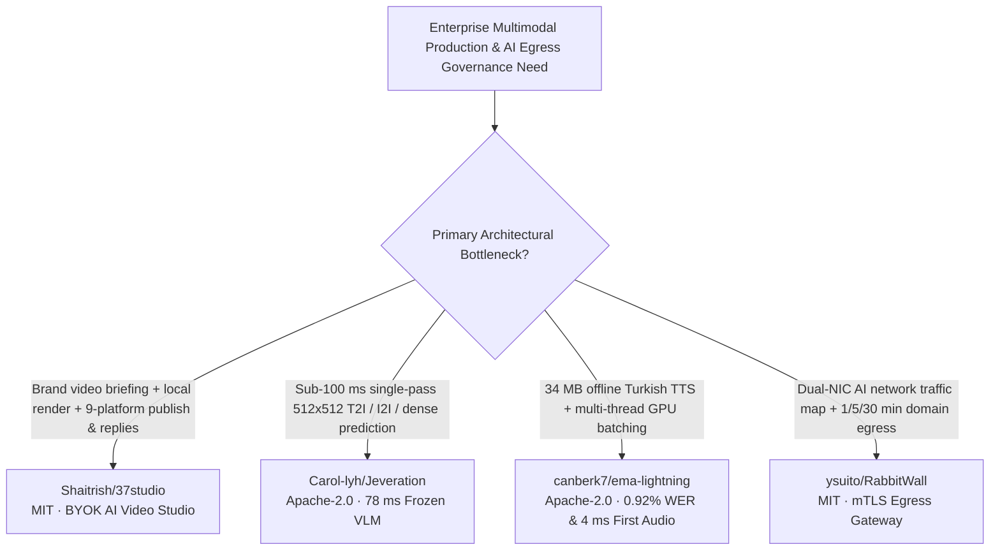
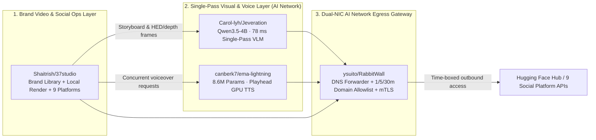
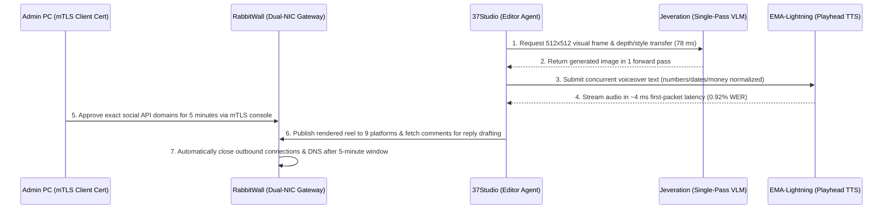

# AI Video Studio, Single-Pass VLM Generation, Ultra-Light Offline TTS & AI Network Egress Gateway Selection Guide: 37Studio vs Jeveration vs EMA-Lightning vs RabbitWall

> **2026-11-23 Night Round 33 (🏆 Cumulative Round 820 Milestone!)** · Enterprise AI Solution Architect Practical Selection, End-to-End Integration Architecture & FinOps TCO Guide
> **Companion Architecture Diagram**: [`assets/github-ai-radar-2026-11-23-r33-r820-37studio-jeveration-emalightning-rabbitwall.svg`](../../../assets/github-ai-radar-2026-11-23-r33-r820-37studio-jeveration-emalightning-rabbitwall.svg)

---

## 1. 📌 Executive Summary

Across multimodal marketing video production and omnichannel social publishing, low-latency single-pass visual generation and dense prediction, high-concurrency offline speech synthesis, and dual-NIC AI network egress control, **`Shaitrish/37studio`**, **`Carol-lyh/Jeveration`**, **`canberk7/ema-lightning`**, and **`ysuito/RabbitWall`** form a complete enterprise closed loop:

1. **AI Video Studio, Local Rendering, 9-Platform Publishing & Comment Replies**: Choose **`Shaitrish/37studio`** (`★ 170`, `25 forks`, Go, `MIT`). It unifies an AI video editor agent, local machine rendering, direct publishing to 9 social platforms, and automated comment reply drafting in one open-source BYOK application (replacing Opus Clip, Buffer, and Claude Motion).
2. **78 ms Single-Forward-Pass VLM Image Generation & Dense Prediction**: Choose **`Carol-lyh/Jeveration`** (`★ 146`, `12 forks`, Python, `Apache-2.0`). Built on a frozen vision-language model (`Qwen3.5-4B` backbone + `TA-TiTok` tokenizer + CLIP text tower), it returns a complete `512x512` image in a single forward pass (`78 ms` on one NVIDIA H200) and handles text-to-image, image-to-image (`hed`, `depth`, `colorize`, `anime`, `ghibli`, `watercolor`), and dense prediction (`segmentation`, `depth`, `surface normals`) from one checkpoint.
3. **8.6M-Parameter Ultra-Fast Offline Turkish TTS with Built-In GPU Batching**: Choose **`canberk7/ema-lightning`** (`★ 308`, `35 forks`, Python, `Apache-2.0`). At only `~34 MB` (`8.6M` parameters), it achieves a state-of-the-art `0.92%` word error rate on `Freya-TR-Eval` (`495` sentences), `~4 ms` first-audio latency, and `440x` real-time speed (`1,316x` batched on RTX 4090 at `~$0.0085/1M chars`) with its built-in thread-safe `Playhead` GPU scheduler and CPU-only support.
4. **Dual-NIC Linux AI Network Egress Gateway & Time-Boxed Domain Console**: Choose **`ysuito/RabbitWall`** (`★ 68`, `11 forks`, Python, `MIT`). Placed between the corporate LAN and the AI/GPU network, it visualizes connection sessions on a world map, alerts on newly observed domains, cuts off established Internet connections and DNS instantly, and grants temporary exact-domain approvals for `1`, `5`, or `30` minutes per AI node under source-IP and Caddy mTLS client-certificate protection.
5. **FinOps Quantitative Takeaway**: Migrating from commercial video clipping/publishing SaaS, multi-step diffusion APIs, cloud TTS APIs, and managed firewall appliances (Path A: `$9,480.00/mo`) to this self-hosted open-source stack (Path C: `$305.00/mo`) saves **`$9,175.00/mo`** (**`-96.78%`**).

---

## 2. 🎯 Architect & Customer Key Q&A

### Q1: When should an enterprise buy managed cloud SaaS vs. deploying these four open-source projects?
- **Use managed cloud SaaS when**:
  - Marketing teams only produce occasional clips without local rendering or 9-platform automation (**Opus Clip / Buffer**);
  - Visual teams require ultra-high-resolution multi-step diffusion posters rather than sub-100 ms interactive generation (**Azure OpenAI GPT-Image / DALL·E**);
  - Global voice apps require 100+ languages without strict air-gapped residency (**Azure AI Speech**).
- **Deploy these four open-source projects when**:
  - **Zero-Subscription Brand Video Automation**: Use **`37studio`** so an editor agent builds reels/ads/explainers in your brand, renders locally, posts to 9 platforms, and drafts comment replies;
  - **Sub-100 ms Interactive Image Generation & Indoor 3D Perception**: Use **`Jeveration`** to generate `512x512` images, structure/style transfers, or indoor depth/normal maps in a single `78 ms` forward pass;
  - **Ultra-Low-Cost Offline Turkish Speech Synthesis**: Use **`ema-lightning`** to serve multi-threaded streaming TTS at `~4 ms` first-audio latency and `0.92%` WER on local GPUs or CPUs;
  - **Air-Gapped AI/GPU Network Egress Control**: Use **`RabbitWall`** as the default gateway and DNS server for GPU servers, keeping Internet access off by default and approving exact domains for `1 / 5 / 30` minutes when pulling weights or publishing outputs.

### Q2: How do these four components integrate into an end-to-end governed multimodal production architecture?
1. **Video Brief & Omnichannel Publishing Layer (`37studio`)**: Receives creative briefs, orchestrates brand assets, renders video locally, and queues 9-platform social publishing and reply drafts;
2. **Single-Pass Visual Asset & Depth Layer (`Jeveration`)**: Generates `512x512` storyboard frames, HED/depth-conditioned renders, and style transfers in `78 ms` per forward pass;
3. **High-Throughput Local Voiceover Layer (`ema-lightning`)**: Synthesizes voiceovers with automatic Turkish normalization (numbers, dates, times, money, units) via the built-in `Playhead` multi-caller scheduler;
4. **AI Network Egress Security Boundary (`RabbitWall`)**: Sits between the AI network and upstream LAN/Internet, monitoring newly observed domains and enforcing time-boxed (`1 / 5 / 30` min) per-node domain egress via an mTLS-protected console.

### Q3: What are the key operational boundaries and trade-offs?
- **`37studio`**: `MIT` licensed (Go); store 9-platform OAuth tokens in encrypted local secrets and enable human approval before auto-posting comment replies.
- **`Jeveration`**: `Apache-2.0` licensed; requires ~`6.5 GB` local checkpoint (`Qwen3.5-4B` + `TA-TiTok` + CLIP) and targets `512x512` resolution with NYUv2 indoor dense prediction.
- **`ema-lightning`**: `Apache-2.0` licensed; purpose-built for Turkish TTS (`Freya-TR-Eval` `0.92%` WER); on CPU hosts, install the CPU-only PyTorch wheel to avoid downloading `1.5 GB` of CUDA packages.
- **`RabbitWall`**: `MIT` licensed; requires a Linux gateway host with two wired NICs (Upstream NIC + AI-side NIC) and Caddy mTLS client certificates on the management PC.

---

## 3. 🧭 Visual Architecture & Decision Diagrams (Mermaid)

### 3.1 Selection Decision Tree

### 3.2 End-to-End Enterprise Reference Architecture

### 3.3 Runtime Execution Sequence

---

## 4. 📊 Comparative Selection Matrix

| Dimension | `Shaitrish/37studio` | `Carol-lyh/Jeveration` | `canberk7/ema-lightning` | `ysuito/RabbitWall` | Managed Cloud / SaaS Stack (Path A) |
| :--- | :--- | :--- | :--- | :--- | :--- |
| **Primary Role** | AI video editor agent, local renderer, 9-platform publisher & reply drafter | 78 ms single-forward-pass VLM for T2I, I2I & dense prediction | 8.6M-param (`~34 MB`) offline Turkish TTS with `Playhead` scheduler | Dual-NIC Linux AI network traffic console & egress switch | Opus Clip + Buffer + Diffusion/TTS APIs + Managed Firewall |
| **Core Technical Metric** | End-to-end brief → local render → 9 platforms → comment replies | `78 ms` per `512x512` image on 1x NVIDIA H200 (`6.5 GB` weights) | `0.92%` WER on Freya-TR-Eval, `~4 ms` first audio, `440x–1,316x` RT | `1 / 5 / 30` min per-node exact domain approvals + mTLS | Multi-SaaS seats + per-image/per-character API billing |
| **Data Sovereignty** | Local rendering + BYOK keys, zero monthly fee | 100% local VLM inference | 100% offline GPU/CPU execution | Instant cutoff of established connections & DNS | Media assets and prompts uploaded to external clouds |
| **License** | `MIT` | `Apache-2.0` | `Apache-2.0` | `MIT` | Proprietary SaaS / Per-Usage API |
| **Monthly TCO** | **Combined `$305.00/mo`** (`$65.00` compute/gateway + `$240.00` ops labor) | Included in combined stack | Included in combined stack | Included in combined stack | **`$9,480.00/mo`** (`$4,980.00` SaaS/API + `$4,500.00` labor) |

---

## 5. 🧪 Quantitative FinOps TCO Comparison (Closed-Form Audit)

> **Audit Note**: Modeled for an enterprise producing and publishing 600 brand videos/month across 9 platforms, generating 300,000 `512x512` single-pass storyboard/control frames, synthesizing 20M characters of voiceover audio, and governing 4 AI/GPU subnets. Repository metadata is verified via the GitHub REST API; live runtime p99 latency is marked `not_measured`.

| Cost Component | Path A: Commercial Video/Social SaaS + Cloud Image/TTS APIs + Managed Firewall | Path C: Self-Hosted `37studio` + `Jeveration` + `ema-lightning` + `RabbitWall` | Net Savings / Delta |
| :--- | :--- | :--- | :--- |
| **API / SaaS Subscriptions & Compute** | `$4,980.00 / mo` | `$65.00 / mo` | `-$4,915.00 / mo` |
| **Publishing Ops, Voice QA & Firewall Rule Labor** | `$4,500.00 / mo` (`45.0 hrs × $100/hr`) | `$240.00 / mo` (`2.4 hrs × $100/hr`) | `-$4,260.00 / mo` |
| **Total Monthly TCO** | **`$9,480.00 / mo`** | **`$305.00 / mo`** | **`$9,175.00 / mo` (`-96.78%`)** |

---

## 6. 🛠️ Enterprise Architecture Review Checklist

- [ ] **Brand Library & Social Token Governance (`37studio`)**: Load brand templates into `37studio`, verify local video rendering, and scope 9-platform publishing tokens with human review gates for drafted comment replies.
- [ ] **Single-Pass VLM Checkpoint Validation (`Jeveration`)**: Download the `6.5 GB` `linlinlinlinsdada/Jeveration` weights and benchmark single-pass (`78 ms` class) `512x512` text-to-image, `hed`/`depth`/`watercolor` image-to-image, and NYUv2 dense prediction.
- [ ] **Offline TTS Concurrency & CPU/GPU Packaging (`ema-lightning`)**: Validate multi-caller GPU batching via the built-in `Playhead` scheduler (or use the CPU-only PyTorch index on CPU nodes to save `1.5 GB` of NVIDIA packages).
- [ ] **Dual-NIC Egress & mTLS Console Hardening (`RabbitWall`)**: Point AI/GPU host default gateway and DNS to `RabbitWall`'s AI-side NIC, enforce source-IP filtering + Caddy client-certificate mTLS on the management PC, and test `1 / 5 / 30` minute domain approvals.
