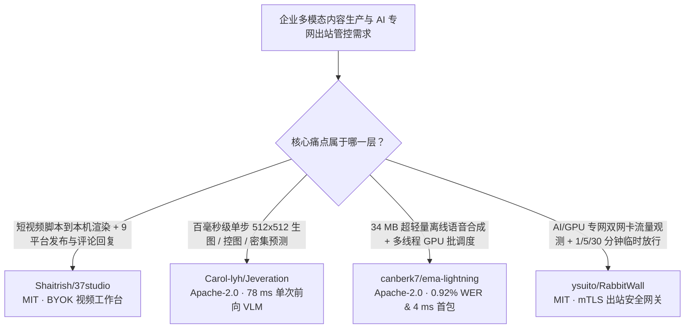
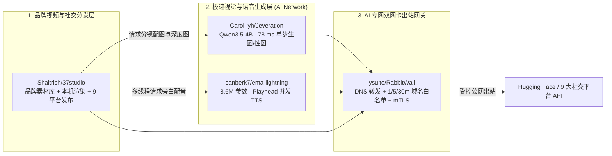
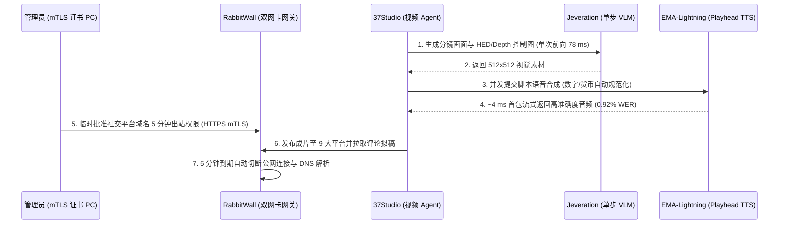

# AI 视频工作台、单步 VLM 生成、超轻量离线 TTS 与 AI 网络出站网关选型指南：37Studio vs Jeveration vs EMA-Lightning vs RabbitWall

> **2026-11-23 Night Round 33（🏆 Cumulative Round 820 里程碑！）** · 面向企业 AI 解决方案架构师（AI Solution Architect）的实战选型、端到端集成架构与 FinOps TCO 决策指南
> **关联架构图**：[`assets/github-ai-radar-2026-11-23-r33-r820-37studio-jeveration-emalightning-rabbitwall.svg`](../../../assets/github-ai-radar-2026-11-23-r33-r820-37studio-jeveration-emalightning-rabbitwall.svg)

---

## 1. 📌 核心结论速览（Executive Summary）

在企业多模态营销视频生产与全渠道分发、低延迟单步视觉生成与密集预测、高并发低成本离线语音合成，以及 GPU/AI 专网出站流量精准管控四大场景中，**`Shaitrish/37studio`**、**`Carol-lyh/Jeveration`**、**`canberk7/ema-lightning`** 与 **`ysuito/RabbitWall`** 构成了从“全链路多模态内容生产 → 78 ms 单次前向图像生成 → 8.6M 参数极速离线 TTS → 双网卡 AI 节点出站安全闸门”的完整闭环：

1. **品牌短视频生产、9 平台自动发布与评论回复（AI Video Studio & Social Ops）**：优先选择 **`Shaitrish/37studio`**（`★ 170`，`25 forks`，Go，`MIT`）。它将品牌短视频剪辑 Agent、本机渲染、9 大社交平台一键发布与评论自动拟稿整合进单一开源应用（支持 BYOK 自带密钥，替代 Opus Clip + Buffer + Claude Motion）。
2. **78 ms 单步前向 VLM 图像生成与密集视觉预测（Single-Pass VLM Generation & Dense Prediction）**：优先选择 **`Carol-lyh/Jeveration`**（`★ 146`，`12 forks`，Python，`Apache-2.0`）。基于冻结视觉语言模型（`Qwen3.5-4B` + `TA-TiTok` + `CLIP`），仅需单次前向传播（单张 NVIDIA H200 上 `78 ms`）即可输出 `512x512` 图像，并以同一权重统一支持文生图、图生图（边缘/深度/上色/风格迁移）与密集预测（语义分割/深度/表面法线）。
3. **8.6M 参数超轻量高准确度离线语音合成（Tiny Offline Turkish TTS with Playhead Scheduler）**：优先选择 **`canberk7/ema-lightning`**（`★ 308`，`35 forks`，Python，`Apache-2.0`）。模型体积仅 `~34 MB`（`8.6M` 参数），在 `Freya-TR-Eval`（495 句）上取得 `0.92%` 词错率（优于 ElevenLabs v4 与 2.38B 模型），首包音频延迟 `~4 ms`、单请求 `440x` 实时速率（RTX 4090 批处理达 `1,316x`），内置 `Playhead` 多线程 GPU 调度器并支持纯 CPU 部署。
4. **双网卡 Linux AI 专网出站网关与临时域名放行控制台（Dual-NIC AI Network Egress Gateway）**：优先选择 **`ysuito/RabbitWall`**（`★ 68`，`11 forks`，Python，`MIT`）。部署在现有局域网与 AI/GPU 专网之间，提供全球连接地图、新观测域名告警、一键切断已建立连接与 DNS，以及按 AI 节点精确授权 `1 / 5 / 30` 分钟临时域名放行，并通过源 IP 过滤与 Caddy 客户端证书（mTLS）加固管理面。
5. **FinOps 定量结论**：将商业短视频剪辑/社交分发 SaaS、多步扩散模型 API、云端商业 TTS 与托管企业防火墙（Path A：`$9,480.00/月`）迁移至上述四大开源组件自建组合（Path C：`$305.00/月`），每月净省 **`$9,175.00`**（降幅 **`-96.78%`**）。

---

## 2. 🎯 客户与架构师灵魂拷问 Q&A（Pain Points & Architecture Decisions）

### Q1：在多模态内容生产与 AI 专网管控中，何时直接采购云托管 SaaS/PaaS，何时引入这 4 款开源工具？
- **直接采用云厂商托管方案的场景**：
  - 营销团队只有少量视频剪辑需求、无需本地渲染或跨 9 平台自动化工作流，可直接使用 **Opus Clip / Buffer**；
  - 图像生成追求超高分辨率海报精修而非百毫秒级实时交互生成，可直接调用 **Azure OpenAI GPT-Image / DALL·E**；
  - 多语种通用语音播报且无离线数据主权限制，可直接使用 **Azure AI Speech**。
- **优先自建本轮 4 大开源组件的场景**：
  - **零月租品牌视频流水线**：用 **`37studio`** 让 AI Agent 读取企业品牌素材库、本机渲染短视频、同步发布至 9 个平台并生成评论回复草稿；
  - **百毫秒级实时视觉生成与室内三维感知**：用 **`Jeveration`** 以单次前向传播（`78 ms`）完成实时文生图、线稿/深度控图及室内深度/法线预测；
  - **高并发极低成本土耳其语离线语音合成**：用 **`ema-lightning`** 在单卡或纯 CPU 上以 `~4 ms` 首包延迟和 `$0.0085 / 百万字符` 成本承载海量客服与播报请求；
  - **GPU 训练/推理集群防数据外泄（Egress 闸门）**：用 **`RabbitWall`** 默认阻断 AI 节点公网连接，仅在拉取模型权重或包依赖时按节点开启 `1 / 5 / 30` 分钟精确域名白名单。

### Q2：如何将这四套组件串联为“安全受控的多模态内容生成与全渠道发布架构”？
1. **视频编排与发布层（`37studio`）**：运营人员或上游 Agent 提交视频 Brief，`37studio` 调用品牌资产库在本机合成视频并准备 9 平台发布任务；
2. **实时视觉素材与深度感知层（`Jeveration`）**：为视频分镜实时生成 `512x512` 视觉画面、风格化转换（`anime` / `ghibli` / `watercolor`）或深度图；
3. **高吞吐本地语音轨生成层（`ema-lightning`）**：通过内置 `Playhead` GPU 调度器并发合成旁白配音（自动规范化数字、日期、金额与单位）；
4. **AI 专网出站安全边界层（`RabbitWall`）**：作为 AI/GPU 节点的默认网关与 DNS 服务器，平时关闭公网访问，仅在发布或下载权重时通过 mTLS 控制台按域名临时放行。

### Q3：这四个项目的核心技术边界与落地注意事项是什么？
- **`37studio`**：采用 `MIT` 协议（Go 编写），支持 Windows/Linux/macOS 与服务端运行；多平台自动发布需妥善保管各社交平台 OAuth 凭据。
- **`Jeveration`**：采用 `Apache-2.0` 协议，推理权重约 `6.5 GB`（依托 `Qwen3.5-4B` 与 `TA-TiTok`），默认输出分辨率为 `512x512`，密集预测针对室内场景（NYUv2）训练。
- **`ema-lightning`**：采用 `Apache-2.0` 协议，专注土耳其语（Turkish）TTS，在无 GPU 机器上建议使用 `--extra-index-url https://download.pytorch.org/whl/cpu` 避免拉取 1.5 GB CUDA 依赖。
- **`RabbitWall`**：采用 `MIT` 协议，部署主机需具备双有线网卡（Upstream NIC 接管理网/路由器，AI-side NIC 接 AI/GPU 专网），管理 PC 必须配置客户端证书（mTLS）。

---

## 3. 🧭 直观可视化图解（Mermaid 决策树 + 集成架构 + 时序流）

### 3.1 技术选型决策树

### 3.2 企业端到端集成参考架构图

### 3.3 业务执行时序图

---

## 4. 📊 同类开源与商业云服务横向选型决策矩阵

| 对比维度 | `Shaitrish/37studio` | `Carol-lyh/Jeveration` | `canberk7/ema-lightning` | `ysuito/RabbitWall` | 商业 SaaS / 云托管组合 (Path A) |
| :--- | :--- | :--- | :--- | :--- | :--- |
| **核心功能定位** | AI 短视频制作、本机渲染、9 平台发布与评论拟稿 | 78 ms 单次前向 VLM 文生图/图生图/密集预测 | 8.6M 参数（34 MB）离线土耳其语极速 TTS | 双网卡 Linux AI 专网流量地图与临时出站网关 | Opus Clip + Buffer + 商业生图/TTS API + 云防火墙 |
| **关键性能/架构指标** | 单一应用覆盖剪辑→渲染→9 平台发布→回复 | 单卡 H200 `78 ms` 生成 `512x512` 图像 | `0.92%` WER、`~4 ms` 首包、`440x–1,316x` 实时速率 | `1 / 5 / 30` 分钟按节点精确域名放行 + mTLS | 强依赖多套 SaaS 订阅与公网 API 调用 |
| **数据主权与安全性** | BYOK 自带密钥 + 本机渲染无月租 | `6.5 GB` 权重本地推理，零公网外发 | 100% 离线 GPU/CPU 运行，音频/文本不出机 | 一键切断已建立连接与 DNS，单 JSON 极简配置 | 媒体素材与提示词需上传至多方云端 |
| **开源协议** | `MIT` | `Apache-2.0` | `Apache-2.0` | `MIT` | 闭源商业订阅 / 按量计费 |
| **月度 TCO（中大型团队）** | **组合总计 `$305.00/月`**（含 `$65.00` 算力/网关主机 + `$240.00` 运维人工） | 同左 | 同左 | 同左 | **`$9,480.00/月`**（`$4,980.00` SaaS/API + `$4,500.00` 人工） |

---

## 5. 🧪 应用落地定量收益 / FinOps TCO 对比（Closed-Form Audit）

> **审计声明**：以下 FinOps 模型基于企业每月生产并跨 9 平台分发 600 条品牌短视频、生成 30 万张 `512x512` 实时分镜与控图、合成 2,000 万字符语音旁白及管控 4 个 AI/GPU 专网子网的标准负载核算；所有仓库元数据均通过 GitHub REST API 实测验证，运行时线上 p99 延迟标记为 `not_measured`。

| 成本项 | Path A：商业视频/社交 SaaS + 商业生图/TTS API + 托管防火墙 | Path C：`37studio` + `Jeveration` + `ema-lightning` + `RabbitWall` 自建 | 净节省 / 变化幅度 |
| :--- | :--- | :--- | :--- |
| **API / SaaS 订阅与算力成本** | `$4,980.00 / mo` | `$65.00 / mo` | `-$4,915.00 / mo` |
| **跨平台搬运、配音校对与网络策略工时** | `$4,500.00 / mo`（`45.0 hrs × $100/hr`） | `$240.00 / mo`（`2.4 hrs × $100/hr`） | `-$4,260.00 / mo` |
| **月度总拥有成本（Total Monthly TCO）** | **`$9,480.00 / mo`** | **`$305.00 / mo`** | **`$9,175.00 / mo`（`-96.78%`）** |

---

## 6. 🛠️ 企业引入与架构评审 Checklist

- [ ] **品牌视频工作流验证（`37studio`）**：导入企业视觉与字体规范至 `37studio` 品牌库，验证本地视频渲染以及目标社交平台的最小权限发布令牌与人工审核开关。
- [ ] **单步 VLM 权重与任务验证（`Jeveration`）**：通过 `hf download linlinlinlinsdada/Jeveration --local-dir weights` 缓存 `6.5 GB` 权重，分别测试文生图、`--task hed/depth/watercolor` 图生图及室内密集预测精度。
- [ ] **离线 TTS 并发与 CPU/GPU 选型（`ema-lightning`）**：在 GPU 节点压测 `Playhead` 多线程并发吞吐，或在无 GPU 节点使用 PyTorch CPU 源安装以节省 `1.5 GB` CUDA 镜像体积。
- [ ] **AI 专网双网卡与 mTLS 准入（`RabbitWall`）**：将 AI/GPU 主机的默认网关与 DNS 指向 `RabbitWall` 的 AI-side NIC，启用 Caddy 客户端证书（mTLS）与源 IP 白名单，并演练 `1 / 5 / 30` 分钟临时域名审批与紧急断网开关。
