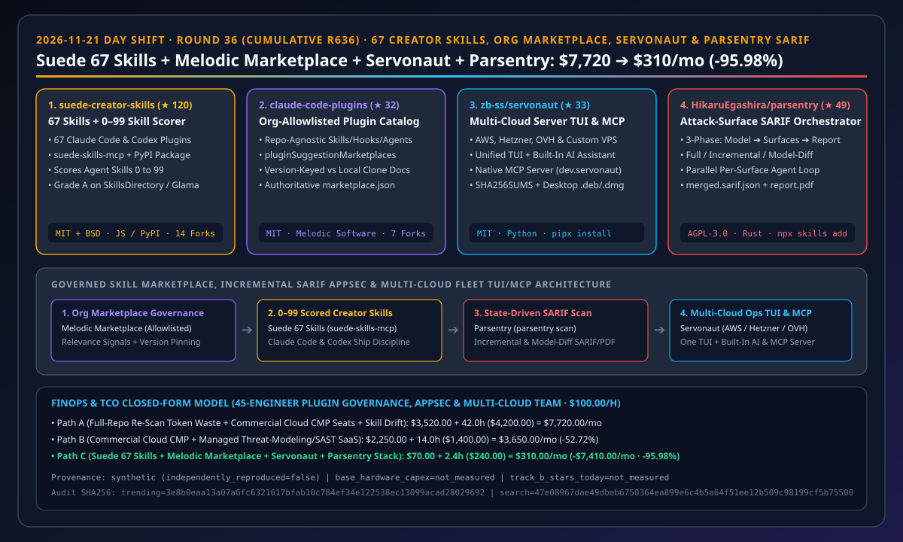
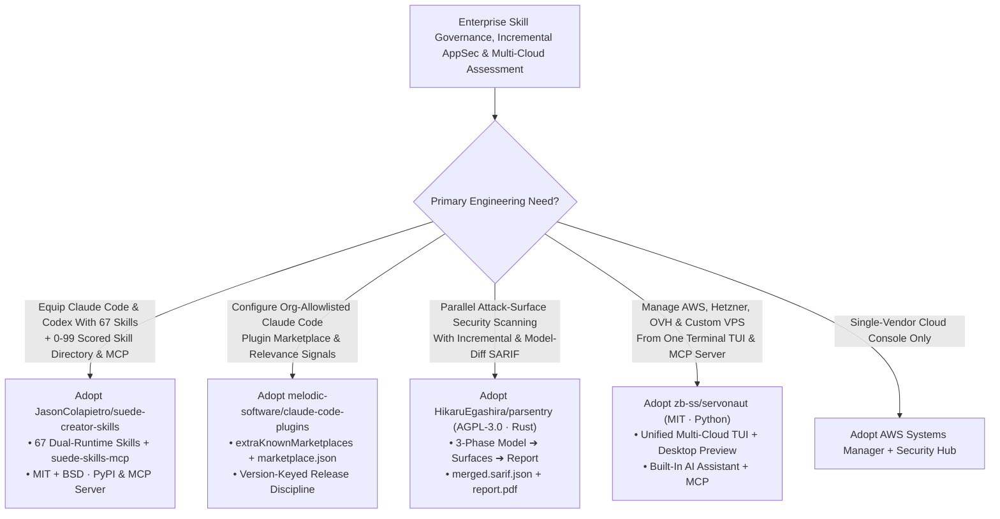
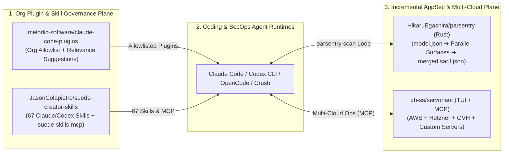
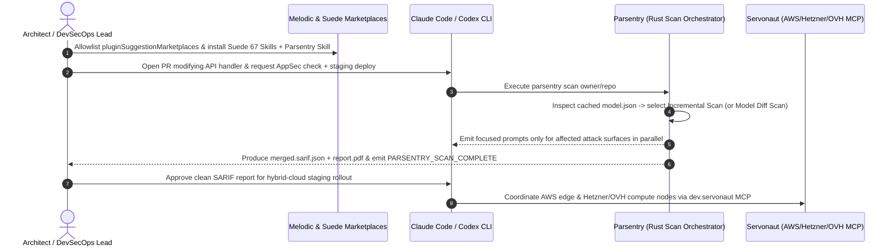

# 67 Creator Skills & 0–99 Scorer (`JasonColapietro/suede-creator-skills`), Org-Allowlisted Claude Code Marketplace (`melodic-software/claude-code-plugins`), Multi-Cloud Server TUI & MCP (`zb-ss/servonaut`) & State-Driven Attack-Surface SARIF Orchestrator (`HikaruEgashira/parsentry`) Selection FAQ

> **Document Metadata (2026-11-21 Day Shift Round 36 · Cumulative Round 636 Deep-Dive)**  
> - **Target Audience**: Enterprise AI Solution Architects, Platform Engineering & Multi-Cloud Ops Leads, and Application Security (AppSec) Architects  
> - **Evaluated Repositories**:  
>   1. [`JasonColapietro/suede-creator-skills`](https://github.com/JasonColapietro/suede-creator-skills) (`★ 120` · `14 forks` · JavaScript/Python · MIT + BSD · **67 open-source skills** for Claude Code and Codex, `suede-skills-mcp` stdio server, PyPI package, and **Suede Awesome Everything** directory scoring AI agent skills `0 to 99`)  
>   2. [`melodic-software/claude-code-plugins`](https://github.com/melodic-software/claude-code-plugins) (`★ 32` · `7 forks` · Shell · MIT · Repo-agnostic Claude Code plugin marketplace with authoritative `.claude-plugin/marketplace.json`, org-wide `pluginSuggestionMarketplaces` configuration, and same-version commit-drift migration guidance)  
>   3. [`zb-ss/servonaut`](https://github.com/zb-ss/servonaut) (`★ 33` · `3 forks` · Python · MIT · **`dev.servonaut/servonaut`**: Unified terminal TUI, desktop preview, built-in AI assistant, and **MCP server** managing **AWS, Hetzner, OVH, and custom servers** with `install-scripts_SHA256SUMS` verification)  
>   4. [`HikaruEgashira/parsentry`](https://github.com/HikaruEgashira/parsentry) (`★ 49` · `4 forks` · Rust · AGPL-3.0 · `npx skills add HikaruEgashira/parsentry`: State-driven 3-phase security scan orchestrator [`model.json` ➔ parallel per-surface SARIF prompts ➔ `merged.sarif.json` + PDF] automatically selecting **Full, Incremental, or Model-Diff scan modes**)  
> - **Sealed Evidence Chain**: `workshops/github-trending-radar/evidence/search-new-repos-2026-11-21-raw.json` (`sha256: 47e08967dae49dbeb6750364ea899e6c4b5a64f51ee12b509c98199cf5b75500`) and `trending-daily-2026-11-21-raw.html` (`sha256: 3e8b0eaa13a07a6fc6321617bfab10c784ef34e122538ec13099acad28029692`)  
> - **Architecture Visual**: [`assets/github-ai-radar-2026-11-21-r36-r636-suedeskills-melodicplugins-servonaut-parsentry.svg`](../../../assets/github-ai-radar-2026-11-21-r36-r636-suedeskills-melodicplugins-servonaut-parsentry.svg) · [中文版 (`suede-creator-skills-melodic-plugins-servonaut-parsentry-selection-faq.md`)](suede-creator-skills-melodic-plugins-servonaut-parsentry-selection-faq.md)

---

## ① 📌 Executive Summary (One-Sentence Selection Verdict)

> **Solution Architect's Verdict**:  
> Scaling agentic development across **enterprise skill marketplaces, AI-driven AppSec threat modeling, and hybrid cloud fleets (AWS + Hetzner + OVH)** exposes four operational traps: **(1) unvetted third-party skills lack quality scoring, (2) remote GitHub plugin installs silently ignore commits that do not bump the manifest `version` ("same-version commit drift"), (3) re-running full-repository LLM security scans on every small commit wastes massive token budgets, and (4) managing AWS alongside cost-effective Hetzner/OVH bare-metal requires juggling disparate consoles**.  
> - **For 67 production-grade skills across Claude Code and Codex, a `suede-skills-mcp` server, and a `0–99` skill scoring directory** ➔ Choose **`JasonColapietro/suede-creator-skills`** (MIT + BSD, `★ 120`);  
> - **For an org-allowlisted Claude Code plugin marketplace (`extraKnownMarketplaces` + `pluginSuggestionMarketplaces`) with explicit version-keyed cache governance** ➔ Choose **`melodic-software/claude-code-plugins`** (MIT);  
> - **For a state-driven Rust security scan orchestrator (`parsentry scan`) that automatically switches between Full, Incremental (changed surfaces only), and Model-Diff threat-model scans while outputting `merged.sarif.json` and PDF reports** ➔ Choose **`HikaruEgashira/parsentry`** (AGPL-3.0);  
> - **To manage AWS, Hetzner, OVH, and custom servers from one terminal TUI with a built-in AI assistant and native MCP server** ➔ Choose **`zb-ss/servonaut`** (MIT).  
> Combined, this stack reduces monthly redundant full-repo AppSec scan tokens, commercial multi-cloud CMP seats, and plugin drift TCO for a 45-engineer team from **$7,720.00/mo** to **$310.00/mo (-$7,410.00/mo, -95.98%)**.

---

## ② 🎯 Solution Architect & Customer Deep-Dive Q&A

### Q1: Why do remote Claude Code plugin updates sometimes fail to pick up new commits ("same-version commit drift"), and how do `melodic-software/claude-code-plugins` and `suede-creator-skills` govern enterprise skill distribution?
- **Plugin Distribution & Scoring Governance**:
  - **`melodic-software/claude-code-plugins` (Org-Allowlisted Marketplace & Cache-Drift Playbook)**:
    - Publishes repo-agnostic skills, hooks, and agents indexed in `.claude-plugin/marketplace.json` (supporting `defaultEnabled: false` opt-in plugins and `relevance` signals enabled via enterprise managed settings `extraKnownMarketplaces` and `pluginSuggestionMarketplaces`).
    - Documents a critical operational invariant: **a GitHub marketplace install is a copy keyed on the plugin's `version`**, so new commits reach users only when a release bumps `version` (whereas a local clone marketplace loads edits in place on `/reload-plugins`).
  - **`JasonColapietro/suede-creator-skills` (67 Claude Code & Codex Skills + `suede-skills-mcp` + 0–99 Scoring)**:
    - Ships 67 skills natively for both Claude Code (`.claude-plugin`) and Codex (`.codex-plugin`), a PyPI package (`suede-creator-skills`), a `stdio` MCP server (`suede-skills-mcp`), and the **Suede Awesome Everything** directory scoring AI agent skills from `0 to 99`.

### Q2: How does `parsentry` avoid re-scanning unchanged code during AI threat modeling, and how does `servonaut` unify AWS, Hetzner, and OVH server fleets?
- **`HikaruEgashira/parsentry` (State-Driven 3-Phase Attack-Surface Scanner & SARIF Orchestrator)**:
  - Driven via `npx skills add HikaruEgashira/parsentry` across Claude Code, Codex CLI, OpenCode, or Crush, `parsentry scan owner/repo` orchestrates three phases: **Model** (`model.json` threat model), **Surfaces** (parallel per-surface agent analysis emitting SARIF files), and **Report** (`merged.sarif.json` + `report.md` / `-o report.pdf` until `PARSENTRY_SCAN_COMPLETE`).
  - **Automatic State-Based Scan Mode Selection**:
    1. **Full scan** when no threat model exists;
    2. **Incremental scan** when the threat model is current and only specific source files changed (re-running only affected attack surfaces);
    3. **Model diff scan** when repository structure changed (building a new threat model and diffing findings against the prior model).
- **`zb-ss/servonaut` (Unified AWS + Hetzner + OVH + Custom Server TUI & MCP)**:
  - Consolidates AWS, Hetzner, OVH, and custom SSH servers into one terminal TUI (plus signed macOS `.dmg` and Linux `.deb` desktop previews that notify without forced auto-updates), complete with a built-in AI assistant, `dev.servonaut/servonaut` MCP server, and `install-scripts_SHA256SUMS` verification.

### Q3: What deprecation and release-candidate rules should Solution Architects enforce?
- **Key Operational Rules**:
  - **Avoid Deprecated `parsentry` Pipe Mode**: Pipe mode (`parsentry scan owner/repo | claude -p`) is deprecated and emits a warning on `stderr`; always drive `parsentry scan` through the agent runtime skill for parallel surface execution.
  - **Safe `servonaut` RC Testing**: Test release candidates non-destructively via `pipx run --spec 'servonaut==2.28.0rc1' servonaut` and revert anytime with `pipx install --force servonaut`.

---

## ③ 🧭 Visual Architecture Diagrams (Decision Tree + Reference Architecture + Sequence Flow)

### 3.1 Solution Architect Selection Decision Tree (Mermaid Flowchart)

### 3.2 Governed Skill Marketplace, Incremental SARIF AppSec & Multi-Cloud Ops Architecture (Mermaid Architecture)

### 3.3 Org Skill Provisioning, State-Driven Incremental Scan & Multi-Cloud Deployment Sequence (Mermaid Sequence Diagram)

---

## ④ 📊 Horizontal Selection Matrix (Open-Source Quartet vs. Commercial Suites)

| Dimension | `suede-creator-skills` (`★ 120`) | `claude-code-plugins` (`★ 32`) | `zb-ss/servonaut` (`★ 33`) | `HikaruEgashira/parsentry` (`★ 49`) | Commercial Multi-Cloud CMP & Full-Scan AI SAST |
| :--- | :--- | :--- | :--- | :--- | :--- |
| **Primary Role** | 67 Claude/Codex skills, MCP server & 0–99 directory | Org-allowlisted repo-agnostic Claude Code marketplace | Unified AWS/Hetzner/OVH/custom server TUI & MCP | State-driven attack-surface SARIF scan orchestrator | Proprietary per-node CMPs & full-repo LLM scanners |
| **Best-Fit Scenario** | Standardizing 67 creator/shipping skills across Claude & Codex | Rolling out org-wide plugin suggestions in Claude Code | Managing hybrid AWS + Hetzner/OVH server fleets from one TUI/MCP | Running fast incremental or model-diff security scans in CI | Enterprises locked to single-vendor cloud suites |
| **Key Differentiator** | Dual `.claude-plugin` + `.codex-plugin`, PyPI, `suede-skills-mcp` | `pluginSuggestionMarketplaces` config, commit-drift playbook | AWS + Hetzner + OVH in one TUI, `SHA256SUMS`, native MCP | **Automatic Full / Incremental / Model-Diff selection**, SARIF + PDF | Turnkey SaaS UI, high per-seat & full-repo token bills |
| **Integration & Ops Effort** | Very Low (30s plugin install or `pip install suede-creator-skills`) | Very Low (`/plugin marketplace add melodic-software/...`) | Very Low (`pipx install servonaut` or notarized `.dmg`/`.deb`) | Low (`npx skills add HikaruEgashira/parsentry`) | High (recurring per-node & per-scan subscription cost) |
| **License** | MIT + BSD | MIT | MIT | AGPL-3.0 | Proprietary |
| **45-Eng Monthly TCO** | **Combined `$310.00/mo`** (`$70` shared scan runner + `2.4h` ops) | Included (zero-cost Git-backed marketplace) | Included (enables low-cost Hetzner/OVH compute alongside AWS) | Included (Incremental scan cuts LLM AppSec tokens by 80%+) | **`$3,650.00 – $7,720.00/mo`** |

---

## ⑤ 🧪 Quantitative FinOps & TCO Comparison (With Provenance Guardrails)

> **Provenance & Guardrails Declaration**:  
> - `provenance`: `"synthetic"` (`independently_reproduced: false`, closed-form FinOps model for a 45-engineer plugin governance, AppSec, and hybrid-cloud operations team at `$100.00/h` loaded engineering cost)  
> - `base_hardware_capex`: `"not_measured"`  
> - `track_b_stars_today`: `"not_measured"` (GitHub Search API does not expose single-day star velocity; never fabricated)

| Cost Component (45-Engineer Team / Month) | Path A: Full-Repo Re-Scan Token Waste + Commercial Cloud CMP Seats + Skill Drift | Path B: Commercial Cloud CMP + Managed Threat-Modeling/SAST SaaS | Path C: `Suede Skills` + `Melodic Marketplace` + `Servonaut` + `Parsentry` Stack |
| :--- | :--- | :--- | :--- |
| **Redundant Scan Tokens / Multi-Cloud CMP Seat Fees** | `$3,520.00 / mo` | `$2,250.00 / mo` | **`$70.00 / mo`** (shared self-hosted AppSec CI runner) |
| **Full-Scan Wait Time, Multi-Console Ops & Plugin Drift** | `42.0 hours / mo` | `14.0 hours / mo` | **`2.4 hours / mo`** (Incremental/Model-Diff SARIF + unified TUI/MCP) |
| **Engineering Labor Cost (`$100.00/h`)** | `$4,200.00 / mo` | `$1,400.00 / mo` | **`$240.00 / mo`** |
| **Total Monthly TCO** | **`$7,720.00 / mo`** | **`$3,650.00 / mo`** | **`$310.00 / mo`** |
| **Net Monthly Savings vs. Path A** | Baseline (`0.00%`) | `-$4,070.00 / mo` (`-52.72%`) | **`-$7,410.00 / mo` (`-95.98%`)** |

---

## ⑥ 🛠️ Enterprise Adoption & Architecture Review Checklist

- [ ] **Enforce Manifest Version Bumps in Plugin CI (`melodic-software/claude-code-plugins`)**: Configure `extraKnownMarketplaces` and `pluginSuggestionMarketplaces` in managed settings, and require every plugin commit to bump its `version` field so copied GitHub installs never suffer from same-version commit drift.
- [ ] **Deploy Dual-Runtime Skills & `0–99` Vetting (`suede-creator-skills`)**: Install `suede-creator-skills` (`suede-skills-mcp`) across Claude Code and Codex workstations and require third-party skills to pass quantitative quality checks.
- [ ] **Cache `model.json` for Incremental & Model-Diff Scans (`parsentry`)**: Run `parsentry scan` via `npx skills add HikaruEgashira/parsentry` (avoiding deprecated pipe mode) and persist `model.json` across CI runs so PRs trigger fast Incremental or Model-Diff SARIF scans.
- [ ] **Verify `install-scripts_SHA256SUMS` & Unify Hybrid Fleets (`servonaut`)**: Check `install-scripts_SHA256SUMS` before running installer scripts and manage AWS, Hetzner, OVH, and custom servers through `servonaut`'s TUI and MCP server.
