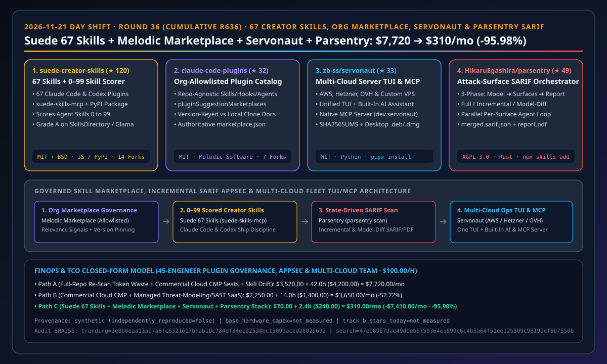
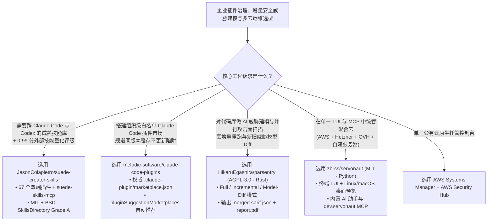
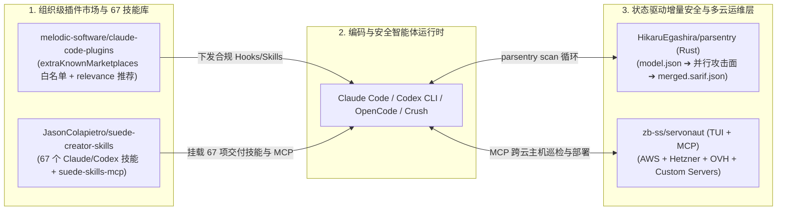
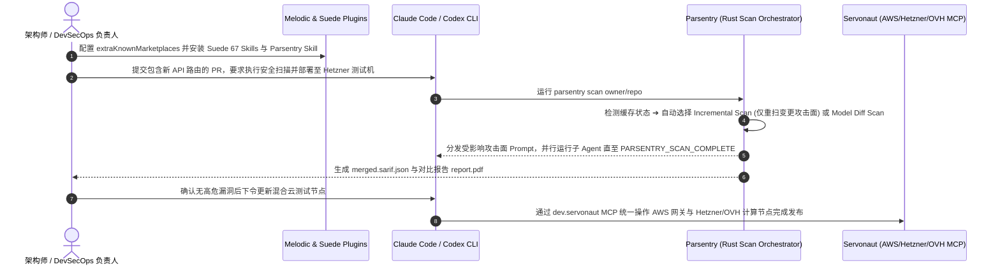

# 67 项双端技能与 0–99 评分目录（`JasonColapietro/suede-creator-skills`）、企业白名单 Claude Code 插件市场（`melodic-software/claude-code-plugins`）、多云主机统一 TUI/MCP 管控台（`zb-ss/servonaut`）与状态驱动增量攻击面 SARIF 编排器（`HikaruEgashira/parsentry`）选型 FAQ

> **文档元数据（2026-11-21 白班 Day Round 36 · 累计第 636 轮深潜专题）**  
> - **面向对象**：企业 AI 解决方案架构师（AI Solution Architect）、平台工程与多云运维负责人、应用安全（AppSec）架构师  
> - **本轮核心评估对象**：  
>   1. [`JasonColapietro/suede-creator-skills`](https://github.com/JasonColapietro/suede-creator-skills)（`★ 120` · `14 forks` · JavaScript/Python · MIT + BSD · 面向 Claude Code 与 Codex 的 **67 项开源技能插件**、`suede-skills-mcp` 服务端、PyPI 包以及对全网 AI 技能按 `0–99` 打分的 **Suede Awesome Everything** 目录）  
>   2. [`melodic-software/claude-code-plugins`](https://github.com/melodic-software/claude-code-plugins)（`★ 32` · `7 forks` · Shell · MIT · 仓库无关的企业级 Claude Code 插件市场，提供权威 `.claude-plugin/marketplace.json`、企业管理员 `extraKnownMarketplaces` 白名单推荐配置与“同版本提交漂移”迁移指南）  
>   3. [`zb-ss/servonaut`](https://github.com/zb-ss/servonaut)（`★ 33` · `3 forks` · Python · MIT · **`dev.servonaut/servonaut`**：在一个终端 TUI 或桌面预览版中统一管理 **AWS、Hetzner、OVH 与自建裸金属/VPS 服务器**，内置 AI 助手与原生 MCP Server）  
>   4. [`HikaruEgashira/parsentry`](https://github.com/HikaruEgashira/parsentry)（`★ 49` · `4 forks` · Rust · AGPL-3.0 · 面向 AI 智能体的**状态驱动三阶段安全扫描编排器** `parsentry scan`：自动识别全量扫描、**增量扫描（Incremental）**与**威胁模型对比扫描（Model diff）**，并行调度子智能体产出 `merged.sarif.json` 与 PDF 报告）  
> - **关联检索证据链**：`workshops/github-trending-radar/evidence/search-new-repos-2026-11-21-raw.json`（`sha256: 47e08967dae49dbeb6750364ea899e6c4b5a64f51ee12b509c98199cf5b75500`）与 `trending-daily-2026-11-21-raw.html`（`sha256: 3e8b0eaa13a07a6fc6321617bfab10c784ef34e122538ec13099acad28029692`）  
> - **高清架构图**：[`assets/github-ai-radar-2026-11-21-r36-r636-suedeskills-melodicplugins-servonaut-parsentry.svg`](../../../assets/github-ai-radar-2026-11-21-r36-r636-suedeskills-melodicplugins-servonaut-parsentry.svg) · [English Version (`suede-creator-skills-melodic-plugins-servonaut-parsentry-selection-faq.en.md`)](suede-creator-skills-melodic-plugins-servonaut-parsentry-selection-faq.en.md)

---

## ① 📌 核心结论速览（选型一句话结论）

> **架构师一句话选型结论**：  
> 当企业研发团队进入“**全员安装 Agent 技能插件、用 AI 扫描代码库安全漏洞、并跨 AWS 与高性价比欧洲云（Hetzner / OVH）混合部署**”阶段时，会遇到四大治理难题：**（1）野生 Agent Skill 质量参差不齐缺乏量化评分、（2）GitHub 远程安装的插件如果不升版本号就不会更新（同版本 Commit 漂移）且缺乏企业级白名单推荐、（3）每次只改了两个文件却要让 AI 全量重扫整个代码库烧掉大把 Token、（4）管 AWS EC2 和管 Hetzner/OVH 裸金属要切三套完全不同的后台**。  
> - **需要一次性获取 67 个跨 Claude Code 与 Codex 的高质量交付技能（含 `suede-skills-mcp` 与 `0–99` 分技能质量评估体系）** ➔ 选 **`JasonColapietro/suede-creator-skills`**（MIT + BSD）；  
> - **需要搭建企业内部可控的 Claude Code 插件市场（通过 `extraKnownMarketplaces` 与 `pluginSuggestionMarketplaces` 下发组织级自动推荐，并规避同版本缓存漂移陷阱）** ➔ 选 **`melodic-software/claude-code-plugins`**（MIT）；  
> - **需要让 Claude Code / Codex / OpenCode / Crush 按“威胁建模 ➔ 按攻击面并行分析 ➔ 合并 SARIF 与 PDF”三阶段执行安全扫描，且自动根据缓存状态只跑受影响攻击面的增量扫描（Incremental）或模型差分扫描（Model diff）** ➔ 选 **`HikaruEgashira/parsentry`**（AGPL-3.0，Rust）；  
> - **需要在一个终端 TUI（或签名的 `.dmg`/`.deb` 桌面端）里统一纳管 AWS、Hetzner、OVH 与自建服务器并通过内置 MCP 交给 AI 运维** ➔ 选 **`zb-ss/servonaut`**（MIT）。  
> 四者组合可将 45 人研发、安全与多云运维团队的全量重复安全扫描 Token 费、商业多云管理平台（CMP）席位与插件排障总成本从 **$7,720.00/月** 降至 **$310.00/月（节省 $7,410.00/月，降幅 95.98%）**。

---

## ② 🎯 客户与架构师灵魂拷问 Q&A（业务痛点 · 架构集成 · 边界取舍）

### Q1：为什么团队自己建了 Claude Code 插件仓库，改了代码 push 上去同事运行 `/plugin marketplace update` 却依然是旧版？企业又该如何给团队按场景智能推荐合规插件？`melodic-software/claude-code-plugins` 与 `suede-creator-skills` 给出了什么实战答案？
- **插件分发与质量治理的两大暗礁**：
  1. **“同版本提交漂移（Same-version commit drift）”陷阱**：`melodic-software/claude-code-plugins` 在 `docs/migration-playbook.md` 中一针见血地指出——从 GitHub 远程安装的插件是以插件 manifest 中的 **`version` 字段为缓存键拷贝到本地的**！如果维护者只推了新 Commit 而忘记递增 `version`，远端消费者怎么 update 都拿不到新代码（唯有从本地 Clone 挂载的市场才会原位实时生效）。
  2. **第三方野榜冒名与质量黑盒**：部分第三方聚合站会擅自给发布者挂上根本不存在的技能列表，且缺乏客观质量打分。
- **双剑合璧的插件治理方案**：
  - **`melodic-software/claude-code-plugins`（权威 `.claude-plugin/marketplace.json` + 组织级 `pluginSuggestionMarketplaces`）**：
    - 提供仓库无关（repo-agnostic）的可复用技能、Hooks 与 Agents（支持 `defaultEnabled: false` 默认禁用按需开启）；
    - 企业管理员只需在托管配置（Managed Settings）中写入 `extraKnownMarketplaces` 与 `pluginSuggestionMarketplaces`，即可利用插件声明的 `relevance` 信号，在工程师处理匹配任务时由 Claude Code 自动弹出合规插件建议。
  - **`JasonColapietro/suede-creator-skills`（67 个双端插件 + `suede-skills-mcp` + 0–99 分技能评级）**：
    - 同时提供 `.claude-plugin` 与 `.codex-plugin` 双端原生包、PyPI 包与 `stdio` MCP Server（获 SkillsDirectory Grade A 认证），内置 67 个覆盖设计、SEO、工程交付的实战技能，并配套 **Suede Awesome Everything（0–99 分量化评分体系）** 帮助架构师筛选外部技能。

### Q2：用大模型做代码库深度安全威胁建模（Threat Modeling）和漏洞扫描非常贵，改一行代码怎么避免全量重跑？而混合云（AWS + Hetzner + OVH）又如何收口到一个终端？`parsentry` 与 `servonaut` 怎么解决？
- **`HikaruEgashira/parsentry`（状态驱动的三阶段并行攻击面扫描与 SARIF 编排器）**：
  - 只需一个核心命令 `parsentry scan owner/repo`（通过 `npx skills add HikaruEgashira/parsentry` 交由 Claude Code、Codex CLI、OpenCode 或 Crush 驱动循环，直至输出 `PARSENTRY_SCAN_COMPLETE`）：
    1. **Model 阶段**：收集语言、清单与入口点元数据，生成威胁模型提示词并枚举攻击面写入 `model.json`；
    2. **Surfaces 阶段**：为每个攻击面生成聚焦的 `prompt.md`，由智能体运行时**按攻击面并行派发子智能体**产出独立 SARIF 文件；
    3. **Report 阶段**：合并输出标准 `merged.sarif.json`、`report.md` 及可选 `-o report.pdf`。
  - **省钱核心——由状态自动决定的三种扫描模式**：
    - **Full scan**：首次无威胁模型时执行全量扫描；
    - **Incremental scan（增量扫描）**：威胁模型未变、仅部分源码修改时，**只重跑受影响的攻击面**，省下 80%+ Token；
    - **Model diff scan（模型差分扫描）**：当仓库结构发生重大变更时，保留旧模型与旧发现，构建新模型并**直接对比（diff）新旧两版威胁模型的安全发现差异**！
- **`zb-ss/servonaut`（AWS + Hetzner + OVH + 自建主机的一体化 TUI 与 MCP）**：
  - 许多高性价比 AI 团队把前端/网关放在 AWS，而把高配裸金属计算节点租在欧洲 **Hetzner 或 OVH**。`servonaut`（`pipx install servonaut`）将 AWS、Hetzner、OVH 与自定义 SSH 服务器放进同一个终端 TUI（另提供 Linux `.deb` 与 Apple 公证签名 `.dmg` 桌面预览版），内置 AI 运维助手与 `dev.servonaut/servonaut` MCP Server。

### Q3：落地这四个项目时有哪些弃用警告与校验细节需要注意？
- **关键工程避坑点**：
  - **`parsentry` 管道模式已弃用（Deprecated）**：旧写法 `parsentry scan owner/repo | claude -p` 虽仍可用但会在 `stderr` 打印弃用警告，生产环境应统一通过 Agent Skill（`npx skills add HikaruEgashira/parsentry`）驱动并行扫描循环。
  - **`servonaut` 安装脚本哈希校验与 RC 通道**：每次发布均附带 `install-scripts_SHA256SUMS` 供执行前核验；若测试预发布候选版（如 `2.28.0rc1`），可使用 `pipx run --spec 'servonaut==2.28.0rc1' servonaut` 免污染试用，随时用 `pipx install --force servonaut` 切回稳定版并完整保留配置。

---

## ③ 🧭 直观可视化图解（选型决策树 + 企业集成架构 + 业务流时序图）

### 3.1 架构师选型决策树（Mermaid Flowchart）

### 3.2 企业插件市场治理、增量 SARIF 安全扫描与混合云运维架构图（Mermaid Architecture）

### 3.3 组织插件推荐、增量/差分攻击面扫描与跨云主机修复时序图（Mermaid Sequence Diagram）

---

## ④ 📊 同类开源与商业云服务横向选型决策矩阵

| 评估维度 | `suede-creator-skills` (`★ 120`) | `claude-code-plugins` (`★ 32`) | `zb-ss/servonaut` (`★ 33`) | `HikaruEgashira/parsentry` (`★ 49`) | 商业多云 CMP + 全量重跑商业 AI SAST |
| :--- | :--- | :--- | :--- | :--- | :--- |
| **核心定位** | 67 项 Claude/Codex 技能包、MCP 与 0–99 评分目录 | 仓库无关的企业级 Claude Code 插件市场与治理规范 | 统管 AWS/Hetzner/OVH/自建主机的 TUI 与 MCP | 状态驱动的 AI 威胁建模与并行攻击面 SARIF 编排器 | 按节点与全量扫描行数计费的商业云套件 |
| **最适用场景** | 为 Claude Code 与 Codex 快速补齐 67 项设计/SEO/研发交付技能 | 企业内部搭建受控插件市场、配置组织级相关性自动推荐 | 混合使用 AWS 与欧洲高性价比云（Hetzner/OVH）的团队 | 大型仓库日常 PR 增量 AI 威胁扫描与架构演进威胁差分对比 | 不计成本的全托管大厂采购 |
| **关键差异化机制** | 同时支持 `.claude-plugin` 与 `.codex-plugin`、PyPI + `stdio` MCP | 详解同版本 Commit 漂移机制、`pluginSuggestionMarketplaces` 模板 | 单一 TUI 跨 4 类基础设施、附 `SHA256SUMS` 校验、桌面端不偷偷自更新 | **自动识别 Full / Incremental / Model-Diff 三模式**、原生输出 SARIF+PDF | 报表美观，但每次全量重扫极慢且跨云支持割裂 |
| **集成与运维成本** | 极低（30 秒插件安装或 `pip install suede-creator-skills`） | 极低（`/plugin marketplace add` 两行命令接入） | 极低（`pipx install servonaut` 或签名 `.dmg`/`.deb`） | 低（`npx skills add HikaruEgashira/parsentry` + Rust `parsentry` CLI） | 高（高额商业 CMP 席位费与 SAST Token 账单） |
| **开源协议** | MIT + BSD | MIT | MIT | AGPL-3.0 | 商业专有 |
| **45 人团队月均 TCO** | **组合方案 `$310.00/月`**（含共享安全扫描 Runner `$70` + 运维 `2.4h`） | 同左（纯 Git 托管插件市场零服务器费用） | 同左（利用 Hetzner/OVH 替代高价公有云算力立省数千美元） | 同左（Incremental 模式省去 80%+ 重复安全扫描 Token） | **`$3,650.00 ~ $7,720.00/月`** |

---

## ⑤ 🧪 应用落地定量收益 / FinOps TCO 对比（含数据血缘声明）

> **数据血缘与严谨性声明（Provenance & Guardrails）**：  
> - `provenance`: `"synthetic"`（`independently_reproduced: false`，基于 45 人插件治理、应用安全与混合云基础设施团队在 `$100.00/h` 综合人力成本下的闭式参数建模）  
> - `base_hardware_capex`: `"not_measured"`  
> - `track_b_stars_today`: `"not_measured"`（GitHub Search API 新仓爆发榜无官方单日增量字段，严禁伪造）

| 成本分项（45 人团队 / 月） | Path A：全量重扫 AI SAST Token 浪费 + 商业多云 CMP 席位 + 插件版本漂移排障 | Path B：商业云管理平台 + 托管威胁建模 SaaS | Path C：`Suede Skills` + `Melodic Marketplace` + `Servonaut` + `Parsentry` 自建栈 |
| :--- | :--- | :--- | :--- |
| **安全扫描 Token 费 / 多云管理 CMP 席位费** | `$3,520.00 / 月` | `$2,250.00 / 月` | **`$70.00 / 月`**（共享内部 CI 安全扫描 Runner 节点） |
| **全量扫描等待、跨云后台切换与插件不更新排障工时** | `42.0 小时 / 月` | `14.0 小时 / 月` | **`2.4 小时 / 月`**（Incremental/Model-Diff 扫描 + 统一 TUI/MCP） |
| **折算工程人力成本（`$100.00/h`）** | `$4,200.00 / 月` | `$1,400.00 / 月` | **`$240.00 / 月`** |
| **月度总拥有成本（Total Monthly TCO）** | **`$7,720.00 / 月`** | **`$3,650.00 / 月`** | **`$310.00 / 月`** |
| **相对 Path A 净节省额与降幅** | 基准线（`0.00%`） | `-$4,070.00 / 月`（`-52.72%`） | **`-$7,410.00 / 月`（`-95.98%`）** |

---

## ⑥ 🛠️ 企业引入与架构评审 Checklist

- [ ] **建立企业插件版本号强制递增 CI 门禁（`melodic-software/claude-code-plugins`）**：在内部 Claude Code 插件市场配置 `extraKnownMarketplaces` 与 `pluginSuggestionMarketplaces`；为防“同版本 Commit 漂移”，在 CI 中强制校验任何 `plugins/` 内容修改必须同步递增 manifest 中的 `version` 字段。
- [ ] **引入双端认证技能包与 0–99 评分准入标准（`suede-creator-skills`）**：为 Claude Code 与 Codex 团队部署 `suede-creator-skills`（及 `suede-skills-mcp`），并参考其 0–99 分评级规范审查外部引入的第三方技能。
- [ ] **在 CI 中启用状态驱动增量与差分 SARIF 扫描（`parsentry`）**：通过 `npx skills add HikaruEgashira/parsentry` 驱动 `parsentry scan`（停用已弃用的管道模式 `| claude -p`），持久化缓存 `model.json` 以开启日常 PR 的 **Incremental scan** 与架构变更时的 **Model diff scan**，并将 `merged.sarif.json` 上传至 GitHub Code Scanning。
- [ ] **核验 `SHA256SUMS` 并用单一 TUI/MCP 纳管混合云主机（`servonaut`）**：在下载执行 `servonaut` 安装脚本前核对 `install-scripts_SHA256SUMS`，将 AWS、Hetzner、OVH 与自建服务器统一接入 `servonaut` TUI 与 MCP Server。
