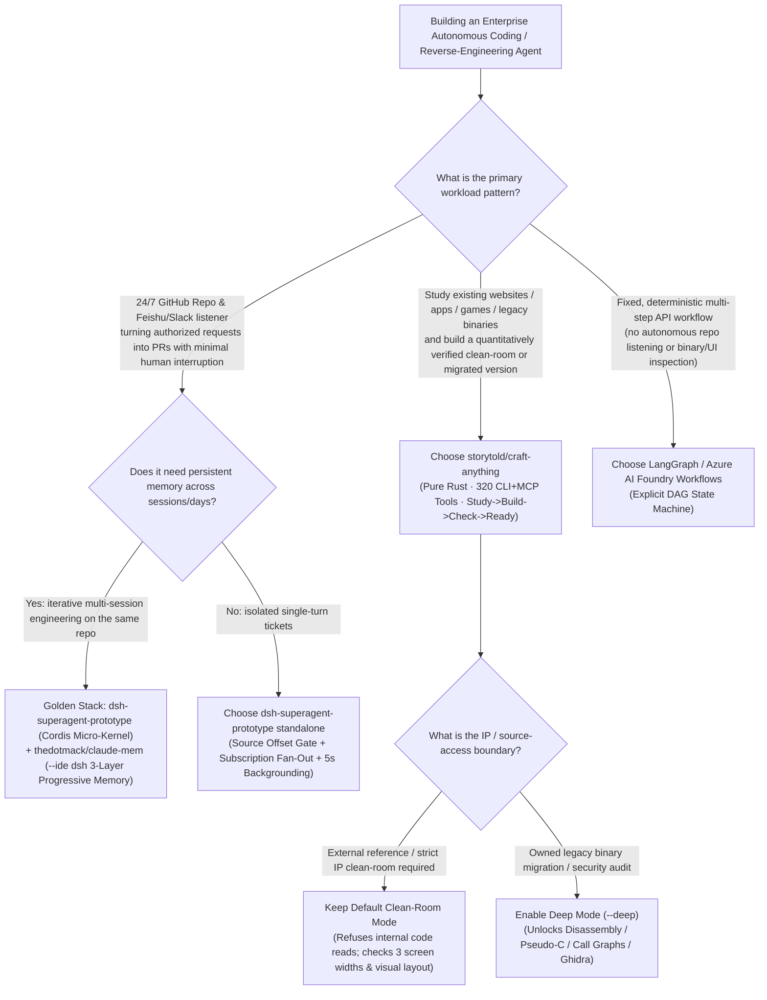
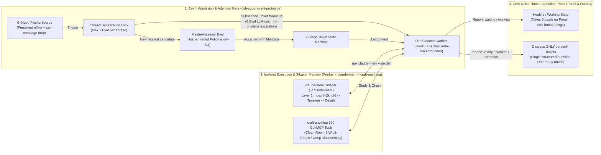

# Autonomous SuperAgent Micro-Kernels & Cross-Session Memory Selection FAQ: `dsh-superagent-prototype` + `claude-mem` + `craft-anything` vs. Heavy Workflow Graph Frameworks (LangGraph / AutoGen)

> **Scope**: Practical architecture and selection guide for AI Solution Architects and Platform Engineering leads building **proactive repository coding agents**, **cross-session persistent memory**, and **clean-room software inspection & verification harnesses**.
> **Companion Deliverables**: [`workshops/github-trending-radar/daily/2026-11-08.en.md`](../daily/2026-11-08.en.md) · [`workshops/github-trending-radar/cards.en.html`](../cards.en.html) · [`assets/github-ai-radar-2026-11-08-r6-superagent-memory.svg`](../../../assets/github-ai-radar-2026-11-08-r6-superagent-memory.svg)
> **Raw Scrape Evidence & Provenance Notice**:
> - **`measured` (Archived GitHub REST Search API JSON + Primary Source Verification)**:
>   - `storytold/craft-anything` (`Apache-2.0 / MIT`, 100% pure Rust, created `2026-10-31T14:50:00Z`, archived in [`workshops/github-trending-radar/evidence/search-new-repos-2026-11-08-raw.json`](../evidence/search-new-repos-2026-11-08-raw.json), LF `sha256: b63e154723524af044eca6d701fd910d2b13ed732d3ad8ae2fd3f0b5584b7ba1`: `22,088` total stars over 8 days [`22,299` in Search API verification], lifecycle average `~2,761★/day`, Track B #1; `stars_today: not_measured`);
>   - `deepseek-ai/dsh-superagent-prototype` (`v0.1.0`, `MIT`, TypeScript, created `2026-10-31T09:32:46Z`, archived in the same Search API snapshot: `21,107` total stars over 8 days [`21,148` in Search API verification], lifecycle average `~2,638★/day`, Track B #2; `stars_today: not_measured`; upstream README explicitly notes *"Research prototype for reference only, not an official DeepSeek product"*);
>   - `thedotmack/claude-mem` (`v15.12.0`, `Apache-2.0`, TypeScript, `73,659` weekly snapshot stars [`114,804` live REST check], `stars_today: not_measured`; supports `npx claude-mem install --ide dsh --dsh-profile tui` for DeepSeek Harness alongside Claude Code, Codex, and OpenCode).
> - **`anonymized_reported` (`independently_reproduced=false`, Upstream Architecture Docs & Tool Counts)**: The 6 core domain concepts (`Source / Trigger / Thread / Eval / Mandate / Subscription`), 7-stage Ticket state machine, `2s -> 60s` exponential delivery backoff, and `5s` foreground-to-background shell job threshold are verified from [`deepseek-ai/dsh-superagent-prototype/docs/000-philosophy.md`](https://github.com/deepseek-ai/dsh-superagent-prototype/blob/main/docs/000-philosophy.md) through [`docs/007-architecture.md`](https://github.com/deepseek-ai/dsh-superagent-prototype/blob/main/docs/007-architecture.md); `craft-anything`'s `320` dual-mode CLI + MCP inspection tools and `Clean room vs Deep` policy gate are verified from [`storytold/craft-anything/README.md`](https://github.com/storytold/craft-anything/blob/main/README.md); `claude-mem`'s 3-step progressive disclosure (`index -> timeline -> details`) and `<private>` secret stripping are verified from [`thedotmack/claude-mem/README.md`](https://github.com/thedotmack/claude-mem/blob/main/README.md).
> - **`synthetic` (`independently_reproduced=false`, Architect 100% Closed-Form Parametric FinOps & Attention Model)**: Section 4's monthly workload calculation (`8,800` inbound repo/chat events = `2,200` executed tickets + `6,600` non-request/follow-up events, reducing monthly routing + cross-session memory API spend from `$1,584.00/mo -> $158.40/mo` [**`-$1,425.60/mo [-90.00%]`**] and engineering attention interruptions from `110.0h/mo -> 22.0h/mo` [**`-88.0h/mo [-80.00%]`**]) is a deterministic closed-form analytical model verified by automated assertions in `tests/radar-integration.cjs`.

---

## 📌 Executive Summary

When enterprise engineering teams wire a coding agent into GitHub Issues/PRs and Feishu/Slack channels, they almost always hit two walls within two weeks:
1. **Attention Spam**: Every casual comment or webhook triggers a LangGraph/AutoGen node that runs an LLM call and posts verbose progress updates back into the channel—flooding the entire team's notifications;
2. **Cross-Session Amnesia**: Every fresh worker session starts from zero, re-reading the same files and repeating mistakes fixed yesterday—or else dumps 5 raw historical transcripts (`~120k` input tokens) into the prompt before doing any real work.

Tonight's top two Track B (10-day new-repo lifecycle velocity) breakouts—**`storytold/craft-anything` (`~2,761★/day`)** and **`deepseek-ai/dsh-superagent-prototype` (`~2,638★/day`)**—paired with weekly heavyweight **`thedotmack/claude-mem` (`v15.12.0`)**, define a **three-layer micro-kernel architecture** for autonomous engineering agents:

- **When your agent listens 24/7 to GitHub and Feishu/Slack and must protect human attention**: Adopt **`deepseek-ai/dsh-superagent-prototype`**'s **Attention-Conserving Cordis Micro-Kernel**. Its host-enforced `Source` offset cursor and allow-list gate drop unauthorized noise before it enters the domain, its `Subscription` fan-out routes follow-up messages on active threads directly to the running `worker-<ticket_id>` with **zero `Eval` LLM overhead**, and its web panel displays **only tickets in `person/*` stages** (*"A healthy state takes no space"*).
- **When multi-turn or multi-day tickets suffer from cross-session amnesia**: Attach **`thedotmack/claude-mem`**. A sidecar observer agent captures structured `decision / bugfix / security_alert` observations into `~/.claude-mem`, injects only a **`~2k`-token Layer-1 Compact Index** at session start, and fetches Layer-2 `timeline` and Layer-3 `details` on demand via `mem-search`.
- **When an agent must study an existing website, desktop app, game, or binary and build a verified replacement**: Use **`storytold/craft-anything`**. Written in 100% pure Rust, it exposes **320 deterministic inspection tools** (each available as both a CLI command and an MCP tool) inside a `Study -> Build -> Check -> Ready` loop, defaulting to **Clean-Room Mode** (refusing internal source/file reads and inspecting only external rendered layout across 3 screen widths, colors, fonts, and self-tests).

---

## 1. First-Principles Q&A

### Q1: Why did DeepSeek build `dsh-superagent-prototype` around 6 domain concepts (`Source -> Trigger -> Thread -> Eval -> Mandate -> Executor`) on the Cordis IoC micro-kernel instead of a cyclic workflow graph like LangGraph?

In plain language: **LangGraph models how a single request steps through a flowchart; `dsh-superagent` models how an autonomous team agent survives an unbounded 24/7 stream of GitHub and chat events without losing security boundaries or spamming humans.**

In [`docs/001-domain.md`](https://github.com/deepseek-ai/dsh-superagent-prototype/blob/main/docs/001-domain.md) and [`docs/002-authorization.md`](https://github.com/deepseek-ai/dsh-superagent-prototype/blob/main/docs/002-authorization.md), `dsh-superagent-prototype` (built on `@deepseek-ai/cordis 4.0.5-alpha.1`) enforces six strict invariants:

1. **`Source` (Persistent Read-Offset & Self-Drop)**: Each Source (`github-watch`, `feishu-watch`) owns its read position and bot identity. **A process restart never replays past events**, and the bot's own messages are dropped before entering the domain.
2. **`Trigger` (Idempotent Audit Unit)**: Every immutable event is a `Trigger`. Accepting the same `Trigger` twice creates at most one `Ticket`.
3. **`Thread` (Single-Eval Serialization Lock)**: At most **one `Eval` runs on a `Thread` at a time**, preventing race conditions when developers post five rapid follow-up comments on a PR.
4. **`Subscription Fan-Out` (Zero-Eval Context Routing)**: Once a `Ticket` subscribes to a `Thread`, subsequent messages on that thread (human follow-ups, CI failures, bot comments) fan out directly to the owning `DshExecutor` (`worker-<ticket_id>`) **without running `MasterAssessor` `Eval` and without granting any new authority**.
5. **`Mandate` (Host-Enforced Privilege Boundary)**: Untrusted messages, comments, and quoted docs are treated purely as data; they cannot alter host allow-lists or expand a Ticket's `Mandate`. Bots on the bot list can at most produce an *inferred candidate*, never an *explicit request*.
6. **`5-Second` Auto-Backgrounding & `person/*`-Only Panel ([`docs/003-execution.md`](https://github.com/deepseek-ai/dsh-superagent-prototype/blob/main/docs/003-execution.md))**: Each `worker-<ticket_id>` runs in `<stateDir>/work/<short-name>` and automatically moves foreground shell commands exceeding **5 seconds** into background jobs so the worker can accept new human steering at the very next step.

---

### Q2: How does `thedotmack/claude-mem`'s 3-layer progressive disclosure (`index -> timeline -> details`) differ from standard Vector RAG conversation memory?

Standard Vector RAG memory fails in two ways:
- **Token Bloat**: Injecting Top-15 retrieved transcript chunks (`30k–50k` tokens) into every new session wastes tokens on irrelevant history;
- **Causal Fragmentation**: Arbitrary chunk boundaries slice apart *why* an architectural approach failed yesterday, causing the agent to repeat the exact same broken approach today.

`thedotmack/claude-mem` (`v15.12.0`) solves both via **Sidecar Observation Compression + 3-Step Progressive Disclosure**:
1. **Sidecar Observer Agent**: While the primary coding agent works, a sidecar worker distills tool executions and edits into structured observations (`decision`, `bugfix`, `security_alert`, `sensitive`) stored locally in `~/.claude-mem` (anything wrapped in `<private>` tags is stripped before persistence).
2. **Layer 1 — Compact Session-Start Index (`~2k` Tokens)**: Every new session opens with a lightweight index of relevant past observations (with token cost telemetry in the header) rather than full transcripts.
3. **Layer 2 & Layer 3 — On-Demand `mem-search` (`timeline -> details`)**: The agent spends tokens on full observation details only when it explicitly opens a cited Observation ID via the 3-step `mem-search` skill.

---

### Q3: Why did `storytold/craft-anything` surge to `22,088+` stars in 8 days, and what architectural gap do its 320 Rust CLI/MCP tools and `Clean-Room vs Deep` modes solve?

Previously, asking an AI coding agent to *"study how an existing web app, desktop app, or game works and build our own version"* failed either on **verification** (guessing from a single static screenshot with zero responsive/behavioral checks) or on **compliance** (scraping proprietary source code).

`storytold/craft-anything` (100% pure Rust) introduces a deterministic **`Study -> Build -> Check -> Ready`** engine backed by **320 dual-mode CLI + MCP inspection tools**:
- **Clean-Room Mode (Default, IP-Safe)**: The engine refuses every tool that reads internal code, files, or page source. It inspects only externally observable behavior (rendered layout across **3 screen widths**, computed colors, fonts, spacing, opened menus, and window screenshots).
- **Deep Mode (Opt-In via `--deep` or `settings_set deep_mode true`)**: For authorized legacy migration and binary security audits, it unlocks built-in disassembly, pseudo-C decompilation, function call graphs, string/hex inspection, and Ghidra integration.
- **Automated Differential Check (`Checked, not guessed`)**: After the builder agent creates the new project, `craft-anything` automatically compares the build against the original across three screen widths or runs the app/game's self-test, listing exact mismatches for iterative refinement.

---

## 2. Decision Tree & Micro-Kernel Architecture Diagrams (Mermaid)

### 2.1 Autonomous Engineering Agent & Memory Selection Decision Tree



### 2.2 End-to-End Micro-Kernel Data Flow (`dsh-superagent` + `claude-mem` + `craft-anything`)



---

## 3. Comprehensive Architecture Comparison Matrix

| Evaluation Dimension | Path A: Naïve Webhook + LangGraph/AutoGen + Raw Transcript Dump | Path B: LangGraph + Standard Vector RAG (Top-K Chunk Injection) | Path C (Tonight's Breakout Stack): `dsh-superagent` (Cordis) + `claude-mem` + `craft-anything` |
| :--- | :--- | :--- | :--- |
| **Representative Stack** | Custom FastAPI Webhook + LangGraph DAG | LangGraph + Chroma / Milvus Top-K transcript chunks | **`deepseek-ai/dsh-superagent-prototype` (`v0.1.0`) + `thedotmack/claude-mem` (`v15.12.0`) + `storytold/craft-anything` (`Rust`)** |
| **Noise Gating & Thread Concurrency** | ❌ Poor (every webhook comment triggers LLM graph routing; concurrent comments cause Git races) | ⚠️ Moderate (requires custom Redis locks; follow-ups still invoke router nodes) | **✅ Deterministic (`Source` offset dedup + `Thread` 1-Eval lock + `Subscription` 0-Eval fan-out to owning worker)** |
| **Human Attention Conservation** | ❌ Poor (posts verbose intermediate status messages on every step) | ⚠️ Moderate (template notifications without strict attention state machine) | **✅ First-Principles Attention Guard (Panel shows ONLY `person/delivery, answer, review, blocked`; asks one structured question at a time)** |
| **Long-Running Shell Command Handling** | ❌ Blocks current turn until command exits | ❌ Blocks current turn until command exits | **✅ Foreground shell commands >`5 seconds` automatically move to background jobs so worker receives new messages at next step** |
| **Cross-Session Memory Token Efficiency** | ❌ Very Low (cold-loads 5 raw transcripts `~120k` input tokens/ticket) | ⚠️ Moderate (injects Top-15 vector chunks `~40k` input tokens/ticket; loses causal chain) | **✅ Very High (`claude-mem` injects `~2k` Layer-1 Index at start + on-demand `mem-search` details, averaging `~10k` input tokens/ticket)** |
| **UI / Binary Inspection & Verification** | ❌ None (blind LLM generation or ad-hoc Playwright scripts) | ❌ None | **✅ Built-in `craft-anything` 320 Rust CLI/MCP tools (Clean-Room 3-width visual/layout diff + Deep disassembly/Ghidra)** |
| **License & Maturity** | MIT / High custom maintenance | MIT / Apache-2.0 | **`dsh-superagent` (`MIT` research prototype) · `claude-mem` (`Apache-2.0`) · `craft-anything` (`MIT OR Apache-2.0`)** |

---

## 4. Quantitative Worked Example & 7-Card Benchmark Insights

### 4.1 Primary-Source Verified Metrics (`measured` / `anonymized_reported, independently_reproduced=false`)

1. **Repository Velocity & Scale (`measured`, archived in [`search-new-repos-2026-11-08-raw.json`](../evidence/search-new-repos-2026-11-08-raw.json) and [`trending-daily-2026-11-08-audit.json`](../evidence/trending-daily-2026-11-08-audit.json))**:
   - `storytold/craft-anything`: Created `2026-10-31` (8 days old), **`22,088`** total stars (`22,299` in Search API verification), creation-to-date lifecycle average **`~2,761★/day`** (`stars_today: not_measured`);
   - `deepseek-ai/dsh-superagent-prototype`: Created `2026-10-31` (8 days old), **`21,107`** total stars (`21,148` in Search API verification), creation-to-date lifecycle average **`~2,638★/day`** (`stars_today: not_measured`);
   - `thedotmack/claude-mem`: Version `v15.12.0`, **`73,659`** weekly snapshot total stars (`114,804` live REST verification, `stars_today: not_measured`).
2. **Architecture Constants from Upstream Source (`anonymized_reported, independently_reproduced=false`)**:
   - `dsh-superagent-prototype`: Input delivery retry starts at **`2 seconds`** and doubles up to **`60 seconds`** (`docs/003-execution.md`); foreground shell commands move to background jobs after **`5 seconds`**; core runtime dependencies are only `proper-lockfile@4.1.2`, `zod@4.4.3`, and `@deepseek-ai/cordis@4.0.5-alpha.1`;
   - `craft-anything`: Exposes **`320`** dual-mode CLI + MCP inspection tools and verifies builds across **`3` screen widths**.

### 4.2 Architect Closed-Form FinOps & Human Attention Worked Example (`synthetic`, `independently_reproduced=false`)

To evaluate the combined impact of **`dsh-superagent-prototype` (Source admission gate + Subscription fan-out + `person/*` attention filter)** and **`claude-mem` (3-layer progressive disclosure)** on an enterprise engineering org, we define a **100% closed-form reproducible** monthly workload model:

- **Explicit Parameters (API-Only Synthetic Model — underlying vector DB/host infrastructure and full customer production bills are explicitly marked `not_measured`)**:
  - Inbound event volume: `E_day = 400` GitHub Issue/PR/comment and Feishu events per workday across `D = 22` workdays/month $\Rightarrow$ **`E_month = 400 × 22 = 8,800` events/month**;
  - Event mix: `25%` require multi-turn coding ticket execution (**`T_month = 2,200` tickets/month**), while `75%` are follow-up comments on subscribed threads, CI status notifications, or non-actionable chat noise (**`N_month = 6,600` events/month**);
  - LLM pricing assumptions: `$3.00 / 1M` uncached input tokens (`p_in`) and `$15.00 / 1M` output tokens (`p_out`), with input and output components computed separately and output counted strictly once;
  - Engineering human attention valuation: `$100.00 / hour` (`w_eng`, reported in a separate column from API-only spend and never conflated with token bills; infrastructure and full production bills: `not_measured`).
- **Closed-Form Equations (rounded to 2 decimal places)**:
  - **Path A (Unfiltered Webhook + LLM Router on All Events + Cold-Loading 5 Raw Session Transcripts per Ticket)**:
    - Routing spend: All `8,800` events invoke an LLM router node (`0.020M` input + `0.001M` output $\Rightarrow 0.020 × $3.00 + 0.001 × $15.00 = $0.0750/event`) $\Rightarrow$ **`Router_Cost_A = 8,800 × $0.0750 = $660.00 / month`**;
    - Cross-session memory spend: Each of the `2,200` executed tickets cold-loads `0.120M` raw transcript input + `0.004M` summary output (`$0.3600 + $0.0600 = $0.4200/ticket`) $\Rightarrow$ **`Memory_Cost_A = 2,200 × $0.4200 = $924.00 / month`**;
    - Total Monthly API Bill: **`API_Total_A = $660.00 + $924.00 = $1,584.00 / month`** (`$0.7200 / executed ticket`);
    - Engineering Attention Interruptions: Verbose step chatter and unstructured questions consume `3.0 minutes` (`0.05 hours`) per ticket $\Rightarrow$ **`Attention_Hours_A = 2,200 × 0.05 = 110.0 hours/month`** (**`$11,000.00 / month`** in engineering attention value).
  - **Path B (Basic Regex Drop of 50% Noise + Standard Vector RAG Top-15 Chunk Injection)**:
    - Routing spend: `4,400` events hit the LLM router (`$0.0750/event`) $\Rightarrow$ **`Router_Cost_B = 4,400 × $0.0750 = $330.00 / month`**;
    - Cross-session memory spend: `2,200` tickets inject `0.040M` vector chunk input + `0.002M` output (`$0.1200 + $0.0300 = $0.1500/ticket`) $\Rightarrow$ **`Memory_Cost_B = 2,200 × $0.1500 = $330.00 / month`**;
    - Total Monthly API Bill: **`API_Total_B = $330.00 + $330.00 = $660.00 / month`** (`$0.3000 / executed ticket`);
    - Engineering Attention Interruptions: `1.8 minutes` (`0.03 hours`) per ticket $\Rightarrow$ **`Attention_Hours_B = 2,200 × 0.03 = 66.0 hours/month`** (**`$6,600.00 / month`** in engineering attention value).
  - **Path C (`dsh-superagent` Source Gate & Subscription Fan-Out + `claude-mem` 3-Layer Progressive Disclosure)**:
    - Routing & Eval spend: `6,600` non-request or subscribed follow-up events are either dropped by `Source` policy or routed directly via `Subscription` fan-out with **zero `Eval` LLM tokens**; only `2,200` candidate requests enter `MasterAssessor` `Eval` (`0.008M` input + `0.0004M` output $\Rightarrow $0.0240 + $0.0060 = $0.0300/event`) $\Rightarrow$ **`Router_Cost_C = 2,200 × $0.0300 = $66.00 / month`**;
    - Cross-session 3-layer memory spend: Each of the `2,200` tickets loads `claude-mem` Layer-1 Index (`0.002M`) + selective Layer-3 details (`0.006M`) + sidecar observer compression (`0.002M` input + `0.0008M` output), totaling `0.010M` input + `0.0008M` output (`$0.0300 + $0.0120 = $0.0420/ticket`) $\Rightarrow$ **`Memory_Cost_C = 2,200 × $0.0420 = $92.40 / month`**;
    - Total Monthly API Bill: **`API_Total_C = $66.00 + $92.40 = $158.40 / month`** (`$0.0720 / executed ticket`, saving **`$1,425.60 / month` [`-90.00%`]** vs. Path A and **`$501.60 / month` [`-76.00%`]** vs. Path B);
    - Engineering Attention Interruptions: Only `person/*` stages interrupt humans (`0.6 minutes` = `0.01 hours` average per ticket) $\Rightarrow$ **`Attention_Hours_C = 2,200 × 0.01 = 22.0 hours/month`** (reclaiming **`88.0 hours/month` [`-80.00%`]** of engineering focus vs. Path A, worth **`$8,800.00 / month`**).

| Architecture Path | Monthly Events Entering LLM Router | Monthly Router / Eval API Cost (`Router_Cost`) | Memory Tokens per Ticket (`In + Out`) | Monthly Memory API Cost (`Memory_Cost`) | **Total Monthly API Bill (`API_Total`)** | **Monthly Engineering Attention (`Attention_Hours`)** |
| :--- | :---: | :---: | :---: | :---: | :---: | :---: |
| **Path A: Unfiltered Webhook + Raw Transcript Dump** | `8,800` (`$0.0750`/ev) | `$660.00` | `120k In + 4k Out` (`$0.4200`/tkt) | `$924.00` | **`$1,584.00 / mo`** | **`110.0 hrs / mo`** (`$11,000.00` attention value) |
| **Path B: Basic Regex Filter + Vector RAG Top-15** | `4,400` (`$0.0750`/ev) | `$330.00` | `40k In + 2k Out` (`$0.1500`/tkt) | `$330.00` | **`$660.00 / mo`** | **`66.0 hrs / mo`** (`$6,600.00` attention value) |
| **Path C: `dsh-superagent` Fan-Out + `claude-mem` 3-Layer** | **`2,200`** (`$0.0300`/ev) | **`$66.00`** | **`10k In + 0.8k Out`** (`$0.0420`/tkt) | **`$92.40`** | **`$158.40 / mo` (`-$1,425.60/mo`, `-90.00%`)** | **`22.0 hrs / mo` (`-88.0h/mo`, `-80.00%`)** |

> 💡 **7-Card Benchmark Report Takeaway (see [`workshops/github-trending-radar/cards.en.html`](../cards.en.html) Card 3 / Card 7)**:
> - **Human Attention is 7× More Expensive Than Token Spend**: By elevating *"Take as little human attention as possible"* into a state-machine invariant (`Subscription` fan-out + `person/*`-only UI panel) and pairing it with `claude-mem`'s 3-layer progressive disclosure, Path C cuts API spend by **90.00%** while saving **88 hours/month** of senior developer interruptions.

---

## 5. Architect 30-Minute PoC & Production Readiness Checklist

### 5.1 30-Minute Local Verification Runbook

```bash
# Step 1: Install claude-mem 3-layer progressive memory sidecar for Claude Code / DeepSeek Harness / OpenCode
npx claude-mem install --runtime worker --provider host
# For DeepSeek Harness TUI specifically:
npx claude-mem install --ide dsh --dsh-profile tui

# Step 2: Clone and run the dsh-superagent-prototype typecheck, test suite, and build
git clone https://github.com/deepseek-ai/dsh-superagent-prototype.git
cd dsh-superagent-prototype
pnpm install
pnpm check   # Runs tsc --noEmit && vitest run && tsdown

# Step 3: Run storytold/craft-anything in default Clean-Room mode against a target web app
# (Verifies 3-width layout inspection and differential check without reading internal source code)
```

### 5.2 Production SuperAgent Governance Checklist

- [ ] **Persistent `Source` Read-Offset & Self-Message Drop**: Confirm GitHub and Feishu/Slack `Source` plugins persist read offsets across restarts and drop messages authored by the bot's own identity before they enter the domain.
- [ ] **Host-Enforced `Policy` & `Mandate` Isolation**: Verify that external comments, PR bodies, and bot messages are treated strictly as untrusted inputs and cannot modify host allow-lists or escalate a Ticket's `Mandate`.
- [ ] **Single-`Eval` Thread Lock & `Subscription` Fan-Out**: Ensure at most 1 `Eval` runs per `Thread` at any time, and that follow-up messages on subscribed threads route directly to the owning `worker-<ticket_id>` without triggering duplicate tickets.
- [ ] **`5-Second` Foreground Shell Auto-Backgrounding**: Verify that worker sessions move foreground shell commands exceeding `5s` into background jobs so human stop/redirect messages take effect at the next step boundary.
- [ ] **Cross-Session `<private>` Redaction & Opt-In Cloud Sync**: Confirm `claude-mem` strips `<private>` blocks before disk write, runs with `CLAUDE_MEM_ONLINE_OPTIN=false` in enterprise environments, and injects only the Layer-1 Compact Index (`~2k` tokens) at session start.
- [ ] **Explicit `Clean-Room` vs. `Deep` Boundary**: Keep `craft-anything` locked to default `Clean room` mode when benchmarking or recreating external software; enable `--deep` (disassembly / Pseudo-C / Ghidra) only on owned legacy binaries or authorized security targets.
