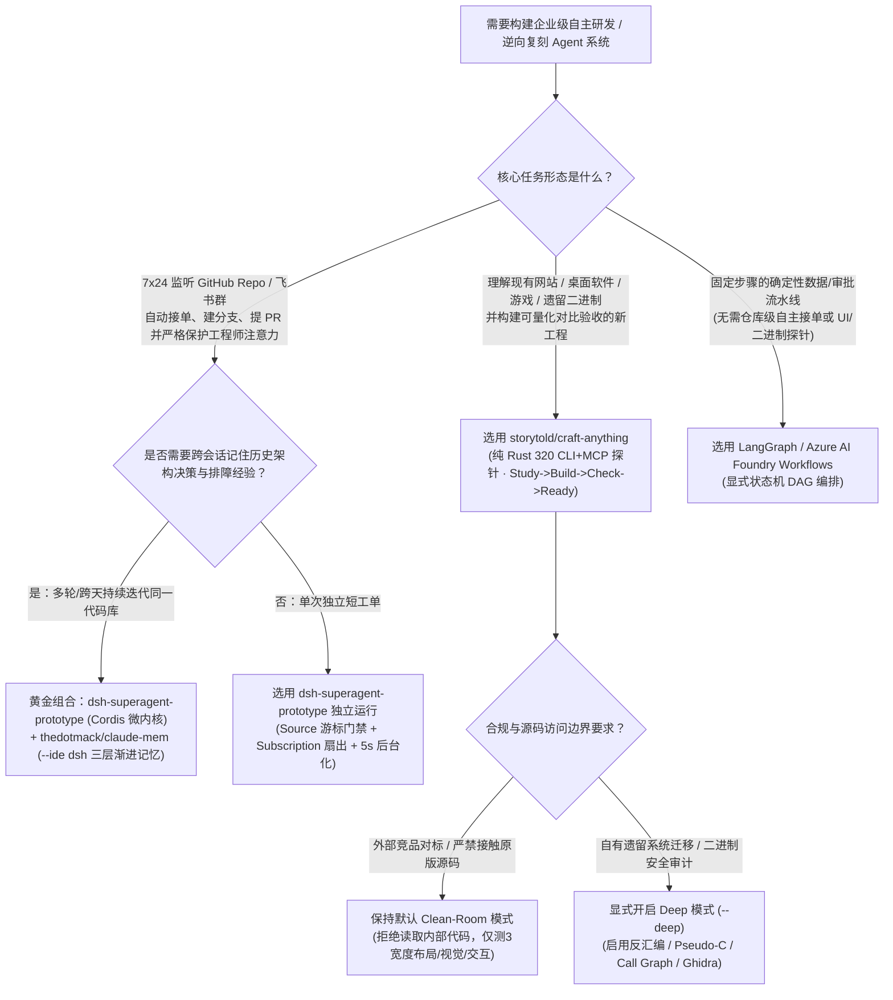
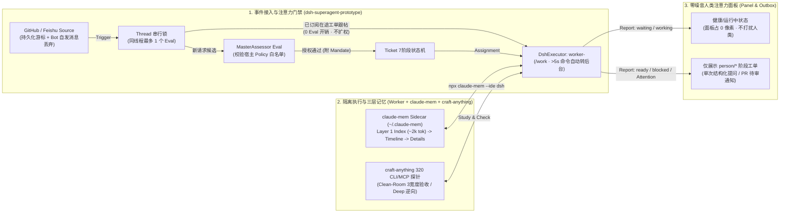

# 自主 SuperAgent 微内核与跨会话记忆选型 FAQ：`dsh-superagent-prototype` + `claude-mem` + `craft-anything` vs 重型工作流图框架（LangGraph / AutoGen）

> **适用范围**：面向需要构建**仓库级主动式研发智能体（Proactive Repo SuperAgent）**、**跨会话持久记忆（Cross-Session Persistent Memory）**与**净室逆向/验收引擎（Clean-Room Inspection & Verification）**的 AI 解决方案架构师（AI Solution Architect）与平台工程负责人。
> **关联评测产物**：[`workshops/github-trending-radar/daily/2026-11-08.md`](../daily/2026-11-08.md) · [`workshops/github-trending-radar/cards.html`](../cards.html) · [`assets/github-ai-radar-2026-11-08-r6-superagent-memory.svg`](../../../assets/github-ai-radar-2026-11-08-r6-superagent-memory.svg)
> **原始抓取证据与 Provenance 声明**：
> - **`measured`（GitHub REST Search API 原始快照 + 一手源码核验）**：
>   - `storytold/craft-anything`（`Apache-2.0 / MIT`，100% 纯 Rust，建仓于 `2026-10-31T14:50:00Z`，封存快照检索见 [`workshops/github-trending-radar/evidence/search-new-repos-2026-11-08-raw.json`](../evidence/search-new-repos-2026-11-08-raw.json)，LF `sha256: b63e154723524af044eca6d701fd910d2b13ed732d3ad8ae2fd3f0b5584b7ba1`：建仓 8 天总 Star `22,088` [检索复核 `22,299`]，生命周期日均 `≈ 2,761★/天`，赛道 B 第 1 名；`stars_today: not_measured`）；
>   - `deepseek-ai/dsh-superagent-prototype`（`v0.1.0`，`MIT`，TypeScript，建仓于 `2026-10-31T09:32:46Z`，同份封存 Search API 快照：建仓 8 天总 Star `21,107` [检索复核 `21,148`]，生命周期日均 `≈ 2,638★/天`，赛道 B 第 2 名；`stars_today: not_measured`；官方 README 明确标注 *"Research prototype for reference only, not an official DeepSeek product"*）；
>   - `thedotmack/claude-mem`（`v15.12.0`，`Apache-2.0`，TypeScript，周榜总 Star `73,659` [实时 REST 复核 `114,804`]，`stars_today: not_measured`；支持 `npx claude-mem install --ide dsh --dsh-profile tui` 接入 DeepSeek Harness 及 Claude Code / Codex / OpenCode）。
> - **`anonymized_reported`（`independently_reproduced=false`，一手源码架构文档与工具计数）**：`dsh-superagent-prototype` 的 6 核心领域概念（`Source / Trigger / Thread / Eval / Mandate / Subscription`）与 7 阶段工单状态机核验自 [`docs/000-philosophy.md`](https://github.com/deepseek-ai/dsh-superagent-prototype/blob/main/docs/000-philosophy.md) 至 [`docs/007-architecture.md`](https://github.com/deepseek-ai/dsh-superagent-prototype/blob/main/docs/007-architecture.md)；`craft-anything` 的 `320` 个 CLI + MCP 双模探针工具与 `Clean room vs Deep` 门控核验自 [`storytold/craft-anything/README.md`](https://github.com/storytold/craft-anything/blob/main/README.md)；`claude-mem` 的 `index -> timeline -> details` 三层渐进检索与 `<private>` 脱敏机制核验自 [`thedotmack/claude-mem/README.md`](https://github.com/thedotmack/claude-mem/blob/main/README.md)。
> - **`synthetic`（`independently_reproduced=false`，架构师 100% 闭式参数化成本与注意力算例）**：第 4 节中每月 `8,800` 个仓库/IM 事件（`2,200` 个有效执行工单 + `6,600` 个非请求/噪音跟帖）下的路由 + 跨会话记忆 API 成本（`$1,584.00/月 -> $158.40/月`，节省 **`$1,425.60/月 [-90.00%]`**）与工程师注意力耗时（`110.0h/月 -> 22.0h/月`，节省 **`88.0h/月 [-80.00%]`**）为显式参数闭式推导的架构师理论模型，已在 `tests/radar-integration.cjs` 内置自动化数学断言校验。

---

## 📌 核心结论速览（Executive Summary）

很多企业团队把 Coding Agent 接进 GitHub 和飞书/Slack 后，往往在两周内遭遇两大灾难：
1. **“群聊噪音轰炸（Attention Spam）”**：只要有人在 Issue 或群里说话，Webhook 就无脑拉起 LangGraph/AutoGen 图节点去跑大模型、发长篇进度刷屏，全组工程师的注意力被机器人废话彻底淹没；
2. **“跨会话失忆症（Cross-Session Amnesia）”**：每次新开 Worker 会话，Agent 都要从零重新 `grep` 同样的文件、踩昨天刚修过的坑；如果把前 5 次会话全文硬塞进 Prompt，每单还没干活就先烧掉 `120k` 输入 Token。

今晚赛道 B（近 10 天新建黑马生命周期日均榜）前两名 **`storytold/craft-anything`（日均 `≈ 2,761★/天`）** 与 **`deepseek-ai/dsh-superagent-prototype`（日均 `≈ 2,638★/天`）**，加上周榜霸榜项目 **`thedotmack/claude-mem`（`v15.12.0`）**，共同给出了下一代企业级自主 SuperAgent 的**三层微内核标准答案**：

- **如果你要让 Agent 7×24 监听 GitHub 仓库与飞书群，且绝不能打扰工程师**：借鉴 **`deepseek-ai/dsh-superagent-prototype`** 的**“注意力守恒微内核（Cordis Micro-Kernel）”**。它用宿主级 `Source` 游标与白名单门禁过滤掉非授权噪音，用 `Subscription` 将已有工单跟帖零成本路由给在途 `worker-<ticket_id>`（完全绕过 `Eval` 评估开销），且 Web 面板**只展示处于 `person/*`（需人类回答/审批/排障）阶段的工单**——健康运行的工单占零像素（*"A healthy state takes no space"*）。
- **如果你要解决多轮/跨天工单的“失忆症”且不想付全量历史 Token 税**：挂载 **`thedotmack/claude-mem`**。它通过旁路 Observer 采集每次会话的 `decision / bugfix / security_alert`，在新会话启动时**只注入约 `2k` Token 的超薄目录索引（Layer 1 `index`）**，仅当 Agent 按需调用 `mem-search` 时才展开 `timeline`（Layer 2）与 `details`（Layer 3）。
- **如果你要让 Agent 逆向理解现有网站/桌面应用/二进制并重写出可验收的新工程**：使用 **`storytold/craft-anything`**。它用 100% 纯 Rust 提供了 **320 个既是 CLI 又是 MCP 的确定性探针工具**，默认开启 **Clean-Room（净室模式，禁止读取原项目源码，仅测量多分辨率渲染布局/字体/配色并自动做像素与自测比对）**，彻底解决传统生成式编程“写完从不对比原版、合规边界不清”的痛点。

---

## 1. 核心概念与第一性原理 Q&A

### Q1：同样是跑后台多智能体任务，为什么 DeepSeek 放弃了复杂的 DAG 连线图（如 LangGraph），而是用 `Source -> Trigger -> Thread -> Eval -> Mandate -> Executor` 六个概念构建 `dsh-superagent`？

用通俗大白话讲：**LangGraph 解决的是“单次请求内部的流程图怎么走”，而 `dsh-superagent` 解决的是“一个团队面对全天候涌入的 GitHub/飞书事件流，怎么管住权限、状态和人类注意力”**。

在 `deepseek-ai/dsh-superagent-prototype`（基于 `@deepseek-ai/cordis 4.0.5-alpha.1` IoC 微内核）的 [`docs/001-domain.md`](https://github.com/deepseek-ai/dsh-superagent-prototype/blob/main/docs/001-domain.md) 与 [`docs/002-authorization.md`](https://github.com/deepseek-ai/dsh-superagent-prototype/blob/main/docs/002-authorization.md) 中，整个系统被严格收敛为 **6 个正交领域原语**：

1. **`Source`（带持久化游标的事件源）**：每个 Source 实例（如 `github-watch`、`feishu-watch`）自己维护读取游标（Read Offset）和 Bot 身份。**服务重启绝不重放历史事件**，Bot 自己发出的消息或监听范围外的消息在进入领域层之前就被直接丢弃。
2. **`Trigger`（幂等审计单元）**：每条外部事件是一个不可变的 `Trigger`。同一个 `Trigger` 即使被重复投递，也只会生成唯一一张 `Ticket`（天然幂等）。
3. **`Thread`（单线程评估串行锁）**：同一个 GitHub Issue/PR 或飞书话题构成一个 `Thread`。**同一个 `Thread` 在同一时刻最多只允许运行 1 个 `Eval`**，彻底杜绝多人连发 5 条消息触发 5 个并发 Agent 互相覆盖代码的竞态灾难。
4. **`Subscription Fan-Out`（已订阅工单的零 Eval 直通路由）**：当某个 `Ticket` 已经订阅了某个 `Thread`，该 `Thread` 后续产生的所有消息（包括人类追问、CI 报错、Bot 通知）**直接作为上下文扇出（Fan-out）给该 Ticket 专属的 `DshExecutor`（`worker-<ticket_id>`），完全绕过 `MasterAssessor` 的 `Eval` 评估步骤，且绝不授予任何额外权限**。
5. **`Mandate`（宿主强制执行的权限边界）**：外部消息、评论和引用文档只是输入数据，**绝不能修改宿主 `Policy` 白名单和 Ticket 的 `Mandate`（授权契约）**。非白名单 Bot 最多只能产生待核实的候选线索（Inferred Candidate），绝不能直接发起显式任务（Explicit Request）。
6. **`5秒自动后台化` 与 `person/*` 注意力面板（[`docs/003-execution.md`](https://github.com/deepseek-ai/dsh-superagent-prototype/blob/main/docs/003-execution.md)）**：每个 `worker-<ticket_id>` 在独立目录 `<stateDir>/work/<short-name>` 中运行；**任何前台 Shell 命令超过 5 秒自动转为后台 Job**，确保 Worker 在下一步立刻能响应人类发来的新修正指令，而不是死等长耗时编译结束。

---

### Q2：`thedotmack/claude-mem` 的三层渐进记忆（Progressive Disclosure）和传统“把历史对话塞进向量库（Vector RAG）”有什么本质区别？

传统 Vector RAG 做跨会话记忆有两个致命硬伤：
- **要么塞太多（Token 爆炸）**：每次新会话开头无脑检索 Top-15 历史切片（动辄 `30k–50k` Token）塞进 System Prompt，其中 85% 跟当前修的 Bug 毫无关系；
- **要么切碎了（因果断裂）**：向量切片把“当时为什么放弃方案 A 改用方案 B”的上下文切得七零八落，导致 Agent 在新会话里再次把错误的方案 A 写了一遍。

`thedotmack/claude-mem`（`v15.12.0`）采用的是**“旁路记笔记 Agent（Sidecar Observer）+ 三步按需披露（Index $\rightarrow$ Timeline $\rightarrow$ Details）”**架构：
1. **旁路异步结构化提炼（Sidecar Observer）**：主 Coding Agent 干活时，旁路 Worker 实时捕获工具调用与修改决策，将其压缩为带唯一 ID 与分类标签（`decision`、`bugfix`、`security_alert`、`sensitive`）的结构化 Observation，保存在本地 `~/.claude-mem`（所有被 `<private>...</private>` 包裹的凭据在落盘前直接剥离）。
2. **Layer 1 — 启动时仅注入极简目录（Compact Index，`~2k` Tokens）**：新会话启动时，只注入一张带 Token 成本标注的高密度观察目录（标题 + 类型 + 发生时间 + Observation ID），让 Agent 知道“过去干过什么”，但不塞入具体代码 diff。
3. **Layer 2 & Layer 3 — `mem-search` 三步按需拉取（Timeline $\rightarrow$ Details）**：只有当主 Agent 发现某条历史记录与当前任务强相关时，才主动调用 `mem-search` 展开时间线（Layer 2）或读取指定 Observation ID 的完整排障细节（Layer 3），**只为真正打开的记忆付 Token 费**。

---

### Q3：`storytold/craft-anything` 为什么能在建仓 8 天内冲上 `22,088+` Star？它的 `Clean-Room vs Deep` 引擎和 320 个 CLI/MCP 工具解决了什么工程难题？

以前让 Coding Agent “参考某网站或某桌面软件做一个我们自己的版本”，通常只有两条死路：
- **死路 A（盲盒截图生成）**：丢一张截图给大模型，生成的网页只有一个静态空壳，响应式断点全崩、交互菜单点不开，且没有任何自动化手段量化“生成的版本和原版到底差在哪”；
- **死路 B（直接扒源码侵权风险）**：让 Agent 直接爬对方混淆后的 JS 或反编译二进制，不仅极易陷入屎山代码迷宫，还会触发严重的知识产权污染。

`storytold/craft-anything`（100% 纯 Rust 编写）把软件理解与复刻变成了一条 **`Study -> Build -> Check -> Ready` 四步闭环流水线**，并内置了 **320 个“一鱼两吃”（既是命令行 CLI 又是标准 MCP 工具）的确定性探针**：
- **Clean-Room 净室模式（默认开启，合规安全）**：引擎在宿主层面**拒绝一切读取目标内部源码、文件或页面 Source 的工具调用**，只允许使用外部可观测探针（在 3 种屏幕宽度下测量真实渲染布局、计算字号/间距/色板、点击展开菜单截图、对比交互状态），从根源上保证生成代码属于 Clean-Room 独立实现。
- **Deep 深度逆向模式（显式开关 `--deep` / `settings_set deep_mode true`）**：面向企业内部遗留系统迁移或安全审计，解锁内置反汇编、伪 C 代码（Pseudo-C）、函数调用图（Call Graph）、字符串/Hex 追踪以及 Ghidra 联动引擎。
- **Check 量化验收闭环（Checked, not guessed）**：每次构建完成后，引擎自动在 3 种屏幕分辨率下对比原版与新构建版本的布局差异、运行游戏/应用的自检测试（Self-test），列出“哪些页面还不一致、相似度多少”，驱动 Coding Agent 定向返工直到达标。

---

## 2. 架构师选型决策树与微内核架构图（Mermaid）

### 2.1 自主研发智能体与持久记忆选型决策树



### 2.2 `dsh-superagent` + `claude-mem` + `craft-anything` 协同微内核数据流



---

## 3. 同类方案全维度选型对比矩阵

| 评估维度 | 方案 A：传统 Webhook + LangGraph/AutoGen + 全量历史拼接 | 方案 B：LangGraph + 传统外部向量库 RAG（Top-K 切片注入） | 方案 C（今晚黑马黄金栈）：`dsh-superagent` (Cordis) + `claude-mem` + `craft-anything` |
| :--- | :--- | :--- | :--- |
| **代表项目与版本** | 自建 FastAPI Webhook + LangGraph DAG | LangGraph + Chroma / Milvus Top-K 历史对话检索 | **`deepseek-ai/dsh-superagent-prototype` (`v0.1.0`) + `thedotmack/claude-mem` (`v15.12.0`) + `storytold/craft-anything` (`Rust`)** |
| **噪音过滤与线程并发控制** | ❌ 差（每条群消息/Webhook 都触发图节点推理，并发消息易产生 Git 冲突） | ⚠️ 一般（需手写 Redis 锁与正则过滤，在途工单追问仍需重跑路由节点） | **✅ 极强（`Source` 游标去重 + `Thread` 单 Eval 锁 + `Subscription` 在途工单零 Eval 直通扇出）** |
| **人类注意力保护机制** | ❌ 差（每步状态变更都在群里刷屏，工程师被废话淹没） | ⚠️ 一般（依靠固定模板通知，无严格状态机约束） | **✅ 第一性原理级保护（Web 面板仅显示 `person/delivery, answer, review, blocked`；一次只问一个结构化问题）** |
| **长耗时 Shell 阻塞处理** | ❌ 阻塞当前 Turn，长编译期间无法接收人类新指令 | ❌ 阻塞当前 Turn，需额外编写异步队列 | **✅ 前台命令超过 `5 秒` 自动迁入后台 Job，Worker 在下一 Step 立即接收人类新消息** |
| **跨会话记忆 Token 效率** | ❌ 极差（冷加载前 5 轮原始记录约 `120k` Token/工单） | ⚠️ 中等（固定塞入 Top-15 向量切片约 `40k` Token/工单，易丢失因果链） | **✅ 极高（`claude-mem` 启动仅注入 `~2k` Index，按需 `mem-search` 展开 Details，平均仅 `~10k` 输入 Token/工单）** |
| **UI / 二进制逆向与量化验收** | ❌ 无（纯靠 LLM 盲写或手工跑截图脚本） | ❌ 无 | **✅ 内置 `craft-anything` 320 个 Rust CLI/MCP 探针（Clean-Room 3 宽度像素/布局验收 + Deep 反汇编/Ghidra）** |
| **开源协议与定位** | MIT / 自建维护成本高 | MIT / Apache-2.0 | **`dsh-superagent` (`MIT` 研究原型) · `claude-mem` (`Apache-2.0`) · `craft-anything` (`MIT OR Apache-2.0`)** |

---

## 4. 定量成本与注意力算例 & 7-Card 洞察联动

### 4.1 一手源码核验的确定性指标（`measured` / `anonymized_reported, independently_reproduced=false`）

1. **GitHub 爆发增速与体量（`measured`，封存证据见 [`search-new-repos-2026-11-08-raw.json`](../evidence/search-new-repos-2026-11-08-raw.json) 与 [`trending-daily-2026-11-08-audit.json`](../evidence/trending-daily-2026-11-08-audit.json)）**：
   - `storytold/craft-anything`：建仓 8 天（`2026-10-31`）总 Star **`22,088`**（Search API 复核 **`22,299`**），建仓以来生命周期日均 **`≈ 2,761★/天`**（`stars_today: not_measured`）；
   - `deepseek-ai/dsh-superagent-prototype`：建仓 8 天（`2026-10-31`）总 Star **`21,107`**（Search API 复核 **`21,148`**），建仓以来生命周期日均 **`≈ 2,638★/天`**（`stars_today: not_measured`）；
   - `thedotmack/claude-mem`：版本 `v15.12.0`，周榜快照总 Star **`73,659`**（实时 REST 复核 **`114,804`**，`stars_today: not_measured`）。
2. **源码架构硬指标（`anonymized_reported, independently_reproduced=false`）**：
   - `dsh-superagent-prototype`：重试退避从 **`2 秒`** 起步指数翻倍至上限 **`60 秒`**（`docs/003-execution.md`）；前台 Shell 命令超过 **`5 秒`** 自动转入后台；核心运行依赖仅 `proper-lockfile@4.1.2` + `zod@4.4.3` + `@deepseek-ai/cordis@4.0.5-alpha.1`；
   - `craft-anything`：内置 **`320` 个** CLI/MCP 双模工具，在 **`3` 种屏幕宽度**下执行自动对比验收。

### 4.2 架构师闭式参数化 FinOps 与工程师注意力算例（`synthetic`, `independently_reproduced=false`）

为了量化 **`dsh-superagent-prototype`（门禁路由 + 注意力过滤）+ `claude-mem`（三层渐进记忆）** 对企业研发团队的真实收益，我们建立 **100% 闭式可复算（Closed-Form Reproducible）** 的月度模型：

- **显式输入参数（Explicit Parameters）**：
  - 团队事件流规模：每天收到 `E_day = 400` 条 GitHub Issue/PR/评论与飞书群事件，每月 `D = 22` 个工作日 $\Rightarrow$ 每月总事件数 **`E_month = 400 × 22 = 8,800` 条/月**；
  - 事件结构：其中 `25%` 为需要启动/执行跨会话编码工单的有效需求（**`T_month = 2,200` 单/月**），其余 `75%` 为在途工单上下文跟帖、CI 状态通知或群聊噪音（**`N_month = 6,600` 条/月**）；
  - 模型单价假设：主力大模型未缓存输入单价 `p_in = $3.00 / 1M tokens`，输出单价 `p_out = $15.00 / 1M tokens`；
  - 工程师注意力时间价值：折算时薪 `w_eng = $100.00 / 小时`（仅用于折算注意力中断成本，与 API 账单分列展示，绝不混加）。
- **闭式计算公式（Closed-Form Equations，保留两位小数）**：
  - **路径 A（无门禁 Webhook + 每次事件均调 LLM 路由 + 每单冷加载 5 轮原始历史记录）**：
    - 路由成本：`8,800` 条事件全部调用路由节点（每条消耗 `0.020M` 输入 + `0.001M` 输出 $\Rightarrow 0.020 × $3.00 + 0.001 × $15.00 = $0.0750/事件`）$\Rightarrow$ **`Router_Cost_A = 8,800 × $0.0750 = $660.00 / 月`**；
    - 跨会话记忆重读成本：`2,200` 张工单每单硬塞 `0.120M` 原始历史输入 + `0.004M` 摘要输出（`$0.3600 + $0.0600 = $0.4200/工单`）$\Rightarrow$ **`Memory_Cost_A = 2,200 × $0.4200 = $924.00 / 月`**；
    - 月度 API 总账单：**`API_Total_A = $660.00 + $924.00 = $1,584.00 / 月`**（单均 `$0.7200 / 工单`）；
    - 工程师注意力中断耗时：无 `person/*` 门控，每单中间状态刷屏与重复追问平均消耗工程师 `3.0 分钟`（`0.05 小时`）$\Rightarrow$ **`Attention_Hours_A = 2,200 × 0.05 = 110.0 小时/月`**（折合注意力价值 **`$11,000.00 / 月`**）。
  - **路径 B（基础正则过滤掉 50% 噪音 + 传统 Vector RAG 每次注入 Top-15 切片）**：
    - 路由成本：`4,400` 条事件进入 LLM 路由（`$0.0750/事件`）$\Rightarrow$ **`Router_Cost_B = 4,400 × $0.0750 = $330.00 / 月`**；
    - 跨会话记忆检索成本：`2,200` 张工单每单注入 `0.040M` 向量切片输入 + `0.002M` 输出（`$0.1200 + $0.0300 = $0.1500/工单`）$\Rightarrow$ **`Memory_Cost_B = 2,200 × $0.1500 = $330.00 / 月`**；
    - 月度 API 总账单：**`API_Total_B = $330.00 + $330.00 = $660.00 / 月`**（单均 `$0.3000 / 工单`）；
    - 工程师注意力中断耗时：每单平均消耗 `1.8 分钟`（`0.03 小时`）$\Rightarrow$ **`Attention_Hours_B = 2,200 × 0.03 = 66.0 小时/月`**（折合注意力价值 **`$6,600.00 / 月`**）。
  - **路径 C（`dsh-superagent` Source 门禁与 Subscription 直通扇出 + `claude-mem` 三层渐进记忆）**：
    - 路由与评估成本：`6,600` 条非请求/已订阅在途跟帖由 `Source` 白名单门禁丢弃或通过 `Subscription` 零 Eval 直通扇出给在途 Worker（`0` 路由 LLM 开销）；仅 `2,200` 条新工单候选进入 `MasterAssessor` `Eval`（每条精简评估消耗 `0.008M` 输入 + `0.0004M` 输出 $\Rightarrow $0.0240 + $0.0060 = $0.0300/事件`）$\Rightarrow$ **`Router_Cost_C = 2,200 × $0.0300 = $66.00 / 月`**；
    - 跨会话三层渐进记忆成本：`2,200` 张工单每单启动加载 `claude-mem` Layer 1 Index（`0.002M`）+ 按需展开 Details（`0.006M`）+ 旁路 Observer 提炼（`0.002M` 输入 + `0.0008M` 输出），合计每单消耗 `0.010M` 输入 + `0.0008M` 输出（`$0.0300 + $0.0120 = $0.0420/工单`）$\Rightarrow$ **`Memory_Cost_C = 2,200 × $0.0420 = $92.40 / 月`**；
    - 月度 API 总账单：**`API_Total_C = $66.00 + $92.40 = $158.40 / 月`**（单均 `$0.0720 / 工单`，比路径 A **净省 `$1,425.60 / 月` [`-90.00%`]**，比路径 B **净省 `$501.60 / 月` [`-76.00%`]**）；
    - 工程师注意力中断耗时：仅 `person/*` 阶段（一次一问结构化卡片或最终 PR 交付）触发人类关注，每单平均仅需 `0.6 分钟`（`0.01 小时`）$\Rightarrow$ **`Attention_Hours_C = 2,200 × 0.01 = 22.0 小时/月`**（比路径 A **每月释放 `88.0 小时` [`-80.00%`] 工程师核心研发注意力**，折合 **`$8,800.00 / 月`**）。

| 方案路径 | 每月进入 LLM 路由事件数 | 月度路由/Eval API 成本 (`Router_Cost`) | 每单记忆 Token (`In + Out`) | 月度记忆 API 成本 (`Memory_Cost`) | **月度 API 总账单 (`API_Total`)** | **月度工程师注意力耗时 (`Attention_Hours`)** |
| :--- | :---: | :---: | :---: | :---: | :---: | :---: |
| **路径 A：无门禁 Webhook + 全量历史硬塞** | `8,800` (`$0.0750`/条) | `$660.00` | `120k In + 4k Out` (`$0.4200`/单) | `$924.00` | **`$1,584.00 / 月`** | **`110.0 小时 / 月`** (`$11,000.00` 注意力价值) |
| **路径 B：基础正则过滤 + Vector RAG Top-15** | `4,400` (`$0.0750`/条) | `$330.00` | `40k In + 2k Out` (`$0.1500`/单) | `$330.00` | **`$660.00 / 月`** | **`66.0 小时 / 月`** (`$6,600.00` 注意力价值) |
| **路径 C：`dsh-superagent` 门禁扇出 + `claude-mem` 三层记忆** | **`2,200`** (`$0.0300`/条) | **`$66.00`** | **`10k In + 0.8k Out`** (`$0.0420`/单) | **`$92.40`** | **`$158.40 / 月`（净省 `$1,425.60/月`，`-90.00%`）** | **`22.0 小时 / 月`（净省 `88.0h/月`，`-80.00%`）** |

> 💡 **7-Card 评测报告核心洞察（对应 [`workshops/github-trending-radar/cards.html`](../cards.html) Card 3 / Card 7）**：
> - **最大的隐性成本不是 Token，而是全组工程师被机器人的半成品消息打断心流**：`dsh-superagent-prototype` 将“注意力成本（Attention Cost）”升格为第一架构约束——未授权人员不触发 Eval、未要求自动干的活默认只记 Shadow 日志、工作期间保持静默、Web 面板上健康工单占 0 像素。这套状态机设计值得所有企业内部研發 Agent 原样照搬。

---

## 5. 架构师 30 分钟 PoC 实战与生产落地核验清单（Checklist）

### 5.1 30 分钟客户/团队 PoC 极速验证方案

```bash
# Step 1: 为现有 Claude Code / DeepSeek Harness / OpenCode 安装 claude-mem 三层渐进记忆旁路服务
npx claude-mem install --runtime worker --provider host
# 若目标环境为 DeepSeek Harness TUI：
npx claude-mem install --ide dsh --dsh-profile tui

# Step 2: 克隆并验证 deepseek-ai/dsh-superagent-prototype 领域状态机与单元测试
git clone https://github.com/deepseek-ai/dsh-superagent-prototype.git
cd dsh-superagent-prototype
pnpm install
pnpm check   # 依次运行 tsc --noEmit, vitest run 与 tsdown 构建

# Step 3: 使用 storytold/craft-anything 在默认 Clean-Room 模式下对目标站点执行 3 宽度布局探针检查
# (验证 320 个 CLI/MCP 探针在不读取原站源码的前提下输出布局与视觉差异报告)
```

### 5.2 生产级主动式研发 SuperAgent 上线核验清单

- [ ] **事件源幂等游标与自发消息熔断**：确认 GitHub / 飞书 `Source` 插件已持久化读取游标（重启不重放历史 Webhook），且在进入领域层前强制丢弃 Bot 自身账号发出的消息，防止多 Bot 死循环互聊。
- [ ] **宿主强制 `Policy` 与 `Mandate` 隔离**：确认外部 Issue 评论、PR 正文与第三方 Bot 消息仅作为非信任输入参与评估，绝不允许通过 Prompt Injection 修改宿主白名单或提升 Ticket 的 `Mandate` 权限。
- [ ] **同线程单 `Eval` 串行锁与 `Subscription` 直通扇出**：确认同一 Issue/PR `Thread` 同一时刻最多运行 1 个 `Eval`；已在途工单的后续人类追问与 CI 报错直接通过 `Subscription` 扇出给对应 `worker-<ticket_id>`，不重复创建新 Ticket。
- [ ] **长耗时命令 `5 秒` 自动后台化**：确认 Worker 执行器的 Shell 工具已启用 `>5s` 自动转后台 Job 机制，保证在长编译或集成测试期间人类发出的停止/转向指令能在下一 Step 立即生效。
- [ ] **跨会话记忆 `<private>` 脱敏与三层披露**：确认 `claude-mem` 已开启 `<private>` 标签过滤并关闭未授权公网同步（`CLAUDE_MEM_ONLINE_OPTIN=false`），新会话启动仅注入 Layer 1 Index（`~2k` Tokens）。
- [ ] **净室合规边界（Clean-Room vs Deep Mode）**：确认在面向外部产品做参考重构时强制锁定 `craft-anything` 的默认 `Clean room` 模式；仅在对自有产权遗留代码或授权二进制做逆向迁移时才通过 `--deep` 开启反汇编与 Ghidra 探针。
