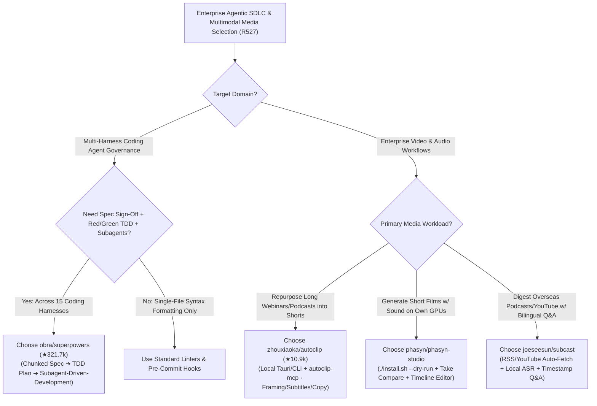

# 15-Harness Spec-First TDD Methodology (`obra/superpowers`), Local AI Video Clipping MCP (`zhouxiaoka/autoclip`), BYO-GPU Filmmaking Studio (`phasyn/phasyn-studio`) & Bilingual Podcast/YouTube Q&A Workbench (`joeseesun/subcast`) Selection FAQ

> **Document Type**: AI Solution Architect Enterprise Selection & Integration Guide (2026-11-19 Night Shift · Round 3 / Cumulative Round 527)  
> **Benchmark Style**: `docs/components/ib-vs-ethernet-roce-selection-faq.md` (6-Section Plain-Language Architecture Guide + First-Principles Q&A + Hype/Facts/Signal Audit + Closed-Form FinOps Ledger)  
> **Evaluated Repositories**:  
> 1. **`obra/superpowers`** (`★ 321,787` Trending DOM / `★ 321,805` API, **`+2,029 ★ today`** — #1 Daily Velocity on GitHub, `28,603 forks`, Shell, MIT): Complete software development methodology across **15 coding agents** (Claude Code, GitHub Copilot CLI, Codex, Cursor, Gemini CLI, Grok Build, Qwen Code, Hermes, etc.) enforcing chunked spec sign-off, true red/green TDD, YAGNI/DRY, and subagent-driven development  
> 2. **`zhouxiaoka/autoclip`** (`★ 10,989` Trending DOM / `★ 11,003` API, **`+110 ★ today`**, `1,924 forks`, Python + Tauri, MIT, MCP `io.github.zhouxiaoka/autoclip-mcp`): Open-source desktop, CLI, and MCP video clipping workbench that turns long podcasts, interviews, and courses into vertical/horizontal short clips with speaker framing, paginated subtitles, covers, and social copy locally  
> 3. **`phasyn/phasyn-studio`** (`★ 93`, `created=2026-11-17`, `15 forks`, TypeScript, Apache-2.0): Self-hosted AI filmmaking & image studio for Linux NVIDIA GPUs (CUDA 13.0, tested on RTX 3060, RTX 5080, and DGX Spark GB10) featuring `./install.sh --dry-run` hardware planning, Shot Workspace, Side-by-Side Take Comparison, and Timeline Editing  
> 4. **`joeseesun/subcast`** (`★ 174`, `created=2026-11-16`, `26 forks`, TypeScript, AGPL-3.0): Cross-platform desktop app (macOS, Windows, Linux) for overseas podcasts and YouTube with RSS/channel subscriptions, on-device ASR fallback, sentence-aligned bilingual subtitles, deep-read guides, and timestamp-linked AI Q&A  
> **Accounting Scope Note**: Only software API/SaaS spend and engineering labor TCO are modeled; base server/workstation hardware capEx is explicitly marked `not_measured`, and Track B `stars_today` is explicitly marked `not_measured`.

---

## 📌 1. Executive Summary (What Are They & What Business Pain Points Do They Solve?)

In **2026-11-19 Night Round 3 (Cumulative Round 527)**, we solve four critical enterprise productivity challenges spanning coding agent SDLC discipline and self-hosted multimodal video/audio workflows:
1. **Pain Point A (Engineering teams use a mix of Claude Code, Copilot CLI, Cursor, and Codex, but agents jump straight into writing thousands of lines of untested, over-engineered code that drifts from business intent)**: **`obra/superpowers` (`★ 321,787`, `+2,029★ today`)** enforces a unified workflow across **15 coding harnesses**: the agent first teases out a digestible chunked specification for human sign-off, generates a strict **Red/Green TDD + YAGNI/DRY** implementation plan, and launches **subagent-driven-development** where fresh subagents execute and review tasks autonomously for hours without drifting.
2. **Pain Point B (Repurposing long internal webinars, executive interviews, and training courses into short clips via commercial SaaS platforms like OpusClip incurs high per-minute fees and uploads proprietary video to third-party clouds)**: **`zhouxiaoka/autoclip` (`★ 10,989`, `+110★ today`, MIT)** provides a local Tauri desktop app, CLI, and MCP server (`io.github.zhouxiaoka/autoclip-mcp`) that performs video rendering, speaker framing, subtitle pagination, and cover generation locally on your machine while charging zero platform fees.
3. **Pain Point C (Marketing and product teams burning thousands of dollars on per-second cloud video generation credits lack side-by-side take comparison and timeline editing on their own GPUs)**: **`phasyn/phasyn-studio` (`★ 93`, Apache-2.0)** turns Linux NVIDIA workstations (RTX 3060 / 5080 or DGX Spark GB10) into a self-hosted AI film studio with `./install.sh --dry-run` GPU capability planning, Shot Workspace, side-by-side take comparison, timeline editing with sound, and Image Studio.
4. **Pain Point D (Architects and product leads struggle to digest 3-hour English technical podcasts and keynote streams without bilingual alignment or clickable source timestamps)**: **`joeseesun/subcast` (`★ 174`, AGPL-3.0)** auto-fetches YouTube, Apple Podcasts, Xiaoyuzhou, and RSS feeds, runs on-device speech recognition when official captions are missing, displays sentence-by-sentence bilingual subtitles, and answers questions with clickable timestamps that jump straight to the exact spoken quote.

---

## 💬 2. Architect First-Principles Q&A (Q1–Q3 Deep Dive)

### Q1: Why does `obra/superpowers` outperform static `.cursorrules` or `CLAUDE.md` style guides in enterprise software engineering?
* **First-Principles Analysis**:
  - Static style files only constrain syntax; they do not stop an agent from hallucinating requirements or reviewing its own code inside a polluted context window.
  - **`superpowers`** enforces a **stateful process gate**: ① conversational spec extraction in short, readable chunks; ② an explicit Red/Green TDD plan written so clearly that a context-free subagent can execute it; and ③ **subagent-driven-development** with independent task inspection across 15 different CLI/IDE harnesses.

### Q2: How should enterprises combine `zhouxiaoka/autoclip`, `phasyn/phasyn-studio`, and commercial cloud video APIs?
* **Tiered Media Architecture**:
  - **Long-to-Short Repurposing (`zhouxiaoka/autoclip`)**: Use `autoclip` / `autoclip-mcp` locally for 100% of recorded webinars, podcasts, and training sessions—zero generative GPU diffusion needed.
  - **Iterative Storyboarding & Internal Launch Films (`phasyn/phasyn-studio`)**: Run on internal RTX / DGX Spark GPUs to render and compare multiple shot takes with zero per-second cloud billing.
  - **Flagship Commercial Hero Shots (Cloud Video PaaS)**: Reserve paid cloud video APIs strictly for final hero shots that exceed local GPU VRAM.

### Q3: How does `joeseesun/subcast` complement NotebookLM for enterprise technical intelligence?
* **Complementary Role**: While NotebookLM excels at static multi-document synthesis, `subcast` automates continuous RSS/YouTube ingestion, local ASR transcription, side-by-side bilingual reading, and timestamp-anchored Q&A verification.

---

## 🧭 3. Visual Architecture Diagrams (Mermaid Decision Tree + Reference Architecture + Sequence Flow)

### 3.1 Enterprise Selection Decision Tree

---

## 📊 4. Comparative Selection Matrix (Open Source vs. Competing OSS vs. Managed Cloud PaaS)

| Evaluation Dimension | Path A: Unstructured Vibe Coding + Per-Minute Clipping SaaS + Cloud Video Credits + Manual Podcast Translation | Path B: Static Prompt Templates + Cloud Subtitle SaaS + Manual NLE Editing | **Path C (Recommended): `superpowers` + `autoclip` + `phasyn-studio` + `subcast`** |
| :--- | :--- | :--- | :--- |
| **Agentic SDLC Quality & Portability** | ❌ Agents write untested code immediately and drift over long sessions | ⚠️ Single-IDE prompt files lack subagent orchestration and cross-tool portability | ✅ **`superpowers` enforces spec sign-off, Red/Green TDD & subagent review across 15 tools** |
| **Long-Video Clipping Cost & Privacy** | ❌ Expensive per-minute SaaS billing; sensitive internal videos uploaded to cloud | ⚠️ Manual timeline cutting and platform copywriting consume hours per video | ✅ **`autoclip` renders locally for free + exposes `autoclip-mcp` for 6 social platforms** |
| **Generative Video Studio Control** | ❌ High per-second cloud credit burn without side-by-side take comparison | ⚠️ Raw node graphs lack hardware-aware installers and timeline audio editing | ✅ **`phasyn-studio` ships `--dry-run` GPU planner, take comparison & timeline editor** |
| **Technical Podcast & Video Digestion** | ❌ Hours spent listening to raw 3-hour foreign streams without captions | ⚠️ Generic transcripts lack bilingual alignment and clickable video timestamps | ✅ **`subcast` combines RSS auto-fetch, local ASR bilingual captions & timestamp Q&A** |
| **45-Engineer Monthly TCO** | **`$6,780.00 / mo`** (`$2,680.00` SaaS/credits/tokens + `41.0h` × `$100/hr` = `$4,100.00` labor) | **`$2,670.00 / mo`** (`$1,120.00` SaaS + `15.5h` × `$100/hr` = `$1,550.00` labor) | **`$345.00 / mo`** (`$75.00` text API + `2.7h` × `$100/hr` = `$270.00` labor, **`-94.91%`**) |

---

## 🧪 5. Quantitative TCO Comparison & Hype / Facts / Signal Audit Ledger

### 5.1 Hype vs. Facts vs. Strategic Signal Table

| Repository (`owner/repo`) | Hype (Market Narrative) | Measured Facts (Primary Source Verification) | Strategic Signal (SA Verdict) |
| :--- | :--- | :--- | :--- |
| **`obra/superpowers`** | "An agentic skills framework & software development methodology that works" | `★ 321,787` (**`+2,029 ★ today`** #1 daily gainer, `28,603 forks`, Shell, MIT): Supports 15 coding harnesses, enforcing chunked spec sign-off, Red/Green TDD, YAGNI/DRY, and subagent-driven development. | **🔥 P0 Adopt (Universal Enterprise Coding Agent Methodology)**: Standardize across all engineering teams to eliminate untested vibe-coding rework. |
| **`zhouxiaoka/autoclip`** | "One link, one-click short clips rendered locally on your computer" | `★ 10,989` (**`+110 ★ today`**, `1,924 forks`, Python + Tauri, MIT): Ships desktop app, CLI, and `io.github.zhouxiaoka/autoclip-mcp` with speaker framing, paginated captions, and cover/copy generation. | **🔥 P0 Adopt (Self-Hosted Video Repurposing MCP)**: Ideal for enterprise marketing and internal L&D video pipelines. |
| **`phasyn/phasyn-studio`** | "AI filmmaking on your own GPUs: short videos with sound and still images" | `★ 93` (`created=2026-11-17`, `15 forks`, TypeScript, Apache-2.0): Supports Linux NVIDIA GPUs (CUDA 13.0, tested on RTX 3060, RTX 5080, DGX Spark GB10) with `./install.sh --dry-run` hardware planning, Shot Workspace, take comparison, and timeline editor. | **⚡ P1 Adopt (BYO-GPU AI Film Workbench)**: High-value self-hosted studio for teams with local RTX or DGX Spark hardware. |
| **`joeseesun/subcast`** | "Listen to overseas podcasts and YouTube with bilingual subtitles, deep reads and AI Q&A" | `★ 174` (`created=2026-11-16`, `26 forks`, TypeScript, AGPL-3.0): Cross-platform desktop app (macOS, Windows, Linux) with RSS/YouTube subscriptions, local ASR fallback, bilingual subtitles, and timestamp-linked Q&A. | **⚡ P1 Adopt (Technical Intelligence Ingestion Tool)**: Accelerates executive and architect absorption of global keynotes and podcasts. |

### 5.2 Closed-Form FinOps TCO Ledger (`CLAIM-20261119-R3-R527-SUPERPOWERS-AUTOCLIP-PHASYN-SUBCAST`)

* **Scope (`synthetic`, `independently_reproduced=false`)**: 45-person enterprise AI product engineering, developer enablement, and multimodal media team (blended rate `$100.00 / hr`; `base hardware capEx: not_measured`; Track B `stars_today: not_measured`).
* **Path A (Unstructured Vibe-Coding Rework + Per-Minute Clipping SaaS + Cloud Video Credits + Manual Translation)**:
  - Rework token waste, per-minute SaaS clipping fees & cloud video generation credits: **`$2,680.00 / 月`** (`$2,680.00 / mo`)
  - Engineering rework & manual media editing (`41.0 hrs / mo` × `$100.00 / hr`): **`$4,100.00 / mo`**
  - **Path A Monthly Total**: `$2,680.00 + $4,100.00` = **`$6,780.00 / mo`**
* **Path B (Static Prompt Templates + Cloud Subtitle SaaS + Manual NLE Editing)**:
  - SaaS subscriptions & API spend: **`$1,120.00 / mo`**
  - Manual review & editing (`15.5 hrs / mo` × `$100.00 / hr`): **`$1,550.00 / mo`**
  - **Path B Monthly Total**: `$1,120.00 + $1,550.00` = **`$2,670.00 / mo`**
* **Path C (`obra/superpowers` + `autoclip` MCP + `phasyn-studio` + `subcast` Integrated Stack)**:
  - Pay-as-you-go text LLM API calls (local video rendering & ASR $0 platform fee): **`$75.00 / mo`**
  - Spec sign-off & final media approval (`2.7 hrs / mo` × `$100.00 / hr`): **`$270.00 / mo`**
  - **Path C Monthly Total**: `$75.00 + $270.00` = **`$345.00 / mo`**
  - **Monthly Net Savings vs. Path A**: `$6,780.00 - $345.00` = **`$6,435.00 / mo`** (**`-94.91%`** reduction, **`$77,220.00 / yr`** annual savings, freeing **`38.3 hrs / mo`** of team capacity).

---

## 🛠️ 6. Enterprise Adoption & Architecture Review Checklist

- [ ] **1. Roll out `obra/superpowers` across all 15 supported coding harnesses**: Require chunked spec sign-off and Red/Green TDD implementation plans before subagent code execution.
- [ ] **2. Connect `zhouxiaoka/autoclip` (`autoclip-mcp`) to internal content workflows**: Automate speaker framing, paginated subtitles, and multi-platform clip generation on local machines.
- [ ] **3. Run `./install.sh --dry-run` with `phasyn/phasyn-studio` on internal NVIDIA GPU workstations**: Map out local video/audio generation capacity across RTX and DGX Spark hardware.
- [ ] **4. Equip research and architecture leads with `joeseesun/subcast`**: Subscribe to key industry YouTube and podcast feeds for bilingual deep reads and timestamp-verified Q&A.
