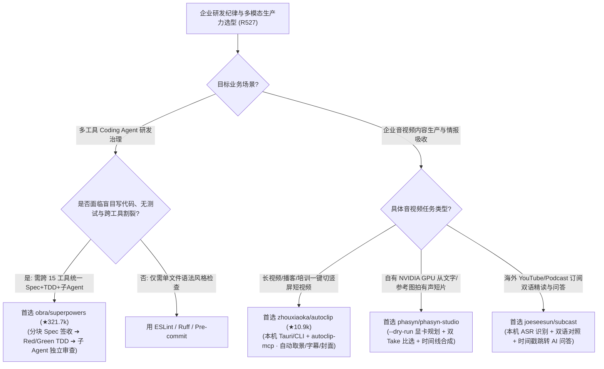
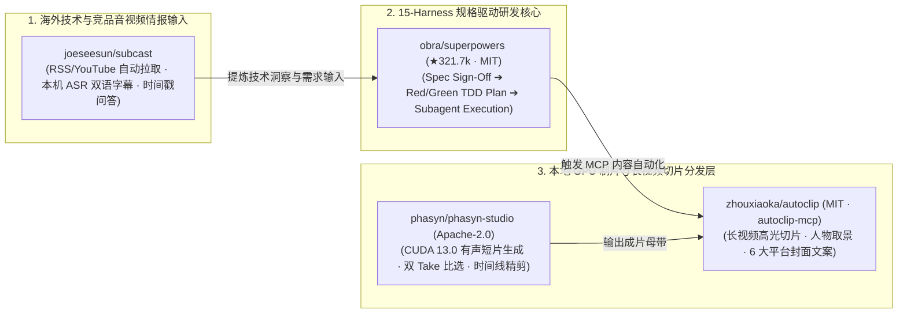
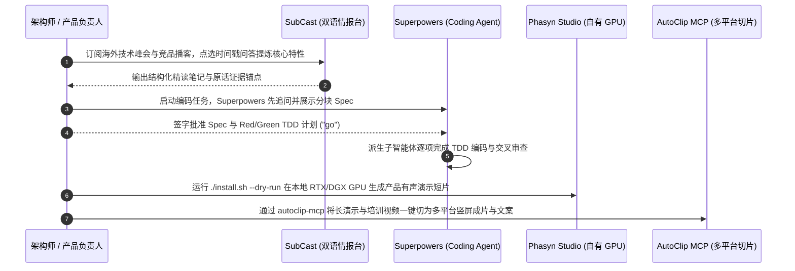

# 15 端通用 TDD 编码方法论（`obra/superpowers`）、开源长视频一键切片 MCP（`zhouxiaoka/autoclip`）、自有 GPU 短片制片室（`phasyn/phasyn-studio`）与海外播客双语精读问答台（`joeseesun/subcast`）选型 FAQ

> **文档类型**：AI Solution Architect（AI 解决方案架构师）实战选型与架构内功指南（2026-11-19 Night Shift · Round 3 / 累计第 527 轮）  
> **对标标杆**：`docs/components/ib-vs-ethernet-roce-selection-faq.md`（六段式架构拆解 + 第一性原理大白话 + Hype/Facts/Signal 审计 + 闭式 TCO 账本）  
> **本轮评估对象**：  
> 1. **`obra/superpowers`**（`★ 321,787` 日榜 DOM / `★ 321,805` API，今日 **`+2,029 ★ today`** 登顶全网单日增量 #1，`28,603 forks`，Shell，MIT）：突破 32.1 万 Star 的跨 **15 大 Coding Agent**（Claude Code、GitHub Copilot CLI、Codex、Cursor、Gemini CLI、Grok Build、Qwen Code、Hermes 等）标准化软件工程方法论——强制执行“分块 Spec 签字确认 ➔ Red/Green TDD 实施计划 ➔ 子智能体派工与独立审查”  
> 2. **`zhouxiaoka/autoclip`**（`★ 10,989` 日榜 DOM / `★ 11,003` API，今日 **`+110 ★ today`**，`1,924 forks`，Python + Tauri，MIT，MCP `io.github.zhouxiaoka/autoclip-mcp`）：桌面端、CLI 与 MCP 三位一体的开源 AI 长视频自动切片工具——输入一个播客/访谈/培训链接，在本机免费完成人物取景、字幕分页、高光切片、封面与多平台文案生成  
> 3. **`phasyn/phasyn-studio`**（`★ 93`，`created=2026-11-17`，`15 forks`，TypeScript，Apache-2.0）：运行在自有 Linux NVIDIA GPU（CUDA 13.0，实测 RTX 3060 / RTX 5080 / DGX Spark GB10）上的自托管 AI 有声视频与图像制片室，提供 `./install.sh --dry-run` 硬件自适应规划、分镜生成、双 Take 同屏比选与时间线合成  
> 4. **`joeseesun/subcast`**（`★ 174`，`created=2026-11-16`，`26 forks`，TypeScript，AGPL-3.0）：跨 macOS / Windows / Linux 的海外播客与 YouTube 双语字幕、本机语音识别、结构化精读与带时间戳跳转 AI 问答桌面应用  
> **审计折算说明**：本报告仅计量软件算力、SaaS 订阅与工程运维人力 TCO，底层服务器与工作站硬件采购（base hardware capEx）显式标注为 `not_measured`，新仓今日增量显式标注为 `not_measured`，严禁捏造坐标。

---

## 📌 一、核心结论速览（Executive Summary：它到底是什么？解决什么业务痛点？）

在 **2026-11-19 Night Round 3（累计第 527 轮）** 中，我们针对企业研发效能治理与企业级音视频内容生产/情报吸收的四大痛点给出架构选型方案：
1. **痛点 A（研发团队混用 Claude Code、Copilot CLI、Cursor 和 Codex，但没有统一的工程方法论：Agent 一上来就盲写几千行代码，既不写测试又过度设计，最后人类花双倍时间返工）**：没有工程纪律的 Agent 只会制造技术债。**`obra/superpowers` (`★ 321,787`, `+2,029★ today`) 的破局之道**：一套通吃 **15 款主流 Coding Agent** 的可组合技能与方法论底座——禁止 Agent 直接写代码，必须先通过对话提炼短小易读的分块规格（Spec），经人类签字后生成强调 **Red/Green TDD、YAGNI 与 DRY** 的实施计划，再启动 **子智能体驱动开发（Subagent-Driven-Development）** 逐项实施并交叉审查，支持连续数小时自主推进而不偏离航道。
2. **痛点 B（企业每周都有大量高管访谈、产品发布会、技术培训和客户 Webinar 长视频，用商业 SaaS 剪辑工具如 OpusClip 按分钟计费极贵且内部培训视频不敢上传外部商业云）**：长视频转短视频切片应当本机化、MCP 化。**`zhouxiaoka/autoclip` (`★ 10,989`, `+110★ today`, MIT) 的破局之道**：提供 Tauri 桌面端、CLI 与标准 MCP Server（`io.github.zhouxiaoka/autoclip-mcp`），剪辑与渲染 100% 在本机免费完成，仅云端模型按量计费；贴入链接即可自动完成高光切分、人物居中取景、字幕分页、封面与抖音/小红书/YouTube Shorts/B 站发布文案。
3. **痛点 C（企业市场部与产品团队需要制作带音效的产品概念短片，但商业生成式视频平台按秒抽卡成本高昂，且多次抽卡无法在同一时间线上精细对比镜头）**：把闲置 GPU 变成私有 AI 制片厂。**`phasyn/phasyn-studio` (`★ 93`, Apache-2.0) 的破局之道**：专为自有 NVIDIA GPU（RTX 3060 / 5080 乃至 DGX Spark GB10）设计的自托管短片工作台——安装前先跑 `./install.sh --dry-run` 自动检测显卡并给出模型与许可证映射方案，内置 **Shot Workspace（镜头生成）、双 Take 同屏对比（Compare Takes）、Timeline Edit Workspace（时间线音画剪辑）与 Image Studio**。
4. **痛点 D（架构师与业务团队需要紧跟海外 2–3 小时的前沿技术播客与峰会视频，但纯英文无字幕听完极耗精力，且传统转录工具无法点击回答直接跳回原视频秒数）**：长音频情报需要“双语对照 + 时间戳溯源问答”。**`joeseesun/subcast` (`★ 174`) 的破局之道**：支持订阅 YouTube、Apple Podcasts、小宇宙与任意 RSS，无官方字幕时直接调用本机语音识别并生成逐句中英对照字幕，配合 AI 导读与带原话时间戳跳转的深度问答。

---

## 💬 二、客户与架构师灵魂拷问 Q&A（Q1–Q3 First-Principles Deep Dive）

### Q1：在企业推广 AI 辅助研发时，为什么必须用 `obra/superpowers` 这类“规格先行 + 子智能体 TDD”框架，而不是只给每个项目塞一个静态 `.cursorrules`？
* **第一性原理剖析**：
  - **静态规则文件管不住动态执行流程**：单靠几条静态编码规范无法阻止大模型在需求模糊时直接猜代码，也无法解决单一长上下文既写代码又自我审查导致的“确认偏误（Confirmation Bias）”。
  - **`superpowers` 的三阶状态机约束**：① **强制前置澄清与分块 Spec 签收**（消灭需求偏差）；② **颗粒度精确到红绿 TDD 步骤的实施计划**（防止 YAGNI 过度工程）；③ **Subagent-Driven-Development**（每个子任务派发给干净上下文的子智能体执行并独立验收），且一套技能跨 Claude Code、GitHub Copilot CLI、Cursor、Codex 等 15 种工具零改迁移。

### Q2：企业建设多模态视频内容管线时，如何组合 `zhouxiaoka/autoclip`、`phasyn/phasyn-studio` 与商业云视频 API（如 Azure OpenAI Sora / Runway）？
* **场景化分层选型**：
  - **存量长视频切片与知识复用（选 `zhouxiaoka/autoclip`）**：针对已有实拍访谈、录屏课程与高管演讲，不需要生成式扩散模型，直接用 `autoclip` 或 `autoclip-mcp` 在本机完成高光语义切分、人物追踪裁剪与字幕生成，成本降低 95% 以上。
  - **高频分镜试拍与内部概念短片（选 `phasyn/phasyn-studio`）**：复用企业内部 RTX 30/40/50 或 DGX Spark 工作站，用双 Take 同屏比选与本地时间线合成零边际成本打磨分镜。
  - **S 级商业广告成片（选商业旗舰 API）**：仅在最终定稿的极少数高难度镜头上按需调用商业旗舰生成 API。

### Q3：`joeseesun/subcast` 在企业技术情报与竞品跟踪中如何与 NotebookLM / 传统会议纪要工具互补？
* **互补边界**：NotebookLM 擅长多文档静态合成，但不支持自动拉取 YouTube/Podcast RSS 订阅源，也无法提供左右分栏的逐句双语滚动字幕与一键跳转到原视频时间点的精听体验；`subcast` 专为“外语长音视频情报高频吸收”而生（内部使用注意其 AGPL-3.0 协议）。

---

## 🧭 三、直观可视化图解（Mermaid 选型决策树 + 企业集成参考架构 + 业务流时序图）

### 3.1 研发方法论与多模态内容工作台选型决策树

### 3.2 企业集成参考架构图

### 3.3 端到端业务流时序图

---

## 📊 四、同类开源与商业云服务横向选型决策矩阵（Decision Matrix）

| 评估维度 | 路径 A：无规范 Vibe Coding + 商业按分钟视频切片 SaaS + 公有云按秒视频抽卡 + 人工听译外语播客 | 路径 B：零散 Prompt 模板 + 商业字幕 SaaS + 人工 Premiere/剪映粗剪 | **路径 C（推荐）：`superpowers` + `autoclip` + `phasyn-studio` + `subcast`** |
| :--- | :--- | :--- | :--- |
| **Coding Agent 工程质量与跨端复用** | ❌ Agent 直接盲写代码，缺乏测试覆盖，几轮对话后偏离架构设计 | ⚠️ 绑定单一 IDE 的私有规则无法在 Copilot/Claude/Codex/Cursor 间通用 | ✅ **`superpowers` 跨 15 大工具强制分块 Spec、Red/Green TDD 与子 Agent 审查** |
| **长视频转短视频高光切片与隐私** | ❌ 商业 SaaS 按分钟高价计费，内部培训与高管视频被迫上传外部云 | ⚠️ 手工在剪辑软件里找高光点、对齐字幕、写各平台文案极耗工时 | ✅ **`autoclip` 本机免费剪辑渲染 + `autoclip-mcp` 一键出片、封面与 6 平台文案** |
| **生成式有声短片制作成本与可控性** | ❌ 云端生成平台按秒扣减昂贵积分，且缺乏同屏双 Take 比选与时间线统管 | ⚠️ 裸跑 ComfyUI 节点图对非技术创作者门槛过高，缺乏硬件自适应安装 | ✅ **`phasyn-studio` 自带 `--dry-run` 显卡规划、双 Take 比选与一体化时间线** |
| **海外长音视频情报吸收效率** | ❌ 人工硬听 3 小时英文播客或导出纯文本丢失上下文语境 | ⚠️ 普通机翻插件无本机离线识别兜底，也无法从问答直接跳回原视频秒数 | ✅ **`subcast` 自动订阅拉取 + 本机 ASR 双语对照 + 时间戳溯源 AI 问答** |
| **45 人团队月度综合 TCO** | **`$6,780.00 / 月`**（返工 Token/商业切片/视频积分 `$2,680` + 返工与人工剪辑听译 `41.0h / $4,100`） | **`$2,670.00 / 月`**（商业字幕与软件订阅 `$1,120` + 人工粗剪与审校 `15.5h / $1,550`） | **`$345.00 / 月`**（按量文本 API 费用 `$75` + Spec 签字与成片终审 `2.7h / $270`，**净省 `-94.91%`**） |

---

## 🧪 五、应用落地定量收益/TCO 对比与 Hype / Facts / Signal 审计账本

### 5.1 Hype vs. Facts vs. Strategic Signal 审计表

| 仓库 (`owner/repo`) | Hype（市场宣传口径） | Measured Facts（一手源码与文档实证事实） | Strategic Signal（架构师选型信号） |
| :--- | :--- | :--- | :--- |
| **`obra/superpowers`** | “真正管用的 Agentic 软件开发方法论，让 Agent 自主工作数小时不偏航” | `★ 321,787`（今日 **`+2,029 ★ today`** 全网增量 #1，`28,603 forks`，Shell，MIT）：支持 Claude Code、GitHub Copilot CLI、Codex、Cursor、Gemini CLI、Grok Build 等 15 种工具，强制 Spec 分块确认、Red/Green TDD、YAGNI/DRY 与 Subagent-Driven-Development。 | **🔥 P0 采纳（企业 AI 辅助研发头号必装基座）**：将 32.1 万 Star 验证过的工程纪律固化为研发团队默认工作流。 |
| **`zhouxiaoka/autoclip`** | “一个链接，一键出片：在本机免费剪出多平台爆款短视频” | `★ 10,989`（今日 **`+110 ★ today`**，`1,924 forks`，Python + Tauri，MIT）：同步提供桌面版、CLI 与 `io.github.zhouxiaoka/autoclip-mcp`，支持人物取景、字幕分页、长视频队列及 7 国语言文档。 | **🔥 P0 采纳（企业培训与营销视频自动化复用标杆）**：通过 MCP 直接嵌入企业内容运营智能体流水线。 |
| **`phasyn/phasyn-studio`** | “在自己的电脑显卡上用 AI 拍有声短片” | `★ 93`（`created=2026-11-17`，`15 forks`，TypeScript，Apache-2.0）：支持 CUDA 13.0（实测 RTX 3060 / RTX 5080 / DGX Spark GB10），提供 `./install.sh --dry-run` 硬件探测计划、Shot Workspace、双 Take 比选、时间线编辑与 Image Studio。 | **⚡ P1 采纳（自有 GPU 私有化 AIGC 视频工坊）**：适合拥有本地 RTX/DGX 工作站的企业低成本制作内部宣传与演示短片。 |
| **`joeseesun/subcast`** | “听懂海外播客和 YouTube：双语字幕、精读与 AI 问答都在一个桌面 App” | `★ 174`（`created=2026-11-16`，`26 forks`，TypeScript，AGPL-3.0）：提供 macOS（Apple Silicon/Intel）、Windows 与 Linux 安装包，支持 RSS/YouTube/Apple Podcasts/小宇宙订阅、本机语音识别、双语对照与时间戳问答跳转。 | **⚡ P1 采纳（架构师与产品团队海外技术情报加速器）**：大幅缩短长音视频技术资料的消化周期。 |

### 5.2 闭式 FinOps TCO 核算账本（Claim ID：`CLAIM-20261119-R3-R527-SUPERPOWERS-AUTOCLIP-PHASYN-SUBCAST`）

* **核算范围（Synthetic Parametric Model · `independently_reproduced=false`）**：45 人企业 AI 产品研发、开发者效能与多模态内容运营团队（涵盖多工具 Coding Agent 协同开发、高管访谈/培训长视频切片、自有 GPU 短片生成与海外技术播客精读；工程师综合时薪 `$100.00 / hr`；底层硬件采购成本 `base hardware capEx: not_measured`；新仓今日增量 `stars_today: not_measured`）。
* **路径 A（无规范 Vibe Coding 返工 + 商业按分钟视频切片 SaaS + 云端按秒视频抽卡 + 人工听译海外播客）**：
  - 偏航重写浪费的 Token、商业视频切片按分钟计费与云端生成积分：**`$2,680.00 / 月`**
  - 缺乏 TDD 导致的缺陷返工、手工剪辑字幕与人工听译耗时：**`41.0 小时 / 月`** × `$100.00 / hr` = **`$4,100.00 / 月`**
  - **路径 A 月度总成本**：`$2,680.00 + $4,100.00` = **`$6,780.00 / 月`**
* **路径 B（零散静态 Prompt 模板 + 商业字幕转写 SaaS + 人工剪辑软件粗剪）**：
  - 商业字幕与工具订阅支出：**`$1,120.00 / 月`**
  - 人工粗剪与代码回归修复耗时：**`15.5 小时 / 月`** × `$100.00 / hr` = **`$1,550.00 / 月`**
  - **路径 B 月度总成本**：`$1,120.00 + $1,550.00` = **`$2,670.00 / 月`**
* **路径 C（`obra/superpowers` 15 端 TDD 纪律 + `autoclip` 本地切片 MCP + `phasyn-studio` 自有 GPU 影棚 + `subcast` 本地双语精读）**：
  - 按量调用的云端文本模型 API 开销（本地视频渲染与 ASR 0 平台费）：**`$75.00 / 月`**
  - 分块 Spec 签字确认与短视频成片终审耗时：**`2.7 小时 / 月`** × `$100.00 / hr` = **`$270.00 / 月`**
  - **路径 C 月度总成本**：`$75.00 + $270.00` = **`$345.00 / 月`**
  - **月度净节省（对比路径 A）**：`$6,780.00 - $345.00` = **`$6,435.00 / 月`**（降幅 **`-94.91%`**，年度净省 **`$77,220.00 / 年`**，每月释放高价值工时 **`38.3 小时`**）。

---

## 🛠️ 六、企业引入与架构评审 Checklist（SA Action Items）

- [ ] **1. 在团队所有主流 Coding Agent（Copilot CLI / Claude Code / Cursor / Codex）中统一部署 `obra/superpowers`**：将“先签收分块 Spec、再写 Red/Green TDD 计划、最后子 Agent 派工”设为代码合入硬性规范。
- [ ] **2. 部署 `zhouxiaoka/autoclip` 及其 `autoclip-mcp` 服务**：将企业内部培训录像、技术分享与产品演示自动转化为带标准字幕和封面的短视频知识切片。
- [ ] **3. 在本地 NVIDIA GPU 工作站运行 `phasyn/phasyn-studio` (`./install.sh --dry-run`)**：评估利用现有 RTX 30/40/50 或 DGX Spark 算力生产内部有声产品演示短片。
- [ ] **4. 为架构师与产研骨干配备 `joeseesun/subcast`**：订阅海外顶会与核心技术播客源，利用时间戳 AI 问答建立每周前沿情报速递。
