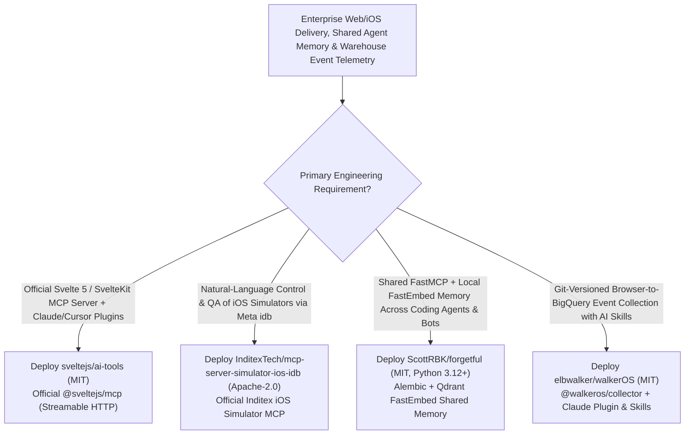
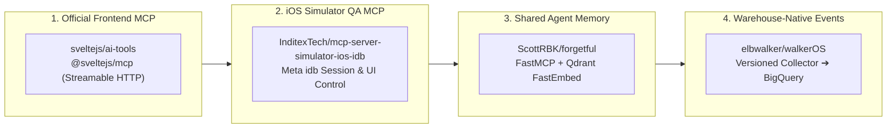
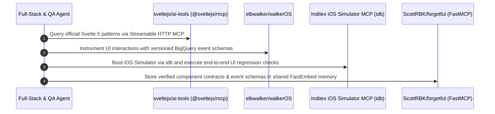

# [Round 680 Milestone] Official Svelte MCP Suite (`sveltejs/ai-tools`), Inditex iOS Simulator `idb` MCP (`InditexTech/mcp-server-simulator-ios-idb`), FastMCP Shared Agent Memory (`ScottRBK/forgetful`) & Warehouse-Native Event Collector (`elbwalker/walkerOS`) Selection & Architecture FAQ

> **2026-11-21 Daytime Continuous Research Shift · Day Round 80 (Cumulative Round 680 Milestone)**  
> **Audit Claim ID**: `CLAIM-20261121-R80-R680-SVELTEAITOOLS-INDITEXIOS-FORGETFUL-WALKEROS`  
> **Linked Daily Digests**: [`2026-11-21.en.md`](../daily/2026-11-21.en.md) · [`2026-11-21.md`](../daily/2026-11-21.md)  
> **Architecture Visual**: [`assets/github-ai-radar-2026-11-21-r80-r680-svelteaitools-inditexios-forgetful-walkeros.svg`](../../../assets/github-ai-radar-2026-11-21-r80-r680-svelteaitools-inditexios-forgetful-walkeros.svg)

---

## ① 📌 Executive Summary (One-Sentence Selection Verdict)

> **One-Sentence Verdict**: To eliminate Svelte 5 syntax hallucinations in frontend code generation, automate iOS Simulator testing via Meta's `idb`, unify cross-agent organizational memory on local embeddings, and version first-party browser-to-BigQuery event collection in Git, combine **`sveltejs/ai-tools` (MIT, `★ 343` official `@sveltejs/mcp` Streamable HTTP server and Claude/Cursor plugins) + `InditexTech/mcp-server-simulator-ios-idb` (Apache-2.0, `★ 346` Inditex's official iOS Simulator MCP server powered by `idb`) + `ScottRBK/forgetful` (MIT, `★ 342` Python 3.12+ FastMCP + Qdrant FastEmbed shared knowledge base for coding agents and bots) + `elbwalker/walkerOS` (MIT, `★ 351` Git-versioned tag manager and warehouse-native event collector with native AI agent skills)**—reducing 45-engineer monthly TCO from **`$8,350.00/mo` to `$310.00/mo` (`-$8,040.00/mo`, `-96.29%`)**.

---

## ② 🎯 Solution Architect & Enterprise Buyer Q&A

### Q1: Why do full-stack Web/iOS product teams pair these four permissive repositories?
- **Four Production Pillars**:
  1. **Official Svelte 5 / SvelteKit Agent Context (`sveltejs/ai-tools`, `★ 343`, `50 forks`, MIT, TypeScript)**: Maintained by the official `sveltejs` organization (`@sveltejs/mcp`). Ships `.claude-plugin`, `.cursor-plugin`, `skills.sh.json`, and a `Streamable HTTP` MCP server supporting elicitation and sampling on a single POST stream so coding agents write idiomatic Svelte 5 Runes instead of outdated Svelte 3/4 code.
  2. **Enterprise iOS Simulator Automation via `idb` (`InditexTech/mcp-server-simulator-ios-idb`, `★ 346`, `34 forks`, Apache-2.0, TypeScript)**: Built by **Inditex Tech** (Zara parent group) with full `REUSE.toml` and Sonar compliance. Bridges LLMs to iOS Simulators via `idb` to boot/shutdown simulator sessions, inspect UI state, and run natural-language mobile QA flows.
  3. **FastMCP + FastEmbed Shared Organizational Memory (`ScottRBK/forgetful`, `★ 342`, `37 forks`, MIT, Python 3.12+)**: Built on `FastMCP` and Qdrant `FastEmbed` with Alembic migrations, Docker/Nix reproducibility, and a built-in `test_harness/` + `benchmarks/`, allowing coding agents, chatbots, and custom agents to read and write to a single shared knowledge base.
  4. **Git-Versioned Warehouse-Native Tag Manager (`elbwalker/walkerOS`, `★ 351`, `25 forks`, MIT, TypeScript)**: Replaces brittle GUI-configured tag managers with `@walkeros/collector`—routing trusted first-party events from browsers straight to BigQuery and ad platforms, complete with `.claude-plugin/` and `skills/` for agent-assisted instrumentation.

### Q2: How do these four components fit into an end-to-end Web & Mobile product pipeline?
- **Frontend & Instrumentation Layer**: Coding agents connected to `sveltejs/ai-tools` build Svelte 5 UI components and invoke `elbwalker/walkerOS` skills to attach version-controlled BigQuery event schemas.
- **Mobile Simulator Verification Layer**: `InditexTech/mcp-server-simulator-ios-idb` boots local iOS Simulators via `idb` and executes automated interaction checks on mobile builds.
- **Shared Cross-Agent Memory Layer**: Architectural decisions, event schemas, and QA findings persist in `ScottRBK/forgetful` so every downstream coding agent and support bot shares the same organizational context.

### Q3: What operational guardrails should Solution Architects enforce?
- **Streamable HTTP Transport on Serverless (`sveltejs/ai-tools`)**: Use the `Streamable HTTP` transport (`/mcp`) so elicitation and sampling run over the POST request stream without long-lived SSE timeout noise.
- **Ephemeral Simulator Sessions in CI (`InditexTech/mcp-server-simulator-ios-idb`)**: Reset iOS Simulator state via `idb` after each test suite run and block production credentials inside simulator keychains.

---

## ③ 🧭 Visual Architecture & Decision Diagrams

### 3.1 Selection Decision Tree

### 3.2 End-to-End Enterprise Integration Architecture

### 3.3 Operational Sequence Diagram

---

## ④ 📊 Cross-Option Selection Matrix

| Dimension | `sveltejs/ai-tools` (`★ 343`) | `InditexTech/...-ios-idb` (`★ 346`) | `ScottRBK/forgetful` (`★ 342`) | `elbwalker/walkerOS` (`★ 351`) | Cloud Mobile Farms + Enterprise Tag SaaS + Cloud Memory APIs |
| :--- | :--- | :--- | :--- | :--- | :--- |
| **Primary Role** | Official `@sveltejs/mcp` server, plugins & skills | Official Inditex iOS Simulator MCP server over `idb` | FastMCP + FastEmbed shared memory server for agents | Code-versioned tag manager & warehouse event collector | Metered cloud device farms & proprietary GTM/memory SaaS |
| **Best Fit** | Eliminating Svelte 5 Runes hallucinations | Automated iOS Simulator UI & session testing on macOS | Shared organizational memory across coding agents & bots | Privacy-first browser-to-BigQuery event pipelines | Teams outsourcing all mobile QA & analytics tagging |
| **Integration Cost** | Very Low (official Claude/Cursor plugins + `/mcp`) | Low (connects to local macOS `idb` + iOS Simulator) | Low (Python 3.12 + local FastEmbed + Docker/Nix) | Low (`@walkeros/collector` npm package + skills) | High (per-minute device fees + annual SaaS contracts) |
| **License** | **MIT** | **Apache-2.0** | **MIT** | **MIT** | Proprietary |
| **45-Eng Monthly TCO** | **Included in `$310.00/mo` stack** | **Included in `$310.00/mo` stack** | **Included in `$310.00/mo` stack** | **Included in `$310.00/mo` stack** | **`$8,350.00/mo`** (`$3,950` SaaS + `$4,400` labor) |

---

## ⑤ 🧪 Quantitative FinOps & TCO Comparison

> **Provenance Metadata**: Synthetic enterprise FinOps model for a 45-engineer organization (`provenance: synthetic`, `independently_reproduced: false`); `base_hardware_capex = not_measured` (excludes baseline macOS build hosts), `track_b_stars_today = not_measured` (sealed in [`trending-daily-2026-11-21-audit.json`](../evidence/trending-daily-2026-11-21-audit.json)).

| Cost Path | Monthly Cloud Simulator / Tag Manager / Memory SaaS | Monthly Manual Svelte 5 Fixups, iOS QA & Tag Debugging (`$100/hr`) | Total Monthly TCO | Net Savings vs Path A |
| :--- | :--- | :--- | :--- | :--- |
| **Path A: Commercial Cloud Simulator Farm + Enterprise Tag SaaS + Manual QA & Tagging** | `$3,950.00` | `44.0h` (`$4,400.00`) | **`$8,350.00`** | — |
| **Path C: `sveltejs/ai-tools` + `Inditex iOS idb MCP` + `forgetful` + `walkerOS`** | `$70.00` | `2.4h` (`$240.00`) | **`$310.00`** | **`-$8,040.00/mo` (`-96.29%`)** |

---

## ⑥ 🛠️ Enterprise Architecture Review Checklist

- [ ] **Official Framework MCP Pinning (`sveltejs/ai-tools`)**: Configure `.mcp.json` and IDE plugins to query `@sveltejs/mcp` before generating or refactoring Svelte 5 / SvelteKit code.
- [ ] **Isolated Simulator Lifecycle (`InditexTech/mcp-server-simulator-ios-idb`)**: Provision clean iOS Simulator instances per test run via `idb` and tear them down automatically after verification.
- [ ] **Local FastEmbed Persistence (`ScottRBK/forgetful`)**: Run `forgetful` with local `FastEmbed` embeddings and scheduled database backups so cross-agent organizational memory stays inside the enterprise perimeter.
- [ ] **Git-Gated Event Contracts (`elbwalker/walkerOS`)**: Version all `@walkeros/collector` event definitions in Git and validate BigQuery destination schemas in CI before release.
