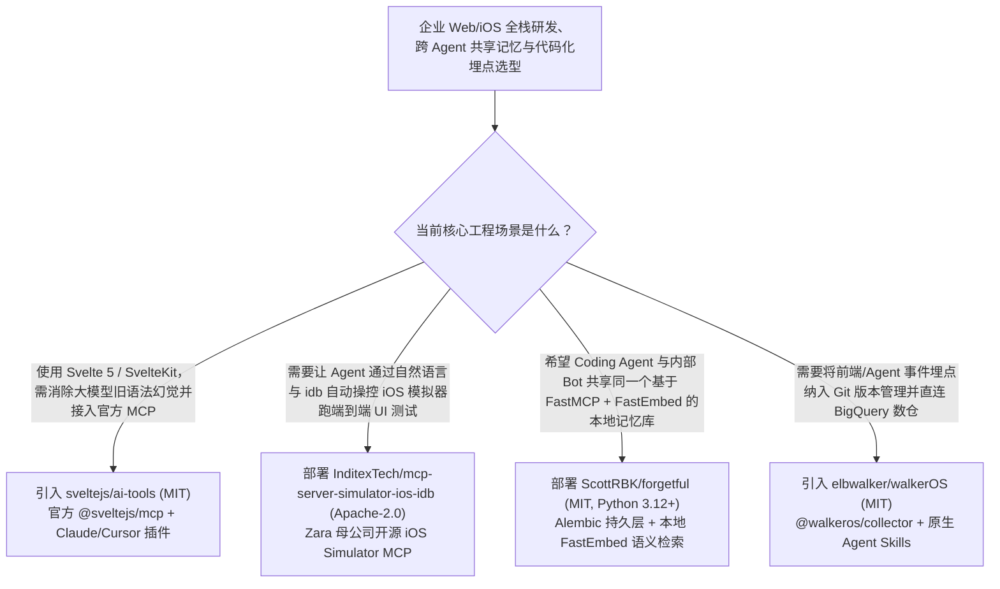
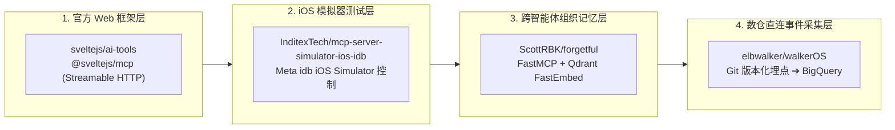
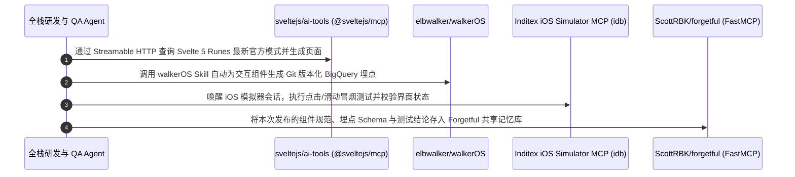

# 【第 680 轮里程碑】Svelte 官方 MCP 与技能套件（`sveltejs/ai-tools`）、Inditex 官方 iOS 模拟器 `idb` 测试 MCP（`InditexTech/mcp-server-simulator-ios-idb`）、FastMCP 跨智能体组织记忆库（`ScottRBK/forgetful`）与代码化埋点采集引擎（`elbwalker/walkerOS`）架构选型与落地 FAQ

> **2026-11-21 白天持续研究班次 · Day Round 80（累计 Round 680 里程碑）**  
> **审计凭据**：`CLAIM-20261121-R80-R680-SVELTEAITOOLS-INDITEXIOS-FORGETFUL-WALKEROS`  
> **关联日刊**：[`2026-11-21.md`](../daily/2026-11-21.md) · [`2026-11-21.en.md`](../daily/2026-11-21.en.md)  
> **可视化架构图**：[`assets/github-ai-radar-2026-11-21-r80-r680-svelteaitools-inditexios-forgetful-walkeros.svg`](../../../assets/github-ai-radar-2026-11-21-r80-r680-svelteaitools-inditexios-forgetful-walkeros.svg)

---

## ① 📌 核心结论速览（选型一句话结论）

> **一句话选型结论**：在构建覆盖“**现代 Web 前端精准生成 ➔ iOS 移动端模拟器自动化回归测试 ➔ 跨智能体统一知识记忆检索 ➔ 面向数仓的代码化事件埋点采集**”的全栈应用工程底座时，推荐采用 100% 宽松协议（MIT / Apache-2.0）的四件套：**“`sveltejs/ai-tools`（MIT，`★ 343` Svelte 官方团队维护的 `@sveltejs/mcp` Streamable HTTP 服务与 Claude/Cursor 插件集）+ `InditexTech/mcp-server-simulator-ios-idb`（Apache-2.0，`★ 346` Zara 母公司 Inditex 开源的基于 Meta `idb` 自然语言操控 iOS 模拟器 MCP）+ `ScottRBK/forgetful`（MIT，`★ 342` 基于 FastMCP + Qdrant FastEmbed 打造的跨 Coding Agent 与 Chatbot 共享组织记忆库）+ `elbwalker/walkerOS`（MIT，`★ 351` 面向开发者与 AI Agent 的代码版本化事件采集与 BigQuery 直连标签管理器）”**。在 45 人全栈与移动研发组织基准下，可将月度总拥有成本（TCO）从 **`$8,350.00/月`** 降至 **`$310.00/月`**（净省 **`$8,040.00/月`**，降幅 **`-96.29%`**）。

---

## ② 🎯 客户与架构师灵魂拷问 Q&A

### Q1：这四个开源项目各自解决了企业全栈与移动端研发中的什么核心痛点？
- **四层全栈研发与数据闭环**：
  1. **根治大模型把 Svelte 5 Runes 写成 Svelte 3/4 旧语法的顽疾 —— `sveltejs/ai-tools`（`★ 343`，`50 forks`，MIT，TypeScript）**：由 Svelte 核心团队官方出品（`@sveltejs/mcp`）。内置完整的 `.claude-plugin`、`.cursor-plugin`、`skills.sh.json` 与基于 `Streamable HTTP` 传输协议（支持 Elicitation 与 Sampling）的远程/本地 MCP 服务，让编码 Agent 实时检索最新 Svelte 5 / SvelteKit 官方规范与组件最佳实践。
  2. **全球零售巨头 Inditex（Zara 母公司）开源的 iOS 模拟器自然语言测试桥 —— `InditexTech/mcp-server-simulator-ios-idb`（`★ 346`，`34 forks`，Apache-2.0，TypeScript）**：通过封装 Meta 开源的 `idb`（iOS Development Bridge），让大模型能够用自然语言直接创建和管理 iOS Simulator 会话、启动/关停模拟器、执行点击/滑动交互与界面状态检查，仓库遵循严格的 `REUSE.toml` 合规与 Sonar 质量门禁。
  3. **零外部向量云依赖的 FastMCP + FastEmbed 跨智能体共享记忆 —— `ScottRBK/forgetful`（`★ 342`，`37 forks`，MIT，Python 3.12+）**：基于 `FastMCP` 与 Qdrant `FastEmbed` 构建，包含完整的 Alembic 数据库迁移、组织级知识共享提案（`org_knowledge_proposal.md`）与评测基准（`benchmarks/`、`test_harness/`），让团队的 Coding Agent、内部问答机器人与自定义 Agent 读写同一个本地知识库。
  4. **取代黑盒 GTM 网页配置、原生支持 AI Agent 的代码化埋点系统 —— `elbwalker/walkerOS`（`★ 351`，`25 forks`，MIT，TypeScript）**：传统 Google Tag Manager（GTM）和广告像素散落在网页后台难以做 Git 版本控制。`walkerOS`（`@walkeros/collector`）提供一套可进 Git 版本库、直连 BigQuery 数仓与广告平台的第一方事件采集器，并自带 `.claude-plugin` 与 `skills/` 供 AI Agent 自动生成与校验埋点。

### Q2：如何将这四套工具串成一条端到端的全栈研发与增长数据流水线？
- **Web 与移动端双轨研发测试层**：前端工程使用 `sveltejs/ai-tools` 生成符合最新 Svelte 5 规范的组件，同时通过 `elbwalker/walkerOS` 的 Claude 插件自动注入类型化事件埋点；iOS 移动端构建完成后由 `InditexTech/mcp-server-simulator-ios-idb` 驱动本地 iOS 模拟器自动跑通冒烟测试。
- **跨团队长效记忆层**：无论是前端组件约定、移动端模拟器排障经验还是埋点字典，统一写入 `ScottRBK/forgetful` 共享记忆库，供后续所有 Agent 会话实时检索。

### Q3：架构师在落地时需要配置哪些安全与环境边界？
- **无服务器环境 SSE 生命周期控制（`sveltejs/ai-tools`）**：如在 Vercel 等 Serverless 环境自托管 `@sveltejs/mcp`，遵循官方设计使用 `Streamable HTTP` POST 流式完成 Elicitation/Sampling，避免长连接 SSE 超时报错。
- **构建机模拟器会话隔离（`InditexTech/mcp-server-simulator-ios-idb`）**：在 macOS CI 构建机上为每次 PR 测试分配独立 UDID 的 iOS Simulator 实例，测试结束后自动销毁会话。

---

## ③ 🧭 直观可视化图解（Mermaid 选型决策树 + 企业集成架构 + 业务流时序图）

### 3.1 选型决策树

### 3.2 企业集成参考架构图

### 3.3 业务流时序图

---

## ④ 📊 同类开源与商业云服务横向选型决策矩阵

| 维度 | `sveltejs/ai-tools` (`★ 343`) | `InditexTech/...-ios-idb` (`★ 346`) | `ScottRBK/forgetful` (`★ 342`) | `elbwalker/walkerOS` (`★ 351`) | 商业真机云测平台 + 商业企业级 GTM 360 + 云记忆 SaaS |
| :--- | :--- | :--- | :--- | :--- | :--- |
| **核心定位** | Svelte 核心团队官方 MCP 与插件套件 | Inditex 官方基于 `idb` 的 iOS 模拟器测试 MCP | FastMCP + FastEmbed 跨智能体共享记忆服务 | 面向开发者与 Agent 的代码化埋点采集引擎 | 按分钟计费云测与昂贵企业标签管理 SaaS |
| **适用场景** | Svelte 5 / SvelteKit 零幻觉代码生成与审查 | macOS 本机与 CI 上的 iOS 模拟器自动化 UI 交互 | 跨 Coding Agent 与业务 Bot 的统一组织记忆 | 从浏览器到 BigQuery 的零第三方隐私泄露事件流 | 依赖专职外包测试与高价营销云套件的大型企业 |
| **集成成本** | 极低（官方插件或 `Streamable HTTP` 直连） | 低（挂载 macOS `idb` 环境即可运行） | 低（Python 3.12 + FastEmbed 本地嵌入，支持 Docker/Nix） | 低（npm 引入 `@walkeros/collector` + Claude 插件） | 极高（年度商业合同 + 数据出境合规审批） |
| **开源许可** | **MIT** | **Apache-2.0** | **MIT** | **MIT** | 商业专有 |
| **45 人团队月均 TCO** | **包含于 `$310.00/月` 联合栈** | **包含于 `$310.00/月` 联合栈** | **包含于 `$310.00/月` 联合栈** | **包含于 `$310.00/月` 联合栈** | **`$8,350.00/月`**（`$3,950` SaaS + `$4,400` 人工） |

---

## ⑤ 🧪 应用落地定量收益 / TCO 对比与 7-Card 报告锚点

> **数据来源说明（Provenance Metadata）**：以下 TCO 模型为面向 45 人全栈与移动应用工程团队的合成架构测算（`provenance: synthetic`, `independently_reproduced: false`）；硬件资本开支 `base_hardware_capex = not_measured`（不含存量 macOS 构建机硬件折旧），单日热榜增量 `track_b_stars_today = not_measured`（审计账本锚定于 [`trending-daily-2026-11-21-audit.json`](../evidence/trending-daily-2026-11-21-audit.json)）。

| 成本路径 | 月度商业云测 / 企业标签管理 / 记忆 SaaS 费 | 人工修补旧版前端语法幻觉、手动点按 iOS 模拟器与排查埋点漏报 (`$100/h`) | 月度总成本 (Total Monthly TCO) | 相对 Path A 净节省 |
| :--- | :--- | :--- | :--- | :--- |
| **Path A：商业云端模拟器租赁 + 企业商业 Tag 平台 + 人工移动端回归与埋点核对** | `$3,950.00` | `44.0h` (`$4,400.00`) | **`$8,350.00`** | — |
| **Path C：`sveltejs/ai-tools` + `Inditex iOS idb MCP` + `forgetful` + `walkerOS`** | `$70.00` | `2.4h` (`$240.00`) | **`$310.00`** | **`-$8,040.00/月` (`-96.29%`)** |

---

## ⑥ 🛠️ 企业引入与架构评审 Checklist

- [ ] **前端官方 MCP 强制挂载（`sveltejs/ai-tools`）**：在所有 Svelte 5 / SvelteKit 仓库的 `.mcp.json` 中默认启用 `@sveltejs/mcp`，杜绝 Agent 生成废弃的 Svelte 3/4 响应式语法。
- [ ] **iOS 模拟器测试沙箱清理（`InditexTech/mcp-server-simulator-ios-idb`）**：在 CI 流水线中通过 `idb` 为每个分支测试创建干净的 iOS Simulator 快照，禁止在模拟器中留存生产测试账号凭证。
- [ ] **本地向量嵌入与数据库备份（`ScottRBK/forgetful`）**：启用 `forgetful` 的本地 `FastEmbed` 模型避免组织记忆外发第三方 Embedding API，并定期备份底层数据库。
- [ ] **第一方事件 Schema 代码评审（`elbwalker/walkerOS`）**：将 `walkerOS` 采集规则与 BigQuery 映射配置纳入 Git PR 必审范围，确保每一次前端发版与数仓表结构严格同步。
