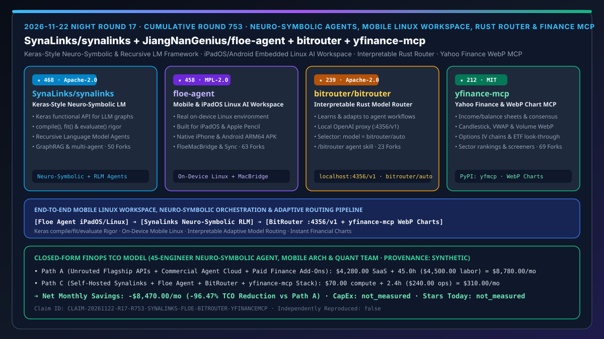
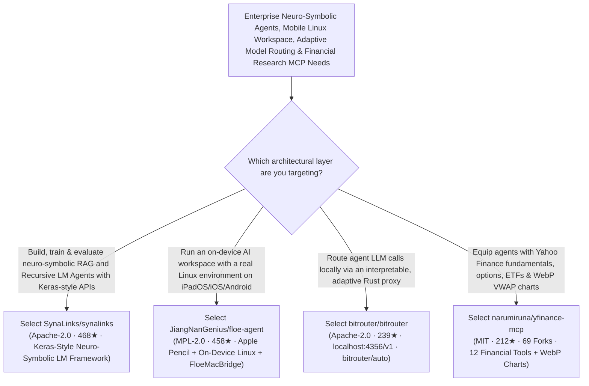
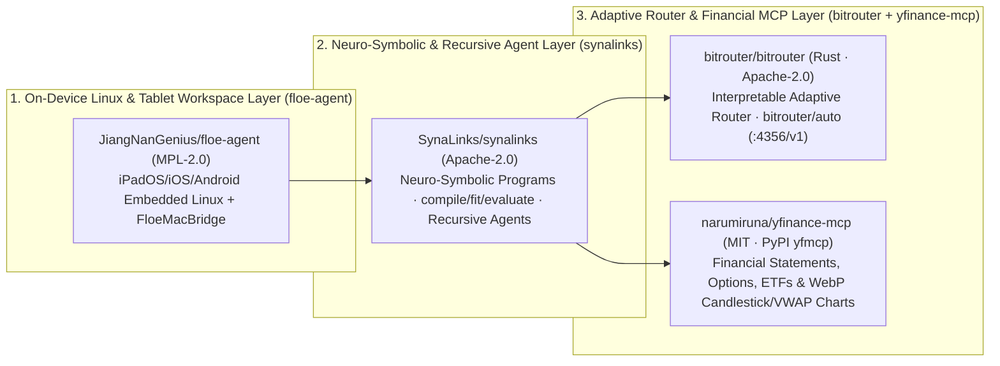
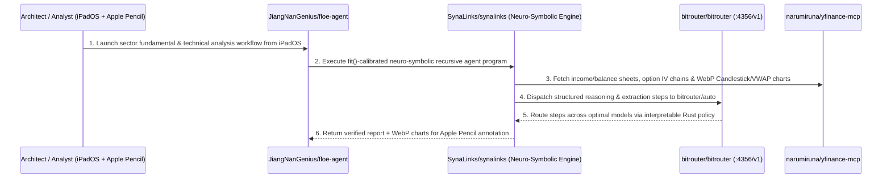

# Keras-Style Neuro-Symbolic & Recursive Agent Framework (`SynaLinks/synalinks`), On-Device Linux AI Workspace for iPadOS/iOS/Android (`JiangNanGenius/floe-agent`), Interpretable Rust Adaptive Model Router (`bitrouter/bitrouter`) & Yahoo Finance Charting MCP (`narumiruna/yfinance-mcp`) Selection & Architecture FAQ

> **Document Type**: Enterprise AI Solution Architect Selection & Integration Guide (GitHub Trending AI Radar — 2026-11-22 Night Round 17 / Cumulative Round 753)
> **Covered Repositories**: [`SynaLinks/synalinks`](https://github.com/SynaLinks/synalinks) (`★ 468`, `50 forks`, `Apache-2.0`: neuro-symbolic Language Model framework combining Keras-style functional API simplicity and deep-learning `compile/fit/evaluate` rigor for GraphRAG, tool-using agents, and Recursive Language Model Agents) · [`JiangNanGenius/floe-agent`](https://github.com/JiangNanGenius/floe-agent) (`★ 458`, `63 forks`, `MPL-2.0`: on-device AI workspace for iPadOS/Apple Pencil, iOS, and Android with a real embedded Linux environment and `FloeMacBridge`/`FloeDesktopSync` desktop pairing) · [`bitrouter/bitrouter`](https://github.com/bitrouter/bitrouter) (`★ 239`, `23 forks`, `Apache-2.0`: minimal interpretable Rust model router exposing `http://localhost:4356/v1` and `bitrouter/auto` with `/bitrouter` agent skill setup) · [`narumiruna/yfinance-mcp`](https://github.com/narumiruna/yfinance-mcp) (`★ 212`, `69 forks`, `MIT`, PyPI `yfmcp`: 12-feature Yahoo Finance MCP server returning financials, analyst targets, option chains, ETF look-throughs, and Candlestick/VWAP/Volume Profile WebP charts)
> **Core Scenario**: When enterprise quantitative research, solution architecture, and agent platform teams struggle with **brittle hand-tuned prompt chains that lack Keras-like `fit/evaluate` optimization, mobile/tablet apps that lack a real on-device Linux environment and Apple Pencil engineering workflow, unrouted agent calls burning flagship token budgets without interpretable local routing policies, and financial analysis agents that cannot render Candlestick/VWAP charts directly**, how do you combine **`SynaLinks/synalinks` + `JiangNanGenius/floe-agent` + `bitrouter/bitrouter` + `narumiruna/yfinance-mcp`** into an end-to-end architecture?

---

## 1. 📌 Executive Summary (One-Line Selection Verdict)

1. **Want to build, train, and evaluate neuro-symbolic RAG pipelines, multi-agent systems, and Recursive Language Model (RLM) agents in just a few lines of Python using Keras's familiar functional API (`compile()` / `fit()` / `evaluate()`)?** ➔ Choose **[`SynaLinks/synalinks`](https://github.com/SynaLinks/synalinks) (`★ 468`, `50 forks`, `Apache-2.0`)**.
   - **Plain-English Mechanism**: Treats structured LLM prompts, symbolic logic branches, and knowledge graph operations as composable computational graphs that can be systematically optimized and evaluated like deep learning models.
2. **Need an open-source (`MPL-2.0`) mobile and tablet AI workspace designed for iPadOS + Apple Pencil, iPhone, and Android that runs a real Linux environment on-device while bridging to your Mac/desktop via `FloeMacBridge`?** ➔ Choose **[`JiangNanGenius/floe-agent`](https://github.com/JiangNanGenius/floe-agent) (`★ 458`, `63 forks`, `MPL-2.0`)**.
   - **Plain-English Mechanism**: Combines document annotation, code editing, an on-device Linux runtime, `skill-hub`, and `FloeDeviceLink` synchronization so architects can run real CLI workflows and inspect repositories from an iPad or Android device.
3. **Need a minimal, interpretable Rust model router (`Apache-2.0`) that drops in via `OPENAI_BASE_URL=http://localhost:4356/v1` and `model="bitrouter/auto"` and adapts to your agent workflows?** ➔ Choose **[`bitrouter/bitrouter`](https://github.com/bitrouter/bitrouter) (`★ 239`, `23 forks`, `Apache-2.0`)**.
   - **Plain-English Mechanism**: A single Rust router sits between your agents and every LLM provider, offering transparent routing policies and one-command agent self-installation (`npx skills add bitrouter/bitrouter`).
4. **Need an `MIT`-licensed MCP server (`uvx yfmcp`) that gives AI assistants instant access to Yahoo Finance income statements, balance sheets, analyst targets, option chains, ETF holdings, and WebP Candlestick/VWAP/Volume Profile charts?** ➔ Choose **[`narumiruna/yfinance-mcp`](https://github.com/narumiruna/yfinance-mcp) (`★ 212`, `69 forks`, `MIT`)**.
   - **Plain-English Mechanism**: Wraps `yfinance` and server-side chart rendering into structured MCP tools returning both markdown tables and ready-to-display WebP technical charts.

---

## 2. 🎯 Architect & Customer Deep-Dive Q&A

### Q1: How do `synalinks`, `floe-agent`, `bitrouter`, and `yfinance-mcp` upgrade traditional agent development and financial research stacks?

- **Four Architectural Advantages**:
  1. **Neuro-Symbolic Rigor over Prompt Guesswork ➔ `SynaLinks/synalinks`**: Replaces fragile string templates with Keras-style computation graphs and Recursive Language Model agents that optimize against evaluation datasets.
  2. **Interpretable Local Model Routing ➔ `bitrouter/bitrouter`**: Routes routine tool steps to fast/low-cost models and complex reasoning to frontier models via inspectable Rust policies at `localhost:4356/v1`.
  3. **On-Device Mobile Linux + Apple Pencil Workspace ➔ `JiangNanGenius/floe-agent`**: Brings a real Linux environment and desktop bridge (`FloeMacBridge`) to iPadOS, iOS, and Android.
  4. **Turnkey Financial Data & WebP Technical Charts ➔ `narumiruna/yfinance-mcp`**: Delivers fundamentals, option chains, and rendered Candlestick/VWAP/Volume Profile images in one MCP call.
- **When to Choose Managed Cloud / Institutional Feeds (Path B)?**
  - Regulated trading desks requiring sub-millisecond Level-2 exchange feeds should use Bloomberg/Refinitiv enterprise terminals; for enterprise AI architecture prototyping, equity/sector research assistants, neuro-symbolic agent pipelines, and multi-model cost routing, deploy this open-source stack (Path C).

### Q2: How do these four projects integrate into a unified production architecture?

1. **Mobile & Tablet Linux Workspace Layer (`JiangNanGenius/floe-agent`)**:
   - Architects and analysts trigger workflows from iPadOS (with Apple Pencil) or Android, syncing artifacts via `FloeDesktopSync`.
2. **Neuro-Symbolic & Recursive Agent Orchestration Layer (`SynaLinks/synalinks`)**:
   - Executes type-safe neuro-symbolic programs and recursive sub-task decomposition in Python.
3. **Adaptive Model Routing & Financial Tool Layer (`bitrouter/bitrouter` + `narumiruna/yfinance-mcp`)**:
   - Routes all LLM completions through `bitrouter/auto` (`:4356/v1`) while invoking `yfinance-mcp` for financial statements, screeners, and WebP charts.

### Q3: How fast can existing OpenAI-compatible agents adopt `BitRouter`?

- **Zero Runtime Rewrite**:
  - Point `OPENAI_BASE_URL` to `http://localhost:4356/v1`, set model to `bitrouter/auto`, or run `npx skills add bitrouter/bitrouter` so your coding agent configures policies automatically.

---

## 3. 🧭 Visual Architecture & Workflow Diagrams (Mermaid)

### 3.1 Solution Architect Selection Decision Tree

### 3.2 End-to-End Enterprise Reference Architecture

### 3.3 End-to-End Neuro-Symbolic Execution, Adaptive Model Routing & Financial Charting Sequence Diagram

---

## 4. 📊 Peer Open-Source vs. Commercial Cloud Selection Matrix

| Dimension | `SynaLinks/synalinks` (`★ 468`) | `JiangNanGenius/floe-agent` (`★ 458`) | `bitrouter/bitrouter` (`★ 239`) | `narumiruna/yfinance-mcp` (`★ 212`) | Unrouted Flagship LLM Calls + Commercial Agent Cloud + Paid Finance Add-Ons (Path A) | Brittle Prompt Scripts + Fragile Mobile SSH + Hardcoded Model Switchers (Path B) |
| :--- | :--- | :--- | :--- | :--- | :--- | :--- |
| **Primary Role** | Keras-style neuro-symbolic & recursive LM framework | On-device Linux AI workspace for iPadOS/iOS/Android | Minimal interpretable Rust adaptive model router | Yahoo Finance fundamentals, options & WebP chart MCP | Per-seat cloud agent builder, unrouted flagship API billing & commercial data plugins | Ad-hoc prompt templates, mobile SSH clients & manual matplotlib scripts |
| **Key Differentiator** | **Keras functional API + neuro-symbolic schemas + RLM agents** | **Real on-device Linux + Apple Pencil UI + `FloeMacBridge`** | **Single Rust binary `bitrouter/auto` + `/bitrouter` skill** | **Financials/options/ETF look-through + WebP VWAP charts** | Every tool call hits expensive frontier models; no on-device mobile Linux | Manual prompt tuning guesswork; high script maintenance overhead |
| **License** | `Apache-2.0` | `MPL-2.0` | `Apache-2.0` | `MIT` | Proprietary SaaS | Internal glue scripts |
| **Monthly TCO (45-Eng Team)** | **`$310.00/mo` combined** (`$70.00` shared router/eval host + `2.4h` ops) | Included (on-device mobile/tablet execution) | Included (local Rust binary, zero proxy markup) | Included (`MIT` open-source MCP server) | **`$8,780.00/mo`** (`$4,280.00` unrouted frontier API & SaaS seats + `45.0h` tuning/glue labor) | ~`$3,050.00/mo` (manual prompt debugging & custom chart scraper maintenance) |

---

## 5. 🧪 Quantitative Enterprise ROI / FinOps TCO Model & 7-Card Report

> **📊 Provenance & Closed-Form Declaration**:
> - **provenance**: `synthetic` (45-engineer enterprise quantitative research, neuro-symbolic agent engineering, and mobile architecture team workload model: `independently_reproduced = false`; `base_hardware_capex = not_measured`; `track_b_stars_today = not_measured`).
> - **Closed-Form Equations**:
>   - **Path A (Unrouted Flagship LLM API Calls + Commercial Cloud Agent Seats + Paid Financial Charting Add-Ons + Manual Prompt Trial-and-Error & Scraper Glue)**: Monthly unrouted frontier API and SaaS seat bills **`$4,280.00`** + manual prompt debugging, custom charting glue, and cross-device sync labor **`45.0h × $100.00/h = $4,500.00`** = **`$8,780.00/mo`**.
>   - **Path C (Self-Hosted `SynaLinks/synalinks` + `JiangNanGenius/floe-agent` + `bitrouter/bitrouter` + `narumiruna/yfinance-mcp` Stack)**: Shared router/eval container compute **`$70.00`** + routing policy & neuro-symbolic graph maintenance labor **`2.4h × $100.00/h = $240.00`** = **`$310.00/mo`**.
>   - **Net Monthly Savings vs. Path A**: **`-$8,470.00/mo`** (**`96.47%`** TCO reduction).

| Evaluation Path | API/SaaS & Compute Cost | Prompt Tuning & Glue Maintenance Labor (`$100/h`) | Total Monthly TCO | Net Savings vs. Path A | Architectural Delivery Impact |
| :--- | :---: | :---: | :---: | :---: | :--- |
| **Path A: Unrouted Flagship APIs + Commercial Agent Cloud** | `$4,280.00` | `45.0h` (`$4,500.00`) | **`$8,780.00`** | Baseline | Frontier token waste on routine steps; no on-device mobile Linux |
| **Path B: Raw Prompt Strings + Hardcoded Routing + Custom Scrapers** | `$1,450.00` | `16.0h` (`$1,600.00`) | **`$3,050.00`** | `-$5,730.00` (`-65.26%`) | Lacks Keras-style `fit/evaluate` optimization & instant WebP VWAP charts |
| **Path C: `synalinks` + `floe-agent` + `bitrouter` + `yfinance-mcp`** | **`$70.00`** | **`2.4h` (`$240.00`)** | **`$310.00`** | **`-$8,470.00` (`-96.47%`)** | **Keras neuro-symbolic training + iPad Linux + Rust adaptive router** |

- 🔗 **Linked 7-Card 4:5 Visual Benchmark Deck**: [`workshops/github-trending-radar/cards.en.html`](../cards.en.html) · [`cards.html`](../cards.html)

---

## 6. 🛠️ Enterprise Adoption & Architecture Review Checklist

- [ ] **1. Standardize Neuro-Symbolic & Recursive Agents on `SynaLinks/synalinks`**: Replace ad-hoc prompt chains with Keras-style `compile()`, `fit()`, and `evaluate()` programs.
- [ ] **2. Equip Mobile Architects with `JiangNanGenius/floe-agent`**: Run on-device Linux environments on iPadOS (with Apple Pencil) and Android paired with desktop machines via `FloeMacBridge`.
- [ ] **3. Route Agent Model Traffic via `bitrouter/bitrouter`**: Point `OPENAI_BASE_URL` to `http://localhost:4356/v1` (`bitrouter/auto`) for interpretable, adaptive multi-provider routing.
- [ ] **4. Connect Financial Research Workflows to `narumiruna/yfinance-mcp`**: Retrieve financials, option chains, ETF holdings, and Candlestick/VWAP WebP charts via MCP.
