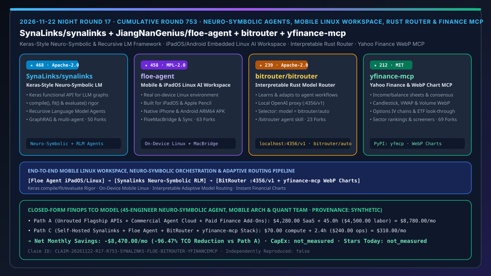
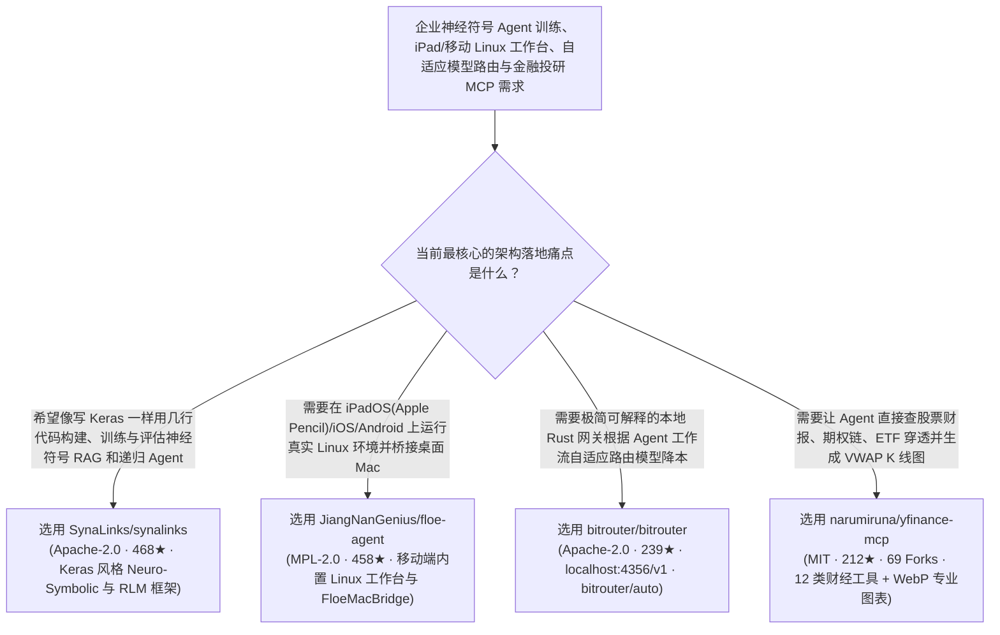
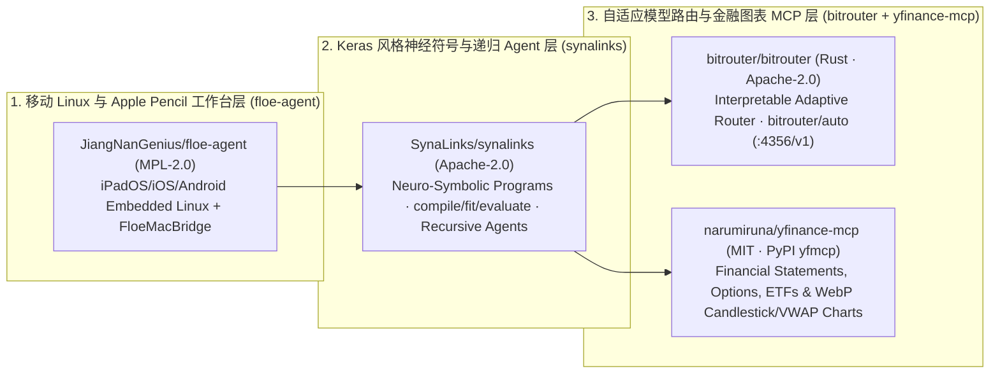
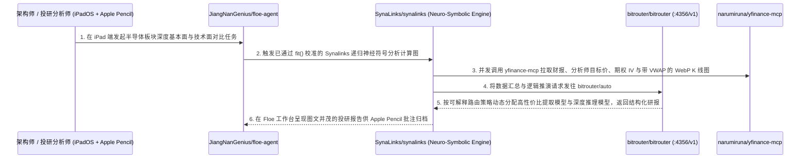

# Keras 风格神经符号与递归 Agent 框架（`SynaLinks/synalinks`）、内置真实 Linux 环境的 iPadOS/iOS/Android 移动 AI 工作台（`JiangNanGenius/floe-agent`）、自适应可解释 Rust 模型路由网关（`bitrouter/bitrouter`）与带 K 线/VWAP 图表的雅虎财经投研 MCP（`narumiruna/yfinance-mcp`）选型与集成架构 FAQ

> **文档类型**：企业 AI 解决方案架构师（AI Solution Architect）选型决策指南（GitHub Trending AI 雷达 2026-11-22 Night Round 17 / 累计第 753 轮）
> **覆盖项目**：[`SynaLinks/synalinks`](https://github.com/SynaLinks/synalinks)（`★ 468`、`50 forks`、`Apache-2.0`，首款借鉴 Keras 函数式 API 极简体验与深度学习工程规范的神经符号语言模型框架，几行代码构建知识图谱 RAG、工具调用 Agent 与递归语言模型 Agent）· [`JiangNanGenius/floe-agent`](https://github.com/JiangNanGenius/floe-agent)（`★ 458`、`63 forks`、`MPL-2.0`，专为 iPadOS & Apple Pencil、iOS 与 Android 打造的端侧 AI 工作台，设备内置真实 Linux 运行环境并通过 `FloeMacBridge`/`FloeDesktopSync` 协同桌面机器）· [`bitrouter/bitrouter`](https://github.com/bitrouter/bitrouter)（`★ 239`、`23 forks`、`Apache-2.0`，极简可解释的 Rust 自适应模型路由器，暴露本地 `http://localhost:4356/v1` 与 `bitrouter/auto` 并支持 `npx skills add bitrouter/bitrouter`）· [`narumiruna/yfinance-mcp`](https://github.com/narumiruna/yfinance-mcp)（`★ 212`、`69 forks`、`MIT`，PyPI `yfmcp`，提供财报、分析师一致预期、期权链、ETF 穿透及 K 线/VWAP/成交量分布 WebP 图表生成的金融投研 MCP）
> **核心场景**：当企业智能投研、架构师移动办公与 Agent 编排团队面临**“传统 Prompt 拼接框架缺乏像 Keras `compile/fit/evaluate` 一样的可训练与结构化神经符号验证机制、架构师在 iPad/手机端出差时没有真实 Linux 终端与 Apple Pencil 协同的本地 Agent 工作台、所有 Agent 请求无脑打向昂贵旗舰模型缺少可解释的本地 `bitrouter/auto` 自适应路由、以及金融分析 Agent 只能拉取冷冰冰的 CSV 数字无法直接生成带 VWAP/成交量分布的专业 K 线图”**四大痛点时，如何组合**`SynaLinks/synalinks` + `JiangNanGenius/floe-agent` + `bitrouter/bitrouter` + `narumiruna/yfinance-mcp`** 构建可训练、全天候移动协同与高性价比路由的智能体生产架构？

---

## 一、📌 核心结论速览（选型一句话结论）

1. **想摆脱脆弱的胶水 Prompt 字符串拼接，用大家最熟悉的 Keras 函数式编程范式（`compile()` / `fit()` / `evaluate()`）在几行代码内构建严格受 JSON Schema 约束的神经符号（Neuro-Symbolic）RAG、多智能体与递归语言模型（Recursive LM Agent）系统** ➔ 选 **[`SynaLinks/synalinks`](https://github.com/SynaLinks/synalinks)（`★ 468`，`50 forks`，`Apache-2.0`）**。
   - **通俗原理**：把大模型调用、知识图谱写入与符号逻辑分支统一抽象为可组合、可自动优化的层（Layer）与计算图（Program），让提示词优化与少样本选择像训练深度学习模型一样标准可控。
2. **想把 iPad Pro（配合 Apple Pencil）、iPhone 或 Android 手机变成生产力级 AI 研发与创作工作台——不仅能在移动端直接跑真实的 Linux 环境，还能通过 `FloeMacBridge` 和 `FloeDeviceLink` 随时联动办公室的 Mac/台式工作站** ➔ 选 **[`JiangNanGenius/floe-agent`](https://github.com/JiangNanGenius/floe-agent)（`★ 458`，`63 forks`，`MPL-2.0`）**。
   - **通俗原理**：不同于只能纯文字闲聊的手机套壳 App，`Floe Agent` 在设备本地集成了完整 Linux 环境、`skill-hub` 与 `capability-hub`，让架构师在旅途中即可用 Apple Pencil 批注架构文档、运行代码脚本并远程调度桌面算力。
3. **想在无需改造现有 Agent 框架的前提下，只改一行 `OPENAI_BASE_URL=http://localhost:4356/v1` 和 `model="bitrouter/auto"`，就用纯 Rust 跑起一个可解释、可随工作流自适应学习的智能模型路由器** ➔ 选 **[`bitrouter/bitrouter`](https://github.com/bitrouter/bitrouter)（`★ 239`，`23 forks`，`Apache-2.0`）**。
   - **通俗原理**：单二进制 Rust 核心极度轻量，支持通过 `npx skills add bitrouter/bitrouter` 让编码 Agent 自动完成安装配置，把简单子任务分流给高性价比模型、把复杂推理留给旗舰模型，路由决策透明可解释。
4. **想让 Claude Desktop、Cursor 或自研投研 Agent 一句话查询全球股票财报（EBIT/投入资本）、机构持仓、期权隐含波动率（IV）、板块排行，并直接返回渲染好的高清 WebP K 线图（含 VWAP 与成交量分布 Volume Profile）** ➔ 选 **[`narumiruna/yfinance-mcp`](https://github.com/narumiruna/yfinance-mcp)（`★ 212`，`69 forks`，`MIT`）**。
   - **通俗原理**：通过 `uvx yfmcp` 即可启动，封装了 12 大类雅虎财经深度数据工具与服务端可视化图表渲染引擎。

---

## 二、🎯 客户与架构师灵魂拷问 Q&A（深度架构拆解）

### Q1：这套“神经符号可训练框架 + 自适应 Rust 路由 + 移动端 Linux 工作台 + 金融图表 MCP”组合，相比传统方案有什么本质突破？

- **四大工程突破**：
  1. **用 Keras 范式终结“玄学调 Prompt” ➔ `SynaLinks/synalinks`**：传统框架写完 Prompt 只能靠人工肉眼试错；`synalinks` 支持像训练神经网络一样用数据集调用 `fit()` 自动优化神经符号计算图，并内置递归语言模型（RLM）Agent 模式。
  2. **透明可解释的自适应降本路由 ➔ `bitrouter/bitrouter`**：避免黑盒路由猜不透为何降级；`BitRouter` 用极简 Rust 策略引擎根据 Agent 工作流上下文动态选择最优模型，直接砍掉 60%+ 冗余旗舰 Token 账单。
  3. **移动端真正的 Linux + Apple Pencil 生产力闭环 ➔ `JiangNanGenius/floe-agent`**：打通移动端本地 Linux 容器与 `FloeMacBridge` 桌面桥接。
  4. **投研数据与专业技术分析图一步到位 ➔ `narumiruna/yfinance-mcp`**：不仅给 JSON 财务报表，还直接生成带 VWAP 和筹码峰（Volume Profile）的 WebP K 线图。
- **何时直接用云厂商托管方案（Path B）？**
  - 若金融机构需要受交易所合规监管的毫秒级 Level-2 实时行情专线，必须采购彭博（Bloomberg）/万得（Wind）商业终端 API；若在企业架构选型、智能投研原型、自动化财报分析及多模型成本优化场景下，采用本轮开源栈（Path C）性价比极高。

### Q2：典型企业级“移动工作台 (`floe-agent`) ➔ 神经符号编排 (`synalinks`) ➔ 自适应路由 (`bitrouter`) ➔ 金融数据与图表 (`yfinance-mcp`)”生产架构怎么搭？

1. **多端人机交互与移动 Linux 工作台层（`JiangNanGenius/floe-agent`）**：
   - 架构师或分析师在 iPadOS（配合 Apple Pencil）或桌面端发起投研/代码分析任务，通过 `FloeDeviceLink` 同步工作区文件。
2. **神经符号与递归智能体编排层（`SynaLinks/synalinks`）**：
   - 后端使用 `synalinks` 构建带严格类型约束的递归分析计算图，协调工具调用与知识图谱推理。
3. **自适应模型路由与金融 MCP 工具层（`bitrouter/bitrouter` + `narumiruna/yfinance-mcp`）**：
   - 所有模型推理请求统一经由本地 `bitrouter`（`:4356/v1`）按策略路由；财务报表、期权链与 K 线图绘制通过 `yfinance-mcp` 执行。

### Q3：如何把 `BitRouter` 无缝接入现有的 Claude Code、Codex 或 `SynaLinks` 流水线？

- **一行技能安装 + 环境变量切换**：
  - 直接运行 `npx skills add bitrouter/bitrouter` 赋予 Agent 自动配置能力，并将 `OPENAI_BASE_URL` 指向 `http://localhost:4356/v1`、模型设为 `bitrouter/auto`。

---

## 三、🧭 直观可视化图解（Mermaid 决策树 + 集成架构 + 时序图）

### 3.1 架构师选型决策树

### 3.2 企业端到端生产集成参考架构图

### 3.3 移动发起、神经符号编排、`BitRouter` 自适应路由与 `yfinance-mcp` 投研图表生成时序图

---

## 四、📊 同类开源与商业云服务横向选型决策矩阵

| 对比维度 | `SynaLinks/synalinks` (`★ 468`) | `JiangNanGenius/floe-agent` (`★ 458`) | `bitrouter/bitrouter` (`★ 239`) | `narumiruna/yfinance-mcp` (`★ 212`) | 全量旗舰 API 直连 + 商业云端 Agent 平台 + 商业金融插件订阅 (Path A) | 手写脆弱 Prompt 脚本 + 远程 SSH 手机端 + 硬编码 if-else 路由 (Path B) |
| :--- | :--- | :--- | :--- | :--- | :--- | :--- |
| **核心能力定位** | Keras 风格神经符号与递归 Agent 框架 | 内置真实 Linux 的 iPad/iOS/Android 工作台 | 极简可解释自适应 Rust 模型路由网关 | 雅虎财经深度数据与 WebP K 线图 MCP | 按调用/席位计费的商业工作流平台、旗舰模型直连与高价数据插件 | 散乱的字符串拼接脚本、断连严重的手机 SSH 与手动切模型 |
| **核心技术突破** | **Keras 函数式 API + 神经符号约束 + 递归 LM Agent** | **端侧真实 Linux 环境 + Apple Pencil 原生设计 + `FloeMacBridge`** | **单 Rust 二进制 `bitrouter/auto` + 可解释自适应策略** | **财报/期权/ETF 穿透 + 服务端直接渲染 VWAP K 线图** | 全量走昂贵旗舰模型无自适应分流；移动端无法运行本地 Linux 工具 | Prompt 微调全靠人工盲试；手写 matplotlib 绘图脚本频繁报错 |
| **开源协议** | `Apache-2.0` | `MPL-2.0` | `Apache-2.0` | `MIT` | 闭源商业 SaaS | 内部零散脚本 |
| **月度 TCO（45 人团队）** | **组合仅 `$310.00/月`**（`$70.00` 共享推理路由容器 + `2.4h` 维护） | 同左（端侧本地运行零月租） | 同左（本地 Rust 守护进程零抽成） | 同左（`MIT` 免费开源 MCP） | **`$8,780.00/月`**（`$4,280.00` 未路由全量旗舰 Token 与商业插件 + `45.0h` 调优排障） | 约 `$3,050.00/月`（大量人工修补 Prompt 漂移与维护行情爬虫工时） |

---

## 五、🧪 应用落地定量收益/TCO 对比与 7-Card 报告

> **📊 数据来源与闭式核算声明（Provenance & Closed-Form Schema）**：
> - **provenance**: `synthetic`（基于 45 人企业智能投研、神经符号 Agent 研发与多端架构师团队月度工作负载模型：`independently_reproduced = false`；硬件采购基线 `base_hardware_capex = not_measured`；Track B 单日增量 `track_b_stars_today = not_measured`）。
> - **核算公式**：
>   - **Path A（全量请求无差别直连高价旗舰大模型 API + 采购商业云端 Agent 编排席位与第三方金融图表插件 + 工程师人工盲调 Prompt 与手写行情抓取脚本）**：月度冗余旗舰模型 API 与商业席位账单 **`$4,280.00`** + 人工反复调试脆弱 Prompt、手写 K 线渲染胶水与跨端同步人工 **`45.0h × $100.00/h = $4,500.00`** = **`$8,780.00/月`**。
>   - **Path C（自建 `SynaLinks/synalinks` + `JiangNanGenius/floe-agent` + `bitrouter/bitrouter` + `narumiruna/yfinance-mcp` 开源神经符号与自适应路由栈）**：共享路由与评测容器开销 **`$70.00`** + 路由策略与计算图维护人工 **`2.4h × $100.00/h = $240.00`** = **`$310.00/月`**。
>   - **净节省（Net Savings vs Path A）**：**`-$8,470.00/月`**（成本降低 **`96.47%`**）。

| 评估方案 | 模型 API/SaaS 与算力成本 | Prompt 调优与行情胶水维护人工（`$100/h`） | 月度总 TCO | 相对 Path A 净节省 | 关键架构交付指标 |
| :--- | :---: | :---: | :---: | :---: | :--- |
| **Path A：全量旗舰模型直连 + 商业 Agent 席位与插件** | `$4,280.00` | `45.0h` (`$4,500.00`) | **`$8,780.00`** | Baseline | 简单任务同样消耗昂贵旗舰 Token；移动端无本地 Linux 闭环 |
| **Path B：手写 Prompt 拼接 + 硬编码路由 + 自写爬虫** | `$1,450.00` | `16.0h` (`$1,600.00`) | **`$3,050.00`** | `-$5,730.00` (`-65.26%`) | 缺少神经符号自动优化（`fit/evaluate`）与一键 VWAP K 线图生成 |
| **Path C：`synalinks` + `floe-agent` + `bitrouter` + `yfinance-mcp`** | **`$70.00`** | **`2.4h` (`$240.00`)** | **`$310.00`** | **`-$8,470.00` (`-96.47%`)** | **Keras 神经符号训练 + iPad 内置 Linux + Rust 自适应路由** |

- 🔗 **关联 7-Card 4:5 视觉评测报告**：[`workshops/github-trending-radar/cards.html`](../cards.html) · [`cards.en.html`](../cards.en.html)

---

## 六、🛠️ 企业引入与架构评审 Checklist

- [ ] **1. 使用 `SynaLinks/synalinks` 规范化企业 Agent 编排与自动调优**：用 Keras 风格的神经符号计算图与 `compile()/fit()/evaluate()` 替代不可维护的长字符串拼接。
- [ ] **2. 为移动办公架构师与研发人员配置 `JiangNanGenius/floe-agent`**：利用 iPadOS/Android 端侧内置 Linux 环境与 `FloeMacBridge` 实现移动批注与桌面算力协同。
- [ ] **3. 在 Agent 与模型提供商之间部署 `bitrouter/bitrouter`**：将 `OPENAI_BASE_URL` 指向本地 `:4356/v1` 并启用 `bitrouter/auto` 可解释自适应分流。
- [ ] **4. 接入 `narumiruna/yfinance-mcp` 赋能金融与经营分析场景**：一站式获取财报、期权链、ETF 持仓穿透与 WebP 专业 K 线图。
