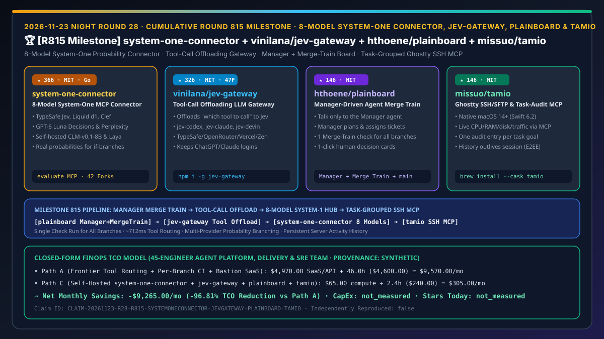
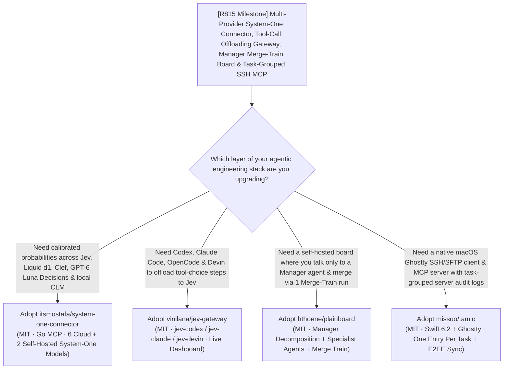
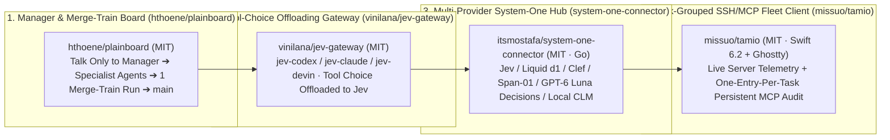

# 🏆 [Round 815 Milestone] Multi-Provider System-One Probability Connector (`itsmostafa/system-one-connector`), Coding Agent Tool-Choice Offloading Gateway (`vinilana/jev-gateway`), Manager-Driven Multi-Agent Merge-Train Board (`hthoene/plainboard`) & Task-Grouped Native macOS SSH/MCP Client (`missuo/tamio`) Selection & Architecture FAQ

> **Document Type**: Enterprise AI Solution Architect Selection & Integration Guide (GitHub Trending AI Radar · 2026-11-23 Night Round 28 / **🏆 Cumulative Round 815 Milestone**)
> **Covered Repositories**: [`itsmostafa/system-one-connector`](https://github.com/itsmostafa/system-one-connector) (`★ 366`, `42 forks`, `MIT`, Go: unified System-One MCP connector `evaluate` giving Claude Code, Claude Desktop, Codex, Hermes, and Pi direct probability-branching access to **TypeSafe `Jev`, Liquid AI `d1`, Cloudflare `Clef`, Respan `Span-01`, `GPT-6 Luna Decisions`, `Perplexity Decider Flash`, and self-hosted `CLM-v0.1-8B` / `Laya`**) · [`vinilana/jev-gateway`](https://github.com/vinilana/jev-gateway) (`★ 326`, `47 forks`, `MIT`: local LLM gateway `npm install -g jev-gateway` with drop-in launchers `jev-codex`, `jev-claude`, `jev-opencode`, `jev-kilo`, `jev-gemini`, and `jev-devin` that offloads **which tool to call** to `Jev` via TypeSafe, OpenRouter, Vercel AI Gateway, or OpenCode Zen free tier while passing reasoning untouched to your primary LLM) · [`hthoene/plainboard`](https://github.com/hthoene/plainboard) (`★ 146`, `14 forks`, `MIT`: self-hosted multi-agent software factory where **you talk only to the Manager agent**, specialist agents build tickets on separate branches, and **one unified Merge-Train check run** merges verified work into `main`) · [`missuo/tamio`](https://github.com/missuo/tamio) (`★ 146`, `13 forks`, `MIT`, Swift 6.2: native macOS SSH/SFTP client with Ghostty terminal, live server telemetry, E2EE iCloud sync, and a built-in MCP server that records **one persistent, task-grouped audit entry per goal** across agents and Macs)
> **Core Scenario**: At our **815th Cumulative Deep-Dive Round (`R815`)**, when enterprise teams architect hybrid System-1/System-2 coding and infrastructure fleets, how do you solve **"asking slow frontier LLMs for routing judgments that return vague paragraphs instead of `if`-statement probabilities, burning expensive Claude/Codex reasoning quotas on repetitive tool-selection steps, manually micromanaging prompts and running N redundant CI pipelines across parallel coding agents, and losing server deployment context when agents switch sessions or run raw `ssh`/`scp` commands"** by combining **`system-one-connector` + `jev-gateway` + `plainboard` + `tamio`**?

---

## 1. 📌 Executive Summary (Single-Sentence Selection Verdict)

1. **Need a single Go MCP connector (`evaluate`) that gives Claude Code, Codex, Hermes, and Pi real calibrated probabilities (`0.00–1.00`) across both hosted System-One models (`TypeSafe Jev`, `Liquid AI d1`, `Cloudflare Clef`, `Respan Span-01`, `GPT-6 Luna Decisions`, `Perplexity Decider Flash`) and self-hosted open models (`CLM-v0.1-8B`, `Laya`)** ➔ Choose **[`itsmostafa/system-one-connector`](https://github.com/itsmostafa/system-one-connector) (`★ 366`, `42 forks`, `MIT`)**.
   - **Plain-Language Mechanism**: Instead of parsing a paragraph like `"This seems fairly urgent"` from a chat LLM, `system-one-connector` returns exact numeric probabilities (`is_urgent: 0.95`, `department: billing 86%`) that deterministic code can branch on in an `if` statement—without locking your architecture to a single decision-model vendor.
2. **Need a local gateway (`jev-codex`, `jev-claude`, `jev-opencode`, `jev-kilo`, `jev-gemini`, `jev-devin`) that intercepts only tool-selection decisions and routes them to `Jev` (`~712 ms`) while keeping your existing ChatGPT/Claude subscriptions and primary reasoning model untouched** ➔ Choose **[`vinilana/jev-gateway`](https://github.com/vinilana/jev-gateway) (`★ 326`, `47 forks`, `MIT`)**.
   - **Plain-Language Mechanism**: Installed via `npm install -g jev-gateway`, it configures once (`~/.jev-gateway/.env`, `0600` permissions) across TypeSafe, OpenRouter, Vercel AI Gateway, or OpenCode Zen (free tier by default) and includes a live `--dashboard` view showing every offloaded tool-call decision.
3. **Need a self-hosted 5-column software delivery board where you speak only to a Manager agent that writes tickets, assigns specialist coding agents, and merges all finished branches through a single unified Merge-Train check run into `main`** ➔ Choose **[`hthoene/plainboard`](https://github.com/hthoene/plainboard) (`★ 146`, `14 forks`, `MIT`)**.
   - **Plain-Language Mechanism**: `PlainBoard` eliminates manual ticket assignment, prompt babysitting, and branch merging (`You ➔ Manager ➔ Specialist Agents ➔ One Check Run for All Branches ➔ main`), surfacing 1-click human decision cards only when an agent genuinely needs a policy call.
4. **Need a native macOS SSH/SFTP client (Swift 6.2 + Ghostty terminal) with a built-in MCP server where Claude Code and Codex inspect live host metrics, run multi-server commands with approval, and record one persistent task-grouped activity log per goal (`"Install nginx"`) synced via E2EE iCloud** ➔ Choose **[`missuo/tamio`](https://github.com/missuo/tamio) (`★ 146`, `13 forks`, `MIT`)**.
   - **Plain-Language Mechanism**: Installed via `brew install --cask owo-network/brew/tamio`, `Tamio` groups every command toward a goal—including external `ssh`/`scp` runs outside Tamio—into one structured server Activity entry that outlives agent sessions and syncs across Macs so the next agent or SRE sees the full history at a glance.

---

## 2. 🎯 Key Architectural Q&A (Deep-Dive Breakdown)

### Q1: How do `system-one-connector` and `jev-gateway` complement each other in a System-1 / System-2 enterprise agent architecture?

- **Complementary System-1 Integration Paths**:
  1. **Multi-Provider Application & Workflow Branching (`itsmostafa/system-one-connector`)**: Exposes an explicit `evaluate` MCP tool backed by 6 cloud System-One providers (`Jev`, `Liquid d1`, `Cloudflare Clef`, `Respan Span-01`, `GPT-6 Luna Decisions`, `Perplexity Decider Flash`) and 2 self-hosted models (`CLM-8B`, `Laya`) for explicit `if/else` probability branching.
  2. **Transparent Tool-Call Offloading for Coding CLIs (`vinilana/jev-gateway`)**: Wraps `codex`, `claude`, `opencode`, `kilo`, `gemini`, and `devin` transparently at the gateway layer so tool-routing steps are offloaded without modifying agent prompts.
  3. **Paired with `plainboard` (Merge-Train Orchestration) and `tamio` (Task-Grouped SSH MCP)**: Automates the entire lifecycle from Manager ticket decomposition to audited multi-server deployment.
- **When to Choose Single-Vendor Cloud Services (Path B)**:
  - For single-vendor cloud-only deployments, use native provider routing; for multi-provider System-1 probability branching (including local `CLM-8B`), transparent `jev-claude`/`jev-codex` tool offloading, single-check Merge-Train multi-agent boards, and task-grouped Ghostty SSH MCP auditing, deploy this 4-repo Milestone 815 stack (Path C).

### Q2: How do these four components integrate into an enterprise software & infrastructure pipeline?

1. **Manager Planning & Merge-Train Layer (`hthoene/plainboard`)**:
   - Submit high-level goals to the Manager agent, which decomposes tickets, dispatches specialist agents, and runs one unified Merge-Train check before landing into `main`.
2. **Coding Agent Tool-Decision Offloading Layer (`vinilana/jev-gateway`)**:
   - Run specialist coding agents through `jev-codex` / `jev-claude` / `jev-opencode` / `jev-devin` to offload tool selection to fast System-1 endpoints.
3. **Multi-Vendor System-1 Probability Routing Layer (`itsmostafa/system-one-connector`)**:
   - Route runtime triage, urgency scoring, and classification queries across `Jev`, `Liquid d1`, `Cloudflare Clef`, `GPT-6 Luna Decisions`, or self-hosted `CLM-8B`.
4. **Task-Grouped Multi-Host SSH/MCP Deployment Layer (`missuo/tamio`)**:
   - Deploy verified `main` builds across server fleets via `Tamio`'s MCP server, recording persistent goal-grouped activity logs synced via E2EE iCloud.

### Q3: What are the key production guardrails?

- **Architect Guardrails**:
  1. **Enforce `0600` File Permissions on `~/.jev-gateway/.env`**: Keep shared gateway credentials restricted to the owning OS user.
  2. **Require Human Approval for Production Host Mutations in `tamio`**: Use Tamio's approval gate when agents add SSH keys, change port forwards, or run multi-server deployment snippets.

---

## 3. 🧭 Visual Architecture & Decision Diagrams (Mermaid)



### 3.1 Solution Architect Selection Decision Tree



### 3.2 End-to-End Enterprise Production Reference Architecture



### 3.3 Manager Ticket Dispatch, Tool-Choice Offloading, Multi-Model Probability Branching & Task-Grouped SSH Deployment Sequence

```mermaid
sequenceDiagram
    participant Arch as Solution Architect / SRE Lead
    participant Plb as hthoene/plainboard (Manager)
    participant Jgw as vinilana/jev-gateway
    participant Soc as itsmostafa/system-one-connector
    participant Tam as missuo/tamio (SSH/SFTP MCP)

    Arch->>Plb: 1. State feature goal to Manager agent; Manager creates tickets & assigns specialist agents
    Plb->>Jgw: 2. Specialist agents run via jev-claude/jev-codex, offloading tool choices in ~712ms
    Jgw->>Soc: 3. Call evaluate across Jev / Liquid d1 / GPT-6 Luna Decisions / local CLM for if-branch probabilities
    Plb->>Plb: 4. Batch finished agent branches into one Merge-Train check run and land into main
    Plb->>Tam: 5. Deploy via Tamio MCP with approval; record one persistent task-grouped Activity entry per server
```

---

## 4. 📊 Comparative Selection Matrix (Open-Source vs. Commercial SaaS)

| Dimension | `system-one-connector` (`★ 366`) | `vinilana/jev-gateway` (`★ 326`) | `hthoene/plainboard` (`★ 146`) | `missuo/tamio` (`★ 146`) | Frontier-LLM-for-Everything + N Separate CI Runs + Commercial Bastion SaaS (Path A) | Single-Vendor Lock-In + Manual Multi-Agent Prompting + Raw `.bash_history` (Path B) |
| :--- | :--- | :--- | :--- | :--- | :--- | :--- |
| **Core Role** | Multi-provider System-One probability MCP connector in Go | Local tool-choice offloading gateway for 6 coding CLIs | Manager-driven multi-agent software board with Merge Train | Native macOS Ghostty SSH/SFTP client & task-grouped MCP server | High frontier reasoning token waste, redundant CI bills & per-seat bastion fees | Vendor lock-in, manual branch-merge chaos & fragmented shell logs |
| **Key Differentiator** | **Supports Jev, Liquid d1, Clef, GPT-6 Luna Decisions & local CLM** | **Works with existing Claude/ChatGPT logins; offloads only tool choice** | **Talk only to Manager; 1 unified Merge-Train check for all branches** | **One audit entry per task (incl. external `ssh`/`scp`) + E2EE sync** | Using slow frontier LLMs for simple routing wastes quota and returns unbranchable prose | Running full CI on every micro-branch multiplies runner costs; raw shell logs lose task intent |
| **License** | `MIT` | `MIT` | `MIT` | `MIT` | Proprietary SaaS | Custom scripts |
| **Monthly TCO (45-Eng Team)** | **Combined `$305.00/mo`** (`$65.00` lightweight System-1/local CLM & board host + `2.4h` ops) | Included (supports OpenCode Zen free tier) | Included (single Merge-Train check cuts CI compute) | Included (`brew install --cask` + iCloud E2EE) | **`$9,570.00/mo`** (`$4,970.00` frontier routing tokens, redundant CI runners & bastion SaaS + `46.0h` manual agent coordination & server audit reconstruction) | ~`$3,420.00/mo` (frequent multi-branch merge conflicts & lost server deployment history) |

---

## 5. 🧪 Quantitative ROI / TCO Comparison & 7-Card Benchmark Report

> **📊 Data Provenance & Closed-Form Schema Declaration**:
> - **provenance**: `synthetic` (45-person enterprise AI platform architecture, multi-agent software delivery, and infrastructure operations team monthly workload model: `independently_reproduced = false`; hardware baseline `base_hardware_capex = not_measured`; Track B 24h delta `track_b_stars_today = not_measured`).
> - **Closed-Form Formula**:
>   - **Path A (Burning expensive frontier reasoning tokens on every simple classification and tool-selection step + running separate full CI pipelines for every agent branch + commercial bastion/audit SaaS seats + engineering hours spent manually assigning tickets, resolving multi-agent branch conflicts, and reconstructing fragmented SSH command logs)**: Monthly excess frontier token spend, redundant CI runner, and bastion SaaS bills **`$4,970.00`** + manual multi-agent coordination, branch merging, and server audit triage labor **`46.0h × $100.00/h = $4,600.00`** = **`$9,570.00/mo`**.
>   - **Path C (Self-hosted `itsmostafa/system-one-connector` + `vinilana/jev-gateway` + `hthoene/plainboard` + `missuo/tamio` Milestone 815 stack)**: Shared System-1 routing / local CLM and PlainBoard container compute **`$65.00`** + connector profile and server snippet maintenance labor **`2.4h × $100.00/h = $240.00`** = **`$305.00/mo`**.
>   - **Net Monthly Savings vs. Path A**: **`-$9,265.00/mo`** (**`96.81%`** TCO reduction).

| Evaluation Path | Frontier Routing / CI / Bastion SaaS Cost | Agent Coordination, Branch Merging & SSH Audit (`$100/h`) | Monthly Total TCO | Net Savings vs. Path A | Key Architectural Delivery Metrics |
| :--- | :---: | :---: | :---: | :---: | :--- |
| **Path A: Frontier Tool Routing + Per-Branch CI + Manual Agent Babysitting** | `$4,970.00` | `46.0h` (`$4,600.00`) | **`$9,570.00`** | Baseline | Frontier quotas drained on tool choices; N× redundant CI runs |
| **Path B: Single-Vendor Lock-In + Manual PR Merges + Raw Shell Logs** | `$1,520.00` | `19.0h` (`$1,900.00`) | **`$3,420.00`** | `-$6,150.00` (`-64.26%`) | No local CLM fallback; lost server context across agent handoffs |
| **Path C: `system-one-connector` + `jev-gateway` + `plainboard` + `tamio`** | **`$65.00`** | **`2.4h` (`$240.00`)** | **`$305.00`** | **`-$9,265.00` (`-96.81%`)** | **8+ System-1 models + tool-choice offload + Merge Train + task-grouped SSH MCP** |

- 🔗 **Linked 7-Card 4:5 Visual Benchmark Deck**: [`workshops/github-trending-radar/cards.en.html`](../cards.en.html) · [`cards.html`](../cards.html)

---

## 6. 🛠️ Enterprise Adoption & Architecture Review Checklist

- [ ] **1. Standardize Probability Branching on `itsmostafa/system-one-connector` (`evaluate`)**: Connect agents to `TypeSafe Jev`, `Liquid AI d1`, `Cloudflare Clef`, `GPT-6 Luna Decisions`, `Perplexity Decider Flash`, or self-hosted `CLM-8B` / `Laya` for deterministic `if`-statement routing.
- [ ] **2. Wrap Coding CLIs with `vinilana/jev-gateway` (`jev-codex`, `jev-claude`, `jev-opencode`, `jev-devin`)**: Offload tool-selection decisions to fast System-1 endpoints while preserving primary LLM reasoning quotas.
- [ ] **3. Orchestrate Multi-Agent Feature Delivery with `hthoene/plainboard`**: Delegate ticket planning and branch coordination to the Manager agent and verify all finished branches in one unified Merge-Train run.
- [ ] **4. Audit Multi-Server Agent Operations with `missuo/tamio`**: Require human approval on sensitive SSH/SFTP actions and persist one task-grouped Activity record per goal across your fleet.
