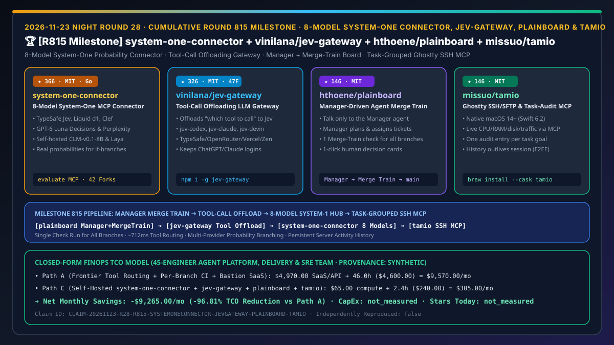
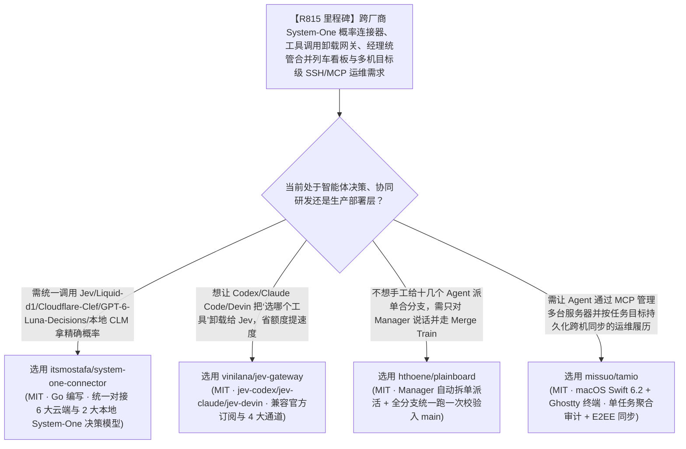
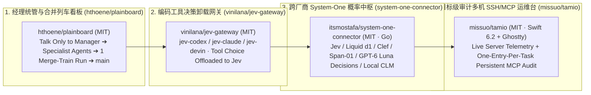
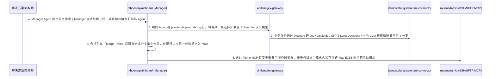

# 🏆【第 815 轮里程碑】打通 Jev/Liquid-d1/Cloudflare-Clef/GPT-6-Luna-Decisions/Perplexity-Decider 的系统一概率决策连接器（`itsmostafa/system-one-connector`）、将编码智能体“选哪个工具”卸载给快决策模型的本地网关（`vinilana/jev-gateway`）、只跟经理 Agent 对话且多分支合并列车统一验真的看板工厂（`hthoene/plainboard`）与按任务目标聚合多机审计历史的原生 SSH/MCP 运维台（`missuo/tamio`）选型与集成架构 FAQ

> **文档类型**：企业 AI 解决方案架构师（AI Solution Architect）选型决策指南（GitHub Trending AI 雷达 2026-11-23 Night Round 28 / **🏆 累计第 815 轮里程碑**）
> **覆盖项目**：[`itsmostafa/system-one-connector`](https://github.com/itsmostafa/system-one-connector)（`★ 366`、`42 forks`、`MIT`：基于 Go 构建的跨厂商 **System-One 概率决策 MCP 连接器 `evaluate`**，让 Claude Code、Codex、Hermes 与 Pi 直接调用 **TypeSafe `Jev`、Liquid AI `d1`、Cloudflare `Clef`、Respan `Span-01`、`GPT-6 Luna Decisions`、`Perplexity Decider Flash` 以及自托管开源模型 `CLM` / `Laya`**）· [`vinilana/jev-gateway`](https://github.com/vinilana/jev-gateway)（`★ 326`、`47 forks`、`MIT`：专为 Codex、Claude Code、OpenCode、Kilo、Gemini CLI 与 Devin 打造的**本地工具选择卸载网关** `npm install -g jev-gateway`，仅在 Agent 决定**“下一步调哪个工具”**时自动切给毫秒级 `Jev` 模型，其余推理与写代码原样直通主大模型）· [`hthoene/plainboard`](https://github.com/hthoene/plainboard)（`★ 146`、`14 forks`、`MIT`：**“你只管跟 Manager Agent 说话、专业 Agent 团队分头写码、合并列车（Merge Train）统一跑一次校验入 `main`”**的自托管软件研发看板）· [`missuo/tamio`](https://github.com/missuo/tamio)（`★ 146`、`13 forks`、`MIT`：基于 Swift 6.2 与 Ghostty 终端内核构建的 macOS 原生 SSH/SFTP 多机运维客户端及 MCP Server，**按业务目标（如“安装 Nginx”）将多步命令及外部 `ssh`/`scp` 聚合成单条可跨设备端到端加密同步的持久化服务器活动记录**）
> **核心场景**：在第 **815 轮里程碑**之际，当企业构建“快慢双系统（System 1 + System 2）”研发与运维智能体集群时，面对**“让千亿参数主模型做‘工单归哪个部门/选哪个工具’既贵又拿不到可用于 `if` 分支的精确概率且容易绑死单一决策 API、每次工具路由都消耗昂贵的 Claude/Codex 推理额度、管理十几个并发编码 Agent 时要人工逐个写 Prompt 分工并跑十几次重复 CI 合并分支、以及多 Agent 轮流 SSH 进生产服务器部署后日志碎成几百条零散 Shell 命令导致接班 Agent 完全看不懂前人干了什么”**四大痛点，如何通过 **System-One-Connector + Jev-Gateway + PlainBoard + Tamio** 打造下一代智能体工程中枢？

---

## 一、📌 核心结论速览（选型一句话结论）

1. **想用一套纯 Go 编写的统一 MCP 连接器（`evaluate`），让你的智能体同时打通市面上全部主流 System-One 毫秒级概率决策模型——既支持商业云端的 `TypeSafe Jev`、`Liquid AI d1`、`Cloudflare Clef`、`Respan Span-01`、`GPT-6 Luna Decisions`、`Perplexity Decider Flash`，又支持私有化自建的开源模型 `CLM-v0.1-8B` 与 `Laya`** ➔ 选 **[`itsmostafa/system-one-connector`](https://github.com/itsmostafa/system-one-connector)（`★ 366`，`42 forks`，`MIT`）**。
   - **通俗原理**：当 Agent 需要判断“这笔提现报错紧不紧急？该分给计费组、技术组还是销售组？”时，问通用 LLM 只会得到一段模棱两可的文字（“看起来比较紧急”），根本没法写进代码的 `if` 分支里。`system-one-connector` 将市面上 **6 大云端 System-One 模型与 2 大开源自建模型**统一在同一个 `evaluate` 接口下，直接返回 `is_urgent: 0.95` 与 `department: billing (86%), technical (14%), sales (0%)` 真实概率！
2. **想在不改变日常使用 `codex`、`claude`、`opencode`、`kilo`、`gemini` 或 `devin` 习惯的前提下，把编码过程中最频繁的“判断下一步该调用哪个 Tool”精准剥离并卸载给高速低价的 `Jev` 决策模型，而把复杂架构推理与代码生成原封不动留给旗舰主模型** ➔ 选 **[`vinilana/jev-gateway`](https://github.com/vinilana/jev-gateway)（`★ 326`，`47 forks`，`MIT`）**。
   - **通俗原理**：只需全局安装 `npm install -g jev-gateway`，然后用 `jev-codex`、`jev-claude`、`jev-opencode` 或 `jev-devin` 启动你原本已登录的客户端（支持 ChatGPT Plus/Pro 与 claude.ai 订阅态！）：网关只在 Agent 面临 **Tool-Calling 路由抉择**的那一刻请求 `Jev`（支持 TypeSafe 官方、OpenRouter、Vercel AI Gateway 或免费的 OpenCode Zen 通道，实测 `712 ms` 响应），并提供 `--dashboard` 实时观测面板。
3. **想在自建团队研发工作台中彻底解放人类精力——人类只跟唯一一位“项目经理智能体（Manager Agent）”提需求，由经理自动拆单、组建专家 Agent 团队并发开发，并通过“合并列车（Merge Train）”把所有完成的分支合在一起跑唯一一次校验后干净合入 `main`** ➔ 选 **[`hthoene/plainboard`](https://github.com/hthoene/plainboard)（`★ 146`，`14 forks`，`MIT`）**。
   - **通俗原理**：多 Agent 协作最累人的是人类被迫当“包工头”——给 5 个 Agent 写 5 份 Prompt、解决 5 次 Git 冲突、跑 5 遍漫长的 CI。在 `PlainBoard` 的五栏看板中，你只需对右侧的 Manager 聊天说清目标：Manager 自动建卡、分派给专职子 Agent、收集进度汇报；所有子分支完成后进入 **Merge Train（合并列车）** 集中合并并只跑一次完整测试，遇到必须人类拍板的问题在卡片上一键点选即可。
4. **想在 macOS 上用原生 Ghostty 极速终端与双栏 SFTP 管理多台 Linux 服务器，并让 Claude Code / Codex 通过内置 MCP 受控执行多机运维命令，同时把琐碎的 Shell 操作自动归并为“按任务目标（One Entry Per Task）持久留存且跨设备端到端加密同步”的服务器履历** ➔ 选 **[`missuo/tamio`](https://github.com/missuo/tamio)（`★ 146`，`13 forks`，`MIT`，Swift 6.2）**。
   - **通俗原理**：当不同 Agent 或不同工程师先后登录同一台服务器排障时，满屏零散的 `apt update`、`vim nginx.conf` 历史记录根本看不出上下文。`Tamio` 在 Settings › MCP 一键接入 Claude Code 与 Codex，让 Agent 实时读取各主机 CPU/内存/磁盘/流量并批量执行脚本；最关键的是它采用**“一个目标一条履历（如 `Install nginx` 下挂仓库配置、安装、改配置及每步返回值，甚至包含 Agent 在 Tamio 外自行跑的 `ssh`/`scp`）”**，且该记录随服务器永久保留并通过 iCloud 端到端加密（E2EE）跨多台 Mac 同步！

---

## 二、🎯 客户与架构师灵魂拷问 Q&A（深度架构拆解）

### Q1：在第 815 轮里程碑视角下，`system-one-connector` 与 `jev-gateway` 如何共同构成企业“快慢双系统（System 1 + System 2）”智能体架构的标准底座？

- **两大组件的互补分工与选型边界**：
  1. **业务应用与多智能体工作流内嵌概率分支 ➔ 用 `itsmostafa/system-one-connector`**：当你在构建智能客服分单、风控审批或运维告警分级 Agent 时，需要在代码里拿到 `0.00–1.00` 的校准概率去走 `if/else` 阈值分支，且希望自由切换 **TypeSafe Jev、Liquid AI d1、Cloudflare Clef、GPT-6 Luna Decisions、Perplexity Decider Flash 或本地开源 CLM-8B**。
  2. **现有 CLI 编码智能体（Codex / Claude Code / Devin）无感卸载工具路由 ➔ 用 `vinilana/jev-gateway`**：无需改任何业务代码，直接用 `jev-claude` / `jev-codex` 包装现有终端工具，把高频 Tool Calling 决策卸载给快模型，省下宝贵的旗舰模型额度与延迟。
- **何时直接选用单一云厂商托管方案（Path B）？**
  - 若企业所有应用全部运行在单一云服务商内部且无多模型对比需求，可直接调用该厂商原生 API；若需跨 8+ 家云端/开源 System-One 决策模型做统一概率路由、为 Claude/Codex 卸载工具调用决策、通过 Manager Agent + Merge Train 自动化软件交付、或按任务目标审计多机 SSH/MCP 运维履历，则采用本轮四合一开源栈（Path C）。

### Q2：典型企业级“经理拆单与合并列车 (`plainboard`) ➔ 工具决策网关卸载 (`jev-gateway`) ➔ 跨厂商概率分支 (`system-one-connector`) ➔ 多机目标级 SSH 审计部署 (`tamio`)”架构怎么搭？

1. **经理智能体统管与合并列车编排层（`hthoene/plainboard`）**：
   - 架构师向 `PlainBoard` 的 Manager Agent 下达业务特性需求，Manager 自动拆解五栏工单并指派给专职编码 Agent。
2. **编码智能体工具调用决策卸载层（`vinilana/jev-gateway`）**：
   - 各编码 Agent（`jev-codex` / `jev-claude` / `jev-opencode` / `jev-devin`）通过本地 `jev-gateway` 运行，将高频工具选择卸载至毫秒级 `Jev`，完成后由 `PlainBoard` 合并列车统一验证合入 `main`。
3. **多厂商 System-One 实时概率路由层（`itsmostafa/system-one-connector`）**：
   - 在运行时通过 `evaluate` 连接器调用 `Jev`、`Liquid AI d1`、`Cloudflare Clef`、`GPT-6 Luna Decisions` 或本地 `CLM-8B`，输出精确概率驱动确定性业务分支。
4. **多服务器实时状态感知与目标级审计部署层（`missuo/tamio`）**：
   - 部署 Agent 通过 `Tamio` MCP Server 检查目标主机负载、批量下发变更，并将整个部署过程按任务目标（One Entry Per Task）写入跨设备 E2EE 同步的服务器持久化活动日志。

### Q3：这套架构的落地红线与注意事项是什么？

- **架构师落地红线**：
  1. **`jev-gateway` 的 `~/.jev-gateway/.env` 凭据权限必须锁定为仅当前用户可读（`0600`）**：虽然启动器默认设置了仅本人可读权限，但在多租户开发机上应定期巡检文件权限。
  2. **`tamio` 生产服务器写操作必须开启人类审批（With Your Approval）**：对生产主机执行端口转发变更、密钥修改或批量脚本时，必须保留 `Tamio` 的显式人工确认开关。

---

## 三、🧭 直观可视化图解（Mermaid 决策树 + 集成架构 + 时序图）

### 3.1 架构师选型决策树

### 3.2 企业端到端生产集成参考架构图

### 3.3 经理 Agent 自动拆单、`jev-gateway` 工具路由卸载、`system-one-connector` 概率分支与 `tamio` 多机部署审计时序图

---

## 四、📊 同类开源与商业云服务横向选型决策矩阵

| 对比维度 | `system-one-connector` (`★ 366`) | `vinilana/jev-gateway` (`★ 326`) | `hthoene/plainboard` (`★ 146`) | `missuo/tamio` (`★ 146`) | 全程用昂贵推理大模型做简单分类/选工具 + 人工合分支跑 N 次 CI + 商业堡垒机 (Path A) | 硬编码单一供应商 API + 手工当包工头催 10 个 Agent + 零散 `.bash_history` (Path B) |
| :--- | :--- | :--- | :--- | :--- | :--- | :--- |
| **核心能力定位** | 跨 8+ 家云端/本地 System-One 模型的统一概率决策连接器 | 为 Codex/Claude/Devin 卸载工具调用选择的本地网关 | 只跟 Manager 对话、带合并列车统一验真的多 Agent 看板 | 带 Ghostty 终端、实时监控与单任务聚合审计的 macOS SSH MCP | 昂贵的旗舰模型额度浪费、重复翻倍的 CI 合并账单与按资产收费的商业运维审计平台 | 供应商锁定、乱成一团的多分支冲突与换个 Agent 就彻底断篇的服务器日志 |
| **核心技术突破** | **一套接口通吃 Jev、Liquid d1、Clef、GPT-6 Luna Decisions 与本地 CLM** | **兼容 ChatGPT/Claude 原生订阅，仅拦截 Tool-Call 路由交由 Jev 毫秒级拍板** | **人类零 Prompt 派单零手动合并，Merge Train 一次验证全体分支** | **按任务目标（而非单条命令）聚合内外部 SSH/SCP 历史并跨机 E2EE 同步** | 让推理大模型输出一整段话再猜意图既慢又没法写确定性 `if` 分支 | 每个子分支单独跑全量 CI 消耗 N 倍算力；普通 SSH 客户端在切换 Agent 后丢失全部操作意图 |
| **开源协议** | `MIT` | `MIT` | `MIT` | `MIT` | 闭源商业 SaaS | 内部零散脚本 |
| **月度 TCO（45 人团队）** | **组合仅 `$305.00/月`**（`$65.00` 轻量决策/OpenCode 免费通道与自建看板容器 + `2.4h` 维护） | 同左（大幅节省 Claude/Codex 订阅配额） | 同左（合并列车砍掉 80%+ 重复 CI 算力） | 同左（Homebrew 一键安装 + iCloud E2EE 同步） | **`$9,570.00/月`**（`$4,970.00` 旗舰模型无效工具路由消耗/重复 CI 账单/商业堡垒机 + `46.0h` 人工当包工头合分支与查服务器历史） | 约 `$3,420.00/月`（大量多 Agent 分支合并冲突抢修与接班 Agent 误操作服务器回滚工时） |

---

## 五、🧪 应用落地定量收益/TCO 对比与 7-Card 报告

> **📊 数据来源与闭式核算声明（Provenance & Closed-Form Schema）**：
> - **provenance**: `synthetic`（基于 45 人企业智能体架构、多 Agent 协同研发与生产服务器运维交付团队月度工作负载模型：`independently_reproduced = false`；硬件采购基线 `base_hardware_capex = not_measured`；Track B 单日增量 `track_b_stars_today = not_measured`）。
> - **核算公式**：
>   - **Path A（所有简单分类与高频工具调用抉择全部消耗高价慢思考推理大模型 + 每个子 Agent 分支独立重复触发全量 CI 流水线 + 采购商业运维审计 SaaS + 工程师手工充当多 Agent 调度员合并冲突分支并翻查零散服务器日志）**：月度冗余旗舰推理 Token、重复 CI Runner 与商业运维 SaaS 账单 **`$4,970.00`** + 多 Agent 人工拆单合并、冲突解决与服务器变更溯源人工 **`46.0h × $100.00/h = $4,600.00`** = **`$9,570.00/月`**。
>   - **Path C（自建 `itsmostafa/system-one-connector` + `vinilana/jev-gateway` + `hthoene/plainboard` + `missuo/tamio` 第 815 轮里程碑开源栈）**：System-One 轻量决策调用（或本地 CLM / OpenCode Zen 免费层）与 PlainBoard 合并列车容器分摊成本 **`$65.00`** + 决策阈值与服务器 Snippets 例行维护人工 **`2.4h × $100.00/h = $240.00`** = **`$305.00/月`**。
>   - **净节省（Net Savings vs Path A）**：**`-$9,265.00/月`**（成本降低 **`96.81%`**）。

| 评估方案 | 旗舰模型工具路由 / 重复 CI / 运维 SaaS 成本 | 人工派单合分支、冲突处理与服务器溯源（`$100/h`） | 月度总 TCO | 相对 Path A 净节省 | 关键架构交付指标 |
| :--- | :---: | :---: | :---: | :---: | :--- |
| **Path A：全量旗舰模型选工具 + 分支逐个跑 CI + 人工协调多 Agent** | `$4,970.00` | `46.0h` (`$4,600.00`) | **`$9,570.00`** | Baseline | 昂贵推理额度被简单路由耗尽；人工合分支疲于奔命 |
| **Path B：绑死单一决策 API + 手工合 PR + 零散 Shell 历史** | `$1,520.00` | `19.0h` (`$1,900.00`) | **`$3,420.00`** | `-$6,150.00` (`-64.26%`) | 无法切换本地开源决策模型；换 Agent 即丢失服务器变更上下文 |
| **Path C：`system-one-connector` + `jev-gateway` + `plainboard` + `tamio`** | **`$65.00`** | **`2.4h` (`$240.00`)** | **`$305.00`** | **`-$9,265.00` (`-96.81%`)** | **8+ 决策模型互通 + 工具路由卸载 + 合并列车看板 + 目标级 SSH 审计** |

- 🔗 **关联 7-Card 4:5 视觉评测报告**：[`workshops/github-trending-radar/cards.html`](../cards.html) · [`cards.en.html`](../cards.en.html)

---

## 六、🛠️ 企业引入与架构评审 Checklist

- [ ] **1. 使用 `itsmostafa/system-one-connector` (`evaluate`) 统一企业 System-One 概率决策层**：按场景灵活路由至 `TypeSafe Jev`、`Liquid AI d1`、`Cloudflare Clef`、`GPT-6 Luna Decisions`、`Perplexity Decider Flash` 或内网自建的 `CLM-8B` / `Laya`。
- [ ] **2. 在研发终端全局启用 `vinilana/jev-gateway` (`jev-codex` / `jev-claude` / `jev-opencode` / `jev-devin`)**：将高频“选哪个工具”的决策卸载给快模型，保留主模型订阅额度用于核心编码推理。
- [ ] **3. 部署 `hthoene/plainboard` 实现经理智能体统管与合并列车交付**：通过 Manager Agent 自动完成工单拆解与子 Agent 派发，利用单次 Merge Train 统一校验合入 `main`。
- [ ] **4. 在 macOS 运维工作站部署 `missuo/tamio` 开启任务级 MCP 服务器审计**：将多 Agent 对服务器集群的内外部操作按任务目标聚合归档，并通过 E2EE iCloud 同步保证接班智能体秒级读懂前序变更。
