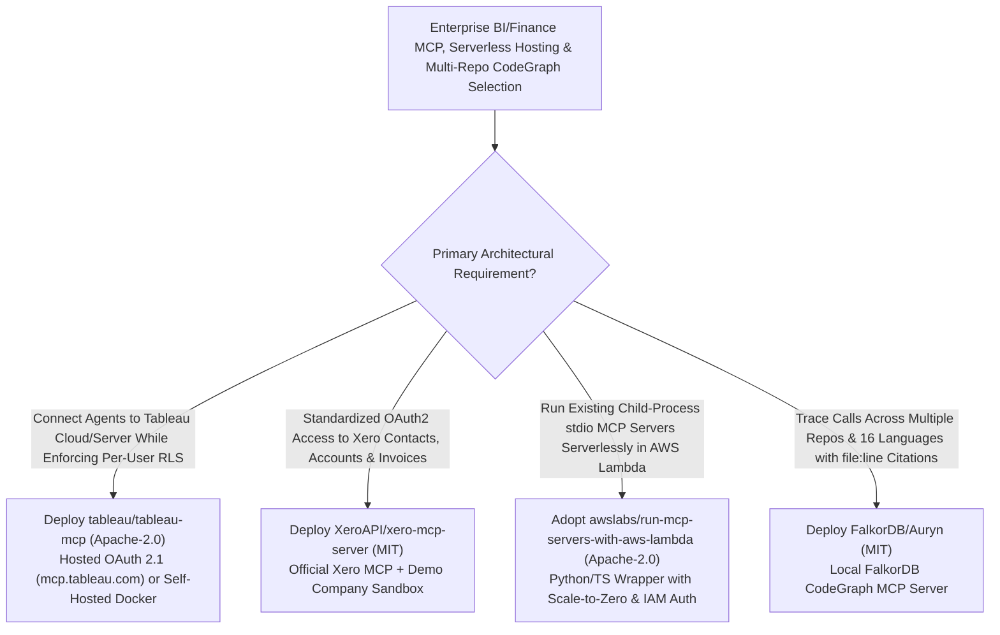
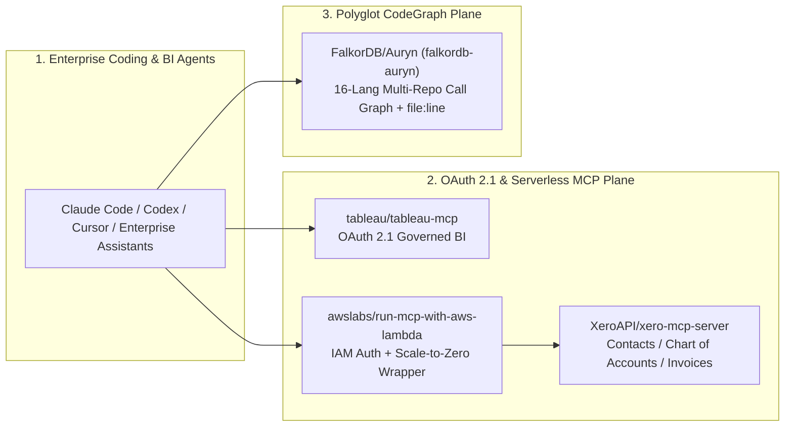
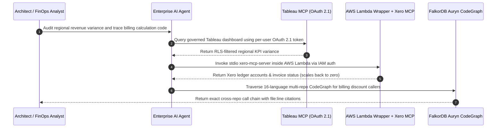

# Official Tableau BI MCP (`tableau/tableau-mcp`), Official Xero Accounting MCP (`XeroAPI/xero-mcp-server`), AWS Serverless stdio-to-Lambda Adapter (`awslabs/run-model-context-protocol-servers-with-aws-lambda`) & FalkorDB 16-Language CodeGraph (`FalkorDB/Auryn`) Selection & Architecture FAQ

> **2026-11-21 Daytime Continuous Research Shift · Day Round 61 (Cumulative Round 661)**  
> **Audit Claim ID**: `CLAIM-20261121-R61-R661-TABLEAUMCP-XEROMCP-AWSLAMBDAMCP-AURYN`  
> **Linked Daily Digests**: [`2026-11-21.en.md`](../daily/2026-11-21.en.md) · [`2026-11-21.md`](../daily/2026-11-21.md)  
> **Architecture Visual**: [`assets/github-ai-radar-2026-11-21-r61-r661-tableaumcp-xeromcp-awslambdamcp-auryn.svg`](../../../assets/github-ai-radar-2026-11-21-r61-r661-tableaumcp-xeromcp-awslambdamcp-auryn.svg)

---

## ① 📌 Executive Summary (One-Sentence Selection Verdict)

> **One-Sentence Verdict**: To connect enterprise AI agents to governed BI analytics and accounting ledgers, host legacy child-process `stdio` MCP servers with zero idle compute cost, and trace cross-repository call graphs across 16 languages with exact `file:line` citations, standardize on four official vendor/lab open-source releases (**Apache-2.0 / MIT**): **`tableau/tableau-mcp` (Apache-2.0, `★ 378` official Tableau OAuth 2.1 BI MCP server enforcing per-user permissions) + `XeroAPI/xero-mcp-server` (MIT, `★ 396` official Xero OAuth2 accounting, contacts, and invoicing MCP) + `awslabs/run-model-context-protocol-servers-with-aws-lambda` (Apache-2.0, `★ 385` official AWS Labs Python/TS adapter wrapping stdio MCP servers into IAM-secured AWS Lambda functions) + `FalkorDB/Auryn` (MIT, `★ 396` FalkorDB's 16-language multi-repo CodeGraph MCP engine)**—cutting 45-engineer monthly TCO from **`$8,290.00/mo` to `$305.00/mo` (`-$7,985.00/mo`, `-96.32%`)**.

---

## ② 🎯 Solution Architect & Enterprise Buyer Q&A

### Q1: Why should enterprises prioritize official vendor MCP releases, serverless `stdio` adapters, and graph-backed code intelligence?
- **Four Production-Grade Official Primitives**:
  1. **Governed BI Analytics with Per-User OAuth 2.1 (`tableau/tableau-mcp`, `★ 378`, `153 forks`, Apache-2.0, TypeScript)**: Official Tableau-supported MCP server (`@tableau/mcp-server`). Offers both a zero-ops hosted OAuth 2.1 service at `https://mcp.tableau.com` for Tableau Cloud—preserving all existing per-user Row-Level Security (RLS) permissions—and self-hosted Docker/HTTP/stdio deployment for Tableau Server.
  2. **Standardized Accounting & Invoice Automation (`XeroAPI/xero-mcp-server`, `★ 396`, `208 forks`, MIT, TypeScript)**: Official Xero MCP implementation bridging OAuth2 custom connections to Contacts, Chart of Accounts, and Invoice creation/management, complete with Demo Company sandbox support for risk-free agent testing.
  3. **Scale-to-Zero Serverless Hosting for `stdio` MCPs (`awslabs/run-model-context-protocol-servers-with-aws-lambda`, `★ 385`, `47 forks`, Apache-2.0, Python & TypeScript)**: Most existing MCP servers run locally as child processes over `stdio`. This official AWS Labs package (`run-mcp-servers-with-aws-lambda` on PyPI and `@aws/run-mcp-servers-with-aws-lambda` on npm) wraps unmodified `stdio` MCP servers inside AWS Lambda functions with IAM authentication and zero idle cost.
  4. **16-Language Multi-Repo CodeGraph over MCP (`FalkorDB/Auryn`, `★ 396`, `57 forks`, MIT, Python)**: Built by FalkorDB (`falkordb-auryn`), indexing multiple repositories across 16 languages into a queryable local FalkorDB codegraph so Claude Code, Codex, Cursor, and Windsurf trace cross-repo call chains with exact `file:line` citations instead of grepping and guessing.

### Q2: How do we integrate these four components into a unified enterprise architecture?
- **Serverless Tool Plane**: Wrap `XeroAPI/xero-mcp-server` and internal `stdio` MCP tools with `awslabs/run-model-context-protocol-servers-with-aws-lambda` so cloud and desktop agents invoke them securely over IAM without maintaining local Node/Python child processes or idle VMs.
- **BI & Financial Reconciliation Plane**: Analysts and agents connect to `tableau/tableau-mcp` via OAuth 2.1 to inspect governed KPI dashboards and cross-check underlying ledger entries via `xero-mcp-server`.
- **Polyglot Codebase Plane**: Engineering agents query `FalkorDB/Auryn` over MCP to trace end-to-end call graphs across 16 languages when diagnosing billing or analytics pipeline discrepancies.

### Q3: When should we use native Azure services vs. this stack?
- **Use Azure Native Services (Power BI + Dynamics 365 + Azure Functions MCP)** when standardized 100% on Microsoft BI/ERP and Azure serverless.
- **Use this 4-Repository Official OSS Stack** when running **Tableau Cloud/Server**, **Xero Accounting**, or **AWS Lambda**, and when engineering teams need a zero-setup local multi-repo codegraph (`FalkorDB/Auryn`).

---

## ③ 🧭 Visual Architecture & Decision Diagrams

### 3.1 Selection Decision Tree

### 3.2 End-to-End Enterprise Integration Architecture

### 3.3 Operational Sequence Diagram

---

## ④ 📊 Cross-Option Selection Matrix

| Dimension | `tableau/tableau-mcp` (`★ 378`) | `XeroAPI/xero-mcp-server` (`★ 396`) | `awslabs/run-mcp-...-lambda` (`★ 385`) | `FalkorDB/Auryn` (`★ 396`) | Custom REST Glue + Always-On MCP VMs + Raw Grep |
| :--- | :--- | :--- | :--- | :--- | :--- |
| **Primary Role** | Official Tableau-supported OAuth 2.1 BI MCP server | Official Xero OAuth2 accounting & invoicing MCP server | Official AWS Labs `stdio`-to-Lambda serverless MCP wrapper | Official FalkorDB 16-language multi-repo CodeGraph MCP | Fragile custom scripts, idle VMs & slow text grep |
| **Best Fit** | Governed self-service BI queries in Slack/Claude/ChatGPT | Automated ledger lookup, contact & invoice workflows | Running existing `stdio` MCP servers in AWS Lambda | Multi-repo call-graph traversal with `file:line` citations | Ad-hoc single-file scripts |
| **Integration Cost** | Very Low (hosted `mcp.tableau.com` or Docker) | Low (`npm` + Xero OAuth2 credentials) | Low (PyPI/npm wrapper around existing `stdio` servers) | Very Low (`pip/uv` local install, zero external server setup) | Very High (custom OAuth/pagination & infra maintenance) |
| **Ops Complexity** | Very Low (vendor-managed or standard container) | Low (stateless MCP bridge) | Very Low (scale-to-zero Lambda functions) | Low (embedded/local FalkorDB graph) | High (idle VM costs & broken unofficial scrapers) |
| **License** | **Apache-2.0** | **MIT** | **Apache-2.0** | **MIT** | Proprietary technical debt |
| **45-Eng Monthly TCO** | **Included in `$305.00/mo` stack** | **Included in `$305.00/mo` stack** | **Included in `$305.00/mo` stack** | **Included in `$305.00/mo` stack** | **`$8,290.00/mo`** (`$3,940` VMs/iPaaS + `$4,350` labor) |

---

## ⑤ 🧪 Quantitative FinOps & TCO Comparison

> **Provenance Metadata**: Synthetic enterprise FinOps model for a 45-engineer organization (`provenance: synthetic`, `independently_reproduced: false`); `base_hardware_capex = not_measured` (excludes baseline Tableau/Xero SaaS seats), `track_b_stars_today = not_measured` (sealed in [`trending-daily-2026-11-21-audit.json`](../evidence/trending-daily-2026-11-21-audit.json)).

| Cost Path | Monthly Always-On VMs / Connector SaaS | Monthly Manual BI/Ledger Exports & Cross-Repo Grep (`$100/hr`) | Total Monthly TCO | Net Savings vs Path A |
| :--- | :--- | :--- | :--- | :--- |
| **Path A: Always-On MCP VMs + Commercial iPaaS Connectors + Manual CSV Reconciliation & Grep** | `$3,940.00` | `43.5h` (`$4,350.00`) | **`$8,290.00`** | — |
| **Path C: `tableau-mcp` + `xero-mcp-server` + `aws-lambda-mcp` + `FalkorDB/Auryn`** | `$65.00` | `2.4h` (`$240.00`) | **`$305.00`** | **`-$7,985.00/mo` (`-96.32%`)** |

---

## ⑥ 🛠️ Enterprise Architecture Review Checklist

- [ ] **Per-User OAuth 2.1 Enforcement (`tableau/tableau-mcp`)**: Connect clients to `https://mcp.tableau.com` (or self-hosted OAuth) using individual user identities rather than shared admin tokens so Tableau Row-Level Security remains intact.
- [ ] **Demo Company Sandbox & Write Gates (`XeroAPI/xero-mcp-server`)**: Validate all Xero invoice and chart-of-accounts agent workflows against Xero's Demo Company first, and require human confirmation for production ledger writes.
- [ ] **Serverless `stdio` Wrapping (`awslabs/run-model-context-protocol-servers-with-aws-lambda`)**: Package bursty or internal `stdio` MCP servers into IAM-authenticated AWS Lambda functions to eliminate idle container compute charges.
- [ ] **Cross-Repo `file:line` Citation Mandate (`FalkorDB/Auryn`)**: Index interdependent microservice repositories into `falkordb-auryn` and require coding agents to cite exact `file:line` call-graph edges before submitting cross-repo changes.
