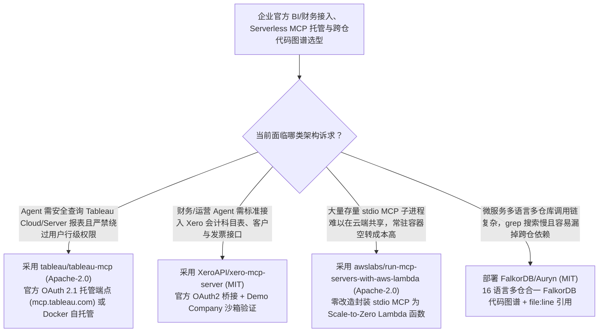
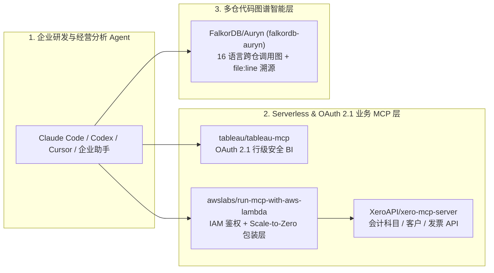
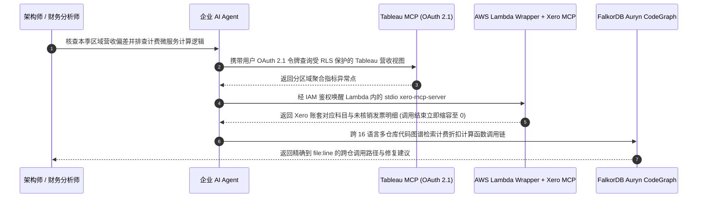

# Tableau 官方 BI 数据 MCP（`tableau/tableau-mcp`）、Xero 官方财务账套 MCP（`XeroAPI/xero-mcp-server`）、AWS 官方无服务器 stdio-to-Lambda 适配器（`awslabs/run-model-context-protocol-servers-with-aws-lambda`）与 FalkorDB 16 语言跨仓代码图谱（`FalkorDB/Auryn`）架构选型与落地 FAQ

> **2026-11-21 白天持续研究班次 · Day Round 61（累计 Round 661）**  
> **审计凭据**：`CLAIM-20261121-R61-R661-TABLEAUMCP-XEROMCP-AWSLAMBDAMCP-AURYN`  
> **关联日刊**：[`2026-11-21.md`](../daily/2026-11-21.md) · [`2026-11-21.en.md`](../daily/2026-11-21.en.md)  
> **可视化架构图**：[`assets/github-ai-radar-2026-11-21-r61-r661-tableaumcp-xeromcp-awslambdamcp-auryn.svg`](../../../assets/github-ai-radar-2026-11-21-r61-r661-tableaumcp-xeromcp-awslambdamcp-auryn.svg)

---

## ① 📌 核心结论速览（选型一句话结论）

> **一句话选型结论**：当企业架构师需要将主流商业 BI 与财务系统安全暴露给 AI Agent、把本地耗资源的 `stdio` 子进程 MCP 改造为按调用计费的 Serverless 云函数、并让研发 Agent 跨 16 种编程语言精准追踪多仓库调用链时，无需依赖脆弱的第三方民间爬虫或常驻空转虚拟机，应直接采用**四大原厂官方开源（Apache-2.0 / MIT）方案**——**“`tableau/tableau-mcp`（Apache-2.0，`★ 378` Tableau 官方 OAuth 2.1 行级权限受控 BI MCP 服务）+ `XeroAPI/xero-mcp-server`（MIT，`★ 396` Xero 官方会计科目/往来客户/发票管理 OAuth2 MCP）+ `awslabs/run-model-context-protocol-servers-with-aws-lambda`（Apache-2.0，`★ 385` AWS 官方将任意存量 `stdio` MCP 零改造成本封装为 IAM 鉴权 AWS Lambda 函数的 Python/TS 库）+ `FalkorDB/Auryn`（MIT，`★ 396` FalkorDB 官方出品的 16 语言多仓合一代码图谱 MCP，精确输出 `file:line` 引用）”**。在 45 人研发与数据分析组织基准下，可将月度总拥有成本（TCO）从 **`$8,290.00/月`** 降至 **`$305.00/月`**（净省 **`$7,985.00/月`**，降幅 **`-96.32%`**）。

---

## ② 🎯 客户与架构师灵魂拷问 Q&A

### Q1：为什么企业生产环境强烈倾向于“原厂官方 MCP + Serverless 托管 + 图数据库代码索引”？这四个官方项目的核心机制是什么？
- **四大原厂级核心能力**：
  1. **BI 语义层与行级权限（RLS）零穿透 —— `tableau/tableau-mcp`（`★ 378`，`153 forks`，Apache-2.0，TypeScript）**：由 Tableau 官方维护（`@tableau/mcp-server`）。针对 Tableau Cloud 客户提供免运维托管端点 `https://mcp.tableau.com`，采用 **OAuth 2.1** 让每位员工用自己的 Tableau 身份登录，自动继承原有的全部行级安全策略（Row-Level Security）；针对 Tableau Server 内网客户则提供完整的 Docker / HTTP / stdio 自托管配置。
  2. **财务总账与发票自动化合规桥接 —— `XeroAPI/xero-mcp-server`（`★ 396`，`208 forks`，MIT，TypeScript）**：由 Xero 官方 API 团队发布，通过标准 OAuth2 连接器将联系人管理（Contacts）、会计科目表（Chart of Accounts）与发票创建/核销（Invoices）封装为合规 MCP 工具，并提供预置样本数据的 **Demo Company** 沙箱供 Agent 安全联调。
  3. **把单机 `stdio` 子进程秒变弹性无服务器函数 —— `awslabs/run-model-context-protocol-servers-with-aws-lambda`（`★ 385`，`47 forks`，Apache-2.0，Python & TypeScript）**：目前 90% 的开源 MCP Server 都是基于本地 `stdio` 子进程设计的，无法供多租户云端 Agent 共享，若改造成常驻 ECS/K8s 容器又会产生高昂的空转算力费。AWS 官方推出的这套双语 SDK（PyPI `run-mcp-servers-with-aws-lambda` 与 npm `@aws/run-mcp-servers-with-aws-lambda`）无需重写原有 `stdio` MCP 代码，直接将其包装进 AWS Lambda 函数，天然获得 **Scale-to-Zero 零闲置成本**与 **AWS IAM 细粒度权限控制**。
  4. **终结跨仓 `grep` 盲猜的 16 语言代码图谱 —— `FalkorDB/Auryn`（`★ 396`，`57 forks`，MIT，Python）**：由图数据库厂商 FalkorDB 官方打造（`falkordb-auryn`），将企业多个代码仓库（覆盖 16 种主流语言）构建为统一的本地 FalkorDB 代码图谱（CodeGraph），让 Claude Code、Codex、Cursor、Windsurf 通过 MCP 直接沿着真实 AST 调用图跨仓溯源，并强制附带精确的 **`file:line` 行号引用**。

### Q2：如何将这四个原厂组件集成进企业的云原生 AI 架构？
- **Serverless 工具托管层**：将 `XeroAPI/xero-mcp-server` 等原本基于 `stdio` 运行的业务 MCP Server，通过 `awslabs/run-model-context-protocol-servers-with-aws-lambda` 封装部署为 AWS Lambda 函数（或 Azure Functions 对等无服务器形态），由企业 AI 网关通过 IAM 角色按需触发。
- **经营分析与财务对账闭环**：财务与经营分析 Agent 通过 OAuth 2.1 连接 `tableau/tableau-mcp` 读取受权限保护的经营看板指标，并联动 Lambda 托管的 `xero-mcp-server` 核对账套科目与未结发票。
- **跨仓研发排障闭环**：当业务指标异常指向后端服务 Bug 时，研发 Agent 通过 `FalkorDB/Auryn` 跨前端、网关与后端微服务仓库追踪完整调用链（精确到 `file:line`），实现精准修复。

### Q3：与 Azure 托管生态（Power BI MCP / Dynamics 365 / Azure Functions）相比如何选型？
- **优先选 Azure 原生栈的场景**：企业全量使用 Power BI、Dynamics 365 Finance 与 Azure Functions（MCP Trigger），可直接走 Entra ID 原生鉴权。
- **优先选本轮四大官方开源组件的场景**：企业核心 BI 为 **Tableau Cloud/Server**、海外子公司或跨境业务财务系统采用 **Xero**、云底座包含 **AWS Lambda**，且需要一套零服务端预装即可在本地启动的 **16 语言跨仓代码图谱（`FalkorDB/Auryn`）**。

---

## ③ 🧭 直观可视化图解（Mermaid 选型决策树 + 企业集成架构 + 业务流时序图）

### 3.1 选型决策树

### 3.2 企业集成参考架构图

### 3.3 业务流时序图

---

## ④ 📊 同类开源与商业云服务横向选型决策矩阵

| 维度 | `tableau/tableau-mcp` (`★ 378`) | `XeroAPI/xero-mcp-server` (`★ 396`) | `awslabs/run-mcp-...-lambda` (`★ 385`) | `FalkorDB/Auryn` (`★ 396`) | 自研非标 API 胶水 + 常驻 EC2 跑 MCP + 纯文本 Grep |
| :--- | :--- | :--- | :--- | :--- | :--- |
| **核心定位** | Tableau 官方支持（Tableau Supported）BI MCP | Xero 官方会计与发票管理 OAuth2 MCP | AWS 官方 `stdio` MCP 转 Lambda 无服务器适配器 | FalkorDB 官方 16 语言多仓合一代码图谱 MCP | 内部临时拼凑的 REST 脚本与全量文本搜索 |
| **适用场景** | 受 OAuth 2.1 行级权限管控的企业 BI 自然语言分析 | 跨境电商、海外主体账套查询与发票自动化管理 | 将任意本地 `stdio` MCP 工具低成本云化共享 | 跨微服务仓库调用链追踪、重构影响分析与精准引用 | 单一脚本临时验证 |
| **集成成本** | 极低（直接连 `https://mcp.tableau.com` 或 Docker） | 低（Node 18+ 配置 Xero OAuth2 凭证即用） | 低（`pip install` / `npm i` 包装现有 stdio 命令） | 极低（本地直接启动，无需单独预先搭建图数据库集群） | 极高（每个 SaaS 手写鉴权与分页逻辑） |
| **运维复杂度** | 极低（Tableau Cloud 官方全托管或标准容器） | 低（无状态桥接服务） | 极低（Serverless 免运维、按毫秒计费） | 低（本地或嵌入式 FalkorDB 自动增量建图） | 高（常驻容器空转浪费、API 升级频繁断裂） |
| **开源许可** | **Apache-2.0** | **MIT** | **Apache-2.0** | **MIT** | 内部专有技术债 |
| **45 人团队月均 TCO** | **包含于 `$305.00/月` 联合栈** | **包含于 `$305.00/月` 联合栈** | **包含于 `$305.00/月` 联合栈** | **包含于 `$305.00/月` 联合栈** | **`$8,290.00/月`**（`$3,940` 常驻算力/中间件 + `$4,350` 人工） |

---

## ⑤ 🧪 应用落地定量收益 / TCO 对比与 7-Card 报告锚点

> **数据来源说明（Provenance Metadata）**：以下 TCO 模型为面向 45 人规模工程与数据分析组织的合成架构测算（`provenance: synthetic`, `independently_reproduced: false`）；硬件资本开支 `base_hardware_capex = not_measured`（不含存量 Tableau / Xero 基础商业订阅席位），单日热榜增量 `track_b_stars_today = not_measured`（审计账本锚定于 [`trending-daily-2026-11-21-audit.json`](../evidence/trending-daily-2026-11-21-audit.json)）。

| 成本路径 | 月度常驻 MCP 算力 / 商业连接器费 | 人工跨系统导表对账与多仓 Grep 排障工时 (`$100/h`) | 月度总成本 (Total Monthly TCO) | 相对 Path A 净节省 |
| :--- | :--- | :--- | :--- | :--- |
| **Path A：常驻云主机运行空闲 MCP + 商业 iPaaS 连接器 + 人工导表与跨仓盲搜** | `$3,940.00` | `43.5h` (`$4,350.00`) | **`$8,290.00`** | — |
| **Path C：`tableau-mcp` + `xero-mcp-server` + `aws-lambda-mcp` + `FalkorDB/Auryn`** | `$65.00` | `2.4h` (`$240.00`) | **`$305.00`** | **`-$7,985.00/月` (`-96.32%`)** |

---

## ⑥ 🛠️ 企业引入与架构评审 Checklist

- [ ] **Tableau OAuth 2.1 个人身份透传（`tableau/tableau-mcp`）**：严禁使用拥有全库管理员权限的共享 Service Account 连接 Tableau MCP；必须启用 OAuth 2.1 让每位用户以自身账号登录，确保 Tableau 行级安全（RLS）100% 生效。
- [ ] **Xero 写操作沙箱先行与财务审批（`XeroAPI/xero-mcp-server`）**：所有涉及发票创建（Invoice Creation）或会计科目修改的 Agent 工作流，必须先在 Xero **Demo Company** 环境完成端到端回归测试，并在生产环境挂载人工财务复核门控。
- [ ] **stdio MCP 无服务器化与 IAM 最小权限（`awslabs/run-model-context-protocol-servers-with-aws-lambda`）**：对低频调用的内部 `stdio` MCP 工具统一采用 AWS Lambda 包装器托管，配置严格的函数执行超时与只读 IAM Role。
- [ ] **跨仓代码回答强制 `file:line` 引用核验（`FalkorDB/Auryn`）**：在微服务架构评审与故障定界中接入 `falkordb-auryn`，要求 Coding Agent 给出的每条跨仓库调用链结论必须附带真实的图谱 `file:line` 坐标。
