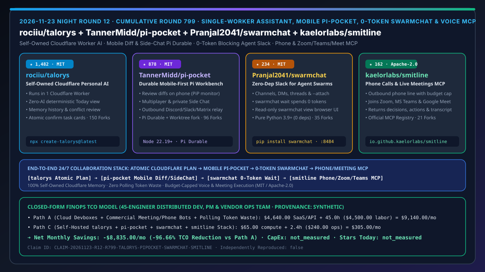
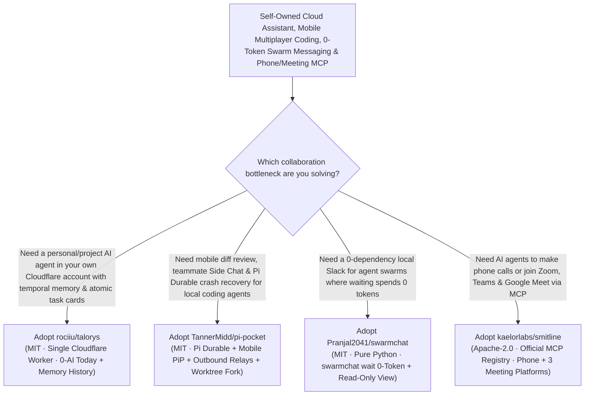
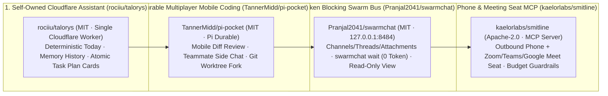

# Single-Worker Cloudflare Personal AI & Memory History (`rociiu/talorys`), Durable Multiplayer Mobile Pi Workbench (`TannerMidd/pi-pocket`), Zero-Dependency `0-Token Wait` Agent Slack (`Pranjal2041/swarmchat`) & Real-Time Phone + Zoom/Teams/Meet MCP (`kaelorlabs/smitline`) Selection & Architecture FAQ

> **Document Type**: Enterprise AI Solution Architect Selection & Integration Guide (GitHub Trending AI Radar · 2026-11-23 Night Round 12 / Cumulative Round 799)
> **Covered Repositories**: [`rociiu/talorys`](https://github.com/rociiu/talorys) (`★ 1,482`, `150 forks`, `MIT`: personal and team AI assistant running **100% inside your own Cloudflare account** as a single Worker `npx create-talorys@latest`, featuring a zero-AI deterministic `Today` dashboard, temporal **Memory History** with conflict confirmation, atomic interactive **AI Task Planning cards**, and scheduled routines) · [`TannerMidd/pi-pocket`](https://github.com/TannerMidd/pi-pocket) (`★ 878`, `96 forks`, `MIT`: durable, multiplayer, mobile-first web workbench for local **Pi** coding agents built on **Pi Durable**, featuring mobile diff review, `PiP` multi-session monitoring, **teammate Side Chats hidden from the agent**, outbound-only Discord/Slack/Telegram/Matrix relays, Git worktree forking, and optional Jev Hub classification) · [`Pranjal2041/swarmchat`](https://github.com/Pranjal2041/swarmchat) (`★ 234`, `35 forks`, `MIT`: zero-dependency Python **"Slack for your AI agent swarm"** `pip install swarmchat` on `127.0.0.1:8484` with channels, DMs, threads, file/folder attachments, **`swarmchat wait` blocking notifications that spend `0 tokens` while waiting**, and a strictly read-only `swarmchat view` browser UI) · [`kaelorlabs/smitline`](https://github.com/kaelorlabs/smitline) (`★ 162`, `21 forks`, `Apache-2.0`, official MCP Registry `io.github.kaelorlabs/smitline`: open-source MCP server giving any AI agent a real phone line and a live seat in **Zoom, Microsoft Teams, and Google Meet** with budget guardrails and structured post-call reports)
> **Core Scenario**: When enterprise engineering and operations teams evolve AI agents from isolated desktop terminals into 24/7 collaborative teammates, how do you solve **"third-party cloud assistants storing personal/project memory on vendor servers, coding sessions stalling whenever engineers step away from their desks, multi-agent swarms burning thousands of tokens polling for peer replies, and AI agents being unable to place phone calls or attend Zoom/Teams/Meet meetings"** using **`talorys` + `pi-pocket` + `swarmchat` + `smitline`**?

---

## 1. 📌 Executive Summary (Single-Sentence Selection Verdict)

1. **Need a personal and project AI assistant that deploys as a single Worker inside your own Cloudflare account with a zero-AI `Today` view, temporal memory conflict resolution, and atomic confirm-before-write task planning cards** ➔ Choose **[`rociiu/talorys`](https://github.com/rociiu/talorys) (`★ 1,482`, `150 forks`, `MIT`)**.
   - **Plain-Language Mechanism**: Deployed via `npx create-talorys@latest`, `Talorys` operates with zero developer-hosted servers: ① its **`Today` overview** uses deterministic logic (zero AI latency/cost) to surface focus tasks, overdue items, and next steps; ② **Memory History** versions evolving facts over time (asking whether an older fact should be retired when a new one contradicts it); and ③ **AI Task Planning** renders proposed project plans as interactive chat cards where nothing touches the database until you click confirm—creating all tasks atomically once and rejecting invalid calendar dates/UTC offsets.
2. **Need a durable, multiplayer, mobile-first web workbench for local Pi coding agents so you can review diffs on your phone, chat with teammates in a side channel the agent doesn't read, and fork experiments into Git worktrees** ➔ Choose **[`TannerMidd/pi-pocket`](https://github.com/TannerMidd/pi-pocket) (`★ 878`, `96 forks`, `MIT`)**.
   - **Plain-Language Mechanism**: Built on **Pi Durable**, `Pi Pocket` keeps coding sessions alive across restarts on your own machine without a cloud VM. You can monitor multiple sessions via **PiP**, connect **Discord, Slack, Telegram, or Matrix** via outbound-only relays (no public server required), invite teammates to steer or discuss in a **private Side Chat invisible to Pi**, fork alternative approaches into isolated Git worktrees, and optionally screen messages with **Jev Hub** (`v0.31 beta`).
3. **Need a zero-dependency local Slack (`127.0.0.1:8484`) for an AI agent swarm where waiting agents block via `swarmchat wait` at `0 token` cost and humans observe live via a read-only browser view that never alters agent unread counts** ➔ Choose **[`Pranjal2041/swarmchat`](https://github.com/Pranjal2041/swarmchat) (`★ 234`, `35 forks`, `MIT`)**.
   - **Plain-Language Mechanism**: Polling a shared inbox in an LLM loop wastes tokens every few seconds. Installed via `pip install swarmchat` (pure Python 3.9+, zero dependencies), `SwarmChat` provides channels, DMs, threads (`--reply-to`), folder attachments (`--attach`), and **`swarmchat wait --from <agent>`**—blocking at the OS process level so the waiting agent spends **zero tokens** until the target message arrives, while `swarmchat view` lets humans watch every thread without advancing any agent's read cursor.
4. **Need an MCP server (`io.github.kaelorlabs/smitline`) that gives any AI agent a phone line and a live seat in Zoom, Microsoft Teams, and Google Meet under explicit budget and negotiation guardrails** ➔ Choose **[`kaelorlabs/smitline`](https://github.com/kaelorlabs/smitline) (`★ 162`, `21 forks`, `Apache-2.0`)**.
   - **Plain-Language Mechanism**: Shipped as an official MCP server and GHCR Docker image (`ghcr.io/kaelorlabs/smitline`), `Smitline` lets agents place outbound phone calls (with hard constraints like *"Don't agree to more than $150"*) or join live Zoom, Microsoft Teams, and Google Meet sessions—returning structured confirmation numbers, prices, decisions, action items, and full transcripts back to the chat.

---

## 2. 🎯 Key Architectural Q&A (Deep-Dive Breakdown)

### Q1: How do `talorys`, `pi-pocket`, `swarmchat`, and `smitline` solve the four biggest friction points in 24/7 human-agent collaboration?

- **Four Collaboration Breakthroughs**:
  1. **Self-Owned Cloud Memory & Atomic Planning (`rociiu/talorys`)**: Runs entirely in your own Cloudflare account with temporal memory retirement and confirm-before-write task cards.
  2. **Mobile Diff Review & Context-Clean Multiplayer (`TannerMidd/pi-pocket`)**: Lets engineers approve local agent diffs from their phones and discuss with teammates in a side chat that never pollutes the agent's prompt.
  3. **Zero-Token Inter-Agent Synchronization (`Pranjal2041/swarmchat`)**: Replaces expensive LLM polling loops with OS-level `swarmchat wait` blocking and cursor-safe human observability.
  4. **Real-World Voice & Meeting Execution (`kaelorlabs/smitline`)**: Bridges text-only agents into phone calls, Zoom, Microsoft Teams, and Google Meet via MCP.
- **When to Choose Commercial SaaS Collaboration Suites (Path B)**:
  - If your organization uses only standard Microsoft 365 Copilot inside Teams meetings and commercial cloud devboxes, stick with managed M365 services; for self-owned Cloudflare personal agents, mobile control over local coding sessions, zero-token local swarm messaging, or MCP-driven phone/meeting agents, deploy this 4-repo OSS stack (Path C).

### Q2: How do you wire these four repositories into an end-to-end enterprise workflow?

1. **Daily Planning & Temporal Memory Layer (`rociiu/talorys`)**:
   - Review the deterministic `Today` dashboard and approve atomic AI task plans inside your Cloudflare Worker.
2. **Durable Mobile-Accessible Coding Layer (`TannerMidd/pi-pocket`)**:
   - Execute coding tasks on local machines backed by Pi Durable, reviewing diffs on mobile and collaborating with peers in the Side Chat.
3. **Zero-Token Swarm Coordination Bus (`Pranjal2041/swarmchat`)**:
   - Coordinate specialist subagents over `127.0.0.1:8484` using `swarmchat wait --from <peer>` and `--attach` log handoffs while monitoring via `swarmchat view`.
4. **External Voice & Meeting Execution Layer (`kaelorlabs/smitline`)**:
   - Dispatch `Smitline` over MCP to attend scheduled Zoom/Teams/Meet standups or place budget-capped vendor phone calls, feeding structured action items back into `Talorys` and `Pi Pocket`.

### Q3: What are the production guardrails?

- **Architect Guardrails**:
  1. **Enforce Call Disclosure & Hard Budget Caps in `smitline`**: Always configure explicit monetary/commitment limits in the call brief and ensure automated voice participants announce their AI assistant status in compliance with telecommunications and meeting recording laws.
  2. **Keep Outbound Relays Authenticated in `pi-pocket`**: When bridging Discord/Slack/Telegram/Matrix into local Pi sessions, enable sender screening (`v0.31` Jev classifier or allowlists) so unauthorized chat users cannot steer local code execution.

---

## 3. 🧭 Visual Architecture & Decision Diagrams (Mermaid)



### 3.1 Solution Architect Selection Decision Tree



### 3.2 End-to-End Enterprise Production Reference Architecture



### 3.3 Atomic Plan Confirmation, 0-Token Swarm Handoff, Mobile Diff Approval & Live Meeting MCP Sequence

```mermaid
sequenceDiagram
    participant Lead as Architect / Tech Lead (Mobile)
    participant Tal as rociiu/talorys (Cloudflare Worker)
    participant Pocket as TannerMidd/pi-pocket (Pi Durable)
    participant Swarm as Pranjal2041/swarmchat (127.0.0.1:8484)
    participant Smit as kaelorlabs/smitline (Phone/Zoom MCP)

    Lead->>Tal: 1. Approve interactive AI task plan card; atomically create sprint tasks & reminders
    Tal->>Pocket: 2. Launch local Pi Durable coding session; spawn specialist subagents
    Pocket->>Swarm: 3. Reviewer agent runs swarmchat wait --from builder (spends 0 tokens while blocked)
    Swarm-->>Pocket: 4. Builder attaches diff/logs & wakes reviewer; Lead approves diff on phone via Pi-Pocket
    Pocket->>Smit: 5. Invoke Smitline MCP to join 3 PM Zoom/Teams review or call vendor with $150 cap
    Smit-->>Lead: 6. Return structured decisions, confirmation numbers, action items & transcript
```

---

## 4. 📊 Comparative Selection Matrix (Open-Source vs. Commercial SaaS)

| Dimension | `rociiu/talorys` (`★ 1,482`) | `TannerMidd/pi-pocket` (`★ 878`) | `Pranjal2041/swarmchat` (`★ 234`) | `kaelorlabs/smitline` (`★ 162`) | Vendor-Hosted Cloud Assistant + Cloud Devboxes + Polling Swarms + Meeting Bot SaaS (Path A) | Static Local Notes + Desktop-Bound CLI + File Polling + Manual Calls/Notes (Path B) |
| :--- | :--- | :--- | :--- | :--- | :--- | :--- |
| **Core Role** | Single-Worker Cloudflare personal AI & temporal memory hub | Durable multiplayer mobile web app for local Pi coding agents | Zero-dependency Python Slack for AI agent swarms (`0-token wait`) | Phone call & Zoom/Teams/Meet live participant MCP server | Vendor-hosted assistant SaaS, metered cloud VMs & per-seat meeting bots | Unsynced local notes, desktop-locked terminals & manual phone/meeting work |
| **Key Differentiator** | **0-AI `Today` view + temporal memory retirement + atomic cards** | **Mobile diff review + context-free Side Chat + outbound relays** | **`swarmchat wait` spends `0 tokens` + cursor-safe `swarmchat view`** | **Outbound phone line + Zoom/Teams/Meet seat + budget caps** | High cloud VM/meeting-bot fees; polling loops burn tokens while waiting | Approvals stall when away from desk; human viewers corrupt unread state |
| **License** | `MIT` | `MIT` | `MIT` | `Apache-2.0` | Proprietary SaaS | Custom scripts |
| **Monthly TCO (45-Eng Team)** | **Combined `$305.00/mo`** (`$65.00` Worker/telephony trunks + `2.4h` ops) | Included (runs on developer's own machine) | Included (zero-dependency local binary, `0` polling tokens) | Included (self-hosted Docker + SIP/meeting minutes) | **`$9,140.00/mo`** (`$4,640.00` cloud VMs/meeting bots/polling tokens + `45.0h` manual coordination) | ~`$3,190.00/mo` (heavy manual meeting note-taking, phone scheduling & stalled approvals) |

---

## 5. 🧪 Quantitative ROI / TCO Comparison & 7-Card Benchmark Report

> **📊 Data Provenance & Closed-Form Schema Declaration**:
> - **provenance**: `synthetic` (45-person enterprise distributed engineering, project delivery, and vendor coordination team monthly workload model: `independently_reproduced = false`; hardware baseline `base_hardware_capex = not_measured`; Track B 24h delta `track_b_stars_today = not_measured`).
> - **Closed-Form Formula**:
>   - **Path A (Commercial cloud devbox seats + per-seat commercial meeting/phone bot subscriptions + LLM token waste from polling inter-agent message queues + manual phone scheduling and meeting note transcription)**: Monthly cloud VM, meeting bot, and polling token fees **`$4,640.00`** + manual vendor calls, meeting action-item entry, and stalled off-desk approval labor **`45.0h × $100.00/h = $4,500.00`** = **`$9,140.00/mo`**.
>   - **Path C (Self-hosted `rociiu/talorys` + `TannerMidd/pi-pocket` + `Pranjal2041/swarmchat` + `kaelorlabs/smitline` stack)**: Monthly Cloudflare Worker and SIP/meeting container compute **`$65.00`** + relay and voice guardrail maintenance labor **`2.4h × $100.00/h = $240.00`** = **`$305.00/mo`**.
>   - **Net Monthly Savings vs. Path A**: **`-$8,835.00/mo`** (**`96.66%`** TCO reduction).

| Evaluation Path | Cloud VM / Meeting Bot / Polling Token Cost | Coordination, Note-Taking & Wait Labor (`$100/h`) | Monthly Total TCO | Net Savings vs. Path A | Key Architectural Delivery Metrics |
| :--- | :---: | :---: | :---: | :---: | :--- |
| **Path A: Cloud Devboxes + Commercial Meeting/Phone Bots + Polling Swarms** | `$4,640.00` | `45.0h` (`$4,500.00`) | **`$9,140.00`** | Baseline | Expensive per-seat bots; continuous polling token waste |
| **Path B: Desktop-Only CLI + File Polling + Manual Calls/Minutes** | `$1,390.00` | `18.0h` (`$1,800.00`) | **`$3,190.00`** | `-$5,950.00` (`-65.10%`) | Stalled mobile approvals; manual phone & meeting overhead |
| **Path C: `talorys` + `pi-pocket` + `swarmchat` + `smitline`** | **`$65.00`** | **`2.4h` (`$240.00`)** | **`$305.00`** | **`-$8,835.00` (`-96.66%`)** | **Single-Worker cloud + mobile diff/Side Chat + `0-token wait` + Phone/Zoom MCP** |

- 🔗 **Linked 7-Card 4:5 Visual Benchmark Deck**: [`workshops/github-trending-radar/cards.en.html`](../cards.en.html) · [`cards.html`](../cards.html)

---

## 6. 🛠️ Enterprise Adoption & Architecture Review Checklist

- [ ] **1. Deploy `rociiu/talorys` as a Single Worker in Your Own Cloudflare Account**: Enable temporal Memory History conflict checks and require explicit human confirmation on interactive AI Task Planning cards before creating tasks.
- [ ] **2. Connect Local Coding Sessions to `TannerMidd/pi-pocket`**: Enable Pi Durable crash recovery, mobile diff approvals, Git worktree forking, and context-isolated teammate Side Chats.
- [ ] **3. Replace Inter-Agent Polling with `Pranjal2041/swarmchat` (`swarmchat wait`)**: Require multi-agent workflows to block via `swarmchat wait --from <agent>` (`0 tokens` while waiting) and inspect live runs via read-only `swarmchat view`.
- [ ] **4. Govern External Phone & Meeting Calls via `kaelorlabs/smitline` MCP**: Attach explicit budget/commitment ceilings and mandatory AI disclosure prompts to every outbound phone call and Zoom/Teams/Meet session.
