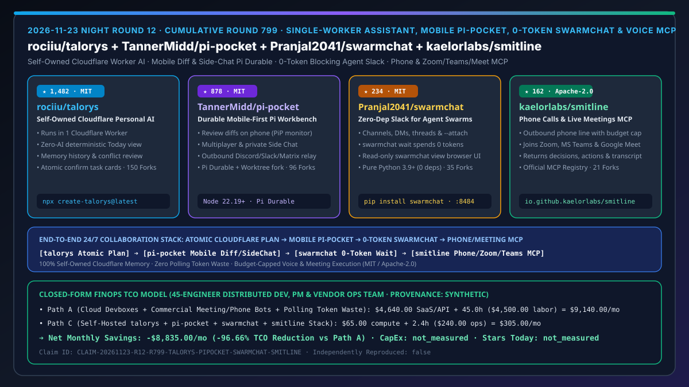
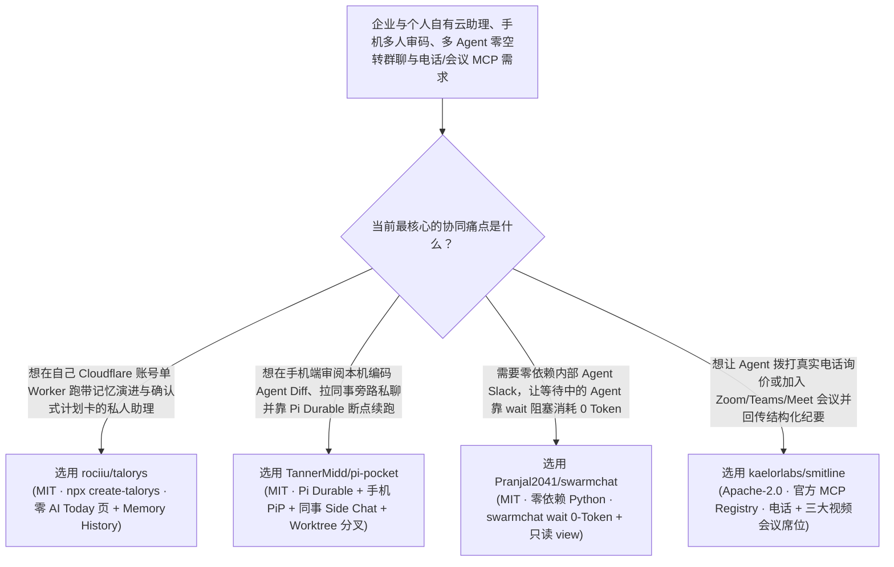
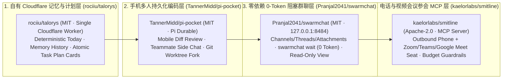
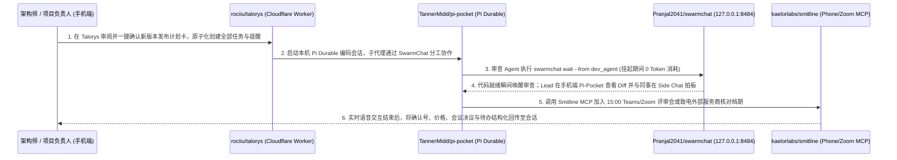

# 自有 Cloudflare 账号单 Worker 持久记忆与原子计划助理（`rociiu/talorys`）、基于 Pi Durable 的多人手机端审 Diff 与工作树分叉工作台（`TannerMidd/pi-pocket`）、零依赖 `wait` 零 Token 阻塞的多智能体群聊总线（`Pranjal2041/swarmchat`）与赋予 Agent 电话外呼及 Zoom/Teams/Meet 参会席位的语音 MCP（`kaelorlabs/smitline`）选型与集成架构 FAQ

> **文档类型**：企业 AI 解决方案架构师（AI Solution Architect）选型决策指南（GitHub Trending AI 雷达 2026-11-23 Night Round 12 / 累计第 799 轮）
> **覆盖项目**：[`rociiu/talorys`](https://github.com/rociiu/talorys)（`★ 1,482`、`150 forks`、`MIT`：100% 部署在用户**自有 Cloudflare 账号（单 Worker）**内的个人与团队 AI 助理 `npx create-talorys@latest`，内置零 AI 确定性 `Today` 概览、带历史事实冲突确认的持久记忆、确认前零副作用的原子化任务计划卡及定时自动化）· [`TannerMidd/pi-pocket`](https://github.com/TannerMidd/pi-pocket)（`★ 878`、`96 forks`、`MIT`：基于 **Pi Durable** 构建的跨电脑与手机端多人协同 Pi 编码工作台，支持手机端审阅 Diff、**Pi 不读取的团队私聊旁路（Side Chat）**、免公网服务器的 Discord/Slack/Telegram/Matrix 外连 Relay、Git Worktree 一键分叉与 Jev Hub 分类器）· [`Pranjal2041/swarmchat`](https://github.com/Pranjal2041/swarmchat)（`★ 234`、`35 forks`、`MIT`：零第三方依赖的 Python 多智能体专属 Slack `pip install swarmchat`，支持频道、私信、线程、文件夹附件、**`swarmchat wait` 零 Token 阻塞等待通知**及不改变 Agent 已读游标的人类只读监控视图 `swarmchat view`）· [`kaelorlabs/smitline`](https://github.com/kaelorlabs/smitline)（`★ 162`、`21 forks`、`Apache-2.0`，官方 MCP Registry `io.github.kaelorlabs/smitline`：赋予任意 AI Agent 真实电话外呼线路与 **Zoom / Microsoft Teams / Google Meet 实时参会席位**的开源 MCP 服务，支持设定谈判金额上限并回传确认号、决议与行动项）
> **核心场景**：当企业架构师与研发团队希望让 AI 智能体从“单人电脑前的命令行工具”进化为“7×24 在线、可手机远程审 Diff、多 Agent 之间零 Token 空转通信、甚至能替团队打电话询价和参加 Teams/Zoom 会议记纪要”的数字协作组织时，如何构建一套**“自有 Cloudflare 单 Worker 助理（`talorys`）+ 手机多人持久化编码台（`pi-pocket`）+ 零 Token 阻塞多 Agent 通信总线（`swarmchat`）+ 电话与三大视频会议参会 MCP（`smitline`）”**的全天候协同底座？

---

## 一、📌 核心结论速览（选型一句话结论）

1. **想用一条命令在自己的 Cloudflare 账号内部署一个零第三方服务器依赖、自带零 AI 秒开 `Today` 看板、能自动识别“新事实替代旧事实”并在任务计划未点击确认前绝不乱建工单的私人/团队助理** ➔ 选 **[`rociiu/talorys`](https://github.com/rociiu/talorys)（`★ 1,482`，`150 forks`，`MIT`）**。
   - **通俗原理**：执行 `npx create-talorys@latest`，全套应用作为单个 Cloudflare Worker 运行在你自己的云账号下。它有三大工程亮点：① **确定性优先的 `Today` 首页**（打开即看焦点任务、逾期项与提醒，不耗一分钱 AI Token）；② **带时间轴演进的记忆库（Memory History）**（当你说换了新车或新架构时，主动询问旧事实是否归档为历史，冲突不明时等待人工裁决）；③ **原子化交互计划卡（AI Task Planning）**（在聊天框预览、增删任务列表，未点击确认前数据库零写入，确认后一次性幂等创建并拦截非法日历日期）。
2. **想在工位电脑启动编码会话、通勤路上用手机查看代码 Diff 与 PR 状态、拉同事进同一个会话并在“Agent 看不见的旁路私聊（Side Chat）”里商量对策，且服务重启后靠 Pi Durable 自动断点续跑** ➔ 选 **[`TannerMidd/pi-pocket`](https://github.com/TannerMidd/pi-pocket)（`★ 878`，`96 forks`，`MIT`）**。
   - **通俗原理**：无需购买云端远程开发机，直接连回你本机的 Pi 编码 Agent。内置 **Agent Teams 与 PiP 画中画多会话盯盘**；通过本机主动外连的 **Relay** 打通 Discord/Slack/Telegram/Matrix（无需公网 IP）；支持将当前会话一键 **Fork 到新的 Git Worktree** 试探激进改法；在多人协同（Multiplayer）中专门设计了**不污染 Agent 上下文的同事旁路聊天窗**，并在 `0.31 beta` 集成 **Jev Hub** 对外来消息与子代理报告做自动分流标签。
3. **想给多个本地或容器内的编码 Agent 搭一套零外部依赖的内部 Slack（`127.0.0.1:8484`），让等待队友回复的 Agent 通过阻塞命令进入休眠（等待期间消耗 `0 Token`），同时让人类在浏览器里静默围观而不弄乱 Agent 的未读消息计数** ➔ 选 **[`Pranjal2041/swarmchat`](https://github.com/Pranjal2041/swarmchat)（`★ 234`，`35 forks`，`MIT`）**。
   - **通俗原理**：传统多 Agent 轮询消息靠大模型每隔几秒调一次工具查收件箱，一晚上光空转轮询就能烧掉几十美元。`SwarmChat` 是一个零依赖纯 Python 包：当 Claude Code 需要等待另一个 Agent 审完代码时，只需在后台终端跑一句 **`swarmchat wait --from thing2`**——进程在操作系统级挂起阻塞，**等待期间消耗 `0 Token`**，一旦对方发来消息或 `--attach ./logs` 附件立即唤醒！而人类打开 `swarmchat view` 网页端处于严格只读观察态，绝不会误把 Agent 的未读消息标为已读。
4. **想让你的 AI 智能体拥有真实电话号码以及 Zoom、Microsoft Teams、Google Meet 的参会席位——替你打电话给供应商询价（严格遵守价格红线）或替你参加下午 3 点的线上会议并把决议和待办发回聊天窗** ➔ 选 **[`kaelorlabs/smitline`](https://github.com/kaelorlabs/smitline)（`★ 162`，`21 forks`，`Apache-2.0`）**。
   - **通俗原理**：已收录于官方 MCP Registry（`io.github.kaelorlabs/smitline`）并提供开箱即用的 GHCR Docker 镜像。你只需像吩咐助理一样下达目标与边界（例如*“联系维修商看今天能否上门，报价超过 $150 不要答应”*或*“参加 15:00 的 Zoom 会议并做纪要”*），`Smitline` 就会拨通电话或加入 Teams/Zoom/Meet 实时语音对话，结束后将时间、报价、确认单号、会议决议、Action Items 与完整逐字稿结构化回传至原会话。

---

## 二、🎯 客户与架构师灵魂拷问 Q&A（深度架构拆解）

### Q1：在企业构建“全天候个人/团队助理 + 手机远程审码 + 多 Agent 内部群聊 + 外部电话/会议代理”体系时，这四个开源项目各自解决了什么架构痛点？

- **四大协同痛点与工程解方**：
  1. **个人与团队助理的云端隐私与乱建任务问题 ➔ `rociiu/talorys`**：单 Worker 跑在自有 Cloudflare 账号内，记忆冲突主动核实，任务计划卡未确认前零写入。
  2. **编码 Agent 被锁死在桌面终端、多人围观会污染 Prompt ➔ `TannerMidd/pi-pocket`**：基于 Pi Durable 提供手机审 Diff、Git Worktree 分叉与 Agent 不可见的同事 Side Chat。
  3. **多 Agent 轮询通信烧爆 Token 且人类围观会吞掉未读状态 ➔ `Pranjal2041/swarmchat`**：用 `swarmchat wait` 实现零 Token 阻塞唤醒，用只读 `swarmchat view` 保护每个 Agent 的独立未读游标。
  4. **Agent 只能发文字无法介入真实电话沟通与 Teams/Zoom 会议 ➔ `kaelorlabs/smitline`**：通过标准 MCP 协议赋予 Agent 电话线与三大视频会议参会席位。
- **何时直接选用商业 SaaS 套件（Path B）？**
  - 若企业已全员采购 Microsoft Teams Premium（含 Copilot 会议纪要）与商业呼叫中心 SaaS，可直接使用托管服务；若希望在自有 Cloudflare 零月租运行私人助理、在手机端远程操控本机编码 Agent、用零依赖 CLI 组建内部 Agent 群聊或自托管跨 Zoom/Teams/Meet/电话的语音 MCP，则采用本轮四合一开源栈（Path C）。

### Q2：典型企业级“Talorys 日程规划 ➔ Pi-Pocket 移动编码 ➔ SwarmChat 零空转协同 ➔ Smitline 电话/会议外联”架构怎么搭？

1. **自有 Cloudflare 记忆与日程总控层（`rociiu/talorys`）**：
   - 在自有 Cloudflare Worker 中维护项目任务、带时间演进的记忆库与定时提醒，通过交互式计划卡确认每日研发与沟通目标。
2. **手机端多人持久化编码与 Worktree 演练层（`TannerMidd/pi-pocket`）**：
   - 触发本机 Pi Durable 编码会话，架构师在手机端通过 PiP 盯盘、在 Side Chat 与同事讨论并在手机上审批 Diff 或分叉 Worktree。
3. **本机多 Agent 零 Token 阻塞通信总线层（`Pranjal2041/swarmchat`）**：
   - 多个子 Agent 通过 `127.0.0.1:8484` 的 `SwarmChat` 传递代码补丁与日志附件（`--attach`），通过 `swarmchat wait` 零 Token 等待上下游就绪。
4. **外部电话与三大视频会议实时执行层（`kaelorlabs/smitline`）**：
   - 当任务需要外部电话确认或参加 Zoom/Teams/Meet 例会时，通过 `Smitline` MCP 派发带预算/权限边界的语音 Agent 参会并结构化回传结论。

### Q3：这套架构的落地注意事项与合规红线是什么？

- **架构师落地红线**：
  1. **外呼电话与会议录音双方法律告知（Call Recording & AI Disclosure）**：使用 `kaelorlabs/smitline` 拨打外部电话或加入客户 Zoom/Teams/Meet 会议时，必须在开场白显式声明 AI 助理身份与录音用途，并严格设置谈判金额或承诺上限（Safety Budget Guardrails）。
  2. **`SwarmChat` 令牌最小权限隔离**：为每个 Agent 颁发独立的 `SWARMCHAT_TOKEN`，人类监控统一使用零副作用的 `swarmchat view`。

---

## 三、🧭 直观可视化图解（Mermaid 决策树 + 集成架构 + 时序图）

### 3.1 架构师选型决策树

### 3.2 企业端到端生产集成参考架构图

### 3.3 原子计划确认、SwarmChat 零空转唤醒、Pi-Pocket 手机审码与 Smitline 参会回传时序图

---

## 四、📊 同类开源与商业云服务横向选型决策矩阵

| 对比维度 | `rociiu/talorys` (`★ 1,482`) | `TannerMidd/pi-pocket` (`★ 878`) | `Pranjal2041/swarmchat` (`★ 234`) | `kaelorlabs/smitline` (`★ 162`) | 商业云托管个人助理 + 商业云 IDE + 高频轮询多 Agent + 商业外呼/会议机器人 SaaS (Path A) | 本地无同步静态笔记 + 纯桌面单人终端 + 共享文件锁轮询 + 全人工打电话开会 (Path B) |
| :--- | :--- | :--- | :--- | :--- | :--- | :--- |
| **核心能力定位** | 自有 Cloudflare 账号单 Worker 记忆与原子计划助理 | 基于 Pi Durable 的手机多人协同编码与 Worktree 工作台 | 零依赖 Python 多智能体群聊与 `wait` 零 Token 阻塞总线 | 赋予 Agent 电话线与 Zoom/Teams/Meet 参会席位的 MCP | 按席位/分钟高价计费的商业助理、云端开发机与商业语音外呼 SaaS | 无跨端能力的本地笔记、离开电脑即断联的终端与耗费人力的电话排期 |
| **核心技术突破** | **零 AI 秒开 `Today` + 历史记忆冲突确认 + 确认前零写入计划卡** | **手机审 Diff + 不污染上下文的同事 Side Chat + 免公网 Relay** | **`swarmchat wait` 阻塞休眠 `0 Token` + 只读 `view` 不改未读游标** | **同时支持真实电话与 Zoom/Teams/Meet + 预算上限护栏** | 多 Agent 轮询收件箱浪费海量 Token；商业外呼与云桌面席位费昂贵 | 手机无法远程审批本机代码 Diff；人类点开消息列表会吞掉 Agent 的未读触发器 |
| **开源协议** | `MIT` | `MIT` | `MIT` | `Apache-2.0` | 闭源商业 SaaS | 内部零散脚本 |
| **月度 TCO（45 人团队）** | **组合仅 `$305.00/月`**（`$65.00` 通话/SIP 通道与轻量容器 + `2.4h` 维护） | 同左（跑在开发者本机免云 VM 费） | 同左（零依赖单包 + 零空转轮询 Token） | 同左（Docker 自托管按实际通话计费） | **`$9,140.00/月`**（`$4,640.00` 商业云桌面/会议 Bot/轮询 Token + `45.0h` 人工电话排期与同步工时） | 约 `$3,190.00/月`（大量人工跟进日常会议纪要、电话询价与離桌断联等待工时） |

---

## 五、🧪 应用落地定量收益/TCO 对比与 7-Card 报告

> **📊 数据来源与闭式核算声明（Provenance & Closed-Form Schema）**：
> - **provenance**: `synthetic`（基于 45 人企业远程研发协同、项目交付管理与外部供应商联络团队月度工作负载模型：`independently_reproduced = false`；硬件采购基线 `base_hardware_capex = not_measured`；Track B 单日增量 `track_b_stars_today = not_measured`）。
> - **核算公式**：
>   - **Path A（采购商业云端远程开发 VM 席位 + 商业会议录音/外呼 Bot 按席位订阅 + 多 Agent 持续轮询收件箱消耗的空转 Token + 工程师与PM手工整理会议待办、电话询价及跨设备同步状态）**：月度商业云桌面、会议 Bot 订阅与空转 Token 账单 **`$4,640.00`** + 手工电话联络、会议纪要转工单与离桌阻塞等待工时 **`45.0h × $100.00/h = $4,500.00`** = **`$9,140.00/月`**。
>   - **Path C（自建 `rociiu/talorys` + `TannerMidd/pi-pocket` + `Pranjal2041/swarmchat` + `kaelorlabs/smitline` 开源全天候协同栈）**：Cloudflare Worker 免费档/超额微费与 Smitline 容器/SIP 通道开销 **`$65.00`** + Relay 与外呼规则维护人工 **`2.4h × $100.00/h = $240.00`** = **`$305.00/月`**。
>   - **净节省（Net Savings vs Path A）**：**`-$8,835.00/月`**（成本降低 **`96.66%`**）。

| 评估方案 | 云桌面 / 会议 Bot / 轮询 Token 成本 | 会议跟进、电话联络与离桌等待人工（`$100/h`） | 月度总 TCO | 相对 Path A 净节省 | 关键架构交付指标 |
| :--- | :---: | :---: | :---: | :---: | :--- |
| **Path A：商业云开发机 + 商业会议/外呼 SaaS + 轮询查消息** | `$4,640.00` | `45.0h` (`$4,500.00`) | **`$9,140.00`** | Baseline | 轮询空转烧钱；按席位采购会议与外呼 Bot 昂贵 |
| **Path B：单机无远程终端 + 文件轮询 + 全人工打电话记纪要** | `$1,390.00` | `18.0h` (`$1,800.00`) | **`$3,190.00`** | `-$5,950.00` (`-65.10%`) | 离桌即卡住审批；人工电话询价与抄写纪要效率低 |
| **Path C：`talorys` + `pi-pocket` + `swarmchat` + `smitline`** | **`$65.00`** | **`2.4h` (`$240.00`)** | **`$305.00`** | **`-$8,835.00` (`-96.66%`)** | **单 Worker 私有云 + 手机多人审 Diff + `wait` 零 Token + 电话/三大会议 MCP** |

- 🔗 **关联 7-Card 4:5 视觉评测报告**：[`workshops/github-trending-radar/cards.html`](../cards.html) · [`cards.en.html`](../cards.en.html)

---

## 六、🛠️ 企业引入与架构评审 Checklist

- [ ] **1. 使用 `rociiu/talorys` 在自有 Cloudflare 账号部署零外传任务与记忆中枢**：开启 Memory History 事实更替复核，并强制要求 AI 任务规划通过交互式卡片经人工确认后再原子化落库。
- [ ] **2. 部署 `TannerMidd/pi-pocket` 打通手机端 Diff 审批与团队旁路协同**：启用 Pi Durable 崩溃恢复、Git Worktree 分叉试错以及不污染 Agent 上下文的同事 Side Chat。
- [ ] **3. 用 `Pranjal2041/swarmchat` 替换多 Agent 之间的轮询消息队列**：要求等待上游结果的 Agent 统一调用 `swarmchat wait --from <peer>` 实现零 Token 休眠，人类统一通过只读 `swarmchat view` 巡检。
- [ ] **4. 接入 `kaelorlabs/smitline` MCP 规范外部电话与 Zoom/Teams/Meet 参会**：为每一通外呼或参会任务显式注入金额/权限上限护栏（如 `Don't agree to more than $X`）及合规录音告知词。
