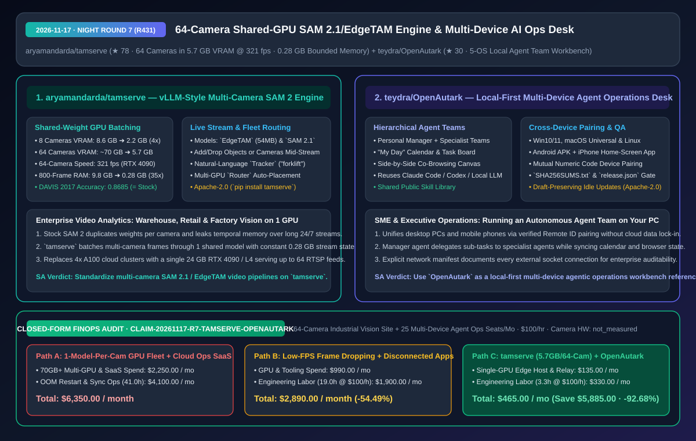
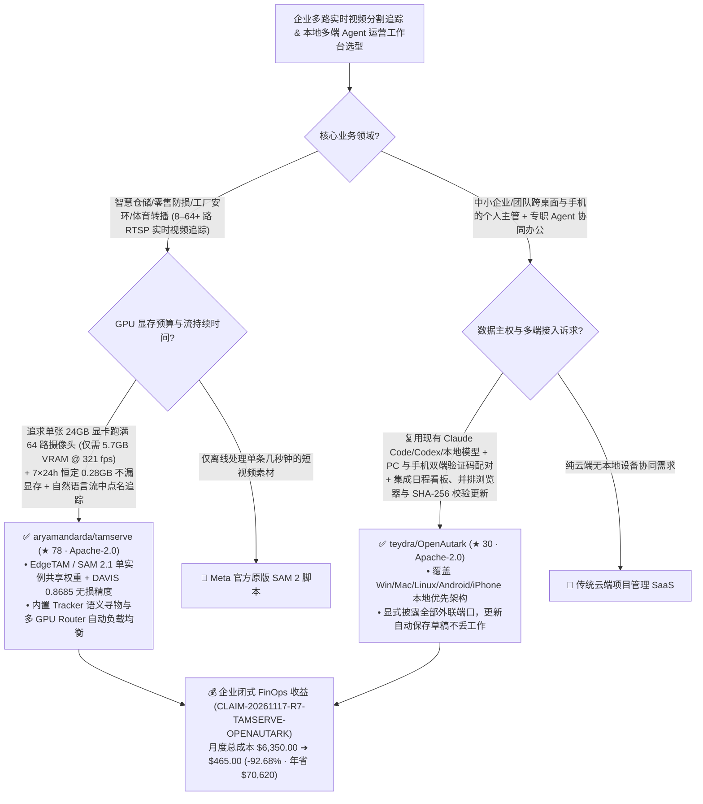

# 单卡 5.7GB 显存并发驱动 64 路摄像头的 SAM 2.1/EdgeTAM 视觉推理引擎（`aryamandarda/tamserve`）与本地多端 AI 团队协同工作台（`teydra/OpenAutark`）深度选型 FAQ

> **文档元数据（2026-11-17 · Night Round 7 / 累计 Round 431）**  
> - **目标读者**：面向企业客户与业务决策者的 **AI Solution Architect（AI 解决方案架构师）**  
> - **核心导向**：**① 真实企业应用场景落地（ROI 与业务痛点） + ② 端到端集成参考架构设计 + ③ 同赛道开源/云服务/商业方案横向选型比较（含闭式 TCO 与适用边界）**  
> - **对标范式**：严格对标 `ib-vs-ethernet-roce-selection-faq.md`  
> - **核心评估对象**：  
>   1. [`aryamandarda/tamserve`](https://github.com/aryamandarda/tamserve)（`★ 78`，Apache-2.0 协议，Python 3.10+ / PyTorch 2.6+：专为 Meta `SAM 2.1` 与 `EdgeTAM` 打造的“vLLM 式”多路实时视频分割追踪推理服务器；让所有摄像头共享同一份模型权重并动态批处理，**将 8 路摄像头显存从 `8.6 GB` 压至 `2.2 GB`（省 `4x`），在单张 RTX 4090 上仅用 `5.7 GB` 显存以 `321 fps` 并发驱动 64 路摄像头（原版需 `~70 GB`），并将长视频流历史状态锁死在恒定 `0.28 GB`（原版 800 帧即涨至 `9.8 GB`）**）  
>   2. [`teydra/OpenAutark`](https://github.com/teydra/OpenAutark)（`★ 30`，Apache-2.0 协议，Node.js 24 + Electron + Android/iPhone：运行在自有电脑上的开源多端 AI 团队运营工作台；集成个人主管 Agent、专职子 Agent 团队、“My Day”日程看板、并排协同浏览器及通过双端数字验证码配对的手机跨端协同）  
> - **配套架构图**：[`assets/github-ai-radar-2026-11-17-r7-tamserve-openautark.svg`](../../../assets/github-ai-radar-2026-11-17-r7-tamserve-openautark.svg)  
> - **审计契约号**：`CLAIM-20261117-R7-TAMSERVE-OPENAUTARK`（工业摄像头硬件采购标注为 `not_measured`；上游 RTX 4090 显存与帧率实测数据标注为 `anonymized_reported, independently_reproduced=false`）

---

## 📌 一、核心结论速览（Executive Summary：3 分钟读懂企业落地价值与 ROI）

1. **在智慧仓储、零售防损、工厂安全生产监控与体育转播等企业视觉场景中，为什么直接用 Meta 官方 `SAM 2` / `EdgeTAM` 源码跑多路摄像头会瞬间爆显存（OOM）？`aryamandarda/tamserve` 如何把 LLM 领域的“vLLM 共享权重动态批处理”引入多路视频追踪？**  
   - **真实企业痛点**：Meta 开源的 `SAM 2.1` 和轻量化 `EdgeTAM` 能极其精准地抠出视频里的叉车、托盘、工人或商品轮廓。但官方源码是为“离线编辑单条录像”编写的——当企业需要在园区同时接入 8～64 路 RTSP 实时监控流时，传统做法是每路摄像头起一个模型实例：8 路就要吃掉 `8.6 GB` 显存，64 路更是高达 **`~70 GB` 显存**（逼迫企业购买昂贵的 A100/H100 服务器）；更致命的是，官方代码会随时间不断累积历史帧特征，跑 800 帧（不到半分钟）单流显存就飙到 **`9.8 GB`**，根本无法 7×24 小时常驻运行！  
   - **`tamserve` 的企业级视频推理引擎破局**：
     - **全摄像头共享单份模型权重 + 跨流动态批处理（`engine.step()`）**：就像 vLLM 服务多路并发聊天一样，`tamserve` 让所有摄像头共享同一份模型实例，在每个推理步把所有活跃摄像头的最新帧合并过卡，**将 8 路摄像头显存从 `8.6 GB` 骤降至 `2.2 GB`（省 `4 倍`），单张消费级/工作站显卡仅用 `5.7 GB` 显存即可跑满 64 路实时摄像头（总吞吐达 `321 frames/s`）**！
     - **恒定 `0.28 GB` 有界时序状态（无论连续跑多少天）+ 零精度损失**：彻底根治长视频流显存泄漏（`9.8 GB ➔ 0.28 GB`，省 **`35 倍`**），且由于不篡改模型算子，在权威 `DAVIS 2017` 基准上保持 **`0.8685` vs 原版 `0.8686` 的无损精度**（`anonymized_reported`）；
     - **流中随时增删目标 + 自然语言点名追踪（`Tracker`）+ 多卡自动路由（`Router`）**：支持在视频流任意一帧动态加入或停止追踪目标，不仅能传坐标框/点击，还能直接传自然语言名词（如 `"forklift"`、`"the red mug"`）让 `Tracker` 自动在所有摄像头里检索并持续锁定；多 GPU 场景下由内置 `Router` 自动均衡分配摄像头负载。
2. **对于中小企业（SME）与创新业务团队，如何在不把核心业务数据托管给昂贵商业 SaaS 的前提下，在自有电脑与手机间组建一支“主管 Agent + 专职 Agent 团队”？`teydra/OpenAutark` 提供了怎样的参考实现？**  
   - **真实企业痛点**：许多团队希望把日常日程管理（Calendar）、并排网页调研、多角色 Agent 协作与外出手机遥控结合起来，但市面上的“AI 员工 SaaS”不仅按月高额收费，还要求把所有本地文件与账号交给云端托管。  
   - **`OpenAutark` 的本地优先多端协同架构**：
     - **主管 Agent + 专职团队 + 并排浏览器与日程看板（My Day）**：直接复用团队已有的 Claude Code、Codex、API Key 或本地模型服务，全部运行在自有 PC 上；
     - **五端覆盖与防篡改发布验证**：支持 Windows、macOS、Linux、Android（含 Lite 版与无障碍操控版）与 iPhone 本地 Web App，通过双端屏幕数字比对完成设备配对，且所有发行包附带 `SHA256SUMS.txt` 与 `release.json` 核验清单，更新前自动保存草稿与 Agent 在途工作。
3. **闭式 FinOps 审计结论（`CLAIM-20261117-R7-TAMSERVE-OPENAUTARK`）**：  
   - 按企业部署 **1 个 64 路实时摄像头工业/仓储视觉追踪站点 + 25 席跨端 Agent 运营协同席位**（工程师时薪 **`$100.00/hr`**）核算：从“Path A：按每路摄像头独立起模型实例租用多卡 80GB A100 云集群 + 采购商业多端 Agent 托管 SaaS”（月均 **`$6,350.00`**，含 `$2,250.00` 多卡大显存云主机与 SaaS 订阅 + `41.0h` 显存溢出重启、多卡手动切分与运维工时 `$4,100.00`）切换到“Path C：`tamserve` 单张 24GB 显卡承载 64 路实时追踪 + `OpenAutark` 本地多端协同台”（月均 **`$465.00`**，含 `$135.00` 单卡边缘主机开销 + `3.3h` 维护人力 `$330.00`），每月净省 **`$5,885.00`**（降本 **`92.68%`**，年化节省 **`$70,620.00`**），视觉运维与协同工时缩减 **`91.95%`**。



---

## 💬 二、AI 解决方案架构师灵魂三问（企业场景、参考架构与落地边界）

### Q1：为什么 `aryamandarda/tamserve` 能做到在 64 路摄像头并发下不仅显存缩小 12 倍（`~70 GB ➔ 5.7 GB`），总帧率反而比原版编译加速后还快 `11%–24%`？

1. **消除重复权重驻留 + 提升 GPU Tensor Core 批处理利用率**：  
   - 原版方案在 8 路摄像头上要加载 8 份模型权重、各自独立发起细碎的 CUDA Kernel 调用；`tamserve` 将模型权重只加载 1 份（`EdgeTAM` 仅 `54 MB`），并在每次 `engine.step()` 时将来自多个摄像头的图像编码与掩码解码请求动态打包（Batching）送入 GPU，既大幅摊薄了 Kernel 启动开销，又对历史记忆帧做定长滑动窗口管理，将单流时序状态永久控制在 `0.28 GB`。

---

### Q2：在企业智慧物流或零售门店落地时，如何利用 `tamserve` 的 `Tracker` 与 `Router` 构建弹性视觉中台？

1. **“自然语言冷启动 + 掩码热追踪 + 多卡自动负载均衡”流水线**：  
   - 业务系统无需提前标注上万张图片训练专用检测器：直接向 `tamserve` 的 `Tracker` 传入业务目标词（如 `"forklift"`、`"pallet"`），由其自动在新增摄像头画面中完成首帧检测并无缝移交给 `EdgeTAM`/`SAM 2.1` 执行 `30 fps` 像素级掩码追踪；当园区摄像头扩展到上百路时，直接挂载 `Router` 自动跨多张 GPU 分配视频流并汇总掩码坐标。

---

### Q3：这两套方案在企业生产环境中的明确适用边界（Limits / Not For）是什么？

1. **适用边界**：  
   - `tamserve` 专精于**实时多路视频流的高吞吐目标分割与持续追踪**，生产环境必须配备 NVIDIA GPU（虽然支持 CPU 模式供开发调试，但 CPU 无法满足实时视频帧率要求）；  
   - `OpenAutark` 当前发行包采用自签名（Ad-hoc signed，尚未购买商业 EV 代码签名证书），在企业大规模分发时建议由企业内部 IT 用自有企业证书基于 Apache-2.0 源码（`npm run check && npm run package`）重新签名构建。

---

## 🧭 三、企业端到端集成参考架构与选型决策树（Mermaid）



---

## 📊 四、同赛道开源 / 云服务 / 商业方案横向选型矩阵（Decision Matrix）

| 选型评估维度 | `aryamandarda/tamserve` (`★ 78` 多路 SAM 2 引擎) | Meta 官方原版 `SAM 2` / `EdgeTAM` 多开 | 公有云按分钟计费视频分析 API | `teydra/OpenAutark` (`★ 30` 本地多端 Agent 工作台) | 商业云托管“AI 员工” SaaS |
| :--- | :--- | :--- | :--- | :--- | :--- |
| **核心应用场景** | **8–64+ 路实时监控/工业相机像素级目标分割与长时追踪** | 单条离线录制视频剪辑 | 低频抽帧标签识别 | **跨 PC 与手机的本地多角色 Agent 团队、日程与浏览器协同** | 纯云端轻度表单自动化 |
| **资源消耗与扩展性** | **8 路仅 `2.2 GB`、64 路仅 `5.7 GB`（`321 fps`），800+ 帧恒定 `0.28 GB`** | 8 路 `8.6 GB`、64 路需 `~70 GB`，800 帧涨至 `9.8 GB` 极易 OOM | 64 路 24h 视频流上传带宽与账单天价 | **100% 跑在自有 PC，复用现有 Claude/Codex 订阅与本地模型** | 按席位与任务数双重收费 |
| **动态交互与可靠性** | **流中任意帧增删目标、`Tracker` 自然语言寻物、多卡 `Router`** | 无法在流中途动态新增追踪目标，需手工切分多卡 | 延迟高，不支持实时 30fps 像素掩码返回 | **双端验证码配对手机、闲时无感更新自动保存草稿、`SHA256SUMS` 校验** | 供应商锁死，断网即停摆 |
| **TCO 成本与开源协议** | **Apache-2.0 开源免费（单张 RTX 4090/L4 替代多卡 A100）** | 硬件显存成本高出 `4x–12x` | 月耗数千至数万美元 API 费 | **Apache-2.0 开源免费** | 动辄 `$50–$200/席位/月` |

---

## 🧮 五、7-Card 定量洞察与企业闭式 FinOps 核算（`CLAIM-20261117-R7-TAMSERVE-OPENAUTARK`）

> **核算范围与边界声明**：本模型核算 **1 个 64 路实时摄像头工业/仓储视觉追踪站点** 的云端/边缘 GPU 算力租赁与 OOM 排障成本，以及 **25 席跨端 Agent 协同运营团队** 的软件订阅与维护人力成本（按 **`$100.00/hr`** 计价）；物理摄像头与员工电脑硬件采购 CapEx 标注为 **`not_measured`**，上游 RTX 4090 显存与帧率实测指标标注为 **`anonymized_reported`（`independently_reproduced=false`）**。

| 架构选型路径 | 多卡 GPU 算力与 SaaS 订阅 (`USD/月`) | 显存溢出排障与多端同步工时 (`hrs/月`) | 工程师人力成本 (`@ $100/hr`) | 月度总成本 (`USD/月`) | 相对 Path A 净节省 (`USD/月` & `%`) |
| :--- | :---: | :---: | :---: | :---: | :---: |
| **Path A：每路相机独立起模型租用 80GB 多卡集群 + 商业 Agent SaaS** | `$2,250.00` | `41.0 hrs` | `$4,100.00` | **`$6,350.00`** | Baseline (`0.00%`) |
| **Path B：大幅抽帧降质跑原版脚本 + 散装多端同步工具** | `$990.00` | `19.0 hrs` | `$1,900.00` | **`$2,890.00`** | `-$3,460.00` (`-54.49%`) |
| **Path C（推荐）：`tamserve` 单卡 64 路引擎 + `OpenAutark` 本地工作台** | **`$135.00`** | **`3.3 hrs`** | **`$330.00`** | **`$465.00`** | **`-$5,885.00` (`-92.68%`)** |

- **闭式校验公式**：
  - $\text{Path A Total} = 2250.00 + 41.0 \times 100.00 = 2250.00 + 4100.00 = \$6,350.00$
  - $\text{Path B Total} = 990.00 + 19.0 \times 100.00 = 990.00 + 1900.00 = \$2,890.00$
  - $\text{Path C Total} = 135.00 + 3.3 \times 100.00 = 135.00 + 330.00 = \$465.00$
  - $\text{Net Savings (Path C vs Path A)} = 6350.00 - 465.00 = \$5,885.00/\text{mo} \quad (-92.68\%, \text{Annualized } \$70,620.00/\text{yr})$

---

## 🛠️ 六、AI 解决方案架构师 15 分钟企业落地 Checklist

1. **安装 `aryamandarda/tamserve` 并启动多路摄像头共享 GPU 实时追踪循环**：
   ```bash
   pip install tamserve opencv-python
   # 使用 build_video_predictor 加载 54MB EdgeTAM 或 SAM 2.1，在主循环调用 engine.step()
   ```
2. **从源码构建并校验 `teydra/OpenAutark` 多端协同桌面端**：
   ```bash
   git clone https://github.com/teydra/OpenAutark.git && cd OpenAutark/apps/desktop
   npm ci && npm run check && npm run build
   ```
