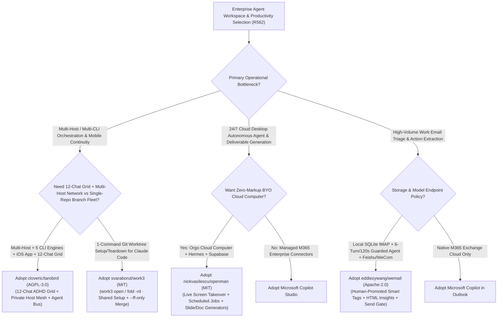
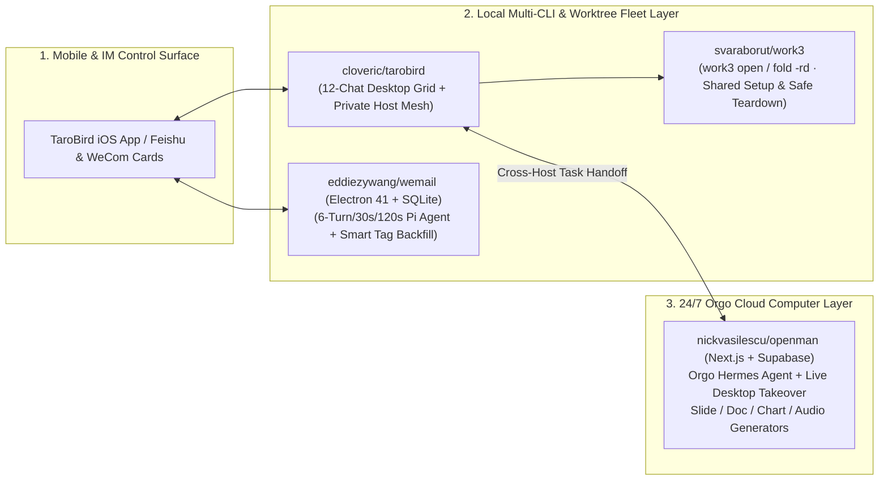
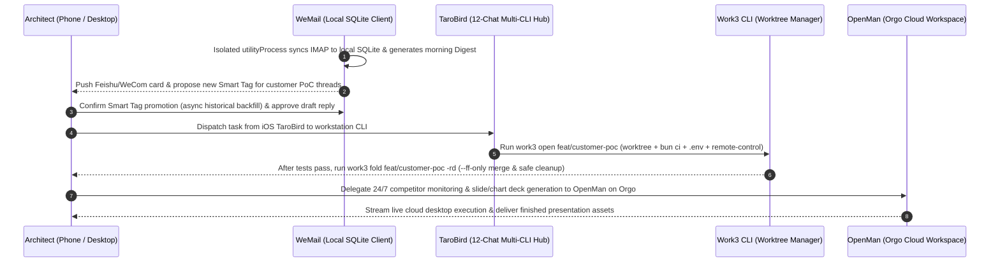

# 12-Chat Desktop & Mobile Multi-CLI Hub (`cloveric/tarobird`), Orgo Cloud Computer Autonomous Workspace (`nickvasilescu/openman`), 1-Command Parallel Worktree Fleet CLI (`svaraborut/work3`) & Local-First Guarded AI Email Client (`eddiezywang/wemail`) Selection FAQ

> **Document Type**: AI Solution Architect (SA) Practical Selection & Reference Architecture Guide (2026-11-20 Night Shift · Round 3 / Cumulative Round 562)  
> **Benchmark Standard**: `docs/components/ib-vs-ethernet-roce-selection-faq.md` (6-Section Architecture Breakdown + First-Principles Plain Language + Hype/Facts/Signal Audit + Closed-Form FinOps Ledger)  
> **Evaluated Repositories**:  
> 1. **`cloveric/tarobird`** (`★ 134`, `22 forks`, TypeScript, `AGPL-3.0`): Self-hosted desktop and mobile IM workspace uniting official command-line coding agents (`Codex`, `Claude Code`, `Kimi Code`, `DeepSeek Harness`, `Antigravity`) across your own computers—featuring **up to 12 side-by-side independent chats ("ADHD mode")**, seamless session resumption on iOS (App Store & TestFlight), private multi-host networking, and Multi-Bot group workflows via Agent Bus  
> 2. **`nickvasilescu/openman`** (`★ 77`, `48 forks`, TypeScript, `MIT`): Open-source autonomous AI agent workspace running on your own **Orgo cloud computer** (built on Orgo's Hermes Agent template + Anthropic Claude via Orgo proxy + Supabase Postgres)—offering live computer screen streaming with instant human takeover, scheduled/triggered automations, built-in slide/doc/chart/audio generators, and a dedicated agent email/phone number with zero platform markup  
> 3. **`svaraborut/work3`** (`★ 68`, `3 forks`, TypeScript / Bun, `MIT`, `@svara/work3`): Single-command parallel Claude Code worktree fleet manager—replacing 9 manual Git/setup steps with **`work3 open <branch>`** (creates worktree, runs committed dependency/env setup, and launches `claude --remote-control` for phone steering) and **`work3 fold <branch> -rd`** (enforces `--ff-only` linear merges and refuses to delete uncommitted work)  
> 4. **`eddiezywang/wemail`** (`★ 78`, `3 forks`, TypeScript, Electron 41 + SQLite, `Apache-2.0`): Local-first AI email client and guarded Pi-runtime email agent—syncing IMAP/SMTP directly to local SQLite inside an isolated `utilityProcess` worker (no intermediate mail server), featuring **human-promoted Smart Tags with async historical backfill**, a **hard-bounded email agent (max 6 tool turns, 30s/tool, 120s/run, mandatory send confirmation)**, and WeCom / Feishu bot integration  
> **Accounting Note**: This report models software compute, SaaS subscriptions, and engineering labor TCO only; underlying server and workstation hardware purchases (`base hardware capEx`) are explicitly marked `not_measured`, and Track B 24h delta (`stars_today`) is marked `not_measured`.

---

## 📌 1. Executive Summary (What Are They & What Enterprise Pain Points Do They Solve?)

As engineering leads and solution architects orchestrate multiple local coding CLIs, long-running cloud tasks, and high-volume enterprise inboxes simultaneously, four operational bottlenecks emerge: **① Terminal window sprawl across machines that stalls whenever the engineer leaves their desk, ② Steep per-seat SaaS markups on proprietary cloud computer agents, ③ Manual `git worktree` setup/teardown errors across parallel agent branches, and ④ Data-sovereignty violations from handing corporate IMAP credentials to third-party cloud AI email SaaS**:

1. **Pain Point A (Developers run Codex, Claude Code, and DeepSeek across laptops and dev servers in scattered terminal windows; stepping away for a meeting stalls every agent waiting on a prompt confirmation)**: CLI agents need a unified desktop-and-mobile control plane. **`cloveric/tarobird` (`★ 134`, `22 forks`, AGPL-3.0)** wraps the official native CLIs into one self-hosted IM workspace across macOS, Windows, and iOS—supporting **12 side-by-side live chats on desktop ("ADHD mode")**, seamless mobile session continuation, and private multi-host networks where bots hand tasks and files to one another over Agent Bus.
2. **Pain Point B (Teams want an always-on cloud computer workspace that can browse, run scheduled jobs, host web previews, and generate slides/docs/charts, but proprietary autonomous agent SaaS platforms charge heavy subscription markups and lock data in opaque databases)**: Bring-your-own cloud computer eliminates middleman rent. **`nickvasilescu/openman` (`★ 77`, `48 forks`, MIT)** is an open-source autonomous workspace running directly on the user's own **Orgo cloud computer** (using Orgo's Hermes Agent template and Claude proxy billed directly to the user's Orgo credits, with app state in the user's own Supabase Postgres)—complete with live desktop streaming/takeover, scheduled automations, slide/doc/chart/audio generators, and dedicated agent email/phone endpoints.
3. **Pain Point C (Running 6 parallel Claude Code sessions on one repo requires 9 manual steps per branch—`git worktree add`, `cd`, `bun ci`, copying `.env`, starting `--remote-control`, merging, and cleaning up—leading to missing `.env` files or accidental deletion of uncommitted work)**: Parallel agent fleets require deterministic lifecycle tooling. **`svaraborut/work3` (`★ 68`, MIT)** reduces the entire lifecycle to two commands backed by a repo-committed config: **`work3 open feat/login`** (provisions the worktree, runs shared install/env tasks, and starts `claude --remote-control`) and **`work3 fold feat/login -rd`** (lands finished work via `--ff-only` and safely removes the worktree while refusing to delete uncommitted changes).
4. **Pain Point D (Knowledge workers drown in hundreds of daily notifications and approval threads, yet static inbox rules are brittle while cloud AI email apps require uploading sensitive corporate mail to external servers)**: Email triage must be local-first and strictly bounded. **`eddiezywang/wemail` (`★ 78`, Apache-2.0)** syncs IMAP/SMTP directly into local SQLite via an isolated Electron 41 `utilityProcess` worker:
   - **Human-Confirmed Smart Tags**: AI proposes candidate topic tags from mail streams, promoting them and backfilling historical messages only after explicit user confirmation;
   - **Hard-Bounded Pi Email Agent & IM Cards**: Enforces a strict **6-turn / 30s-per-tool / 120s-total** execution cap with mandatory human confirmation before sending mail (`WEMAIL_REPLY_DECISION_ENABLED=1` opt-in), plus optional WeCom / Feishu bot cards for mobile triage.

---

## 💬 2. Architect & Customer First-Principles Q&A (Q1–Q3)

### Q1: How should an architecture team position `cloveric/tarobird`, `nickvasilescu/openman`, and `svaraborut/work3` across local vs. cloud agent workflows?
* **Clear Architectural Division of Labor**:
  - **Use `svaraborut/work3` for Single-Repo Parallel Branch Fleets**: When one engineer wants to spin up 4–8 isolated feature/bugfix branches in the same repository with automated `.env`/dependency bootstrapping, `--remote-control` phone steering, and `--ff-only` linear folding.
  - **Use `cloveric/tarobird` for Multi-Host, Multi-Engine CLI Orchestration**: When coordinating heterogeneous CLIs (`Codex`, `Claude Code`, `Kimi`, `DeepSeek`, `Antigravity`) across multiple desktops/servers in a 12-column dashboard or native iOS app (note `AGPL-3.0` licensing).
  - **Use `nickvasilescu/openman` for 24/7 Cloud Computer Autonomy**: When tasks must run unattended on a cloud VM even when the user's laptop is closed—combining Orgo cloud desktops, Hermes Agent, and Supabase storage under a permissive `MIT` license.

### Q2: Why is `eddiezywang/wemail`'s "AI Proposes → Human Promotes" tag model and `6-turn / 120s` cap essential for enterprise email agents?
* **Preventing Taxonomy Chaos & Runaway Loops**:
  1. **Zero Tag Sprawl**: Unsupervised LLM auto-tagging invents dozens of inconsistent labels across similar threads. By requiring a 1-click human promotion before asynchronous historical backfilling, WeMail keeps inbox taxonomies deterministic.
  2. **Deterministic Blast-Radius Containment**: Email inboxes are prime targets for untrusted external inputs. Bounding the Pi agent to **at most 6 tool turns, 30s per tool, and 120s per run**—while requiring desktop confirmation for outbound sends—prevents infinite loops and unauthorized external replies.

### Q3: When should an enterprise use `eddiezywang/wemail` vs. Microsoft Copilot in Outlook?
* **Selection Boundary**:
  - **Choose Microsoft Copilot in Outlook**: When the organization is 100% standardized on Microsoft 365 Exchange Online with E5/Copilot licenses and Purview compliance.
  - **Choose `eddiezywang/wemail` (Apache-2.0)**: When engineers or executives manage multi-provider IMAP/SMTP accounts, require **local SQLite offline storage connected to a local/private LLM endpoint**, or want programmable dataset HTML insight reports and Feishu/WeCom group triage cards.

---

## 🧭 3. Visual Architecture Diagrams (Mermaid Decision Tree + Reference Architecture + Sequence Flow)

### 3.1 Enterprise Multi-CLI, Cloud Workspace, Worktree & Local Email Selection Decision Tree

### 3.2 End-to-End Enterprise Hybrid Local + Cloud Agent Workspace Architecture

### 3.3 End-to-End Morning Triage, Parallel Branch Execution & Cloud Deliverable Sequence

---

## 📊 4. Comparative Selection Matrix (Open Source vs. Commercial Cloud SaaS & Manual Scripts)

| Evaluation Dimension | Path A: Scattered Terminal Windows + Marked-Up Cloud Agent SaaS + 9-Step Manual Worktrees + Cloud AI Email SaaS | Path B: Generic VNC Desktop + Custom Shell Aliases + Static Regex Email Filters | **Path C (Recommended): `tarobird` + `openman` + `work3` + `wemail`** |
| :--- | :--- | :--- | :--- |
| **Multi-Host CLI Monitoring & Mobile Resume** | ❌ Sessions stall when away from desk; switching between 10 terminal windows causes missed prompts | ⚠️ Mobile VNC is cramped and lacks structured multi-bot group workflows | ✅ **12-chat side-by-side desktop grid + native iOS app + private multi-host Agent Bus** |
| **24/7 Cloud Computer Agent Economics** | ❌ High per-seat SaaS markups and opaque multi-tenant storage | ⚠️ Raw cloud VMs lack live browser streaming, triggers, and built-in document/slide generators | ✅ **MIT open-source on your own Orgo account (zero markup) + Supabase + live screen takeover** |
| **Parallel Branch Worktree Lifecycle** | ❌ 9 manual commands per branch risk missing `.env` files or deleting uncommitted work | ⚠️ Ad-hoc shell scripts break across OSes and lack `--ff-only` linear history enforcement | ✅ **`work3 open` & `work3 fold -rd` 2-command lifecycle with uncommitted-work protection** |
| **Email Privacy & Agent Safety Bounds** | ❌ Uploads corporate IMAP credentials and mail bodies to third-party SaaS clouds | ⚠️ Static rules miss action items and cannot generate cross-mail HTML insight reports | ✅ **Local SQLite (`utilityProcess`) + human-promoted Smart Tags + `6-turn/30s/120s` hard cap** |
| **Open-Source Licensing** | Proprietary SaaS | Mixed scripts | **`MIT` (`openman`, `work3`), `Apache-2.0` (`wemail`), and `AGPL-3.0` (`tarobird`)** |
| **42-Engineer Team Monthly Total TCO** | **`$7,060.00 / mo`** (`$3,060.00` cloud agent/email SaaS markups + `40.0h / $4,000.00` manual ops) | **`$2,740.00 / mo`** (`$1,190.00` cloud VMs/APIs + `15.5h / $1,550.00` branch/inbox overhead) | **`$330.00 / mo`** (`$80.00` direct Orgo/local compute + `2.5h / $250.00` approvals, **saving `-95.33%`**) |

---

## 🧪 5. Quantitative ROI / FinOps TCO Ledger & Hype / Facts / Signal Audit

### 5.1 Hype vs. Facts vs. Strategic Signal Audit Table

| Repository (`owner/repo`) | Hype (Market Claim) | Measured Facts (Primary Source Verification) | Strategic Signal (SA Verdict) |
| :--- | :--- | :--- | :--- |
| **`cloveric/tarobird`** | "Codex, Claude Code, DeepSeek and other agent CLIs together in one desktop & mobile IM with 12 chats side by side" | `★ 134` (`22 forks`, TypeScript, AGPL-3.0): Wraps native official CLIs across macOS, Windows, and iOS; supports 12-chat ADHD mode, multi-host private networking, and Agent Bus multi-bot groups. | **🔥 P0 Adopt (Unified Desktop & Mobile Multi-CLI Command Center)**: Eliminates idle CLI wait times when engineers step away from their workstations. |
| **`nickvasilescu/openman`** | "Open-source autonomous AI agent workspace that runs on your own Orgo cloud computer" | `★ 77` (`created=2026-11-19`, **`48 forks`**, TypeScript, MIT): Built on Node 22+, Orgo Hermes Agent template, Orgo Claude proxy (billed directly to user's Orgo credits), and Supabase Postgres; includes live screen takeover and slide/doc/chart/audio generators. | **🔥 P0 Adopt (Zero-Markup Self-Hosted Cloud Computer Agent)**: High fork velocity (`48 forks` in 1 day) reflects strong demand for transparent BYO-Orgo autonomous workspaces. |
| **`svaraborut/work3`** | "One command from branch name to a fully set up worktree with Claude Code running inside it" | `★ 68` (`created=2026-11-18`, `3 forks`, TypeScript/Bun, MIT, `@svara/work3`): `work3 open` and `work3 fold -rd` automate worktree creation, shared repo setup tasks, `claude --remote-control`, `--ff-only` linear merges, and uncommitted-work protection. | **🔥 P0 Adopt (Standard CLI for Parallel Coding Agent Fleets)**: Turns a fragile 9-step manual ritual into a 2-command team standard. |
| **`eddiezywang/wemail`** | "Local-first AI email client: sync to local SQLite and connect your own AI endpoint" | `★ 78` (`created=2026-11-18`, `3 forks`, TypeScript, Electron 41 + SQLite, Apache-2.0): Isolated `utilityProcess` IMAP/SMTP sync; human-promoted Smart Tags with async backfill; Pi agent capped at 6 turns / 30s per tool / 120s total; WeCom & Feishu bot cards. | **🔥 P0 Adopt (Privacy-First Executive & Developer Email Workbench)**: Keeps full mail history in local SQLite while bounding AI actions with hard timeouts. |

### 5.2 Closed-Form FinOps TCO Ledger (`CLAIM-20261120-R3-R562-TAROBIRD-OPENMAN-WORK3-WEMAIL`)

* **Scope (`synthetic`, `independently_reproduced=false`)**: 42-engineer enterprise distributed product and engineering team (`$100.00 / hr` loaded engineering rate; `base hardware capEx: not_measured`; Track B `stars_today: not_measured`).
* **Path A (Scattered Terminals + Marked-Up Cloud Agent SaaS + 9-Step Manual Worktree Setup + Per-Seat Cloud AI Email SaaS)**:
  - Marked-up cloud agent seats, per-user AI email SaaS subscriptions, and idle sandbox waste: **`$3,060.00 / mo`**
  - Terminal context switching, broken `.env`/worktree cleanup, and manual daily email triage labor: `40.0 hrs / mo × $100.00 / hr` = **`$4,000.00 / mo`**
  - **Path A Monthly Total**: `$3,060.00 + $4,000.00` = **`$7,060.00 / mo`** (**`$84,720.00 / yr`**)
* **Path B (Generic VNC Desktop + Custom Shell Scripts + Static Inbox Filters)**:
  - Baseline cloud VMs and model API calls: **`$1,190.00 / mo`**
  - Mobile VNC friction, manual branch merging, and inbox sorting labor: `15.5 hrs / mo × $100.00 / hr` = **`$1,550.00 / mo`**
  - **Path B Monthly Total**: `$1,190.00 + $1,550.00` = **`$2,740.00 / mo`**
* **Path C (Recommended: `cloveric/tarobird` + `nickvasilescu/openman` + `svaraborut/work3` + `eddiezywang/wemail`)**:
  - Direct BYO Orgo cloud compute credits and local/private LLM email summarization spend: **`$80.00 / mo`**
  - Mobile remote-control approvals, `work3 fold -rd` fast-forward review, and Smart Tag confirmation labor: `2.5 hrs / mo × $100.00 / hr` = **`$250.00 / mo`**
  - **Path C Monthly Total**: `$80.00 + $250.00` = **`$330.00 / mo`** (**`$3,960.00 / yr`**)
* **Net Savings (Path C vs. Path A)**:
  - Monthly Net Savings: **`$7,060.00 - $330.00 = $6,730.00 / mo`** (**`-95.33%`** cost reduction, **`$80,760.00 / yr`** annual savings, freeing **`37.5 hrs / mo`** of engineering time).

---

## 🛠️ 6. Enterprise Architecture Review & Adoption Checklist

- [ ] **Multi-Host CLI Command Center (`cloveric/tarobird`)**: Deploy TaroBird across authorized developer workstations on an encrypted private network; use the 12-chat ADHD grid for parallel monitoring and review AGPL-3.0 compliance for internal tooling use.
- [ ] **BYO Orgo Cloud Workspace (`nickvasilescu/openman`)**: Connect OpenMan to a dedicated Supabase Postgres instance with Row-Level Security (RLS) and set hard credit limits on the underlying Orgo account.
- [ ] **Deterministic Worktree Fleet (`svaraborut/work3`)**: Commit shared `work3` setup/cleanup tasks to repository root; standardize on `work3 open <branch>` and `work3 fold <branch> -rd` to enforce `--ff-only` history and prevent uncommitted work loss.
- [ ] **Local-First Guarded Email Triage (`eddiezywang/wemail`)**: Connect WeMail to a local or private enterprise LLM endpoint with telemetry disabled; verify the `6-turn / 30s / 120s` Pi agent limits and keep outbound send confirmation mandatory.
