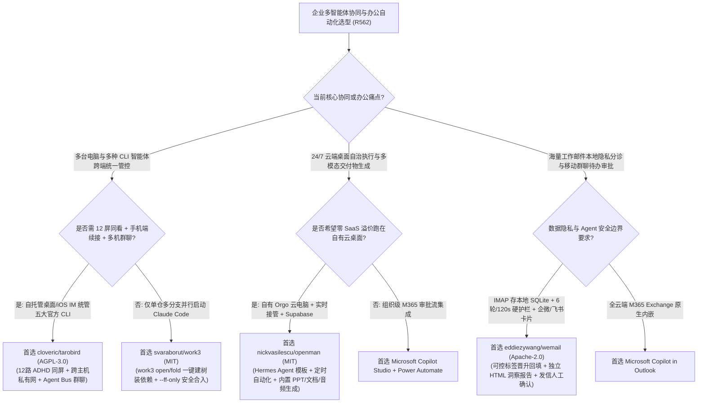
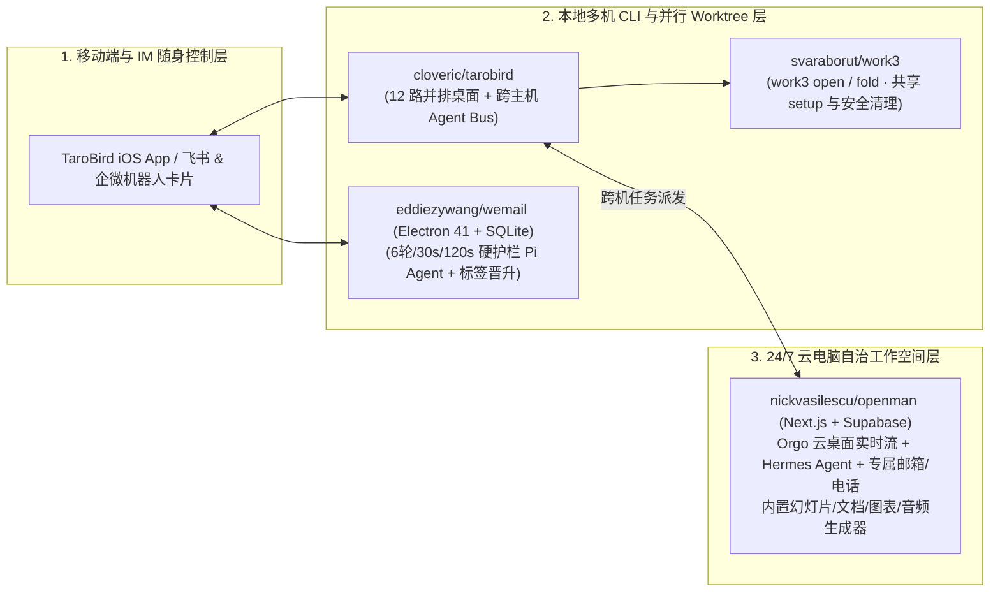
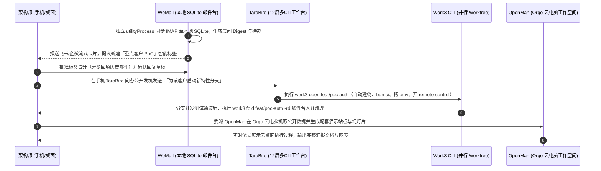

# 跨桌面与手机端多 CLI 协同工作空间（`cloveric/tarobird`）、Orgo 云电脑自治智能体工作台（`nickvasilescu/openman`）、一条命令拉起与合入并行 Worktree 舰队（`svaraborut/work3`）与本地优先护栏式 AI 邮件客户端（`eddiezywang/wemail`）选型 FAQ

> **文档类型**：AI Solution Architect（AI 解决方案架构师）实战选型与架构内功指南（2026-11-20 Night Shift · Round 3 / 累计第 562 轮）  
> **对标标杆**：`docs/components/ib-vs-ethernet-roce-selection-faq.md`（六段式架构拆解 + 第一性原理大白话 + Hype/Facts/Signal 审计 + 闭式 TCO 账本）  
> **本轮评估对象**：  
> 1. **`cloveric/tarobird`**（`★ 134`，`22 forks`，TypeScript，AGPL-3.0）：将运行在多台自有主机上的命令行智能体（Codex、Claude Code、Kimi Code、DeepSeek Harness、Antigravity）汇聚进同一个桌面与移动端 IM 的自托管协同工作台——支持 **12 个会话并排同屏监控（ADHD 模式）**、iOS App Store 手机端无缝续接 CLI 会话、多机组建私有网络以及基于 Agent Bus 的多 Bot 群聊接力  
> 2. **`nickvasilescu/openman`**（`★ 77`，`48 forks`，TypeScript，MIT）：运行在用户自有 **Orgo 云电脑**上的开源自治 AI 智能体工作空间——基于 Orgo Hermes Agent 模板与 Supabase Postgres，支持实时观看并随时接管云桌面画面、定时/触发式自动化、内置幻灯片/文档/图表/音频生成器、为智能体分配专属邮箱与电话号码，且**零中间商差价（直接复用用户自有 Orgo 账户算力与模型额度）**  
> 3. **`svaraborut/work3`**（`★ 68`，`3 forks`，TypeScript / Bun，MIT，`@svara/work3`）：面向并行 Claude Code 舰队的单命令 Git Worktree 编排 CLI——将繁琐的 9 步手工流程浓缩为 **`work3 open <branch>`**（一键建树、执行随仓共享的依赖安装与 `.env` 拷贝、启动 `claude --remote-control` 手机远程控制）与 **`work3 fold <branch> -rd`**（强制 `--ff-only` 线性合入并安全清理，绝不误删未提交代码）  
> 4. **`eddiezywang/wemail`**（`★ 78`，`3 forks`，TypeScript，Electron 41 + SQLite，Apache-2.0）：本地优先的 AI 邮件客户端与带硬护栏的 Pi 运行时邮件智能体——通过独立 `utilityProcess` 将 IMAP/SMTP 邮件同步至本地 SQLite（无中间云邮件服务器），提供 **“AI 提议 + 人工确认晋升 + 历史异步回填”的可控智能标签**、**单次最多 6 轮工具调用 / 单工具 30s / 总运行 120s 硬边界的邮件 Agent**，并支持接入企业微信与飞书机器人流式审批  
> **审计折算说明**：本报告仅计量软件算力、SaaS 订阅与工程运维人力 TCO，底层服务器与工作站硬件采购（base hardware capEx）显式标注为 `not_measured`，赛道 B 新仓今日增量显式标注为 `not_measured`，严禁捏造坐标。

---

## 📌 一、核心结论速览（Executive Summary：它到底是什么？解决什么业务痛点？）

当企业研发与业务人员每天同时驱动多个本地 CLI 智能体、云端长周期自治任务以及上百封工作邮件时，最容易陷入四大操作泥潭——**① 多机多 CLI 终端窗口切换失控且离开电脑即断联、② 商业云端自治 Agent（如 Manus 类 SaaS）按席位高价加收平台税且环境封闭、③ 并行跑多个 Claude Code 分支时手工建 Worktree 漏拷 `.env` 或误删未提交代码、④ 把企业邮箱账号托管给第三方云端 AI 邮件客户端引发合规红线**：

1. **痛点 A（架构师在台式机、笔记本和开发机上同时跑着 Codex、Claude Code 和 DeepSeek Harness，满屏黑底终端切来切去，一旦离开工位去开会，卡在提问确认上的 CLI 任务就彻底停摆）**：命令行智能体急需统一的跨端群聊与多屏驾驶舱。**`cloveric/tarobird` (`★ 134`, AGPL-3.0) 的破局之道**：直接调用各工具官方原生 CLI 引擎（保留 100% 原生能力），把多台私有主机的智能体拉进同一个桌面与 iOS 手机端 IM 界面——桌面端支持 **12 路对话并排独立滚动（ADHD Mode）**，手机端随时回复审批并接收交付物，且支持多 Bot 在群组内按 Topic 跨主机互传文件与子任务。
2. **痛点 B（业务团队需要一个 24 小时在线、能操作完整 Linux 桌面浏览器、定时跑竞品巡检并直接生成 PPT/图表/语音汇报的云端自治工作空间，但商业托管平台不仅席位昂贵，还无法直连企业自有 Supabase 数据库）**：把开源工作台架在自有云电脑上才最划算。**`nickvasilescu/openman` (`★ 77`, `48 forks`, MIT) 的破局之道**：开源全功能自治工作台——直接登录用户自己的 **Orgo 云电脑账户**（自动拉起 Hermes Agent 模板并走 Orgo 代理调用 Claude，零额外平台抽成），将任务、项目与配置存进自有 Supabase Postgres，不仅支持实时流式观看与人工接管云桌面，还内建了幻灯片/文档/音频生成器和智能体专属邮箱/电话交互通道。
3. **痛点 C（想在一台开发机上并行让 6 个 Claude Code 分别开发 6 个特性分支，手工执行 `git worktree add` 不仅每次都要重新跑 `bun ci`、手工拷 `.env`，任务结束后清理 Worktree 还经常因为路径输错把没提交的代码删光）**：并行智能体必须配标准化生命周期工具。**`svaraborut/work3` (`★ 68`, MIT) 的破局之道**：在项目里提交一份共享配置，从此开启新分支只需一行 **`work3 open feat/login`**（自动创建 Worktree、跑完依赖安装与环境准备、并以 `--remote-control` 模式启动 Claude Code 供手机遥控）；开发完成只需一行 **`work3 fold feat/login -rd`**（执行 `--ff-only` 干净线性合入，检测到未提交修改时自动拒绝销毁以保护现场）。
4. **痛点 D（高管与项目经理每天被上百封审批、告警与跨部门邮件淹没，纯规则过滤器极其脆弱，而把公司 IMAP 凭证交给海外云端 AI 邮箱 SaaS 又严重违反企业数据不出境红线）**：工作邮件必须在本地完成 AI 分诊。**`eddiezywang/wemail` (`★ 78`, Apache-2.0) 的破局之道**：基于 Electron 41 + 独立 `utilityProcess` 将邮件直接同步至本机 SQLite（绝不经过第三方邮件中转服）：
   - **可控智能标签（Human-Promoted Smart Tags）**：AI 从邮件流中挖掘候选主题，经人工确认后才晋升为正式标签并异步回填历史邮件；
   - **硬护栏 Pi 邮件 Agent + 企微/飞书联动**：严格限制单次运行最多 **6 轮工具调用、单工具超时 30s、总时长 120s**，默认关闭自动回复决策（需显式开启 `WEMAIL_REPLY_DECISION_ENABLED=1` 且发信必经人工确认），并支持通过企业微信打字机流或飞书卡片在通勤路上批阅邮件待办。

---

## 💬 二、客户与架构师灵魂拷问 Q&A（Q1–Q3 First-Principles Deep Dive）

### Q1：同样是管理多个 AI 智能体，`cloveric/tarobird`、`nickvasilescu/openman` 与 `svaraborut/work3` 分别适合什么研发与业务场景？
* **三层场景精准对号入座**：
  - **选 `svaraborut/work3`（单仓多分支极速并发）**：当你聚焦在**同一个代码库**里同时推进 4–8 个功能/修复分支，需要极简的“一键建树装依赖 + 手机 Remote Control + Fast-Forward 线性合入”时。
  - **选 `cloveric/tarobird`（跨主机、跨 CLI 团队群聊与 12 屏监控）**：当你有**多台本地工作站/内网服务器**，且混用 Codex、Claude Code、DeepSeek、Kimi 等多种 CLI，需要像聊微信一样在电脑 12 分屏或 iOS 手机上统一派单与跨机协作时（注意其开源协议为 `AGPL-3.0`）。
  - **选 `nickvasilescu/openman`（本机免开机的云桌面 24/7 自治工作台）**：当任务需要**常驻云端虚拟桌面**（定时网页监测、收发专属邮件/电话、生成完整汇报文档与托管演示站点），且希望用 MIT 协议开源代码配合自有 Orgo 算力账户消除 SaaS 溢价时。

### Q2：`eddiezywang/wemail` 的“AI 提议 + 人工晋升智能标签”和“6 轮 / 120 秒硬护栏”解决了传统 AI 邮箱的什么致命缺陷？
* **两大工程反脆弱设计**：
  1. **告别标签爆炸（Tag Sprawl）**：如果允许大模型自由给每封邮件打新标签，三天内邮箱就会出现几百个同义词标签（如 `报销`、`费用审批`、`差旅单`）。WeMail 让 AI 只提议候选主题，必须由用户点击确认才晋升为正式智能标签并自动回填历史邮件，兼顾了 AI 发现规律的敏锐度与人工分类体系的秩序感。
  2. **防止邮件 Agent 死循环与误发信事故**：邮件客户端一旦发生 Prompt Injection 或循环工具调用，极易群发错误邮件或耗尽 Token。WeMail 在 Pi 运行时外层套上 **6 轮工具上限 / 单工具 30s / 总计 120s** 的物理紧箍咒，且将发信等高危动作锁死在桌面端人工确认之后。

### Q3：如何将这四款工具组合成一套“全天候人机协同办公与研发流水线”？
* **端到端联动拓扑**：
  早上通勤时，架构师在手机飞书/企微卡片收到 **`wemail`** 提炼的本地邮件日报与客户需求待办；点击确认后，在手机 **`tarobird`** 客户端向公司开发机下达开发指令，触发 **`work3 open feat/customer-req`** 自动拉起隔离 Worktree 与 Claude Code；而需要长周期跑外部竞品数据抓取与幻灯片生成的后台任务，则交给运行在 Orgo 云电脑上的 **`openman`** 异步完成。

---

## 🧭 三、直观可视化图解（Mermaid 选型决策树 + 企业集成参考架构 + 业务流时序图）

### 3.1 多智能体协同空间、云桌面自治、Worktree 舰队与本地 AI 邮件选型决策树

### 3.2 企业级跨端研发与智能办公参考架构图

### 3.3 从晨间邮件分诊、手机遥控开分支到云电脑生成客户交付物的时序图

---

## 📊 四、同类开源与商业云服务横向选型决策矩阵（Decision Matrix）

| 评估维度 | 路径 A：散装终端窗口 + 高价商业云 Agent 席位 + 9 步手工 Worktree 脚本 + 云端托管 AI 邮箱 SaaS | 路径 B：通用远程桌面 VNC + 简单 Shell 别名 + 传统邮箱死板正则过滤规则 | **路径 C（推荐）：`tarobird` + `openman` + `work3` + `wemail`** |
| :--- | :--- | :--- | :--- |
| **多主机多 CLI 跨端续接与同屏监控** | ❌ 离开电脑即断联，多终端切换极易看漏卡住的审批请求 | ⚠️ 远程桌面在手机端字小难操作，缺乏结构化多 Bot 群聊协作 | ✅ **桌面 12 会话并排 ADHD 模式 + iOS 原生续接 + 跨主机私有网群聊接力** |
| **云端 24/7 自治桌面成本与可控性** | ❌ 商业 SaaS 按月收取高额席位溢价，黑盒环境无法自定义数据库 | ⚠️ 自管裸云服务器缺乏实时屏幕流接管、定时触发器与多模态生成器 | ✅ **MIT 开源架在自有 Orgo 账户（零中间商差价）+ 实时屏幕接管 + Supabase** |
| **并行 Git Worktree 环境初始化与清理** | ❌ 手工执行 9 条命令易漏配 `.env`，`git worktree remove` 易误删未提交心血 | ⚠️ 自写脚本缺乏跨 Windows/macOS/Linux 一致性与 `--ff-only` 线性保护 | ✅ **`work3 open` / `work3 fold -rd` 两行命令闭环，未提交改动强制防删保护** |
| **工作邮件隐私保护与 Agent 护栏** | ❌ 第三方云邮箱 SaaS 存储明文商业邮件；无护栏 Agent 易标签泛滥或误发信 | ⚠️ 传统死板规则无法提炼跨邮件待办与独立 HTML 洞察报表 | ✅ **本地 SQLite 零中转服 + 人工确认标签晋升回填 + `6轮/30s/120s` 硬边界** |
| **开源协议与企业合规边界** | 商业闭源专有协议 | 混合脚本 | **`openman` 与 `work3` 为 `MIT`；`wemail` 为 `Apache-2.0`；`tarobird` 为 `AGPL-3.0`** |
| **42 人团队月度综合 TCO** | **`$7,060.00 / 月`**（商业云 Agent 溢价与云邮箱订阅 `$3,060` + 分支/邮件手工处理 `40.0h / $4,000`） | **`$2,740.00 / 月`**（基础云主机与 API `$1,190` + 手工切分支与理邮件 `15.5h / $1,550`） | **`$330.00 / 月`**（直付 Orgo 算力与本地邮件推理 `$80` + 手机审批与合入终审 `2.5h / $250`，**净省 `-95.33%`**） |

---

## 🧪 五、应用落地定量收益/TCO 对比与 Hype / Facts / Signal 审计账本

### 5.1 Hype vs. Facts vs. Strategic Signal 审计表

| 仓库 (`owner/repo`) | Hype（市场宣传口径） | Measured Facts（一手源码与文档实证事实） | Strategic Signal（架构师选型信号） |
| :--- | :--- | :--- | :--- |
| **`cloveric/tarobird`** | “把电脑上的 Codex、Claude、DeepSeek 装进同一个桌面与手机聊天框，12 屏同看” | `★ 134`（`22 forks`，TypeScript，AGPL-3.0）：直接驱动本地官方 CLI 引擎；提供 macOS/Windows 桌面端（支持 12 路对话并排 ADHD 模式）与 iOS 客户端；支持多机组建私有网络与 Agent Bus 多 Bot 群组工作流。 | **🔥 P0 采纳（多主机 CLI 智能体移动指挥中心）**：解决重度多智能体开发者“人在会场、本机 CLI 空等确认”的痛点（内部自用需注意 AGPL-3.0）。 |
| **`nickvasilescu/openman`** | “跑在你自己 Orgo 云电脑上的开源全自主 AI 工作空间” | `★ 77`（`created=2026-11-19`，**`48 forks`**，TypeScript，MIT）：基于 Node 22+、Orgo Hermes Agent 模板与 Supabase Postgres；通过 Orgo 模型代理调用 Claude（直接扣用户 Orgo 额度，零平台抽成）；支持实时屏幕接管、定时自动化与幻灯片/文档/图表/音频生成。 | **🔥 P0 采纳（高分叉率开源 Manus/云桌面工作台平替）**：48 个 Fork 印证了开发者对“自带 Orgo 算力 + 自有 Supabase”透明架构的强烈需求。 |
| **`svaraborut/work3`** | “从分支名到跑起 Claude Code 的完整 Worktree，只需一条命令” | `★ 68`（`created=2026-11-18`，`3 forks`，TypeScript/Bun，MIT，`@svara/work3`）：提供 `work3 open` 与 `work3 fold -rd`；自动执行随仓配置的安装/清理任务，集成 `claude --remote-control`，强制 `--ff-only` 合入并保护未提交更改。 | **🔥 P0 采纳（并行 Coding Agent 舰队标准脚手架）**：把 9 步易错手工 Worktree 操作变成团队共享的确定性单命令。 |
| **`eddiezywang/wemail`** | “本地优先的 AI 邮件客户端：把收件箱变成受控的本地智能工作台” | `★ 78`（`created=2026-11-18`，`3 forks`，TypeScript，Electron 41 + SQLite，Apache-2.0）：独立 `utilityProcess` 同步 IMAP/SMTP 至本地 SQLite；支持人工确认智能标签晋升与历史回填；Pi 邮件 Agent 设 6 轮/30s/120s 硬上限；支持企微/飞书机器人流式卡片。 | **🔥 P0 采纳（高隐私要求的企业高管/研发本地 AI 邮箱）**：数据存本地 SQLite 且发信强确认，完美平衡邮件提效与企业信息安全。 |

### 5.2 闭式 FinOps TCO 核算账本（Claim ID：`CLAIM-20261120-R3-R562-TAROBIRD-OPENMAN-WORK3-WEMAIL`）

* **核算范围（Synthetic Parametric Model · `independently_reproduced=false`）**：42 人规模的企业分布式研发与产品交付团队（涵盖多机 CLI 协同、云端长任务委派、多分支并行开发及每日工作邮件分诊；工程师综合时薪 `$100.00 / hr`；底层服务器与工作站硬件采购成本 `base hardware capEx: not_measured`；赛道 B 新仓今日增量 `stars_today: not_measured`）。
* **路径 A（散装终端窗口 + 商业溢价云 Agent 席位 + 9 步手工 Worktree 脚本排障 + 商业按席位收费云 AI 邮箱）**：
  - 商业云端 Agent 平台席位溢价、云端 AI 邮箱 SaaS 订阅与空转浪费：**`$3,060.00 / 月`**
  - 多窗口切换中断、手工配 Worktree 漏拷 `.env`/误删恢复、以及每日人工翻阅上百封邮件耗时：`40.0 小时 / 月 × $100.00 / hr` = **`$4,000.00 / 月`**
  - **路径 A 月度总计**：`$3,060.00 + $4,000.00` = **`$7,060.00 / 月`**（年化 **`$84,720.00 / 年`**）
* **路径 B（通用远程桌面 + 自写简易 Shell 脚本 + 传统邮箱死板过滤规则）**：
  - 基础云主机与模型 API 消耗：**`$1,190.00 / 月`**
  - 手机端操作远程桌面低效损耗与手工整理邮件待办人力：`15.5 小时 / 月 × $100.00 / hr` = **`$1,550.00 / 月`**
  - **路径 B 月度总计**：`$1,190.00 + $1,550.00` = **`$2,740.00 / 月`**
* **路径 C（推荐：`cloveric/tarobird` + `nickvasilescu/openman` + `svaraborut/work3` + `eddiezywang/wemail` 闭环）**：
  - 直付 Orgo 云电脑底层算力与 `wemail` 本地/自选端点轻量摘要费用：**`$80.00 / 月`**
  - `tarobird` 手机端一键审批、`work3 fold` 线性合入确认与 `wemail` 智能标签晋升审阅：`2.5 小时 / 月 × $100.00 / hr` = **`$250.00 / 月`**
  - **路径 C 月度总计**：`$80.00 + $250.00` = **`$330.00 / 月`**（年化 **`$3,960.00 / 年`**）
* **净节省收益（Path C vs. Path A）**：
  - 月度净省：**`$7,060.00 - $330.00 = $6,730.00 / 月`**（成本直降 **`-95.33%`**，年化净省 **`$80,760.00 / 年`**，每月释放 **`37.5 小时`** 研发与项目管理工时）。

---

## 🛠️ 六、企业引入与架构评审 Checklist（Actionable Adoption Checklist）

- [ ] **多机 CLI 跨端协同（`cloveric/tarobird`）**：在自有内网主机部署 TaroBird 节点并启用私有网络互联；利用 12 屏 ADHD 模式监控并发任务，并评估 AGPL-3.0 协议仅限内部工程效率使用的合规边界。
- [ ] **自有云电脑自治工作台（`nickvasilescu/openman`）**：配置团队自有 Supabase Postgres 实例与 Orgo 账户预算上限；对涉及外部系统写操作的连接器启用实时云桌面监看与人工接管。
- [ ] **并行 Worktree 标准化（`svaraborut/work3`）**：在代码库根目录固化 `work3` 安装与环境初始化配置；强制要求并行 Agent 分支通过 `work3 open` 启动、通过 `work3 fold -rd` 执行 `--ff-only` 线性合入。
- [ ] **本地隐私邮件分诊（`eddiezywang/wemail`）**：保持遥测默认关闭，优先连接本地或企业私有模型端点；保持 `WEMAIL_REPLY_DECISION_ENABLED` 按需受控开启，验证 Pi Agent 的 `6 轮 / 30s / 120s` 硬超时与发信前人工确认门禁。
