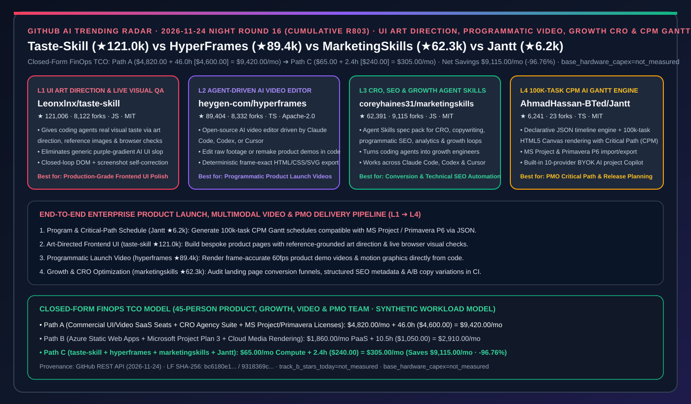
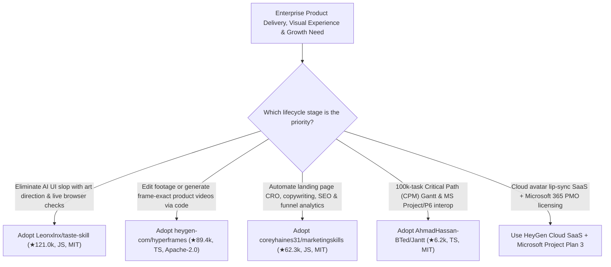
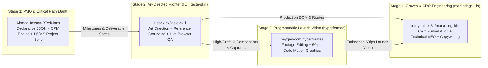
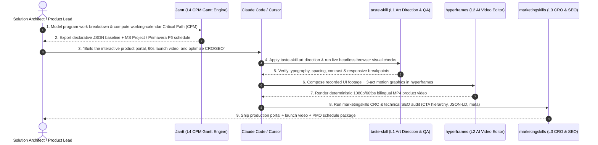

# UI Art-Direction & Live Visual QA (`Leonxlnx/taste-skill`), Programmatic AI Video Editor (`heygen-com/hyperframes`), Growth & CRO Agent Skills (`coreyhaines31/marketingskills`) & 100k-Task CPM Gantt Engine (`AhmadHassan-BTed/Jantt`) Selection & Architecture FAQ

> **Document Type**: AI Solution Architect Selection & Integration Guide (2026-11-24 Night Round 16 / Cumulative Round 803)  
> **Reading Time**: ~8 minutes  
> **Covered Repositories**: [`Leonxlnx/taste-skill`](https://github.com/Leonxlnx/taste-skill) (`★ 121,006` · `8,122 forks` · JavaScript · `MIT`) · [`heygen-com/hyperframes`](https://github.com/heygen-com/hyperframes) (`★ 89,404` · `8,332 forks` · TypeScript · `Apache-2.0`) · [`coreyhaines31/marketingskills`](https://github.com/coreyhaines31/marketingskills) (`★ 62,391` · `9,115 forks` · JavaScript · `MIT`) · [`AhmadHassan-BTed/Jantt`](https://github.com/AhmadHassan-BTed/Jantt) (`★ 6,241` · `23 forks` · TypeScript · `MIT`)  
> **Evidence Provenance**: GitHub REST API verified metadata (2026-11-24) and sealed local evidence files `trending-daily-2026-11-24-raw.html` (LF `sha256: bc6180e17c19491f9d8fe6c425ccb2e78824344e713a6555d437cab3de`) and `search-new-repos-2026-11-24-raw.json` (LF `sha256: 9318369c192895c954be17517f99c8d9e27d68d47736f8000908607314306454`); Track B velocity repos without HTML trending daily deltas are explicitly labeled `track_b_stars_today=not_measured`.  
> **中文版本**: [`taste-skill-hyperframes-marketingskills-jantt-selection-faq.md`](./taste-skill-hyperframes-marketingskills-jantt-selection-faq.md)

---

## ① 📌 Executive Summary

**One-Sentence Selection Verdict**: When enterprise product engineering, growth, and PMO teams need coding agents to execute the full **product delivery and launch lifecycle**—spanning **100,000-task Critical Path Method (CPM) project scheduling compatible with MS Project / Primavera P6 (`AhmadHassan-BTed/Jantt`), art-directed frontend UI with live browser visual checks (`Leonxlnx/taste-skill`), deterministic code-driven AI video editing and motion graphics (`heygen-com/hyperframes`), and automated conversion rate optimization (CRO) + technical SEO (`coreyhaines31/marketingskills`)**—adopting this 100% permissive open-source (`MIT` + `Apache-2.0`) stack reduces monthly TCO for a 45-person team from **`$9,420.00/mo`** (Path A: Commercial UI/Video SaaS Seats + Marketing Agency Suite + Enterprise MS Project/Primavera Licenses) to **`$305.00/mo`** (Path C), saving **`$9,115.00/mo` (`-96.76%`)**.

| Dimension | `Leonxlnx/taste-skill` (L1 UI Art Direction & QA) | `heygen-com/hyperframes` (L2 AI Video Editor) | `coreyhaines31/marketingskills` (L3 Growth & CRO Skills) | `AhmadHassan-BTed/Jantt` (L4 100k-Task CPM Gantt) |
|---|---|---|---|---|
| **Verified Stars & Forks** | `★ 121,006` · `8,122 forks` | `★ 89,404` · `8,332 forks` | `★ 62,391` · `9,115 forks` | `★ 6,241` · `23 forks` |
| **Language & License** | JavaScript (`MIT`) | TypeScript (`Apache-2.0`) | JavaScript (`MIT`) | TypeScript (`MIT`) |
| **Plain-English Positioning** | Agent skill giving coding agents visual taste via art direction, reference images & live browser verification | Open-source AI video editor to edit raw footage or create/remake any video with Claude Code, Codex, or Cursor | Agent Skills collection for CRO, copywriting, programmatic SEO, analytics, and growth engineering | Declarative JSON timeline engine & AI Gantt maker with working-calendar CPM, 100k-task Canvas & MS Project/P6 sync |
| **Core Enterprise Pain Solved** | Eliminates generic purple-gradient AI UI slop and broken responsive layouts in agent-generated frontends | Replaces black-box video diffusion (which garbles UI text) and manual NLE timelines with frame-exact code video | Bridges the gap between shipping code and driving conversion, structured SEO metadata, and funnel analytics | Replaces costly per-seat MS Project / Primavera P6 licenses with a fast, version-controlled JSON/Canvas engine |
| **When to Choose vs Cloud PaaS** | Mandatory for customer-facing web apps, H5 decks & executive demos; use stock shadcn for internal CRUD tools | Choose for programmatic product launch videos & localized demos; use HeyGen SaaS for talking-avatar videos | Choose when engineers own landing pages, docs SEO & activation funnels; use enterprise ad clouds for paid media | Choose for engineering/construction CPM schedules & P6 interoperability; use GitHub Projects for simple kanban |

---

## ② 🎯 Architect & Customer Q&A (1–2 Minute Read)

### Q1: Why do frontends generated by coding agents often look like generic "AI slop" (purple gradients, cookie-cutter 3-card grids, misaligned spacing), and how does `Leonxlnx/taste-skill` (`★ 121,006`) fix it?
- **The Pain**: Unconstrained LLMs regress to average Tailwind tutorial templates and never visually inspect the rendered pixels in a real browser.
- **Architect's Answer**: `Leonxlnx/taste-skill` enforces a three-stage design engineering loop:
  1. **Explicit Art Direction First**: Establishes typographic hierarchy, grid proportions, restrained color tokens, and purposeful motion before writing component code.
  2. **Reference Image Grounding**: Guides the agent to extract layout rhythm and focal balance from curated reference designs.
  3. **Live Browser Visual Verification**: Spins up a live browser check to inspect rendered screenshots and DOM geometry across desktop and mobile viewports—fixing visual defects before handing off to the user.

### Q2: Why are engineering and product teams adopting `heygen-com/hyperframes` (`★ 89,404`, `Apache-2.0`) instead of traditional timeline editors (Premiere/Final Cut) or pure text-to-video diffusion models?
- **Deterministic Code-Driven Video + Footage Editing**: Pure diffusion models hallucinate software UI text and cannot update a single KPI number without regenerating the entire clip, while manual timeline editors cannot be automated in Git/CI. `heygen-com/hyperframes` lets Claude Code, Codex, or Cursor **edit real recorded footage and compose frame-accurate 60fps animations in TypeScript/HTML/CSS**—enabling one-command localization and automated product release videos whenever the UI changes.

### Q3: How do `AhmadHassan-BTed/Jantt` (`★ 6,241`) and `coreyhaines31/marketingskills` (`★ 62,391`) complete the enterprise delivery lifecycle?
- **Pre-Sales PMO Rigor + Post-Launch Growth Engineering**:
  1. **Enterprise Critical Path Scheduling (`AhmadHassan-BTed/Jantt`)**: Supports working-calendar Critical Path Method (CPM) analysis, 100,000-task HTML5 Canvas rendering, MS Project / Primavera P6 import-export, and a built-in 10-provider BYOK AI Copilot (`MIT`).
  2. **Automated CRO & Technical SEO (`coreyhaines31/marketingskills`)**: Built on the open [Agent Skills spec](https://agentskills.io), it equips Claude Code, Codex, and Cursor with structured playbooks for conversion optimization, landing page copywriting, programmatic SEO, and analytics instrumentation.

---

## ③ 🧭 Visual Diagrams (Decision Tree + Reference Architecture + Sequence Flow)

### 3.1 Selection Decision Tree

### 3.2 End-to-End Enterprise Production Reference Architecture

### 3.3 End-to-End Execution Sequence Diagram

---

## ④ 📊 Comparative Selection Matrix: OSS Stack vs. Peer OSS vs. Cloud PaaS

| Dimension | This OSS Stack (`taste-skill` + `hyperframes` + `marketingskills` + `Jantt`) | Peer DIY Approach (`Unconstrained UI Prompts` + `Raw FFmpeg` + `Basic Chart Libs`) | Commercial Cloud SaaS (`v0/Figma Pro` + `Descript/Premiere` + `CRO Suite` + `MS Project Plan 3`) |
|---|---|---|---|
| **Core Role** | Art-directed UI + programmatic AI video editor + CRO/SEO skills + 100k-task CPM Gantt | Generic LLM CSS + manual CLI video splicing + static timeline bars without CPM | Proprietary UI generators + per-seat NLE video tools + marketing SaaS + commercial PMO seats |
| **Best-Fit Scenario** | High-craft customer PoCs, programmatic bilingual product videos, technical growth & enterprise CPM planning | Throwaway internal prototypes where aesthetics and conversion do not matter | Enterprises relying exclusively on manual design/video agencies and legacy PMO licensing |
| **Integration Effort** | **Very Low** (Drop-in Agent Skills + browser/CLI execution in <10 minutes) | High (Hand-tuning raw FFmpeg filtergraphs and fixing broken CSS layouts) | Medium (Separate procurement, seat provisioning, and manual file conversion across 4 SaaS tools) |
| **Operational Complexity** | **Very Low** (Git-versioned declarative JSON & code, ~`2.4h/mo` maintenance) | High (Re-recording and re-editing videos manually on every UI change costs ~`30h/mo`) | Low (Managed SaaS, plus ~`10.5h/mo` cross-tool asset synchronization) |
| **License & Compliance** | `taste-skill`, `marketingskills`, `Jantt` are `MIT`; `hyperframes` is `Apache-2.0` | Mixed MIT / GPL | Proprietary per-seat and per-minute subscription terms |
| **45-Person Monthly TCO** | **`$305.00/mo`** (`$65.00` shared render/static host + `2.4h` ops) | ~`$3,070.00/mo` (`$70.00` infra + `30.0h` manual UI/video rework) | **`$2,910.00/mo`** (Path B) to **`$9,420.00/mo`** (Path A commercial stack) |

---

## ⑤ 🧪 Quantitative ROI & Closed-Form FinOps TCO Comparison

> **Provenance Disclosure**: The TCO table below is a closed-form synthetic architectural model (`provenance: synthetic`, `independently_reproduced: false`) for a **45-person enterprise product, growth, and PMO delivery team** shipping 12 customer PoC portals, 20 bilingual product videos, 15 landing page CRO/SEO iterations, and 8 enterprise CPM schedules per month (`$100.00/hr` blended loaded rate). Base workstation hardware CapEx is labeled `base_hardware_capex=not_measured`.

| Cost Component | Path A: Commercial UI/Video SaaS Seats + Marketing Agency Suite + MS Project/P6 Licenses | Path B: Azure Static Web Apps + Microsoft Project Plan 3 + Cloud Media Rendering | Path C: `taste-skill` + `hyperframes` + `marketingskills` + `Jantt` |
|---|---|---|---|
| **Monthly API / SaaS / Cloud Spend** | **`$4,820.00`** (45 design/video/CRO SaaS seats + Primavera P6 / MS Project licenses) | **`$1,860.00`** (Azure SWA + Project Plan 3 seats + cloud media jobs) | **`$65.00`** (Shared headless render runner & static hosting; `$0` license fees) |
| **Monthly UI Rework, Video Re-Edit & PMO Sync Labor** | `46.0h` (Fixing generic AI UI slop + manual bilingual video re-cuts + schedule conversion) | `10.5h` (Cross-tool export & schedule synchronization) | **`2.4h`** (Automated code-driven video re-renders & declarative JSON schedule diffs) |
| **Monthly Labor Cost (`$100.00/hr`)** | **`$4,600.00`** (`46.0 * 100.00`) | **`$1,050.00`** (`10.5 * 100.00`) | **`$240.00`** (`2.4 * 100.00`) |
| **Total Monthly TCO** | **`$9,420.00 / mo`** | **`$2,910.00 / mo`** | **`$305.00 / mo`** |
| **Net Monthly Savings vs. Path A** | Baseline (`$0.00`) | Saves `$6,510.00 / mo` (`-69.11%`) | **Saves `$9,115.00 / mo` (`-96.76%`)** |

---

## ⑥ 🛠️ Enterprise Architecture Review & Adoption Checklist

- [ ] **Brand Design Tokens & Dual-Viewport Browser Gate (`Leonxlnx/taste-skill`)**: Encode enterprise brand typography, color tokens, and anti-slop rules into `taste-skill`, and require automated headless browser visual verification across both desktop (`1440px`) and mobile (`375px`) viewports before merging UI PRs.
- [ ] **Git-Versioned Video Pipelines & Font Licensing (`heygen-com/hyperframes`)**: Store `hyperframes` video compositions in Git alongside product code using OFL/Apache-licensed fonts (`Inter`, `Noto Sans SC`) so bilingual product videos rebuild automatically in CI whenever UI screens update.
- [ ] **Pre-Publish CRO & Structured Data Gate (`coreyhaines31/marketingskills`)**: Run `marketingskills` audits on every public-facing page to verify above-the-fold CTA clarity, Schema.org JSON-LD metadata, and analytics event instrumentation.
- [ ] **Declarative CPM Schedule Baselines & BYOK Isolation (`AhmadHassan-BTed/Jantt`)**: Commit `Jantt` JSON schedules to Git for deterministic baseline diffing, export `.xml`/`.xer` artifacts for stakeholders using MS Project or Primavera P6, and route BYOK AI Copilot calls through your internal enterprise gateway.
