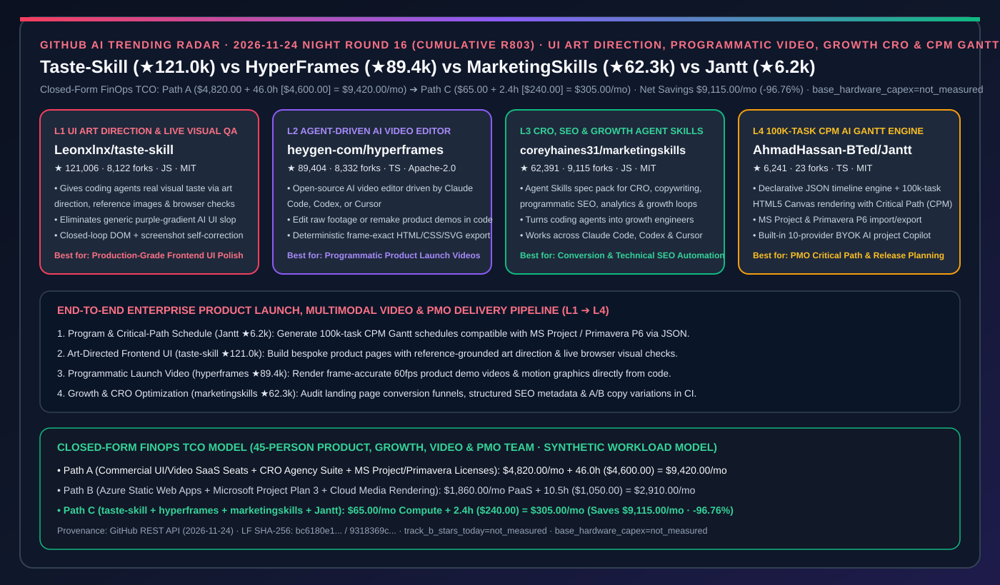
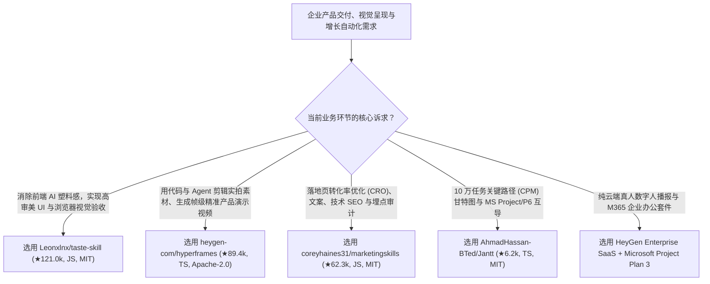
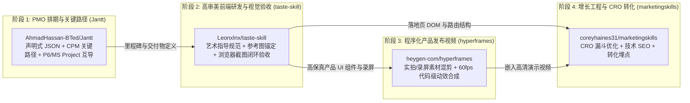
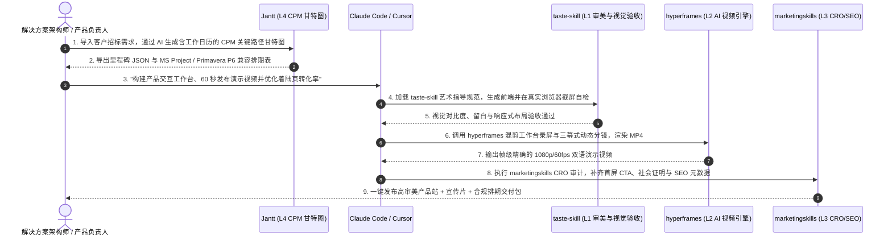

# 前端审美与实时视觉验收技能（`Leonxlnx/taste-skill`）、程序化 AI 视频剪辑与动画引擎（`heygen-com/hyperframes`）、增长工程与转化率优化技能包（`coreyhaines31/marketingskills`）及十万任务关键路径甘特图引擎（`AhmadHassan-BTed/Jantt`）选型与集成 FAQ

> **文档类型**：AI 解决方案架构师（AI Solution Architect）选型决策指南（2026-11-24 Night Round 16 / 累计第 803 轮）  
> **阅读耗时**：约 8 分钟  
> **覆盖项目**：[`Leonxlnx/taste-skill`](https://github.com/Leonxlnx/taste-skill)（`★ 121,006` · `8,122 forks` · JavaScript · `MIT`） · [`heygen-com/hyperframes`](https://github.com/heygen-com/hyperframes)（`★ 89,404` · `8,332 forks` · TypeScript · `Apache-2.0`） · [`coreyhaines31/marketingskills`](https://github.com/coreyhaines31/marketingskills)（`★ 62,391` · `9,115 forks` · JavaScript · `MIT`） · [`AhmadHassan-BTed/Jantt`](https://github.com/AhmadHassan-BTed/Jantt)（`★ 6,241` · `23 forks` · TypeScript · `MIT`）  
> **证据溯源**：GitHub REST API 实测元数据（2026-11-24）与本地冻结证据文件 `trending-daily-2026-11-24-raw.html`（LF `sha256: bc6180e17c19491f9d8fe6c425ccb2e78824344e713a6555d437cab3de`）、`search-new-repos-2026-11-24-raw.json`（LF `sha256: 9318369c192895c954be17517f99c8d9e27d68d47736f8000908607314306454`）；Track B 仓库无 HTML 榜单对应的单日增量，统一标记为 `track_b_stars_today=not_measured`。  
> **English Version**: [`taste-skill-hyperframes-marketingskills-jantt-selection-faq.en.md`](./taste-skill-hyperframes-marketingskills-jantt-selection-faq.en.md)

---

## ① 📌 核心结论速览（Executive Summary）

**选型一句话结论**：当企业产品研发、增长营销与 PMO 交付团队需要用 AI 智能体跑通**“复杂工程关键路径排期（`AhmadHassan-BTed/Jantt`）➔ 高审美定制化前端界面研发（`Leonxlnx/taste-skill`）➔ 帧级可控的产品发布演示视频生成（`heygen-com/hyperframes`）➔ 转化率优化（CRO）与技术 SEO 增长闭环（`coreyhaines31/marketingskills`）”**全链路时，采用这套 100% 宽松开源协议（`MIT` + `Apache-2.0`）的四件套，可将 45 人产品与交付团队的月度 TCO 从商业 UI/视频 SaaS 席位 + 营销顾问工具 + MS Project/Primavera P6 商业授权（Path A）的 **`$9,420.00/月`** 降至 **`$305.00/月`**（净省 **`$9,115.00/月`**，降幅 **`-96.76%`**）。

| 评估维度 | `Leonxlnx/taste-skill` (L1 前端审美与视觉验收) | `heygen-com/hyperframes` (L2 程序化视频剪辑引擎) | `coreyhaines31/marketingskills` (L3 增长与 CRO 技能包) | `AhmadHassan-BTed/Jantt` (L4 10万任务关键路径甘特图) |
|---|---|---|---|---|
| **GitHub 实测热度** | `★ 121,006` · `8,122 forks` | `★ 89,404` · `8,332 forks` | `★ 62,391` · `9,115 forks` | `★ 6,241` · `23 forks` |
| **实现语言与开源协议** | JavaScript (`MIT`) | TypeScript (`Apache-2.0`) | JavaScript (`MIT`) | TypeScript (`MIT`) |
| **一句话通俗定位** | 通过艺术指导、参考图约束与真实浏览器视觉检查消除“AI 廉价模板感”的前端技能 | 支持用 Claude Code/Codex/Cursor 剪辑实拍素材或用代码重制任何宣传视频的开源引擎 | 面向编码智能体的转化率优化（CRO）、文案、技术 SEO 与增长工程标准技能集 | 支持工作日历关键路径（CPM）、10 万任务 Canvas 渲染且兼容 MS Project/P6 的 AI 甘特图 |
| **解决的核心业务痛点** | 根治大模型写前端千篇一律“蓝紫渐变 + 居中三卡片 + 错位留白”的塑料感 UI（UI Slop） | 解决纯扩散视频模型文字拼写乱码、无法逐帧微调产品 UI 录屏与品牌字体的痛点 | 弥补纯程序员团队“代码写得快但落地页转化率低、缺乏 SEO 结构化数据与埋点”的短板 | 替代昂贵笨重的 Microsoft Project 与 Primavera P6，用声明式 JSON 实时排算大型工程排期 |
| **何时选它 vs 云托管** | 需要用 Agent 交付客户级高水准前端 UI/H5 时必选；仅内部后台 CRUD 用默认 shadcn 即可 | 需要制作代码级精准的产品发布视频、动效分镜与混剪时选它；纯真人数字人口播选 HeyGen SaaS | 技术团队自建官网/SaaS 增长漏斗与 SEO 自动化时选它；大型广告投放选商业营销云 | 大型软件/基建项目需免费 CPM 关键路径分析与 P6 互导时选它；简单看板用 GitHub Projects |

---

## ② 🎯 客户与架构师灵魂拷问 Q&A（1–2 分钟速读）

### Q1：为什么用 Claude Code 或 Cursor 生成的前端页面一眼就能看出是“AI 写的廉价塑料风（AI Slop）”？`Leonxlnx/taste-skill`（`★ 121,006`）是怎么让编码 Agent 拥有“高级设计师审美”的？
- **痛点**：大模型默认训练分布偏向高频通用 Tailwind 模板，如果不加审美约束，生成出的页面充斥着刺眼的蓝紫渐变、千篇一律的圆角卡片和移动端溢出。
- **架构师解答**：`Leonxlnx/taste-skill` 为编码 Agent 注入了三道硬核工业设计工序：
  1. **Art Direction（先定艺术风格方向与字体/色彩规范）**：在写一行 CSS 之前，先建立严格的排版网格、字重层级、克制的中性色盘与微交互动效规范。
  2. **Reference Image Grounding（视觉参考图锚定）**：引导 Agent 拆解优秀设计参考图的空间留白与视觉重心。
  3. **Live Browser Visual Check（真实浏览器截图闭环自检）**：写完代码后强制启动无头浏览器渲染真实像素并由视觉模型检查对齐、对比度与响应式断点，不达标自动返工。

### Q2：企业要做新产品发布会视频或客户方案演示视频，为什么 `heygen-com/hyperframes`（`★ 89,404`）比传统时间轴剪辑软件（Premiere/剪映）或黑盒文生视频（Sora/Runway）更适合技术团队？
- **核心差异（确定性程序化视频 + 实拍素材混剪）**：黑盒文生视频无法精确展示企业真实的软件界面、架构图和 KPI 数字（文字会扭曲变形）；而手工剪辑软件无法接入 Git 版本控制与多语言批量重制。`heygen-com/hyperframes`（`Apache-2.0`）允许开发者直接用 Claude Code、Codex 或 Cursor 操控视频时间轴——**既能剪辑真实的实拍/录屏素材，又能用确定性的 HTML/CSS/SVG/WebGL 渲染 60fps 动效转场与字幕**，改一行 JSON 即可批量输出中英双语、不同客户定制 Logo 的高清宣传片。

### Q3：把 `AhmadHassan-BTed/Jantt`（`★ 6,241`）和 `coreyhaines31/marketingskills`（`★ 62,391`）纳入企业交付工具链，分别解决了项目售前/PMO 和上线获客的什么难题？
- **两端赋能**：
  1. **售前排期与 PMO 关键路径管控（`AhmadHassan-BTed/Jantt`）**：企业级大项目往往包含数千至数万个子任务，且需与客户的 Microsoft Project（`.mpp`/`.xml`）或 Primavera P6（`.xer`）互导。`Jantt` 基于声明式 JSON 引擎与 HTML5 Canvas 虚拟化渲染，支持 **100,000 任务秒级拖拽、工作日历关键路径法（CPM）自动推算与 10 大模型供应商 BYOK AI 排期助手**，且完全免费开源（`MIT`）。
  2. **上线后转化率与 SEO 增长工程（`coreyhaines31/marketingskills`）**：遵循 `agentskills.io` 标准，内置落地页转化率优化（CRO）、价值主张文案、程序化 SEO、Schema.org 结构化标记与漏斗埋点审计技能，让工程师在提交前端 PR 时同步完成增长工程加固。

---

## ③ 🧭 直观可视化图解（Mermaid 决策树 + 集成架构 + 时序图）

### 3.1 技术选型决策树

### 3.2 企业端到端生产集成参考架构图

### 3.3 业务流全链路时序图

---

## ④ 📊 同类开源与商业云服务横向选型决策矩阵

| 对比维度 | 本轮开源组合 (`taste-skill` + `hyperframes` + `marketingskills` + `Jantt`) | 同赛道开源/裸写方案 (`默认 Prompt 写 UI` + `裸写 FFmpeg` + `普通甘特图组件`) | 商业 SaaS 与云服务 (`v0/Figma Pro` + `Descript/Premiere` + `CRO 机构` + `MS Project Plan 3`) |
|---|---|---|---|
| **功能定位** | 审美闭环 UI 研发 + 程序化视频剪辑 + CRO/SEO 增长工程 + 10万任务 CPM 甘特图 | 无审美约束生成 + 命令行硬切视频 + 无关键路径推算的静态图表 | 商业生成式 UI 订阅 + 商业视频剪辑席位 + 商业营销套件 + 微软/Oracle 项目管理软件 |
| **适用场景** | 企业级产品快速孵化、高水准客户 PoC 演示、多语言产品视频批量生产与大型项目排期 | 内部临时测试脚本或对视觉质量无要求的原型 | 预算充足且完全依赖专职设计师、视频后期与传统 PMO 团队的机构 |
| **集成成本** | **极低**（标准 Agent Skills 目录挂载 + 浏览器即开即用，10 分钟内生效） | 高（手写 FFmpeg 滤镜与手动调 CSS 样式极其耗时） | 中（多套商业软件独立采购、账号开通与格式转换） |
| **运维复杂度** | **极低**（纯静态构建与 Git 版本化管理，月均维护仅 `2.4h`） | 高（每次改文案或 UI 都要重新录屏剪辑，月均返工 `30h+`） | 低（云端 SaaS，但跨工具手动同步耗费约 `10.5h/月`） |
| **开源协议与合规** | `taste-skill`、`marketingskills`、`Jantt` 为 `MIT`；`hyperframes` 为 `Apache-2.0`（100% 商业友好） | MIT / GPL 混杂 | 商业闭源按席位/按导出时长收费 |
| **45 人团队月度 TCO** | **`$305.00/月`**（含 `$65.00` 渲染/托管容器 + `2.4h` 运维） | 约 `$3,070.00/月`（含 `$70.00` 环境 + `30.0h` 视觉与视频返工） | **`$2,910.00/月`**（Path B）至 **`$9,420.00/月`**（Path A 商业全栈） |

---

## ⑤ 🧪 应用落地定量收益 / TCO 对比（Closed-Form FinOps 模型）

> **数据性质声明（Provenance Metadata）**：以下 TCO 模型为面向 **45 人企业产品研发、增长营销与 PMO 交付团队**（每月交付 12 个客户 PoC 前端工作台、20 支双语产品演示视频、15 次着陆页 CRO/SEO 迭代与 8 个大型工程 CPM 排期表，折算时薪 `$100.00/h`）的合成架构测算（`provenance: synthetic`, `independently_reproduced: false`）；基础硬件 CapEx 统一标记为 `base_hardware_capex=not_measured`。

| 成本构成项 | Path A：商业 UI/视频剪辑 SaaS 席位 + 营销分析套件 + MS Project/P6 商业授权 | Path B：Azure Static Web Apps + Microsoft Project Plan 3 + 云端渲染 | Path C：`taste-skill` + `hyperframes` + `marketingskills` + `Jantt` |
|---|---|---|---|
| **API / SaaS / 云资源月费** | **`$4,820.00`**（45 人设计/视频/营销 SaaS 席位 + Primavera P6 / MS Project 许可） | **`$1,860.00`**（Azure SWA + Project Plan 3 席位 + 云端媒体渲染） | **`$65.00`**（共享无头渲染容器与静态托管；开源工具链 `$0` 许可费） |
| **月度 UI 返工、视频重剪与排期对齐工时** | `46.0h`（修补 AI 塑料感 UI + 手工重录重剪多语种视频 + 手工转换排期表） | `10.5h`（跨平台资源导出与排期同步） | **`2.4h`**（代码化一键重渲染视频与 JSON 排期自动重算） |
| **人工运维与返工成本（`$100.00/h`）** | **`$4,600.00`** (`46.0 * 100.00`) | **`$1,050.00`** (`10.5 * 100.00`) | **`$240.00`** (`2.4 * 100.00`) |
| **月度总拥有成本（Total Monthly TCO）** | **`$9,420.00 / 月`** | **`$2,910.00 / 月`** | **`$305.00 / 月`** |
| **相对 Path A 净节省** | 基准线 (`$0.00`) | 节省 `$6,510.00 / 月` (`-69.11%`) | **净省 `$9,115.00 / 月` (`-96.76%`)** |

---

## ⑥ 🛠️ 企业引入与架构评审 Checklist

- [ ] **企业品牌设计 Token 与浏览器视觉门禁（`Leonxlnx/taste-skill`）**：将企业的标准色板、字体规范与反例清单写入 `taste-skill` 约束文件，并要求所有前端变更必须通过 Playwright 真实浏览器桌面端（`1440px`）与移动端（`375px`）双分辨率截图自检。
- [ ] **视频工程代码化与字体/音频版权合规（`heygen-com/hyperframes`）**：将 `hyperframes` 视频工程纳入 Git 仓库管理，统一使用开源商用免费字体（如 Inter、Noto Sans SC）与合成音效，通过 CI 流水线确定性渲染 MP4 产物。
- [ ] **着陆页 CRO 与结构化 SEO 自动化检查（`coreyhaines31/marketingskills`）**：在公开产品页发布前运行 `marketingskills` 检查清单，确保首屏价值主张清晰、OpenGraph/JSON-LD 结构化数据完整且无阻塞首屏渲染的第三方脚本。
- [ ] **PMO 关键路径基线锁定与 BYOK 密钥安全（`AhmadHassan-BTed/Jantt`）**：将 `Jantt` 的声明式排期 JSON 纳入项目仓库做版本基线对比（Baseline Diff），导出 `.xml`/`.xer` 供客户 MS Project / Primavera P6 审阅，并确保 BYOK 模型密钥仅保存在本地浏览器或企业内网网关中。
