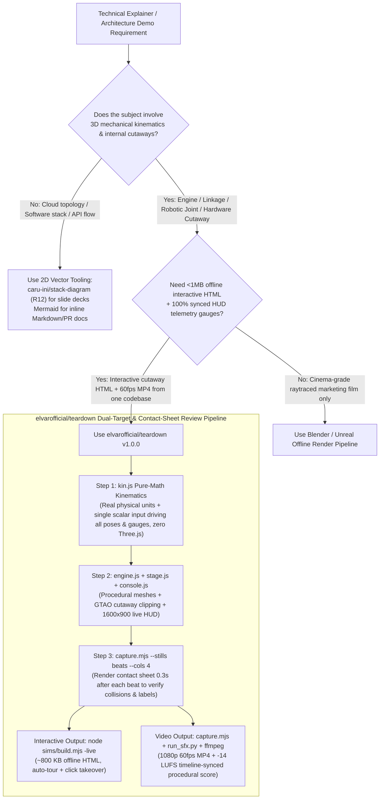

# Teardown 3D Machine Simulator Skill vs. Freehand Three.js / Blender Pre-Render Selection & Architecture FAQ

> **Document Type**: Architecture Selection Guide & First-Principles FAQ (GitHub AI Trending 2026-11-08 Round 13 Standalone Deep Dive)  
> **Primary Subject**: [`elvarofficial/teardown` (`v1.0.0`)](https://github.com/elvarofficial/teardown) (9-day breakout repository recorded in archived GitHub Search API snapshot `evidence/search-new-repos-2026-11-08-raw.json` [`sha256: b63e1547...`], **2,633 Total Stars** / `2,643` live REST stars, `~293 stars/day` creation-to-date lifecycle velocity [`measured`]; single-day `stars_today: not_measured`) vs. **Freehand LLM Three.js Codegen** vs. **Manual Blender / Unity Modeling & Pre-Rendered Video**  
> **Last Updated**: 2026-11-09 (UTC+08:00) | **Target Audience**: AI Solution Architects, Industrial Digital-Twin & Hardware Visualization Engineers, Technical Evangelists

---

## 📌 Executive Summary (3 Takeaways in 30 Seconds)

1. **When to Choose `elvarofficial/teardown` vs. Mermaid / Blender**:
   - Choose **`elvarofficial/teardown` (`v1.0.0`, MIT)** whenever you need to turn a **real physical machine, hardware mechanism, or robotics linkage** (e.g., a 4-stroke engine, landing-gear rack-and-pinion, walking linkage, hydraulic pump, or liquid-cooling valve assembly) into **both a `<1 MB` self-contained offline HTML interactive simulator** (with cutaway views, live telemetry panels, and an auto-tour that yields control on click and resumes after `25 s` of idle time) **and a deterministic `1080p 60fps` MP4 video with `-14 LUFS` timeline-synced procedural audio**;
   - Keep **Round 12's `stack-diagram` or Mermaid** for 2D cloud/software architecture topologies, and keep **Blender / Unreal / Omniverse** for photorealistic CAD surface rendering or multi-gigabyte factory walk-throughs.
2. **First Principles: Why Freehand LLM Three.js Prompts Fail on Real Mechanisms and How `teardown` Solves It**:
   - Verified via primary source inspection (`SKILL.md`, `package.json`, `sims/build.mjs`, `sims/capture.mjs`, `run_sfx.py`, `measured`), freehand LLM Three.js scripts fail because **kinematic math is tangled with mesh creation, hand-keyframed parts drift out of sync with HUD gauges, and the LLM cannot watch a live 60fps WebGL canvas to spot intersecting meshes or shader bugs**;
   - `teardown` enforces three deterministic architectural contracts: (1) **Pure-Math Kinematic Isolation (`kin.js` with zero Three.js imports)**: every part pose and every surrounding HUD gauge reads from a pure function of a **single scalar input** (crank angle, stroke `0..1`, or pre-tabulated wind integral), making gauge-to-mesh drift mathematically impossible; (2) **Dual-Target Pure `render(t)` Pipeline**: `sims/build.mjs` (`esbuild 0.28.1` + `three 0.186.1`) inlines variable fonts and parallel shader warm-up (`kit/warm.js`) into an `~800 KB` (`<1 MB`) offline interactive page (`live.js`), while `sims/capture.mjs` drives the exact same deterministic `render(t)` frame-by-frame in Playwright Chromium to produce a `60fps` MP4 scored by `run_sfx.py` (`48 kHz` procedural audio mastered to `-14 LUFS` from the shared `timeline.json`); and (3) **Contact-Sheet Visual Review Loop (`--stills beats` + `sheet.mjs`)**: renders a 4-column contact sheet `0.3 s` after every timeline beat (`t=`) so multimodal agent vision catches mesh collisions, GTAO cutaway ghosts, and label clipping before final encoding.
3. **Closed-Form API-Only FinOps & Engineering-Time Impact (`synthetic, independently_reproduced=false`)**:
   - For an SA team delivering **12 interactive 3D hardware/mechanism explainers per month** (3 explainers/week for customer PoCs and executive briefings; `$3.00/1M` input, `$15.00/1M` output counted strictly once; external 3D artist contractors and commercial engine licenses marked `not_measured`), switching from iterative Freehand LLM Three.js debugging (Path A: `10` rounds/simulator = `120` rounds/mo, `$37.80/mo` API bill + `72.0h/mo` manual debugging) to **`elvarofficial/teardown` `v1.0.0`** (Path C: `2` rounds/simulator = `24` rounds/mo, `$2.88/mo` API bill + `12.0h/mo` review) reduces monthly LLM API spend by **`-$34.92/mo`** (`-$419.04/yr`, **`-92.38%`** API-only) and saves **`60.0 hours/month`** (`-83.33%`) of SA 3D debugging time.

---

## 1. Core Architectural Questions (Q1–Q3 First-Principles Breakdown)

### Q1: What problem does `elvarofficial/teardown` actually solve for AI Solution Architects?

When presenting industrial AI, robotics, edge hardware, or data-center cooling architectures, customers frequently ask:
> *"Instead of static bullet points, can you show us an interactive 3D cutaway of how this mechanism operates under load, with live pressure/stroke gauges next to the moving parts?"*

Previously, architects faced two painful choices:
- **Pain Path A (Prompting an LLM for a freehand Three.js single-file page)**: The LLM invents dimensions from imagination, pistons poke through cylinder walls, HUD charts display fake random numbers unrelated to the 3D pose, and Windows laptops with integrated GPUs hit black screens or ghosted cutaways due to ANGLE `smoothstep(a,b,x)` (`a>b` returning 0), `ShadowMaterial` depth-buffer fighting, or unclipped `gtao.normalMaterial` planes.
- **Pain Path B (Manual Blender / Unity rigging & video export)**: Takes days of specialist 3D artist time, and produces a heavy MP4 video that customers cannot orbit, cutaway, or open offline inside a `<1 MB` HTML technical proposal.

**`elvarofficial/teardown` (`v1.0.0`, MIT)** packages the runtime, frame capture, and procedural audio engine from `whaleyxbt/claude-motion` into a disciplined Claude Code Skill with 3 complete reference machines (`v8-*`, `cessna-*`, `strandbeest-*`):
1. **One Machine, One `<1 MB` Offline HTML Page (`live.js`)**: `node sims/build.mjs <name>-live` bundles `three@0.186.1` and fonts (`@fontsource-variable/inter`, `@fontsource/jetbrains-mono`) into an `~800 KB` offline HTML file. Left untouched, a virtual cursor runs an automated guided tour; any click, drag, or key hands interactive control to the user, and `25 s` of inactivity smoothly hands control back to the tour.
2. **Same-Source `60fps` Video + `-14 LUFS` Procedural Audio (`film.js` + `score.py`)**: `sims/capture.mjs` renders `render(t)` frame-by-frame at `1600x900` (`--dpr 1.2` = `1920x1080`) into a `60fps` MP4, while `run_sfx.py` synthesizes `48 kHz` procedural audio (`-14 LUFS`, `true peak <= -2 dBFS`) locked to `timeline.json`.

---

### Q2: How does the 5-module contract (`kin.js` → `engine.js` → `stage.js` → `console.js` → `live/film/score`) prevent mesh collisions and gauge drift?

Verified directly against `SKILL.md` and the repository layout (`measured`), every simulator is decomposed by strict separation of concerns:

| Module File | Primary Job | Engineering Guardrail (Why It Never Drifts or Breaks) |
| :--- | :--- | :--- |
| **1. `kin.js` / `gear.js` / `jansen.js`** | **Pure-Math Kinematics & Telemetry** | **Zero `three.js` imports allowed.** Uses real physical dimensions in real units (e.g., Cessna 337 gear: `32 teeth × 4 mm module = 128 mm pitch diameter`, half circumference = `201 mm` rack stroke `0..1`; Jansen's 11 link lengths solved by exact circle intersection in 67 lines). Takes one scalar input and returns every joint pose and gauge value. |
| **2. `engine.js` / `beast.js`** | **Procedural 3D Geometry & Posing** | Builds lathed parts, tubes, and instanced links in code; `update(input)` poses meshes strictly from `kin.js` outputs—nothing is hand-keyframed. |
| **3. `stage.js` + `kit/warm.js`** | **Light Studio, GTAO/Bloom & Shader Warm-Up** | `kit/warm.js` compiles all shaders in parallel before Frame 0; `TIERS` scales down AO, pixel ratio, and shadow maps for integrated GPUs; synchronizes clipping planes onto `gtao.normalMaterial` so cutaway halves never leave pale ghosts. |
| **4. `console.js`** | **Fixed `1600×900` CSS Telemetry Overlay** | `update(state)` redraws indicator diagrams, foot-contact charts, and leader-line callouts from the exact same `kin.js` frame state. |
| **5. `film.js` / `live.js` / `score.py`** | **Pure `render(t)` Timeline, Live Tour & Score** | `render(t)` is a pure function of time `t` (seeded `rng(seed)`, no `Date`/`Math.random`, stateful integrals pre-tabulated into typed arrays at load), shared across interactive WebGL, Playwright frame capture, and Python `-14 LUFS` audio synthesis. |

---

### Q3: When should architects stick to 2D diagrams (`stack-diagram` / Mermaid) or full Blender / CAD pipelines instead?

- **Use `stack-diagram` (Round 12) or Mermaid** when illustrating software layers, cloud topologies, or API sequences that have no 3D mechanical kinematics.
- **Use Blender / Unreal / Native CAD** when inspecting sub-millimeter manufacturing tolerances on imported STEP/IGES meshes or multi-million-polygon CFD simulations.

---

## 2. Architect Decision Tree & Dual-Target Pipeline (Mermaid)

---

## 3. 3D Mechanism Explainer Selection Matrix (Decision Matrix)

| Dimension | Path A: Freehand LLM Three.js Single Page | Path B: LLM Spec + Manual Blender / Unity Authoring | Path C: `elvarofficial/teardown` (`v1.0.0`) |
| :--- | :--- | :--- | :--- |
| **License & Version** | N/A | Blender (`GPL-2.0+`) / Unity (Commercial) | **`MIT` License** (`v1.0.0`, CC0 Freesound samples) |
| **Kinematics-to-HUD Consistency** | ❌ High drift risk (hand keyframes vs. fake chart math) | ⚠️ Requires manual driver/UI binding | ✅ **100% single-source math** (`kin.js` drives both meshes & gauges) |
| **Cutaway / X-Ray Modes** | ❌ Frequent GTAO ghosting & depth-test artifacts | ✅ Mature boolean modifiers, heavy Web export | ✅ **Built-in Glass / Section / Solid cutaways** (`gtao.normalMaterial` synced) |
| **Multimodal Agent Review Loop** | ❌ Blind code edits or ad-hoc user screenshots (~10 rounds) | ❌ Manual GUI viewport inspection | ✅ **`--stills beats` contact sheets + `sheet.mjs` encoder check** (~2 rounds) |
| **Deliverable Format & Size** | ⚠️ External CDN scripts; breaks offline | ❌ Multi-MB video (non-interactive) or heavy WebGL | ✅ **`~800 KB` (`<1 MB`) offline single HTML + `1080p 60fps` scored MP4** |
| **Integrated GPU (iGPU) Smoothness** | ❌ Often drops `<15 fps` or freezes on first draw | N/A (pre-rendered video) | ✅ **`kit/warm.js` parallel shader compile + `TIERS` iGPU quality scaling** |

---

## 4. Closed-Form FinOps & SA Engineering-Time Worked Example (`100%` Reproducible)

### 4.1 Workload Parameters (`CLAIM-R13-02`, `synthetic, independently_reproduced=false`)

Consider an industrial AI / robotics Solution Architecture team producing **`M_month = 12` interactive 3D hardware/mechanism explainers per month** (3 explainers/week for customer PoCs and executive technical briefings):
- **LLM API Pricing Baseline**: Frontier multimodal coding LLM at **`$3.00 / 1M uncached input tokens`** and **`$15.00 / 1M output tokens`** (counted strictly once).
- **Scope Boundary**: Models **API-only LLM token spend** and **SA 3D engineering hours**; external 3D agency fees, commercial game-engine seats, and cloud render-farm bills are explicitly marked **`not_measured`**.

| Path | Avg Rounds / Simulator (`R`) | Monthly Rounds (`12 × R`) | Input Tokens / Round (`T_in`) | Output Tokens / Round (`T_out`) | Input Cost / Round (`T_in × $3`) | Output Cost / Round (`T_out × $15`) | Total API Cost / Round | Monthly Input Spend | Monthly Output Spend | **Monthly API Total (API-Only)** | **Monthly SA 3D Engineering Hours** |
| :--- | :---: | :---: | :---: | :---: | :---: | :---: | :---: | :---: | :---: | :---: | :---: |
| **Path A: Freehand LLM Three.js + Screenshot Debugging** | `10` | `120` | `45,000` (`0.045M`) | `12,000` (`0.012M`) | `$0.1350` | `$0.1800` | `$0.3150` | `$16.20` | `$21.60` | **`$37.80 / mo`** (`$3.15/sim`) | **`72.0 h / mo`** (`6.0h/sim`) |
| **Path B: LLM Spec + Manual Blender/Unity Rigging** | `4` | `48` | `25,000` (`0.025M`) | `6,000` (`0.006M`) | `$0.0750` | `$0.0900` | `$0.1650` | `$3.60` | `$4.32` | **`$7.92 / mo`** (`$0.66/sim`) | **`96.0 h / mo`** (`8.0h/sim`) |
| **Path C: `elvarofficial/teardown` (`v1.0.0`)** | `2` | `24` | `20,000` (`0.020M`) | `4,000` (`0.004M`) | `$0.0600` | `$0.0600` | `$0.1200` | `$1.44` | `$1.44` | **`$2.88 / mo`** (`$0.24/sim`) | **`12.0 h / mo`** (`1.0h/sim`) |

### 4.2 Component-by-Component Closed-Form Equations

1. **Path A (Freehand LLM Three.js)**:
   - Per-round API cost: `Cost_round_A = 0.045 × $3.00 ($0.1350 in) + 0.012 × $15.00 ($0.1800 out) = $0.3150 / round`
   - Monthly rounds: `12 simulators × 10 rounds = 120 rounds`
   - Monthly components: `Input_A = 120 × $0.1350 = $16.20`; `Output_A = 120 × $0.1800 = $21.60`
   - Monthly API total: `Total_API_A = $16.20 + $21.60 = $37.80 / month` (manual collision/shader debugging: `12 × 6.0h = 72.0h / month`).
2. **Path B (LLM Spec + Manual Blender/Unity Rigging)**:
   - Per-round API cost: `Cost_round_B = 0.025 × $3.00 ($0.0750 in) + 0.006 × $15.00 ($0.0900 out) = $0.1650 / round`
   - Monthly rounds: `12 simulators × 4 rounds = 48 rounds`
   - Monthly components: `Input_B = 48 × $0.0750 = $3.60`; `Output_B = 48 × $0.0900 = $4.32`
   - Monthly API total: `Total_API_B = $3.60 + $4.32 = $7.92 / month` (manual rigging & export: `12 × 8.0h = 96.0h / month`).
3. **Path C (`elvarofficial/teardown` `v1.0.0`)**:
   - Per-round API cost: `Cost_round_C = 0.020 × $3.00 ($0.0600 in) + 0.004 × $15.00 ($0.0600 out) = $0.1200 / round`
   - Monthly rounds: `12 simulators × 2 rounds = 24 rounds`
   - Monthly components: `Input_C = 24 × $0.0600 = $1.44`; `Output_C = 24 × $0.0600 = $1.44`
   - Monthly API total: `Total_API_C = $1.44 + $1.44 = $2.88 / month` (SA review & tuning: `12 × 1.0h = 12.0h / month`).
4. **Net Savings (Path C vs. Path A)**:
   - **Monthly API Savings**: `$37.80 - $2.88 = $34.92 / month` (`$419.04 / year`, **`-92.38%`** API-only: `34.92 / 37.80 = 0.9238095... -> 92.38%`).
   - **Monthly SA Engineering Time Saved**: `72.0h - 12.0h = 60.0 hours / month` (**`-83.33%`**).

---

## 5. Production Onboarding Checklist for Solution Architects

- [ ] **Step 1 — Install Skill & Headless Chromium Runtime (5 mins)**:
  - Run `npx skills add elvarofficial/teardown -g -a claude-code` and execute `npm install && npx playwright install chromium` once inside the skill folder (requires Node.js `>=20`, `ffmpeg` on PATH for video, and Python 3 standard library for procedural audio).
- [ ] **Step 2 — Build & Inspect the 3 Reference Simulators (5 mins)**:
  - Run `node sims/build.mjs v8-live`, `node sims/build.mjs cessna-live`, and `node sims/build.mjs strandbeest-live`; open `teardown-out/dist/v8-live.html` (`~800 KB` offline HTML) to verify glass/section/solid cutaways, cylinder firing-order picker, and 25-second idle auto-tour handover.
- [ ] **Step 3 — Lock Real Physical Dimensions in `kin.js` Before Writing Geometry (10 mins)**:
  - Never invent mechanisms from a vague sentence. Extract real bore, stroke, module, tooth count, or link lengths from the hardware manual, implement them in `kin.js` with zero Three.js imports, and verify one landmark calculation by hand (`32 teeth × 4 mm module = 128 mm pitch diameter`).
- [ ] **Step 4 — Enforce the `--stills beats` Contact-Sheet Review Gate (5 mins)**:
  - Run `node sims/capture.mjs <name>-film --size 1600x900 --dpr 1.2 --stills beats --cols 4 --out teardown-out/beats.png` and verify every tile (`0.3 s` after each timeline beat): zero mesh intersections, zero GTAO cutaway ghosts, and all labels at least `60 px` inside frame edges.
- [ ] **Step 5 — Synthesize `-14 LUFS` Procedural Audio & Verify Encoded MP4 (5 mins)**:
  - Run `python run_sfx.py sims/<name>-shared/score.py`, mux with `ffmpeg -movflags +faststart`, and inspect `node sheet.mjs --video <final.mp4> --timeline <timeline.json>` before shipping to the customer.
