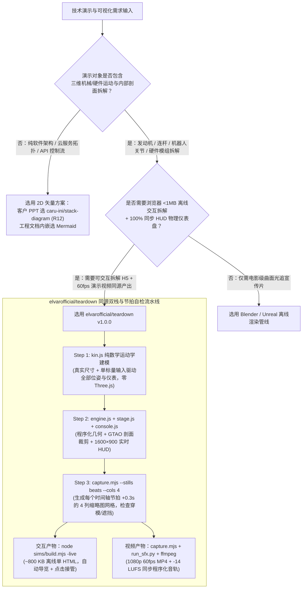

# Teardown 3D 机械拆解模拟器 Skill vs 裸写 Three.js / Blender 预渲染选型与架构 FAQ

> **文档类型**：架构选型指南 & 原理深潜 FAQ（GitHub AI Trending 2026-11-08 Round 13 独立专题深潜）  
> **核心拆解对象**：[`elvarofficial/teardown` (`v1.0.0`)](https://github.com/elvarofficial/teardown)（GitHub Search API 归档快照 `evidence/search-new-repos-2026-11-08-raw.json` [`sha256: b63e1547...`] 9 天新建黑马，**2,633 Total Stars** / REST 实时 `2,643` Stars，建仓以来日均 `~293 stars/day` [`measured`]；单日增量 `stars_today: not_measured`） vs **LLM 裸写 Three.js 单文件脚本** vs **Blender / Unity 手工建模预渲染视频**  
> **最后更新**：2026-11-09（UTC+08:00） | **适用读者**：AI Solution Architect、工业数字孪生与硬件可视化架构师、技术布道与高管汇报工程团队

---

## 📌 核心结论速览（Executive Summary — 30 秒先看懂这 3 条）

1. **什么时候选 `elvarofficial/teardown` vs 什么时候用 Mermaid / Blender**：
   - 当你需要把**真实物理机械、硬件模组或工业机构**（如四冲程发动机、起落架齿轮齿条、连杆步行机构、液压泵、数据中心液冷阀门）变成**既能在浏览器里离线交互拆解（`<1 MB` 单 HTML 文件，带自动导览与 25 秒无操作自动接管），又能一键逐帧导出 `1080p 60fps` 视频 + `-14 LUFS` 同步程序化音效**的技术演示时，**选 `elvarofficial/teardown` (`v1.0.0`, MIT)**；
   - 如果只是画软件微服务拓扑或 API 调用链，用 **Round 12 的 `stack-diagram` 或 Mermaid**；如果是电影级曲面资产或超大规模 3D 工厂漫游，用 **Blender / Unreal / Omniverse**。
2. **第一性原理：为什么直接让大模型“写一个 Three.js V8 发动机模拟器”几乎必败，而 `teardown` 能稳定交付？**
   - 经一手源码核验（`SKILL.md`、`package.json`、`sims/build.mjs`、`sims/capture.mjs`、`run_sfx.py`，`measured`），裸写 Three.js 失败的根因是**运动学数学与 3D 网格耦合、手工关键帧导致仪表盘与模型脱节、以及大模型看不见实时 60fps 渲染里的穿模与着色器 Bug**；
   - `teardown` 用三道工程架构契约彻底解决：① **纯数学运动学隔离（`kin.js` 零 Three.js 依赖）**：所有零件位姿与四周 HUD 仪表盘读数都是**唯一标量输入**（曲轴转角、齿条行程 `0..1`、风速积分表）的纯函数，仪表读数与 3D 剖面永远不可能打架；② **纯函数 `render(t)` 双栈同源构建**：`sims/build.mjs`（基于 `esbuild 0.28.1` + `three 0.186.1`）内联字体与着色器预热（`kit/warm.js`）打包成 `<1 MB` 离线交互网页（`live.js`），而 `sims/capture.mjs` 用 Playwright Chromium 对同一个纯函数 `render(t)` 逐帧采样生成 `60fps` MP4，并由 `run_sfx.py` 读取同一份 `timeline.json` 合成 `-14 LUFS` 程序化音频；③ **多模态节拍缩略图自检闭环（`--stills beats` + `sheet.mjs`）**：大模型无法实时看视频，但能看懂每个时间轴节拍后 `0.3s` 的 `4` 列缩略图网格，从而在编码前精准修复零件穿模、GTAO 剖面鬼影与标签遮挡。
3. **显式 API-Only FinOps 与架构师工时定量结论（闭合公式可复算，`synthetic, independently_reproduced=false`）**：
   - 在月度交付 **12 个交互式 3D 硬件/机械原理演示**（每周 3 个客户数字孪生 PoC 或高管技术拆解）基准下（`$3.00/1M` 输入、`$15.00/1M` 输出严格单次计费；外部 3D 美术外包与商业引擎许可证标为 `not_measured`），从“大模型裸写 Three.js 反复截图修穿模”（Path A：每项目 `10` 轮 = `120` 轮/月，`$37.80/月` API 账单 + `72.0h/月` 人工调参）切换到 **`elvarofficial/teardown` `v1.0.0` 单输入运动学 + `--stills beats` 节拍单自检流**（Path C：每项目 `2` 轮 = `24` 轮/月，`$2.88/月` API 账单 + `12.0h/月` 审阅），**每月 API Token 账单降低 `$34.92/月`（年省 `$419.04/年`，降幅 `-92.38%` API-only），同时节省架构师 3D 调试工时 `60.0 小时/月`（`-83.33%`）**。

---

## 1. 核心架构拷问（Q1–Q3 大白话第一性原理拆解）

### Q1：`elvarofficial/teardown` 到底是什么？它解决了架构师做 3D 硬件/机理交互演示时的什么痛点？

很多 AI 解决方案架构师在给制造业、机器人、能源或智算硬件客户讲方案时，经常被问到：
> *“能不能别只放 PPT 文字，给我们做一个能拆开看内部齿轮/活塞/液冷流道怎么动、旁边还有实时压力/行程仪表的 3D 交互演示？”*

以前只有两条痛路：
- **痛路 A（让 Claude / GPT 直接裸写 Three.js 单页）**：大模型凭空想象出来的 3D 机构几乎必然穿模（活塞捅穿缸体、齿轮齿距对不上），四周画的折线图是假随机数，和中间 3D 零件动作完全脱节；而且在 Windows 集显上经常因为 `smoothstep(a,b,x)`（`a>b` 返回 0）、`ShadowMaterial` 深度冲突或 GTAO 剖面法线未裁剪而黑屏或冒鬼影。
- **痛路 B（找 3D 工程师用 Blender / Unity 手工K帧导出视频）**：排期动辄数天，导出的 MP4 视频客户不能自己鼠标拖拽旋转、不能点按钮单独剖开某个子系统，也没法嵌进 `<1 MB` 的离线 HTML 方案书里发给客户。

**`elvarofficial/teardown` (`v1.0.0`, MIT)** 把 [whaleyxbt/claude-motion](https://github.com/whaleyxbt/claude-motion) 的帧捕获与音效运行时提炼成了一套专门构建 **“可拆解 3D 真实机械模拟器（Interactive 3D Machine Simulator）”** 的标准化 Agent Skill：
1. **单文件离线可交互 + 自动导览（`<1 MB` Offline HTML）**：`node sims/build.mjs <machine>-live` 用 `esbuild` 把 `three@0.186.1`、`@fontsource-variable/inter`、`@fontsource/jetbrains-mono` 全部内联进一个约 `800 KB` 的独立 HTML。没人碰鼠标时，页面带着虚拟光标自动播放导览脚本（依次切换视角、透明剖视、放大做功部件）；观众一旦点击或拖拽立即接管控制权，静置 `25 秒` 后自动恢复导览。
2. **同源导出 `60fps` 高清视频 + `-14 LUFS` 程序化音轨**：同一套机械代码无需重写，通过 `sims/capture.mjs` 驱动纯函数 `render(t)` 逐帧渲染 `1920x1080 60fps` 无声视频，再由纯 Python 标准库脚本 `run_sfx.py` 读取同一份 `timeline.json` 生成 `48 kHz` 程序化机械音效（每次做功冲程的低频顿击、电机声、气流声，自动母带限制在 `-14 LUFS` / `true peak <= -2 dBFS`），最后用 `ffmpeg` 合成带音轨的演示大片。

---

### Q2：它的底层五层模块化契约（`kin.js` → `engine.js` → `stage.js` → `console.js` → `live/film/score`）是怎么做到“零穿模、零仪表漂移”的？

经核验仓库 `SKILL.md` 与内置三大标杆机型（`v8-*` 十字曲轴 V8 发动机、`cessna-*` 塞斯纳 337 起落架、`strandbeest-*` ヤンセン 20 足风力步行机，`measured`），`teardown` 强制将每台机器拆成职责严格正交的模块：

| 模块文件 | 核心职责 | 严苛工程护栏（为什么不会漂移/崩溃） |
| :--- | :--- | :--- |
| **1. `kin.js` / `gear.js` / `jansen.js`** | **纯数学运动学与物理读数层** | **严禁引入 `three.js`**。必须使用真实物理尺寸（如 Cessna 起落架：`32` 齿 × `4 mm` 模数 = `128 mm` 分度圆直径，半周长精确对应 `201 mm` 齿条行程 `stroke 0..1`；V8 点火顺序 `1-8-4-3-6-5-7-2`）。输入唯一标量（曲轴角/行程/风速），输出所有连杆坐标与仪表数值。 |
| **2. `engine.js` / `beast.js`** | **程序化 3D 几何构建与姿态更新** | 用车削体（Lathe）、管道（Tube）和实例化网格（InstancedMesh）生成零件，`update(input)` 只读取 `kin.js` 算出的精确位姿，**严禁手工写死关键帧动画**。 |
| **3. `stage.js` + `kit/warm.js`** | **浅色摄影棚、GTAO/Bloom 后处理与预热** | `kit/warm.js` 在首帧前并行编译全部 Shader 杜绝首帧卡顿；内置集显分级降级（`TIERS`：关 AO、降像素比、隔帧刷新面板）；内置解决 Windows D3D `smoothstep`、地面 Decal `polygonOffset`、GTAO 剖面裁剪平面同步等 5 大 Three.js 陷阱。 |
| **4. `console.js`** | **`1600×900` 固定布局 HUD 遥测面板** | `update(state)` 直接从当前帧的 `kin.js` 状态重绘示功图、足端触地时序图、引线标注（Callouts with leaders），**保证屏幕上的每一个数字与 3D 零件动作 100% 同步**。 |
| **5. `film.js` / `live.js` / `score.py`** | **纯函数 `render(t)` 时间轴、交互接管与音频** | `render(t)` 是严格纯函数（禁用 `Math.random` 和 `Date`，状态在加载期预积分进 TypedArray），让实时网页、Playwright 任意时间点抓帧与 Python `48 kHz` 音效共享唯一时间轴 `timeline.json`。 |

---

### Q3：什么时候必须坚持用 Blender / CAD 或 2D 架构图，而不该强行用 `elvarofficial/teardown`？

- **必须用 `stack-diagram` / Mermaid（2D 架构图）的场景**：软件系统分层、云原生 K8s/Azure 拓扑、API 时序流——这些没有三维刚体运动学关系，强行做 3D 只会降低文字可读性。
- **必须用 Blender / Unreal / CAD 导出的场景**：需要展示真实工业 CAD STEP/IGES 高精度曲面公差、复杂流体 CFD 网格云图、或超过 `1 MB` 远端大体积 `.glb` 资产的场景（注：`teardown` 支持通过 `build.json -> {"external": {"heavy.glb": "light.glb"}}` 外挂模型，但其强项仍是程序化运动学机构拆解）。

---

## 2. 架构师选型决策树与同源双栈流水线图（Mermaid）

---

## 3. 同类 3D 机理演示方案横向选型对比矩阵（Decision Matrix）

| 评估维度 | Path A：大模型裸写 Three.js 单页 | Path B：LLM 生成脚本 + Blender/Unity 手工制作 | Path C：`elvarofficial/teardown` (`v1.0.0`) |
| :--- | :--- | :--- | :--- |
| **开源协议与版本** | N/A | Blender (`GPL-2.0+`) / Unity (商业许可) | **`MIT` License**（`v1.0.0`，内置 CC0 Freesound 采样） |
| **运动学与 HUD 仪表一致性** | ❌ 极易脱节（3D 动画靠凑帧，图表靠随机数） | ⚠️ 需人工对齐驱动器（Drivers）与 UI 叠加层 | ✅ **100% 数学同源**（`kin.js` 单函数同时驱动网格与 HUD） |
| **剖面透视（Cutaway / X-Ray）** | ❌ 剖面法线与 GTAO 阴影常产生白色鬼影 | ✅ 布尔修改器成熟，但导出 Web 交互极重 | ✅ **原生支持 Glass / Section / Solid 三态剖切**（同步裁剪 `gtao.normalMaterial`） |
| **大模型视觉自检机制** | ❌ 只能盲改代码或人工截图报错（均需 ~10 轮） | ❌ 依赖人工在 GUI 视口反复调参 | ✅ **`--stills beats` 节拍联系单 + `sheet.mjs` 编码核验**（~2 轮收敛） |
| **交付物形态与体积** | ⚠️ 依赖外部 CDN，断网即白屏 | ❌ 数十 MB 视频（不可交互）或重型 WebGL 包 | ✅ **`~800 KB`（`<1 MB`）零外链单 HTML + `1080p 60fps` 有声 MP4** |
| **集显（iGPU）帧率保障** | ❌ 经常在笔记本集显掉到 `<15 fps` 或首帧卡死 | N/A（预渲染视频） | ✅ **`kit/warm.js` 并行预编译 Shader + `TIERS` 集显自适应降级** |

---

## 4. 定量 FinOps 与架构师工时推演算例（100% 闭合可复算）与 7-Card 视觉洞察

### 4.1 场景设定与显式参数表（`CLAIM-R13-02`，`synthetic, independently_reproduced=false`）

假设某工业 AI / 具身智能解决方案架构团队每月需制作 **`M_month = 12` 个交互式 3D 硬件/机械原理演示**（每周 3 个，用于客户数字孪生汇报、设备故障机理拆解与高管沙盘展示）：
- **模型 API 费率基准**：前沿多模态编码模型未缓存输入 **`$3.00 / 1M tokens`**，输出 **`$15.00 / 1M tokens`**（严格单次计费，不重复计入）。
- **边界声明**：本算例仅覆盖完全参数化的 **LLM API Token 账单** 与 **架构师 3D 调试工时**；外部 3D 美术外包费用、商业游戏引擎许可证与云渲染农场账单取决于企业采购合同，统一标为 **`not_measured`**。

| 路径 | 单项目平均迭代轮数 (`R`) | 月总轮数 (`12 × R`) | 单轮输入 Token (`T_in`) | 单轮输出 Token (`T_out`) | 单轮输入费 (`T_in × $3`) | 单轮输出费 (`T_out × $15`) | 单轮总 API 费 | 月度输入总费 | 月度输出总费 | **月度 API 总账单 (API-Only)** | **月度架构师 3D 调试工时** |
| :--- | :---: | :---: | :---: | :---: | :---: | :---: | :---: | :---: | :---: | :---: | :---: |
| **Path A：LLM 裸写 Three.js + 截图修穿模** | `10` 轮 | `120` 轮 | `45,000` (`0.045M`) | `12,000` (`0.012M`) | `$0.1350` | `$0.1800` | `$0.3150` | `$16.20` | `$21.60` | **`$37.80 / 月`** (`$3.15/项目`) | **`72.0 小时 / 月`** (`6.0h/项目`) |
| **Path B：LLM 生成规范 + Blender/Unity 手工建模** | `4` 轮 | `48` 轮 | `25,000` (`0.025M`) | `6,000` (`0.006M`) | `$0.0750` | `$0.0900` | `$0.1650` | `$3.60` | `$4.32` | **`$7.92 / 月`** (`$0.66/项目`) | **`96.0 小时 / 月`** (`8.0h/项目`) |
| **Path C：`elvarofficial/teardown` (`v1.0.0`)** | `2` 轮 | `24` 轮 | `20,000` (`0.020M`) | `4,000` (`0.004M`) | `$0.0600` | `$0.0600` | `$0.1200` | `$1.44` | `$1.44` | **`$2.88 / 月`** (`$0.24/项目`) | **`12.0 小时 / 月`** (`1.0h/项目`) |

### 4.2 逐项闭合验证公式（Component-Level Closed-Form Verification）

1. **Path A（LLM 裸写 Three.js）**：
   - 单轮费用：`Cost_round_A = 0.045 × $3.00 ($0.1350 输入) + 0.012 × $15.00 ($0.1800 输出) = $0.3150 / 轮`
   - 月度总轮数：`12 项目 × 10 轮 = 120 轮`
   - 月度分项：`Input_A = 120 × $0.1350 = $16.20`；`Output_A = 120 × $0.1800 = $21.60`
   - 月度 API 总额：`Total_API_A = $16.20 + $21.60 = $37.80 / 月`（人工修穿模与录屏：`12 × 6.0h = 72.0h / 月`）。
2. **Path B（LLM 生成规范 + Blender/Unity 手工制作）**：
   - 单轮费用：`Cost_round_B = 0.025 × $3.00 ($0.0750 输入) + 0.006 × $15.00 ($0.0900 输出) = $0.1650 / 轮`
   - 月度总轮数：`12 项目 × 4 轮 = 48 轮`
   - 月度分项：`Input_B = 48 × $0.0750 = $3.60`；`Output_B = 48 × $0.0900 = $4.32`
   - 月度 API 总额：`Total_API_B = $3.60 + $4.32 = $7.92 / 月`（人工建模绑定：`12 × 8.0h = 96.0h / 月`，且无法产出 `<1 MB` 离线单文件 HTML）。
3. **Path C（`elvarofficial/teardown` `v1.0.0`）**：
   - 单轮费用：`Cost_round_C = 0.020 × $3.00 ($0.0600 输入) + 0.004 × $15.00 ($0.0600 输出) = $0.1200 / 轮`
   - 月度总轮数：`12 项目 × 2 轮 = 24 轮`
   - 月度分项：`Input_C = 24 × $0.0600 = $1.44`；`Output_C = 24 × $0.0600 = $1.44`
   - 月度 API 总额：`Total_API_C = $1.44 + $1.44 = $2.88 / 月`（架构师审阅微调：`12 × 1.0h = 12.0h / 月`）。
4. **净节省（Path C vs. Path A）**：
   - **月省 API 账单**：`$37.80 - $2.88 = $34.92 / 月`（年省 `$34.92 × 12 = $419.04 / 年`，降幅 `34.92 / 37.80 = -92.38%` API-only）。
   - **月省架构师 3D 调试工时**：`72.0h - 12.0h = 60.0 小时 / 月`（降幅 `60.0 / 72.0 = -83.33%`）。

---

## 5. 架构师 30 分钟上手与生产落地 Checklist

- [ ] **Step 1 — 安装 Skill 与无头 Chromium 抓帧环境（5 分钟）**：
  - 执行 `npx skills add elvarofficial/teardown -g -a claude-code`，进入安装目录执行一次 `npm install && npx playwright install chromium`（需 Node.js `>=20`，录视频需 `ffmpeg`，生成音效需 `python3` 标准库）。
- [ ] **Step 2 — 跑通内置三大标杆机型建立物理直觉（5 分钟）**：
  - 运行 `node sims/build.mjs v8-live`、`node sims/build.mjs cessna-live`、`node sims/build.mjs strandbeest-live`，在浏览器直接打开 `teardown-out/dist/v8-live.html`（约 `800 KB` 离线单文件），测试透明气缸剖切（Glass/Section/Solid）、点火顺序切换与 25 秒无操作自动导览恢复。
- [ ] **Step 3 — 定制客户设备前先锁死 `kin.js` 真实物理尺寸（10 分钟）**：
  - 严禁让大模型凭空捏造尺寸！先从客户手册提取真实参数（缸径、行程、齿轮模数与齿数、连杆长度），在独立 `kin.js` 中写成唯一标量输入的纯函数，并手算验证 1 个特征点（如 `32 齿 × 4mm 模数 = 128mm 分度圆直径`）。
- [ ] **Step 4 — 强制执行 `--stills beats` 节拍缩略图视觉门禁（5 分钟）**：
  - 构建 `*-film` 后运行 `node sims/capture.mjs <name>-film --size 1600x900 --dpr 1.2 --stills beats --cols 4 --out teardown-out/beats.png`，检查：① 零件是否穿模、② GTAO 剖面是否有白色残影、③ HUD 文字是否距边缘 `>=60px` 且未遮挡运动部件。
- [ ] **Step 5 — 合成 `-14 LUFS` 同步音轨并导出 `1080p 60fps` 演示视频（5 分钟）**：
  - 运行 `python run_sfx.py sims/<name>-shared/score.py` 生成与 `timeline.json` 严格对齐的 `48 kHz` WAV 音轨，通过 `ffmpeg` 封装为带 `+faststart` 的 MP4，并运行 `node sheet.mjs --video <final.mp4> --timeline <timeline.json>` 完成终版编码帧核验。
