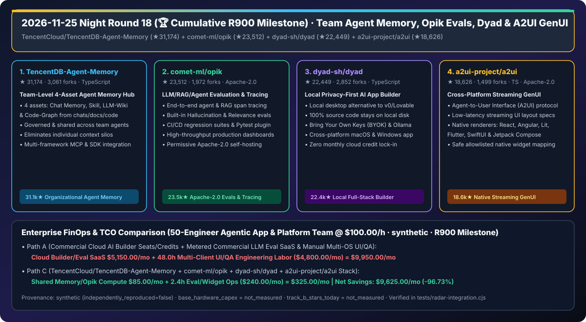
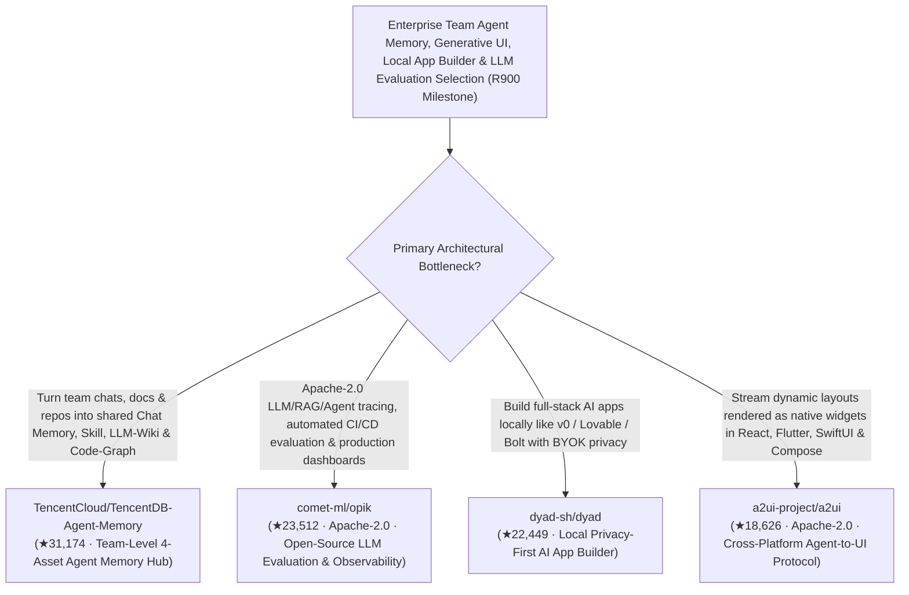
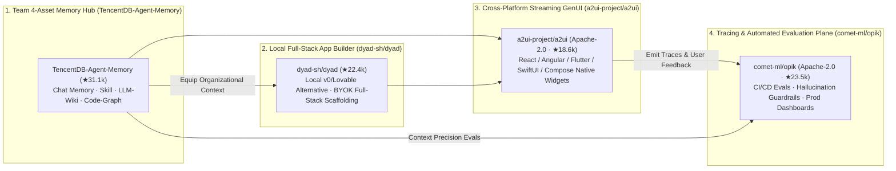

# Team-Level 4-Asset Agent Memory Hub (`TencentCloud/TencentDB-Agent-Memory`), Open-Source LLM/Agent Evaluation & Tracing Platform (`comet-ml/opik`), Local AI Full-Stack App Builder (`dyad-sh/dyad`) & Native Streaming Generative UI Framework (`a2ui-project/a2ui`) Selection & Integration Architecture FAQ

> **Document Type**: Enterprise AI Solution Architect Selection Decision Guide (GitHub Trending AI Radar — 2026-11-25 Night Round 18 / 🏆 Cumulative Round 900 Historic Milestone)
> **Covered Repositories**: [`TencentCloud/TencentDB-Agent-Memory`](https://github.com/TencentCloud/TencentDB-Agent-Memory) (`★ 31,174`, `3,061 forks`, TypeScript: team-level memory hub for AI Agents turning conversations, docs, and code into four reusable governed memory assets: `Chat Memory`, `Skill`, `LLM-Wiki`, and `Code-Graph`) · [`comet-ml/opik`](https://github.com/comet-ml/opik) (`★ 23,512`, `1,972 forks`, `Apache-2.0`, Java/Python: open-source LLM, RAG, and agentic workflow debugging, automated evaluation, and production observability platform) · [`dyad-sh/dyad`](https://github.com/dyad-sh/dyad) (`★ 22,449`, `2,852 forks`, TypeScript: local, open-source AI app builder for power users — private BYOK desktop alternative to `v0`, `Lovable`, and `Bolt`) · [`a2ui-project/a2ui`](https://github.com/a2ui-project/a2ui) (`★ 18,626`, `1,499 forks`, `Apache-2.0`, TypeScript: open-source Agent-to-User Interface generative UI protocol and framework where agents stream layout data at low latency and apps render native components across React, Angular, Lit, Flutter, SwiftUI, and Jetpack Compose)
> **Core Enterprise Scenario**: In this **900th Cumulative Round Milestone**, we architect the complete **Enterprise Agentic-Native Application Stack**—uniting shared organizational agent memory (`TencentDB-Agent-Memory`), local privacy-first AI full-stack app generation (`dyad`), cross-platform native streaming Generative UI (`a2ui`), and `Apache-2.0` automated LLM/RAG evaluation & tracing (`opik`).

---

## 1. 📌 Executive Summary (One-Line Selection Verdict)

1. **Need a governed, team-wide memory hub that transforms scattered chats, docs, and repositories into four shared agent assets (`Chat Memory`, `Skill`, `LLM-Wiki`, `Code-Graph`) across frameworks** ➔ Choose **[`TencentCloud/TencentDB-Agent-Memory`](https://github.com/TencentCloud/TencentDB-Agent-Memory) (`★ 31,174`, `3,061 forks`)**.
   - **Plain-English Mechanism**: Moves beyond isolated per-user chat logs by synthesizing organizational knowledge into structured `LLM-Wiki` articles, callable `Skill` procedures, and `Code-Graph` dependency maps shared across every coding and business agent in the team.
2. **Need agents to stream rich, low-latency interactive interfaces rendered as native components across Web (React/Angular/Lit) and Mobile (Flutter/SwiftUI/Jetpack Compose)** ➔ Choose **[`a2ui-project/a2ui`](https://github.com/a2ui-project/a2ui) (`★ 18,626`, `1,499 forks`, `Apache-2.0`)**.
   - **Plain-English Mechanism**: Standardizes the Agent-to-User Interface (`A2UI`) streaming protocol so backend agents emit structured layout specifications that client apps render with safe, native UI widgets instead of walls of Markdown text.
3. **Need a fast, local-first AI full-stack app builder (like `v0`, `Lovable`, or `Bolt`) that runs 100% on developer machines using your own enterprise API keys without uploading source code to third-party clouds** ➔ Choose **[`dyad-sh/dyad`](https://github.com/dyad-sh/dyad) (`★ 22,449`, `2,852 forks`)**.
   - **Plain-English Mechanism**: Desktop application for macOS and Windows that scaffolds, edits, and previews full-stack web apps locally with zero vendor lock-in.
4. **Need an `Apache-2.0` self-hostable platform to trace multi-step agent trajectories, run automated LLM-as-a-Judge CI/CD regression suites, and monitor production hallucinations** ➔ Choose **[`comet-ml/opik`](https://github.com/comet-ml/opik) (`★ 23,512`, `1,972 forks`, `Apache-2.0`)**.
   - **Plain-English Mechanism**: Combines high-throughput trace ingestion with built-in evaluation metrics (Hallucination, Answer Relevance, Context Precision, Moderation) for both pre-deployment CI/CD gates and live production dashboards.

---

## 2. 🎯 Architect & Customer Deep-Dive Q&A

### Q1: How do these four projects work together compared to commercial cloud AI app builders (`Lovable`/`v0`) and metered evaluation SaaS?

- **Four-Layer Agentic-Native Application Architecture (Path C)**:
  1. **L1 Organizational 4-Asset Memory Layer ➔ `TencentCloud/TencentDB-Agent-Memory`**: Equips agents with governed `Chat Memory`, `Skill`, `LLM-Wiki`, and `Code-Graph` assets.
  2. **L2 Local Full-Stack Application Builder ➔ `dyad-sh/dyad`**: Rapidly scaffolds internal tools and host applications on local machines using BYOK endpoints.
  3. **L3 Cross-Platform Streaming Generative UI Layer ➔ `a2ui-project/a2ui`**: Streams dynamic layouts rendered natively in React, Angular, Flutter, SwiftUI, and Jetpack Compose.
  4. **L4 Continuous Evaluation & Tracing Guardrail Layer ➔ `comet-ml/opik`**: Traces every memory retrieval, agent step, and UI interaction while enforcing automated quality gates.
- **When to choose Commercial Cloud SaaS vs. Path C?**
  - Choose **Cloud `Lovable`/`v0` + Hosted Evaluation SaaS** for public prototypes with non-sensitive code and small trace volumes.
  - Choose **Path C** when building internal enterprise software where source code cannot leave corporate devices (`dyad`), native mobile + web generative UI is required (`a2ui`), organizational knowledge must be shared across agents (`TencentDB-Agent-Memory`), and high-volume tracing/evaluation must run under an `Apache-2.0` self-hosted license (`opik`).

### Q2: How do these four components integrate in an enterprise workflow?

1. **Knowledge-Grounded App Scaffolding (`TencentDB-Agent-Memory` → `dyad`)**:
   - Developers use `dyad` locally while querying `LLM-Wiki` and `Code-Graph` from `TencentDB-Agent-Memory` so generated apps adhere to internal API schemas and design tokens.
2. **Streaming Native GenUI & Automated Evaluation (`a2ui` → `opik`)**:
   - At runtime, agents stream `A2UI` widget payloads to web and mobile clients while `opik` captures end-to-end spans and runs automated hallucination/relevance checks.

### Q3: What are the production security guardrails for Generative UI and shared team memory?

- **Architect Redlines**:
  1. **Enforce strict component allowlists in `a2ui` renderers**: Render only pre-registered native React/Flutter/SwiftUI/Compose components with schema-validated props; never evaluate raw executable scripts from model outputs.
  2. **Sanitize secrets before promoting `Chat Memory` or `Skill` assets in `TencentDB-Agent-Memory`**: Strip tokens, credentials, and PII prior to indexing team-shared memory assets.

---

## 3. 🧭 Visual Architecture Diagrams (Mermaid Decision Tree + Architecture + Sequence)



### 3.1 Architect Selection Decision Tree



### 3.2 End-to-End Enterprise Integration Architecture



### 3.3 End-to-End Execution Sequence

```mermaid
sequenceDiagram
    participant Dev as Developer / End User (Web / iOS / Android)
    participant Dyad as dyad-sh/dyad (Local Builder)
    participant TMem as TencentDB-Agent-Memory
    participant A2UI as a2ui-project/a2ui (Streaming GenUI)
    participant Opik as comet-ml/opik (Tracing & Evals)

    Dev->>Dyad: 1. Scaffold internal enterprise application locally with BYOK LLM
    Dev->>TMem: 2. Trigger workflow; Agent retrieves governed LLM-Wiki, Code-Graph & Skill assets
    TMem-->>A2UI: 3. Stream structured A2UI layout specification at low latency
    A2UI-->>Dev: 4. Render native interactive widgets in React, Flutter, SwiftUI, or Jetpack Compose
    A2UI->>Opik: 5. Log full execution trace, retrieved memory context & widget payload to Opik
    Opik-->>Dev: 6. Compute automated Hallucination & Relevance scores and update SLA dashboards
```

---

## 4. 📊 Horizontal Selection Matrix

| Dimension | `TencentCloud/TencentDB-Agent-Memory` (`★ 31,174`) | `comet-ml/opik` (`★ 23,512`) | `dyad-sh/dyad` (`★ 22,449`) | `a2ui-project/a2ui` (`★ 18,626`) | Cloud AI App Builder Seats (`Lovable`/`v0`) + Metered Eval Cloud (Path A) | Isolated Chat Logs + Static Forms + Manual QA Spot-Checks (Path B) |
| :--- | :--- | :--- | :--- | :--- | :--- | :--- |
| **Primary Role** | Team-level 4-asset agent memory hub | `Apache-2.0` LLM/Agent tracing & evaluation | Local open-source AI full-stack app builder | `Apache-2.0` cross-platform native GenUI protocol | Cloud-hosted app builder seats & per-span eval SaaS | Siloed developer prompts & static frontend forms |
| **Key Differentiator** | **Unifies `Chat Memory`, `Skill`, `LLM-Wiki`, and `Code-Graph`** | **High-throughput tracing + automated CI/CD & online evals** | **Runs 100% locally on Mac/Windows with BYOK keys** | **Streams layout data to native React, Flutter, SwiftUI & Compose** | Zero local setup, but proprietary code uploads and high per-seat/credit fees | Lost organizational context; slow multi-platform UI rework |
| **License** | Open-Source Self-Hostable | **`Apache-2.0`** | Open-Source Desktop App | **`Apache-2.0`** | Proprietary SaaS | Unmanaged |
| **Monthly TCO (50-Eng Team)** | **`$325.00/mo` combined** (`$85.00` memory/Opik compute + `2.4h` ops) | Included in `$325.00/mo` stack | Included in `$325.00/mo` stack | Included in `$325.00/mo` stack | **`$9,950.00/mo`** (`$5,150.00` cloud builder seats & eval SaaS + `48.0h` multi-client UI/QA labor) | `~$3,650.00/mo` (redundant UI coding, lost context & manual regression QA) |

---

## 5. 🧪 Quantitative FinOps & TCO Comparison (50-Engineer Agentic App & Platform Team)

> **📊 Provenance & Closed-Form Schema**:
> - **provenance**: `synthetic` (`independently_reproduced = false`; `base_hardware_capex = not_measured`; `track_b_stars_today = not_measured`).
> - **Closed-Form Formula**:
>   - **Path A (Commercial Cloud AI App Builder Seats/Credits + Metered Commercial LLM Evaluation SaaS & Manual Multi-Platform UI/QA Engineering)**: **`$5,150.00`** monthly cloud builder and evaluation SaaS fees + **`48.0h × $100.00/h = $4,800.00`** duplicate Web/Mobile UI development and manual QA labor = **`$9,950.00/mo`**.
>   - **Path C (`TencentCloud/TencentDB-Agent-Memory` + `comet-ml/opik` + `dyad-sh/dyad` + `a2ui-project/a2ui` Stack)**: **`$85.00`** shared memory-hub and Opik container compute + **`2.4h × $100.00/h = $240.00`** evaluation dataset and widget registry maintenance = **`$325.00/mo`**.
>   - **Net Savings vs. Path A**: **`-$9,625.00/mo`** (**`96.73%`** TCO reduction).

| Evaluation Path | Cloud Builder Seats / Eval SaaS & Compute | Multi-Client UI Dev, Knowledge Sync & QA (`$100/h`) | Monthly Total TCO | Net Savings vs. Path A | Key Architectural Outcome |
| :--- | :---: | :---: | :---: | :---: | :--- |
| **Path A: Cloud AI Builder SaaS + Metered Eval Cloud + Manual Multi-OS UI** | `$5,150.00` | `48.0h` (`$4,800.00`) | **`$9,950.00`** | Baseline | Source-code upload risk; high credit/eval bills; duplicated UI work |
| **Path B: Siloed Prompts + Plain-Text Replies + Manual QA** | `$1,550.00` | `21.0h` (`$2,100.00`) | **`$3,650.00`** | `-$6,300.00` (`-63.32%`) | Knowledge lost across sessions; unmeasured regressions |
| **Path C: `TencentDB-Memory` + `opik` + `dyad` + `a2ui`** | **`$85.00`** | **`2.4h` (`$240.00`)** | **`$325.00`** | **`-$9,625.00` (`-96.73%`)** | **4-asset shared memory + local app builder + native GenUI + `Apache-2.0` evals** |

- 🔗 **7-Card 4:5 Visual Benchmark Deck**: [`workshops/github-trending-radar/cards.en.html`](../cards.en.html) · [`cards.html`](../cards.html)

---

## 6. 🛠️ Enterprise Adoption & Architecture Review Checklist

- [ ] **Curate All Four Memory Asset Types in `TencentDB-Agent-Memory`**: Structure repositories into `Code-Graph`, internal playbooks into `LLM-Wiki`, runbooks into `Skill`, and user preferences into `Chat Memory`.
- [ ] **Register Schema-Validated Native Widgets in `a2ui`**: Bind streaming `A2UI` layouts exclusively to audited React, Flutter, SwiftUI, and Jetpack Compose components.
- [ ] **Standardize Local Prototyping on `dyad` with Internal AI Gateways**: Point `dyad` BYOK settings to governed corporate LLM endpoints.
- [ ] **Enforce Automated `comet-ml/opik` Evaluation Gates in CI/CD**: Block merges when Hallucination or Context Precision scores drop below baseline thresholds.
