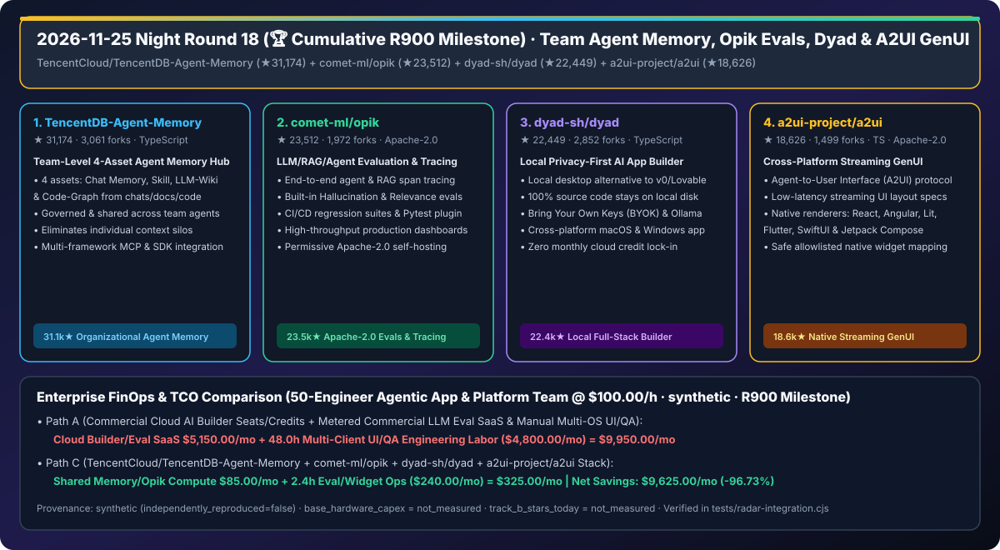
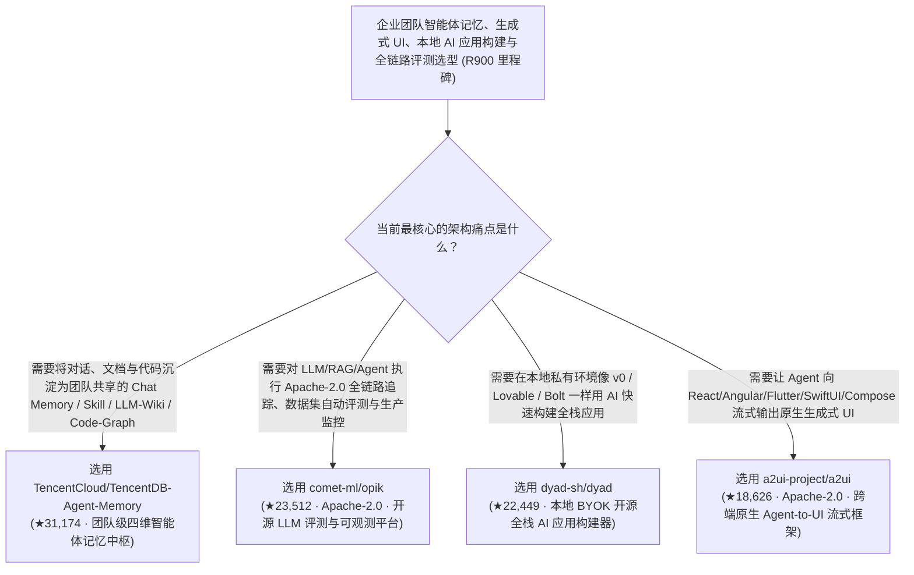
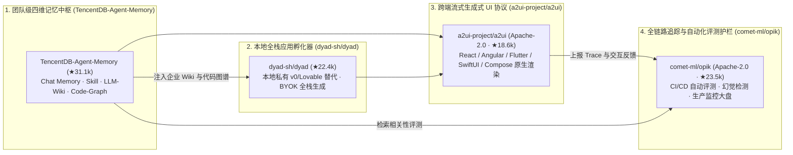
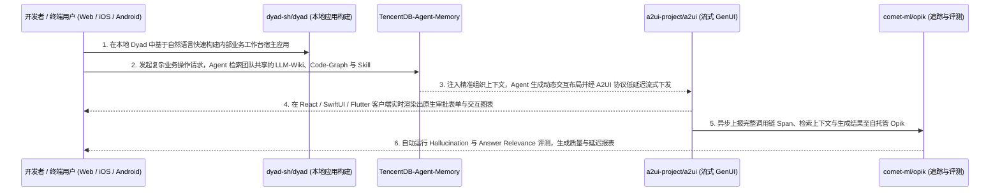

# 团队级四维智能体记忆中枢（`TencentCloud/TencentDB-Agent-Memory`）、开源 LLM/Agent 全链路追踪与自动化评测平台（`comet-ml/opik`）、本地私有全栈 AI 应用构建器（`dyad-sh/dyad`）与跨端原生生成式 UI 协议（`a2ui-project/a2ui`）选型与集成架构 FAQ

> **文档类型**：企业 AI 解决方案架构师（AI Solution Architect）选型决策指南（GitHub Trending AI 雷达 2026-11-25 Night Round 18 / 🏆 累计第 900 轮历史里程碑）
> **覆盖项目**：[`TencentCloud/TencentDB-Agent-Memory`](https://github.com/TencentCloud/TencentDB-Agent-Memory)（`★ 31,174`、`3,061 forks`、TypeScript：3.1 万星团队级智能体记忆中枢，将散落的对话、文档与代码自动沉淀为四类可治理、可跨框架装备的团队记忆资产——`Chat Memory` [会话记忆]、`Skill` [技能]、`LLM-Wiki` [结构化百科] 与 `Code-Graph` [代码图谱]）· [`comet-ml/opik`](https://github.com/comet-ml/opik)（`★ 23,512`、`1,972 forks`、`Apache-2.0`：2.3 万星开源 LLM / RAG / Agent 调试、自动化评测 [Evaluation] 与生产监控平台，内置幻觉检测、上下文相关性打分与高吞吐 Trace 大盘）· [`dyad-sh/dyad`](https://github.com/dyad-sh/dyad)（`★ 22,449`、`2,852 forks`、TypeScript：2.2 万星本地开源 AI 全栈应用构建器，在本地电脑实现类似 `v0` / `Lovable` / `Bolt` 的“自然语言生成全栈应用”，100% 代码留在本地、自带 API Key 零厂商锁定）· [`a2ui-project/a2ui`](https://github.com/a2ui-project/a2ui)（`★ 18,626`、`1,499 forks`、`Apache-2.0`：1.8 万星开源生成式 UI [Agent-to-User Interface] 框架与流式协议，让后端 Agent 实时流式下发动态界面描述，并在 React、Angular、Lit、Flutter、SwiftUI 与 Jetpack Compose 中渲染为原生交互组件）
> **核心场景**：在第 **900 轮**里程碑专题中，我们聚焦企业构建下一代 **Agentic Native（智能体原生）应用** 的四大核心拼图：**“如何让团队里不同人使用的 Claude Code、Cursor 与业务 Agent 共享同一套经过治理的团队记忆、Wiki 与代码图谱（`TencentDB-Agent-Memory`）？如何让后端 Agent 不再只吐冷冰冰的 Markdown 文字，而是在 Web、iOS 与 Android 端实时流式渲染出原生交互表单、审批卡片与动态图表（`a2ui`）？业务与产品团队想在本地安全快速生成一套内部管理后台或原型应用，用什么替代必须上传代码的云端 Lovable/v0（`dyad`）？上线后如何对多步 Agent 与 RAG 进行自动化回归评测与幻觉拦截（`opik`）？”** 本文给出端到端选型与集成蓝图。

---

## 一、📌 核心结论速览（选型一句话结论）

1. **想打破“A 工程师踩过的坑、沉淀的业务规则和代码架构，B 工程师的 Agent 完全不知道”的个人记忆孤岛，建立跨 Agent、跨框架共享的团队级四维记忆底座** ➔ 选 **[`TencentCloud/TencentDB-Agent-Memory`](https://github.com/TencentCloud/TencentDB-Agent-Memory)（`★ 31,174`，`3,061 forks`）**。
   - **通俗原理**：不同于只存零散聊天键值对的个人记忆库，它把团队日常对话、技术文档与代码仓统一提炼成四类可治理的标准资产：**`Chat Memory`（上下文记忆）+ `Skill`（可复用操作技能）+ `LLM-Wiki`（面向大模型优化的结构化知识百科）+ `Code-Graph`（代码调用关系图谱）**，让全团队的 Agent 拥有共同的“组织大脑”。
2. **想让企业智能体走出“纯文本聊天框”，在网页（React/Angular）和手机 App（Flutter/SwiftUI/Jetpack Compose）上根据用户意图实时流式渲染出原生按钮、订单卡片、动态筛选器与交互表单** ➔ 选 **[`a2ui-project/a2ui`](https://github.com/a2ui-project/a2ui)（`★ 18,626`，`1,499 forks`，`Apache-2.0`）**。
   - **通俗原理**：定义了一套极低延迟的流式生成式 UI 协议（Agent-to-User Interface）。后端 Agent 不需要拼凑脆弱的 HTML/iframe，而是流式输出结构化布局协议，由前端预注册的 React/Flutter/SwiftUI 原生安全组件库渲染成符合企业设计规范的动态界面。
3. **业务专家、产品经理或工程师想用自然语言“一句话快速生成完整前后端应用（类似 Lovable / v0 / Bolt）”，但公司安全红线严禁将业务代码托管到外部 SaaS 平台** ➔ 选 **[`dyad-sh/dyad`](https://github.com/dyad-sh/dyad)（`★ 22,449`，`2,852 forks`）**。
   - **通俗原理**：直接装在 Mac 或 Windows 本机的开源 AI 应用构建器（App Builder），连接企业自己的大模型 API Key（或本地 Ollama），在本地文件系统直接生成、预览并热更新全栈 Web 应用，零云端按月订阅费、零代码外泄。
4. **需要对生产环境的 RAG 问答、多智能体工具调用与生成式 UI 进行全链路 Trace 追踪、CI/CD 黄金数据集自动打分（LLM-as-a-Judge）与线上幻觉监控** ➔ 选 **[`comet-ml/opik`](https://github.com/comet-ml/opik)（`★ 23,512`，`1,972 forks`，`Apache-2.0`）**。
   - **通俗原理**：纯 `Apache-2.0` 开源的 LLM 可观测与评测平台，支持每秒高并发写入百万级 Span，内置开箱即用的 Answer Relevance、Hallucination、Context Precision 与 Moderation 评测器，在每次发版前自动拦截退化的 Prompt 与检索链路。

---

## 二、🎯 客户与架构师灵魂拷问 Q&A（深度架构拆解）

### Q1：这四个项目分别补齐了现代企业 AI 架构的哪块短板？与商业云 SaaS（如云端 Lovable/v0 + 商业 APM 按量 Trace）怎么选？

- **四维现代 Agentic 应用技术栈（Path C）**：
  1. **L1 组织级共享记忆与代码图谱层 ➔ `TencentCloud/TencentDB-Agent-Memory`**：统一供给 `Chat Memory`、`Skill`、`LLM-Wiki` 与 `Code-Graph`。
  2. **L2 本地全栈应用快速孵化器 ➔ `dyad-sh/dyad`**：在本地安全生成管理后台、业务看板与原型前端代码。
  3. **L3 跨 Web/iOS/Android 原生生成式 UI 渲染层 ➔ `a2ui-project/a2ui`**：让 Agent 动态输出原生交互控件而非纯文本。
  4. **L4 全链路可观测与自动化评测护栏层 ➔ `comet-ml/opik`**：对记忆检索精度、Agent 决策路径与输出质量执行持续评测。
- **何时选商业云 SaaS vs 自建本轮开源四件套（Path C）？**
  - 若是个人独立开发者做公开 Demo，直接付费订阅云端 Lovable/v0 和云端评测 SaaS 即可。
  - **何时采用本轮开源四件套（Path C）？** 当企业在研发内部核心业务系统（严禁代码上传外部生成式建站云）、需要跨 React Web 与 iOS/Android 原生端统一落地生成式 UI（`a2ui`）、希望将团队经验沉淀为私有 `LLM-Wiki` 与 `Code-Graph`（`TencentDB-Agent-Memory`）、并需要无按条计费焦虑地全量采集生产 Trace 与自动化评测（`opik`）时，Path C 可节省 **96%+** 的商业席位与可观测账单。

### Q2：如何把这四个项目集成到企业研发与业务生产流中？

1. **研发期：团队记忆驱动的本地应用构建（`TencentDB-Agent-Memory` + `dyad`）**：
   - 将企业设计规范、后端接口文档与核心仓库通过 `TencentDB-Agent-Memory` 提炼为 `LLM-Wiki` 与 `Code-Graph`；工程师与产品经理在本地 `dyad` 中调用这些记忆资产，快速生成符合企业规范的前后端应用骨架。
2. **运行期：跨端流式生成式 UI 与闭环评测（`a2ui` + `opik`）**：
   - 线上 Agent 结合 `TencentDB-Agent-Memory` 的上下文，通过 `a2ui` 协议向 React Web 端、SwiftUI iOS 端与 Jetpack Compose Android 端实时流式下发原生业务组件；同时所有检索、推理与 UI 渲染耗时经由 `opik` 全量记录并执行在线幻觉抽检。

### Q3：生成式 UI（`a2ui`）与团队记忆库在生产落地的安全红线是什么？

- **架构师避坑红线**：
  1. **`a2ui` 严禁动态执行任意 JS 代码，只允许白名单组件映射**：客户端渲染器只接收结构化布局与受控 Props，将其映射到经过安全审计的本地原生组件库（如受控表单、图表、确认弹窗），彻底杜绝 XSS 与任意代码注入。
  2. **团队记忆入库前必须经过敏感凭据脱敏与权限分级**：向 `TencentDB-Agent-Memory` 沉淀 `Chat Memory` 与 `Skill` 时，必须开启正则/NER 密钥剥离，并按项目组隔离读写权限。

---

## 三、🧭 直观可视化图解（Mermaid 决策树 + 集成架构 + 时序图）

### 3.1 架构师选型决策树

### 3.2 企业端到端生产集成参考架构图

### 3.3 团队记忆检索、跨端原生生成式 UI 流式渲染与 Opik 自动化评测时序图

---

## 四、📊 同类开源与商业云服务横向选型决策矩阵

| 对比维度 | `TencentCloud/TencentDB-Agent-Memory` (`★ 31,174`) | `comet-ml/opik` (`★ 23,512`) | `dyad-sh/dyad` (`★ 22,449`) | `a2ui-project/a2ui` (`★ 18,626`) | 商业云端建站 SaaS (Lovable/v0 Teams) + 商业按量 LLM 评测云 (Path A) | 无共享记忆 + 纯文本 Markdown 回复 + 人工抽查日志 (Path B) |
| :--- | :--- | :--- | :--- | :--- | :--- | :--- |
| **核心能力定位** | 团队级四维智能体记忆中枢 | `Apache-2.0` LLM 追踪、评测与监控平台 | 本地私有全栈 AI 应用构建器 | `Apache-2.0` 跨端原生流式生成式 UI 框架 | 按席位/按积分计费的云端建站与按 Span 计费评测 SaaS | 散装单人聊天记录 + 静态手写前端页面 |
| **核心技术突破** | **统一沉淀 `Chat Memory` / `Skill` / `LLM-Wiki` / `Code-Graph`** | **从 CI/CD 离线回归评测到线上高吞吐监控一体贯通** | **本机直接生成运行全栈应用、零代码上云、自带 Key** | **一套流式协议同时驱动 Web (React/Angular) 与移动端 (Flutter/SwiftUI/Compose)** | 开箱即用，但企业核心业务代码无法上传外部建站 SaaS | 团队经验无法复用；所有复杂交互都只能退化为大段文本阅读 |
| **开源协议** | 开源可自托管 | **`Apache-2.0`** | 开源桌面构建器 | **`Apache-2.0`** | 闭源商业 SaaS | 无治理 |
| **月度 TCO（50 人团队）** | **四件套合建仅 `$325.00/月`**（`$85.00` 记忆库与 Opik 容器算力 + `2.4h` 维护） | 同左（`Apache-2.0` 无限 Trace/Eval 零按条计费） | 同左（免除全员云端 AI 建站席位与额外积分包） | 同左（跨 Web/iOS/Android 复用同一套动态 UI 协议） | **`$9,950.00/月`**（`$5,150.00` 云端建站席位/商业评测账单 + `48.0h` 跨端 UI 重复开发与排障） | 约 `$3,650.00/月`（大量重复造轮子、上下文丢失与线上幻觉漏检返工） |

---

## 五、🧪 应用落地定量收益/TCO 对比与 7-Card 报告

> **📊 数据来源与闭式核算声明（Provenance & Closed-Form Schema）**：
> - **provenance**: `synthetic`（基于 50 人企业智能体原生应用研发、跨端前端与质量评测团队月度工作负载模型：`independently_reproduced = false`；硬件采购基线 `base_hardware_capex = not_measured`；Track B 单日增量 `track_b_stars_today = not_measured`）。
> - **核算公式**：
>   - **Path A（采购商业云端 AI 建站 SaaS 团队席位与算力包 + 按 Trace/Eval 条数计费的商业 LLM 可观测云 + 手工在 Web/iOS/Android 三端重复编写静态交互界面与重复排查团队知识断层）**：月度商业建站席位与商业评测 SaaS 账单 **`$5,150.00`** + 跨端 UI 重复开发、团队上下文同步与人工回归测试工时 **`48.0h × $100.00/h = $4,800.00`** = **`$9,950.00/月`**。
>   - **Path C（自建 `TencentCloud/TencentDB-Agent-Memory` + `comet-ml/opik` + `dyad-sh/dyad` + `a2ui-project/a2ui` 智能体原生应用与评测闭环栈）**：内网记忆库存储与 `Opik` 容器算力分摊 **`$85.00`** + 评测集与组件白名单日常维护人工 **`2.4h × $100.00/h = $240.00`** = **`$325.00/月`**。
>   - **净节省（Net Savings vs Path A）**：**`-$9,625.00/月`**（成本降低 **`96.73%`**）。

| 评估方案 | 云端建站席位 / 商业评测账单与算力成本 | 跨端 UI 开发、知识同步与人工评测工时（`$100/h`） | 月度总 TCO | 相对 Path A 净节省 | 核心业务交付收益 |
| :--- | :---: | :---: | :---: | :---: | :--- |
| **Path A：商业云端 AI 建站 SaaS + 商业按量评测云 + 三端手写 UI** | `$5,150.00` | `48.0h` (`$4,800.00`) | **`$9,950.00`** | Baseline | 源码外传合规受阻；全量评测账单高昂；多端 UI 割裂 |
| **Path B：无团队记忆库 + 纯文本回复 + 手工抽样回归测试** | `$1,550.00` | `21.0h` (`$2,100.00`) | **`$3,650.00`** | `-$6,300.00` (`-63.32%`) | 组织经验随会话清空流失；发版缺乏自动化回归质量门禁 |
| **Path C：`TencentDB-Memory` + `opik` + `dyad` + `a2ui`** | **`$85.00`** | **`2.4h` (`$240.00`)** | **`$325.00`** | **`-$9,625.00` (`-96.73%`)** | **四维共享记忆 + 本地全栈建站 + 跨端原生 GenUI + 自动化评测** |

- 🔗 **关联 7-Card 4:5 视觉评测报告**：[`workshops/github-trending-radar/cards.html`](../cards.html) · [`cards.en.html`](../cards.en.html)

---

## 六、🛠️ 企业引入与架构评审 Checklist

- [ ] **在 `TencentDB-Agent-Memory` 中按四类资产分层治理**：将项目架构文档沉淀为 `LLM-Wiki`、核心代码仓建立 `Code-Graph`、标准排障动作封装为 `Skill`、用户偏好存入 `Chat Memory`。
- [ ] **在 `a2ui` 客户端注册严格受控的原生组件白名单**：确保 React、Flutter、SwiftUI 与 Jetpack Compose 渲染器仅消费经过 Schema 校验的布局数据。
- [ ] **使用 `dyad` 在内网本地孵化业务应用并纳入 Git 版本控制**：严禁将包含企业私有接口定义的代码上传至外部公共建站云。
- [ ] **将 `comet-ml/opik` 嵌入 CI/CD 流水线**：每次修改 Prompt、更新 `LLM-Wiki` 或升级模型前，自动运行黄金测试集并校验得分阈值。
