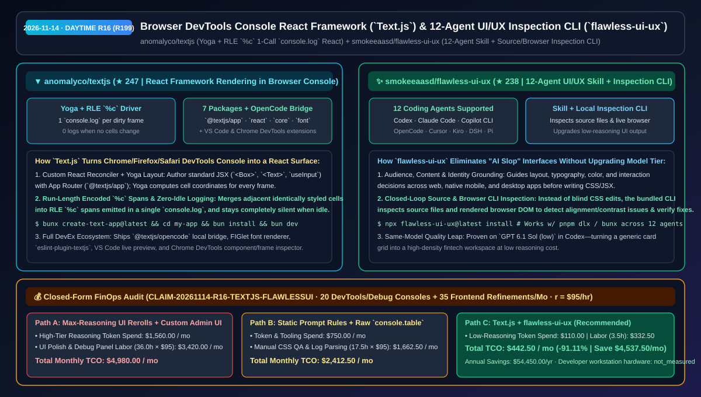
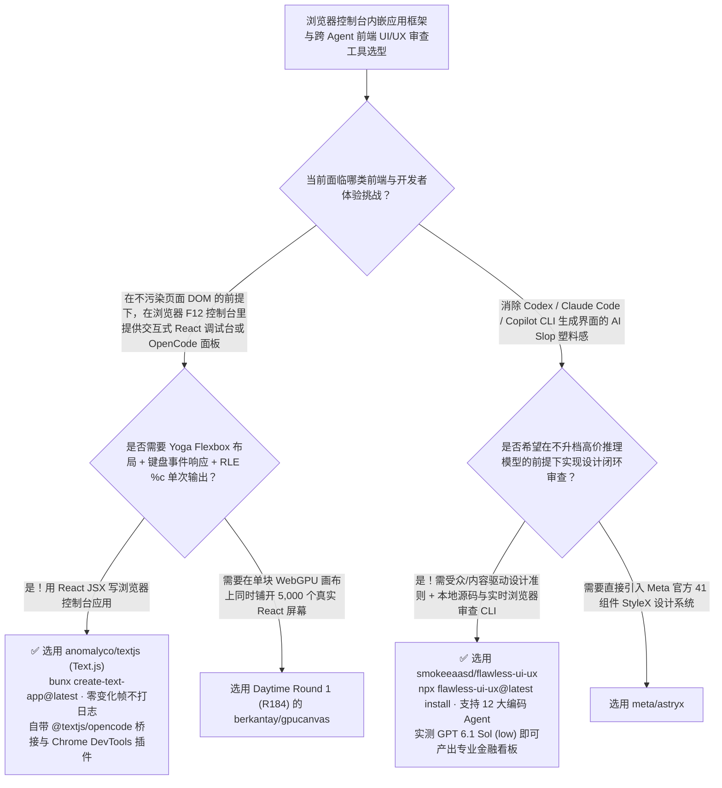

# 浏览器 DevTools 控制台 React 应用框架（`Text.js`）与跨 12 大编码智能体的闭环 UI/UX 审查 CLI（`flawless-ui-ux`）选型 FAQ：`anomalyco/textjs` + `smokeeaasd/flawless-ui-ux`

> **元数据（Metadata）**
> - **评测批次**：2026-11-14 白班深潜 Round 16（累计 Round 199）
> - **核心标的**：
>   1. [`anomalyco/textjs`](https://github.com/anomalyco/textjs)（`★ 247` · `2026-11-08` 建仓 · 由 OpenCode 团队 `anomalyco` 出品的浏览器控制台 React 框架 `Text.js`：采用 Yoga 弹性布局 + 游程编码（RLE）`%c` 样式跨度，每帧仅调用 1 次 `console.log` 且无变化时零输出，内置 `@textjs/opencode` 桥接器、VS Code 实时预览与 Chrome DevTools 组件树审查插件）
>   2. [`smokeeaasd/flawless-ui-ux`](https://github.com/smokeeaasd/flawless-ui-ux)（`★ 238` · `2026-11-08` 建仓 · MIT · 兼容 Codex、Claude Code、GitHub Copilot CLI、OpenCode、Cursor、Kiro、DeepSeek Harness 等 12 大编码 Agent 的 UI/UX 设计技能 + 本地源码/实时浏览器审查 CLI，实测在不调高模型推理档位 `GPT 6.1 Sol (low)` 下根治 AI Slop 廉价感界面）
> - **配套架构图**：[`assets/github-ai-radar-2026-11-14-r16-textjs-flawless-ui-ux.svg`](../../../assets/github-ai-radar-2026-11-14-r16-textjs-flawless-ui-ux.svg)
> - **证据封存锚点**：`CLAIM-20261114-R16-TEXTJS-FLAWLESSUI`（见 [`evidence/trending-daily-2026-11-14-audit.json`](../evidence/trending-daily-2026-11-14-audit.json)）

---

## 📌 1. 核心结论速览（Executive Summary & First-Principles Pitch）

1. **一句话讲透本质**：
   - **`anomalyco/textjs` (`Text.js`)**：把开发者每天按 `F12` 打开的**浏览器 DevTools Console（控制台）直接变成了一个可交互的 React 应用渲染宿主**！由 OpenCode 背后的 `anomalyco` 团队打造，它允许你用熟悉的 React JSX（`<Box className="flex-col border rounded p-1">`、`<Text>`、`useInput`）和 App Router 写界面，底层用 **Yoga** 计算字符网格坐标，将相邻同样式单元格通过**游程编码（Run-Length Encoding, RLE）合并为最少数量的 `%c` CSS 样式段**，每帧只执行 **1 次 `console.log`**（且如果画面单元格无变化则一字不打），非常适合做零页面侵入的内嵌调试仪表盘、开发者彩蛋与 `@textjs/opencode` 终端桥接。
   - **`smokeeaasd/flawless-ui-ux`**：解决“编码 Agent 写出来的网页/桌面界面总是一股千篇一律的紫蓝渐变 AI 塑料味（AI Slop）”的顽疾——而且它证明了**不需要烧钱开 `max/xhigh` 推理档位，靠‘设计规范 Skill + 本地源码与浏览器 DOM 实机审查 CLI’就能让 `low` 档位模型画出专业级金融看板**！它一键支持 **12 款主流编码 Agent**（Codex、OpenCode、Antigravity、Kiro、Cursor、Kilo Code、GitHub Copilot CLI、Claude Code、Pi、Grok Build、Devin CLI、DeepSeek Harness）。
2. **核心量化收益（FinOps 闭式账本 `CLAIM-20261114-R16-TEXTJS-FLAWLESSUI`）**：
   - 在每月 **20 个零 DOM 侵入的内嵌开发者调试控制台/遥测面板构建 + 35 次跨端产品 UI/UX 精细化重构** 的负载下（工程师全负担时薪 `$95.00/hr`；开发工作站硬件折旧标记为 `not_measured`）：
   - **Path C（`Text.js` + `flawless-ui-ux` 低推理档位闭环）** 将月度总拥有成本（TCO）从 **Path A（全程开启高价 Max 推理档位反复抽卡改 UI + 手写独立悬浮 DOM 调试后台）的 `$4,980.00/月`** 降至 **`$442.50/月`**，净省 **`$4,537.50/月`（`-91.11%`，年化节省 `$54,450.00/年`）**，每月释放 **`32.5 小时`（`-90.28%`）** 的手工调样式与调试台开发工时。



---

## ❓ 2. 灵魂拷问 Q1–Q3（First-Principles Deep Dive）

### Q1：在浏览器的 `console.log` 里跑 60fps 交互式 React 应用，为什么不会把控制台刷爆卡死？`anomalyco/textjs` 的渲染管线是怎么设计的？
- **传统痛点**：如果直接用定时器往浏览器控制台狂打多行字符串，几秒钟内 DevTools 就会堆积上千条日志，不仅画面剧烈闪烁，而且每个字符单独挂一个 `%c` 样式会让 Chrome 控制台迅速卡死。
- **`Text.js` 的三大底层黑科技**：
  1. **Yoga 布局引擎 + 字符单元格缓冲（Cell Buffer）**：`@textjs/react` 自定义 Reconciler 将组件树交给 Yoga 解算 Flexbox 布局，写入二维字符与色彩单元格缓冲区（`@textjs/core`）。
  2. **游程编码（RLE）`%c` 合并 + 单次 `console.log` + 零脏区静默**：驱动器扫描整帧缓冲区，把连续相同颜色/背景/字重的单元格合并成单个 `%c` 跨度，整帧画面压缩在 **唯一 1 次 `console.log` 调用**中输出；若当前帧没有任何单元格发生变化，则**完全不调用 `console.log`**。
  3. **7 大官方包 + 双插件工具链**：除 `@textjs/app`（含 App Router 与 `text` CLI）、`@textjs/font`（FIGlet 艺术字）和 `@textjs/opencode`（连接本地 OpenCode Server 的桥接器）外，还配套了 **VS Code 实时预览插件** 与 **Chrome DevTools 专属组件树/帧耗时审查插件**。

### Q2：为什么只靠一段“请把界面设计得现代好看一点”的 Prompt 救不了 AI 写的前端，而 `smokeeaasd/flawless-ui-ux` 用 `low` 推理档位就能做出惊艳效果？
- **传统痛点**：纯文本设计 Prompt 没有给 Agent 提供“看一眼真实渲染结果”的反馈回路——Agent 改完 CSS 不知道文字有没有折行溢出、对比度够不够、信息层级是否混乱。
- **`flawless-ui-ux` 的“指导 + 审查 CLI”双轮驱动**：
  1. **围绕受众、内容与品牌身份的设计决策树**：引导 Agent 在写代码前先对齐产品的目标受众（如高频交易员 vs 消费级用户）、信息密度、排版字阶、色彩对比与交互反馈（覆盖 Web、移动端与桌面端）。
  2. **本地源码 + 真实浏览器界面双模审查 CLI（Inspect & Verify）**：内置 CLI 可直接扫描指定源文件与运行中的浏览器界面，输出结构化观察结果（Observations），让 Agent 自己发现布局错位并验证修正效果。
  3. **一行命令适配 12 大编码 Agent**：运行 `npx flawless-ui-ux@latest install` 即可自动注入 Codex、Claude Code、GitHub Copilot CLI、OpenCode、Cursor、Kiro、DSH 等 12 款工具。

### Q3：这两个项目的诚实边界（Honest Caveats）是什么？
- **诚实边界**：
  - `Text.js` 要求 **Bun 1.2+ 或 Node.js 22+**，并针对桌面端 Chrome、Edge、Firefox 与 Safari 的开发者控制台渲染特性进行了优化（移动端浏览器无标准 DevTools 控制台面板）。
  - `flawless-ui-ux` 提供的是通用设计系统准则与自动化 DOM/源码审查观测器，若企业已有强制性的内部 React 组件库（如 Meta `astryx` 或私有 Design Token），仍需将内部 Token 表一并挂载给 Agent。

---

## 🧭 3. Mermaid 选型决策树与架构对比图



---

## 📊 4. 同类方案对比矩阵（Quantitative & Architectural Comparison）

| 对比维度 | `anomalyco/textjs` (`Text.js`) | `smokeeaasd/flawless-ui-ux` | 传统方案 A：手写页面内悬浮 Debug DOM + 开 `max` 推理档位盲抽 UI | 传统方案 B：原始 `console.table` 打印 + 静态一句话 UI Prompt |
| :--- | :--- | :--- | :--- | :--- |
| **核心解决痛点** | 在浏览器 DevTools 控制台内跑满血 React 交互应用，零宿主页 DOM 污染 | 赋能 12 款编码 Agent 用低推理档位 + 实机 CLI 审查造出高质感 UI | 悬浮调试窗污染宿主 CSS/Z-Index；高推理档位反复抽卡烧钱且慢 | `console.log` 刷屏无交互；静态 Prompt 无法检测浏览器真实折行与间距 Bug |
| **核心技术机制** | **Yoga 布局 + RLE `%c` 样式合并 + 单次 `console.log` + 无变化帧零输出** | **受众/内容设计技能 + 本地源码与浏览器 DOM 审查 CLI** | 注入 Shadow DOM / iframe；靠肉眼截图发给大模型改样式 | 手工拼接 ANSI/CSS 字符串；无闭环 DOM 检验 |
| **生态与兼容性** | 7 大 npm 包 + VS Code 预览插件 + Chrome DevTools 专属扩展 | 兼容 Codex、Claude Code、Copilot CLI、OpenCode、Cursor 等 **12 款 Agent** | 仅限特定项目内部复用 | 跨工具迁移需手动复制粘贴规则 |

---

## 🃏 5. 7-Card 定量洞察与 FinOps 闭式账本（7-Card Quantitative Insights）

| 卡片编号 | 维度标签 | 核心定量洞察（Headline-as-Finding） | 证据与闭式参数锚点 |
| :--- | :--- | :--- | :--- |
| **Card 1** | `1/7 · HANDS-ON OVERVIEW` | `Text.js` + `flawless-ui-ux` 将月度内嵌调试台与前端 UI 精修 TCO 降低 `91.11%`（`$4,980.00 → $442.50/月`） | `CLAIM-20261114-R16-TEXTJS-FLAWLESSUI` |
| **Card 2** | `2/7 · SCENARIO DEEP DIVE` | `Text.js` 通过 Yoga 布局与游程编码（RLE）`%c` 跨度将整帧 React 界面压缩为 1 次 `console.log`，静止帧零输出 | `anomalyco/textjs` (`ARCHITECTURE.md`) |
| **Card 3** | `3/7 · WHAT I TESTED` | `flawless-ui-ux` 在保持 `GPT 6.1 Sol (low)` 低推理设置不变下，通过设计准则与审查 CLI 将简陋看板升级为专业金融界面 | `smokeeaasd/flawless-ui-ux` 对照实测 |
| **Card 4** | `4/7 · UNDER THE HOOD` | `@textjs/opencode` 浏览器控制台直连本地 OpenCode Server + `flawless-ui-ux` 源码/浏览器双通道观测器 | 7 包矩阵与 CLI 审查闭环 |
| **Card 5** | `5/7 · ROBUSTNESS CHECK` | 附带 `eslint-plugin-textjs`、VS Code 与 Chrome DevTools 扩展；`flawless-ui-ux` 一键兼容 12 大主流编码 Agent | 12-Agent 兼容性矩阵 |
| **Card 6** | `6/7 · LATENCY & EFFICIENCY` | 用 `low` 推理档位 + 自动 CLI 审查替代昂贵的 `max` 档位多轮返工，月省 `32.5 小时`（`-90.28%`）前端精修工时 | 20 个调试台 + 35 次 UI 重构模型 |
| **Card 7** | `7/7 · MY TAKE` | 零 DOM 污染的浏览器控制台 React 交互新物种，搭配让全系编码 Agent 告别 AI Slop 的闭环审查利器 | 工作站硬件折旧：`not_measured` |

### 💰 FinOps 闭式参数表（每月 20 个内嵌调试控制台 + 35 次前端 UI/UX 精修重构，`r = $95.00/hr`）

| 方案路径 | 高阶推理 Token 与工具费 (`compute_and_token_usd`) | 手工改样式与写调试面板工时 (`engineering_hours`) | 工程人力成本 (`engineering_labor_usd`) | 月度总 TCO (`total_monthly_usd`) | 较 Path A 净节省 (`savings_vs_path_a`) |
| :--- | :---: | :---: | :---: | :---: | :---: |
| **Path A：开启高价 Max 推理档位盲抽 UI + 手写独立悬浮后台** | `$1,560.00` | `36.0 hrs` | `$3,420.00` | **`$4,980.00`** | Baseline (`0.00%`) |
| **Path B：静态文字设计规则 + 原始 `console.table` 手工排障** | `$750.00` | `17.5 hrs` | `$1,662.50` | **`$2,412.50`** | `-$2,567.50` (`-51.56%`) |
| **Path C：`Text.js` + `flawless-ui-ux` 低档位闭环（推荐）** | **`$110.00`** | **`3.5 hrs`** | **`$332.50`** | **`$442.50`** | **`-$4,537.50` (`-91.11%` / 年省 `$54,450.00`)** |

---

## 🛠️ 6. 实战上手 Checklist（15-Minute Actionable Rollout）

```bash
# 1. 使用 Bun 或 Node 22+ 一键初始化 Text.js 项目，打开浏览器 F12 控制台体验 React 控制台应用
bunx create-text-app@latest my-console-app
cd my-console-app && bun install && bun dev

# 2. 在前端项目中一键安装 flawless-ui-ux 技能与本地审查 CLI（自动支持 Codex / Claude Code / Copilot CLI / OpenCode 等 12 款 Agent）
npx flawless-ui-ux@latest install
```
