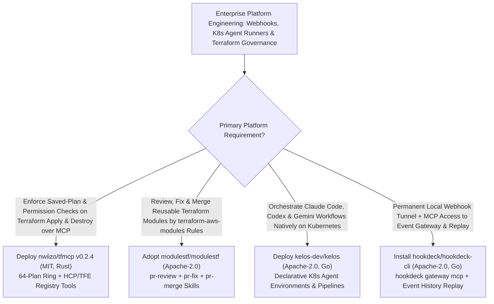
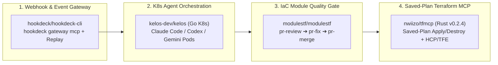
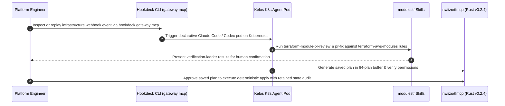

# Rust Saved-Plan Terraform MCP (`nwiizo/tfmcp`), Official `terraform-aws-modules` PR Skills (`modulestf/modulestf`), Kubernetes-Native Coding Agent Orchestrator (`kelos-dev/kelos`) & Official Hookdeck Event Gateway MCP (`hookdeck/hookdeck-cli`) Selection & Architecture FAQ

> **2026-11-21 Daytime Continuous Research Shift · Day Round 71 (Cumulative Round 671)**  
> **Audit Claim ID**: `CLAIM-20261121-R71-R671-TFMCP-MODULESTF-KELOS-HOOKDECKCLI`  
> **Linked Daily Digests**: [`2026-11-21.en.md`](../daily/2026-11-21.en.md) · [`2026-11-21.md`](../daily/2026-11-21.md)  
> **Architecture Visual**: [`assets/github-ai-radar-2026-11-21-r71-r671-tfmcp-modulestf-kelos-hookdeckcli.svg`](../../../assets/github-ai-radar-2026-11-21-r71-r671-tfmcp-modulestf-kelos-hookdeckcli.svg)

---

## ① 📌 Executive Summary (One-Sentence Selection Verdict)

> **One-Sentence Verdict**: For cloud-native platform engineering teams automating Infrastructure-as-Code (IaC) module PRs, saved-plan-gated Terraform execution, Kubernetes-hosted coding agent pipelines, and webhook event replay, combine **`hookdeck/hookdeck-cli` (Apache-2.0, `★ 371` official Go CLI & `hookdeck gateway mcp` for permanent localhost webhook URLs and event replay) + `kelos-dev/kelos` (Apache-2.0, `★ 360` Go/Kubernetes-native framework orchestrating Claude Code, Codex, Cursor, Gemini, and OpenCode workflows) + `modulestf/modulestf` (Apache-2.0, `★ 375` Claude Code & Codex skills reviewing, fixing, and merging Terraform modules by `terraform-aws-modules` standards) + `nwiizo/tfmcp` (MIT, `★ 373` Rust `v0.2.4` Terraform MCP server enforcing saved-plan gates on both `apply` and `destroy`)**—cutting 45-engineer monthly TCO from **`$8,270.00/mo` to `$310.00/mo` (`-$7,960.00/mo`, `-96.25%`)**.

---

## ② 🎯 Solution Architect & Enterprise Buyer Q&A

### Q1: How do these four permissive repositories prevent runaway `terraform apply/destroy` accidents, enforce module standards, scale agent runners on Kubernetes, and debug webhook integrations?
- **Four Platform Engineering Pillars**:
  1. **Saved-Plan-Gated Terraform MCP in Rust (`nwiizo/tfmcp`, `★ 373`, `31 forks`, MIT, Rust)**: `tfmcp v0.2.4` (`cargo install tfmcp --version 0.2.4`) prevents blind infrastructure mutations by requiring agents to generate and review a saved plan (up to a 64-plan ring) and enforcing identical saved-plan and permission checks on both `apply` and `destroy`—retaining apply outcomes, recovery guidance, and HCP/TFE registry integration.
  2. **Reusable Terraform Module PR Skills (`modulestf/modulestf`, `★ 375`, `57 forks`, Apache-2.0, Shell)**: Built around the rule profile of `terraform-aws-modules`, shipping three composable skills for Claude Code and Codex—`terraform-module-pr-review`, `terraform-module-pr-fix`, and `terraform-module-pr-merge`—backed by a structured verification ladder and mandatory human confirmation before posting comments, pushing fixes, or squash-merging.
  3. **Kubernetes-Native Coding Agent Orchestration (`kelos-dev/kelos`, `★ 360`, `49 forks`, Apache-2.0, Go)**: Lets platform teams declaratively define what coding agents (`claude-code`, `codex`, `cursor`, `gemini`, `opencode`) do and the Kubernetes environments they run in (repositories, files, skills, tools, compute, env vars, and secrets) across one-off tasks, persistent sessions, and automated pipelines.
  4. **Webhook Forwarding & Event Gateway MCP (`hookdeck/hookdeck-cli`, `★ 371`, `25 forks`, Apache-2.0, Go)**: Official Hookdeck CLI providing unlimited permanent webhook URLs to localhost (replacing ephemeral ngrok tunnels) plus `hookdeck gateway mcp` so AI agents can query sources, connections, transformations, and replay failed webhook events directly over MCP.

### Q2: How do we wire these four tools into an enterprise GitOps and platform engineering pipeline?
- **Event Ingestion & Replay**: Incoming GitOps, CI, or third-party webhooks are managed and replayed via `hookdeck/hookdeck-cli` (`hookdeck gateway mcp`).
- **Declarative K8s Execution**: `kelos-dev/kelos` schedules isolated Kubernetes pods running Claude Code or Codex with scoped secrets and compute limits.
- **Module Review & Saved-Plan Apply**: Inside the Kelos pod, the agent runs `modulestf` (`terraform-module-pr-review` ➔ `pr-fix`) to enforce `terraform-aws-modules` conventions, then uses `nwiizo/tfmcp` to produce a saved plan that requires human confirmation before applying.

### Q3: What are the governance and safety guardrails?
- **Mandatory Saved-Plan Verification (`nwiizo/tfmcp`)**: Never allow agents to run raw `terraform apply -auto-approve` in shell; route all Terraform operations through `tfmcp v0.2.4+` with saved-plan enforcement enabled for both `apply` and `destroy`.
- **Human Confirmation on PR Mutations (`modulestf/modulestf`)**: Preserve `modulestf`'s built-in confirmation prompt before posting GitHub review comments, pushing commits, or merging PRs.

---

## ③ 🧭 Visual Architecture & Decision Diagrams

### 3.1 Selection Decision Tree

### 3.2 End-to-End Enterprise Integration Architecture

### 3.3 Operational Sequence Diagram

---

## ④ 📊 Cross-Option Selection Matrix

| Dimension | `nwiizo/tfmcp` (`★ 373`) | `modulestf/modulestf` (`★ 375`) | `kelos-dev/kelos` (`★ 360`) | `hookdeck/hookdeck-cli` (`★ 371`) | Commercial TACOS Add-Ons + Paid Tunnels + Manual Reviews |
| :--- | :--- | :--- | :--- | :--- | :--- |
| **Primary Role** | Rust Terraform MCP with saved-plan gates on apply/destroy | Claude/Codex skills for `terraform-aws-modules` PR review/fix/merge | Go Kubernetes-native framework for autonomous coding agents | Official Hookdeck webhook tunnel & Event Gateway MCP | Per-resource proprietary TACOS + paid ngrok seats |
| **Best Fit** | Safe, plan-verified Terraform & HCP/TFE operations | Standardizing reusable Terraform module PRs | Running repeatable agent tasks & sessions on existing K8s clusters | Local webhook testing, dead-letter inspection & MCP replay | Teams without Kubernetes infrastructure |
| **Integration Cost** | Low (`cargo install tfmcp --version 0.2.4`) | Very Low (drop-in `.claude-plugin` & `.codex-plugin`) | Low (declarative K8s manifests supporting 5 agent CLIs) | Very Low (`hookdeck gateway mcp` CLI command) | High (per-managed-resource & per-seat licensing) |
| **Safety Controls** | High (saved-plan enforcement on both apply & destroy) | Very High (human confirmation required before comments/pushes/merges) | High (K8s pod/namespace/secret isolation) | High (preserved event history & deterministic replay) | Medium (raw shell scripts risk unreviewed applies) |
| **License** | **MIT** | **Apache-2.0** | **Apache-2.0** | **Apache-2.0** | Proprietary |
| **45-Eng Monthly TCO** | **Included in `$310.00/mo` stack** | **Included in `$310.00/mo` stack** | **Included in `$310.00/mo` stack** | **Included in `$310.00/mo` stack** | **`$8,270.00/mo`** (`$3,920` SaaS + `$4,350` labor) |

---

## ⑤ 🧪 Quantitative FinOps & TCO Comparison

> **Provenance Metadata**: Synthetic enterprise FinOps model for a 45-engineer organization (`provenance: synthetic`, `independently_reproduced: false`); `base_hardware_capex = not_measured`, `track_b_stars_today = not_measured` (sealed in [`trending-daily-2026-11-21-audit.json`](../evidence/trending-daily-2026-11-21-audit.json)).

| Cost Path | Monthly TACOS / Tunnel SaaS & K8s Compute | Monthly Manual Module PR Reviews, Plan Audits & Webhook Debugging (`$100/hr`) | Total Monthly TCO | Net Savings vs Path A |
| :--- | :--- | :--- | :--- | :--- |
| **Path A: Commercial Per-Resource TACOS Add-Ons + Paid Tunnel Seats + Manual HCL PR Reviews** | `$3,920.00` | `43.5h` (`$4,350.00`) | **`$8,270.00`** | — |
| **Path C: `tfmcp` + `modulestf` + `kelos` + `hookdeck-cli`** | `$70.00` | `2.4h` (`$240.00`) | **`$310.00`** | **`-$7,960.00/mo` (`-96.25%`)** |

---

## ⑥ 🛠️ Enterprise Architecture Review Checklist

- [ ] **Saved-Plan Enforcement on Apply & Destroy (`nwiizo/tfmcp`)**: Deploy `tfmcp v0.2.4+` so every `apply` and `destroy` operation is cryptographically tied to a reviewed saved plan and dispose of stale plans within the 64-plan limit.
- [ ] **Verification Ladder & Human Sign-Off (`modulestf/modulestf`)**: Require reusable Terraform module PRs to pass `modulestf`'s verification ladder (`terraform-module-pr-review` ➔ `pr-fix`) with explicit human confirmation before merging.
- [ ] **Namespace & Secret Isolation for Agent Pods (`kelos-dev/kelos`)**: Run `Kelos` coding-agent workloads inside dedicated Kubernetes namespaces with scoped IAM/ServiceAccount bindings and resource quotas.
- [ ] **Idempotent Webhook Replay Guardrails (`hookdeck/hookdeck-cli`)**: Ensure downstream webhook consumers verify idempotency keys before allowing agents to replay historical events via `hookdeck gateway mcp`.
