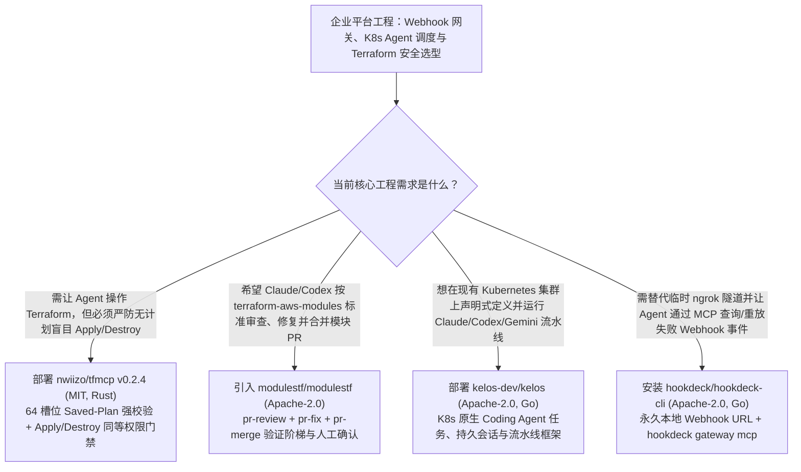
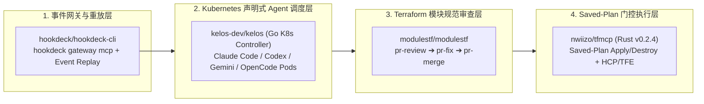
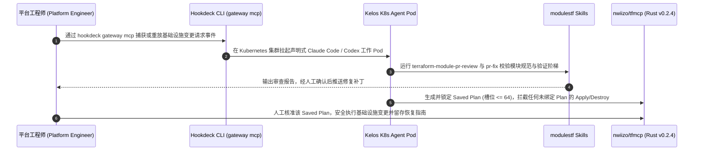

# Rust 预存计划门控 Terraform MCP（`nwiizo/tfmcp`）、`terraform-aws-modules` 官方规范审查修复技能集（`modulestf/modulestf`）、Kubernetes 原生 Coding Agent 编排框架（`kelos-dev/kelos`）与 Hookdeck 官方事件网关与回放 MCP（`hookdeck/hookdeck-cli`）架构选型与落地 FAQ

> **2026-11-21 白天持续研究班次 · Day Round 71（累计 Round 671）**  
> **审计凭据**：`CLAIM-20261121-R71-R671-TFMCP-MODULESTF-KELOS-HOOKDECKCLI`  
> **关联日刊**：[`2026-11-21.md`](../daily/2026-11-21.md) · [`2026-11-21.en.md`](../daily/2026-11-21.en.md)  
> **可视化架构图**：[`assets/github-ai-radar-2026-11-21-r71-r671-tfmcp-modulestf-kelos-hookdeckcli.svg`](../../../assets/github-ai-radar-2026-11-21-r71-r671-tfmcp-modulestf-kelos-hookdeckcli.svg)

---

## ① 📌 核心结论速览（选型一句话结论）

> **一句话选型结论**：在企业云原生平台工程（Platform Engineering）与基础设施即代码（IaC）自动化场景中，为了防止 AI Agent 未经审查直接裸跑 `terraform apply / destroy` 引发生产事故、把通用 Terraform 模块的 PR 审查标准对齐到 `terraform-aws-modules` 官方级别、在 Kubernetes 集群上声明式调度 Claude Code/Codex 容器，并让 Agent 自动排查与重放 Webhook 事件，推荐采用 100% 宽松协议（MIT / Apache-2.0）的四大平台工程栈：**“`hookdeck/hookdeck-cli`（Apache-2.0，`★ 371` Hookdeck 官方事件网关 CLI 与 `hookdeck gateway mcp` 永久测试隧道/事件重放工具）+ `kelos-dev/kelos`（Apache-2.0，`★ 360` 在 Kubernetes 上声明式定义与运行 Claude Code/Codex/Gemini/OpenCode 工作流的 Go 原生框架）+ `modulestf/modulestf`（Apache-2.0，`★ 375` `terraform-aws-modules` 团队出品的模块 PR 审查、修复与合并三连技能包）+ `nwiizo/tfmcp`（MIT，`★ 373` 基于 Rust `v0.2.4` 强制对 Apply 与 Destroy 执行 Saved-Plan 预存计划门控的 Terraform MCP）”**。在 45 人平台与云架构团队基准下，可将月度总拥有成本（TCO）从 **`$8,270.00/月`** 降至 **`$310.00/月`**（净省 **`$7,960.00/月`**，降幅 **`-96.25%`**）。

---

## ② 🎯 客户与架构师灵魂拷问 Q&A

### Q1：让 AI Coding Agent 参与 Terraform 基础设施变更与 Kubernetes 自动化运维时，最容易踩的坑是什么？这四个开源项目各自如何设防？
- **四大平台工程核心防线**：
  1. **Apply 与 Destroy 强制绑定“已审查预存计划（Saved-Plan）” —— `nwiizo/tfmcp`（`★ 373`，`31 forks`，MIT，Rust）**：最危险的操作是让 Agent 直接跑 `terraform apply -auto-approve`。Rust 编写的 `tfmcp v0.2.4` 引入了严格的 **Saved-Plan 门禁机制**：Agent 必须先生成并保存计划（最多缓存 64 个计划槽位），无论是执行 `apply` 还是高危的 `destroy`，都只能针对**同一份已通过审查的 Saved Plan** 执行，并自动保留执行结果与故障恢复指南，同时支持 Terraform Registry 与 HCP/TFE 查询。
  2. **`terraform-aws-modules` 级可复用模块 PR 三步曲 —— `modulestf/modulestf`（`★ 375`，`57 forks`，Apache-2.0，Shell）**：由全球下载量最高的 `terraform-aws-modules` 背后的核心力量维护。提供三个专为 Claude Code 与 Codex 打造的精细技能：`terraform-module-pr-review`（按成文的模块家族规范审查 PR）、`terraform-module-pr-fix`（按审查意见自动打补丁并通过验证阶梯 Verification Ladder）与 `terraform-module-pr-merge`（复审确认后执行 Squash Merge），每一步向 GitHub 发评论或推分支前均强制要求人工确认。
  3. **Kubernetes 原生声明式 Coding Agent 编排底座 —— `kelos-dev/kelos`（`★ 360`，`49 forks`，Apache-2.0，Go）**：平台工程团队不希望跑 Agent 还要单独维护一套非标调度器。`Kelos` 让架构师直接用 Kubernetes 原生声明式资源定义 Coding Agent（原生支持 `claude-code`、`codex`、`cursor`、`gemini`、`opencode`）的仓库、文件、Skills、Tools、算力配额与 Secret，统一复用于单次任务、持久化会话与自动化流水线。
  4. **永久免费本地隧道与事件网关 MCP —— `hookdeck/hookdeck-cli`（`★ 371`，`25 forks`，Apache-2.0，Go）**：由事件网关厂商 Hookdeck 官方出品。一方面作为 ngrok 的强力替代品提供永久固定 URL 将外部 Webhook 转发至本地并保留跨会话历史以供随时重放（Replay）；另一方面内置 **`hookdeck gateway mcp`**，让 AI Agent 直接查询事件源（Sources）、连接、转换规则并重放失败的生产 Webhook。

### Q2：如何把这四个组件串联进企业的 GitOps 与云原生平台工程流水线？
- **事件接入与触发层**：外部 GitHub / 告警 / 支付 Webhook 经由 Hookdeck Event Gateway 接入，开发调试或故障复现时由 Agent 调用 `hookdeck gateway mcp` 检索失败载荷并一键重放。
- **K8s 弹性执行层**：事件触发 Kubernetes 集群中的 `kelos-dev/kelos` 控制器，按声明式配置拉起隔离的 Claude Code 或 Codex 工作负载 Pod。
- **IaC 模块审查与预存计划变更层**：当涉及 Terraform 模块 PR 时，Pod 内的 Agent 调用 `modulestf` 执行 `pr-review ➔ pr-fix` 验证阶梯；当涉及环境变更时，调用 `nwiizo/tfmcp` 生成 Saved Plan 挂起人工审批，获批后仅针对该哈希一致的 Saved Plan 执行 Apply。

### Q3：这套开源组合与商业 TACOS（Terraform Cloud Plus / Spacelift / Env0）相比如何定位？
- **商业 TACOS 平台的优势**：提供现成的商业多租户 RBAC 网页与 OPA 策略托管面板。
- **本轮四层 MIT/Apache-2.0 栈的优势**：零按活跃资源（Managed Resources）或按并发 Runner 分钟数的高昂溢价，直接复用企业现有的 **Kubernetes 集群（`Kelos`）**，且赋予 Coding Agent 遵循 **`terraform-aws-modules` 规范（`modulestf`）** 与 **Rust Saved-Plan 安全门禁（`tfmcp`）** 的原生 MCP 能力。

---

## ③ 🧭 直观可视化图解（Mermaid 选型决策树 + 企业集成架构 + 业务流时序图）

### 3.1 选型决策树

### 3.2 企业集成参考架构图

### 3.3 业务流时序图

---

## ④ 📊 同类开源与商业云服务横向选型决策矩阵

| 维度 | `nwiizo/tfmcp` (`★ 373`) | `modulestf/modulestf` (`★ 375`) | `kelos-dev/kelos` (`★ 360`) | `hookdeck/hookdeck-cli` (`★ 371`) | 商业 TACOS 附加包 + 付费隧道 + 手工审查 |
| :--- | :--- | :--- | :--- | :--- | :--- |
| **核心定位** | Rust 编写的 Saved-Plan 门控 Terraform MCP 工具 | 按 `terraform-aws-modules` 规则审查/修复/合并 PR 的技能集 | Kubernetes 原生 Coding Agent 声明式编排框架 | Hookdeck 官方 Webhook 本地隧道与事件网关 MCP | 按受管资源数计费的商业平台 + 人工逐行看 HCL |
| **适用场景** | 受控的本地与 HCP/TFE `plan ➔ review ➔ apply/destroy` | 企业内部通用 Terraform 模块库的标准化 PR 审查与自动修复 | 在自有 K8s 集群批量运行单次或持久化编码 Agent 会话 | Webhook 本地联调、生产死信事件查询与一键重放 | 缺乏 K8s 底座的纯托管小团队 |
| **集成成本** | 低（`cargo install tfmcp --version 0.2.4`） | 极低（Claude Code 与 Codex 原生插件目录即插即用） | 低（标准 Go K8s 资源定义，支持 5 大主流 Coding CLI） | 极低（`hookdeck gateway mcp` 一条命令暴露 MCP） | 高（随云资源规模线性暴涨的商业账单） |
| **安全护栏** | 高（`v0.2.4` 对 Apply 与 Destroy 强制要求 Saved Plan） | 极高（每次发评论、推分支、合并前强制请求人工确认） | 高（K8s Namespace、Secret 与算力限额原生隔离） | 高（事件历史持久化与精准过滤重放） | 中（若给 AI 裸 CLI 权限极易误删资源） |
| **开源许可** | **MIT** | **Apache-2.0** | **Apache-2.0** | **Apache-2.0** | 商业专有 |
| **45 人团队月均 TCO** | **包含于 `$310.00/月` 联合栈** | **包含于 `$310.00/月` 联合栈** | **包含于 `$310.00/月` 联合栈** | **包含于 `$310.00/月` 联合栈** | **`$8,270.00/月`**（`$3,920` 商业附加费 + `$4,350` 人工） |

---

## ⑤ 🧪 应用落地定量收益 / TCO 对比与 7-Card 报告锚点

> **数据来源说明（Provenance Metadata）**：以下 TCO 模型为面向 45 人规模平台工程与云架构组织的合成架构测算（`provenance: synthetic`, `independently_reproduced: false`）；硬件资本开支 `base_hardware_capex = not_measured`，单日热榜增量 `track_b_stars_today = not_measured`（审计账本锚定于 [`trending-daily-2026-11-21-audit.json`](../evidence/trending-daily-2026-11-21-audit.json)）。

| 成本路径 | 月度商业 TACOS 附加包 / 隧道 SaaS 费 | 人工审查 Terraform 模块 PR、重造 Webhook 测试载荷与维护调度脚本 (`$100/h`) | 月度总成本 (Total Monthly TCO) | 相对 Path A 净节省 |
| :--- | :--- | :--- | :--- | :--- |
| **Path A：商业 TACOS 按资源计费增购 + 付费 ngrok 席位 + 人工逐行审 HCL 与手抓 Webhook** | `$3,920.00` | `43.5h` (`$4,350.00`) | **`$8,270.00`** | — |
| **Path C：`tfmcp` + `modulestf` + `kelos` + `hookdeck-cli`** | `$70.00` | `2.4h` (`$240.00`) | **`$310.00`** | **`-$7,960.00/月` (`-96.25%`)** |

---

## ⑥ 🛠️ 企业引入与架构评审 Checklist

- [ ] **禁止无 Saved-Plan 的直接变更（`nwiizo/tfmcp`）**：升级至 `tfmcp v0.2.4+`，强制开启 Saved-Plan 校验与权限检查（覆盖 `apply` 与 `destroy`），并定期清理 64 槽位计划池中的过期计划。
- [ ] **Terraform 模块 PR 验证阶梯（`modulestf/modulestf`）**：在企业基础模块仓引入 `modulestf` 三大技能，要求任何 `pr-fix` 补丁必须跑通 Verification Ladder 并经人工确认后方可调用 `pr-merge`。
- [ ] **Kubernetes Coding Agent Pod 最小权限（`kelos-dev/kelos`）**：在 `Kelos` 工作流定义中为每个 Coding Agent Pod 显式配置 CPU/Memory Limits 与只读 Secret 挂载，严禁赋予 Pod 宿主机特权模式（Privileged）。
- [ ] **Webhook 生产重放脱敏与幂等核验（`hookdeck/hookdeck-cli`）**：在允许 Agent 通过 `hookdeck gateway mcp` 重放失败事件前，确保下游消费服务已实现基于 Event ID 的幂等去重逻辑。
