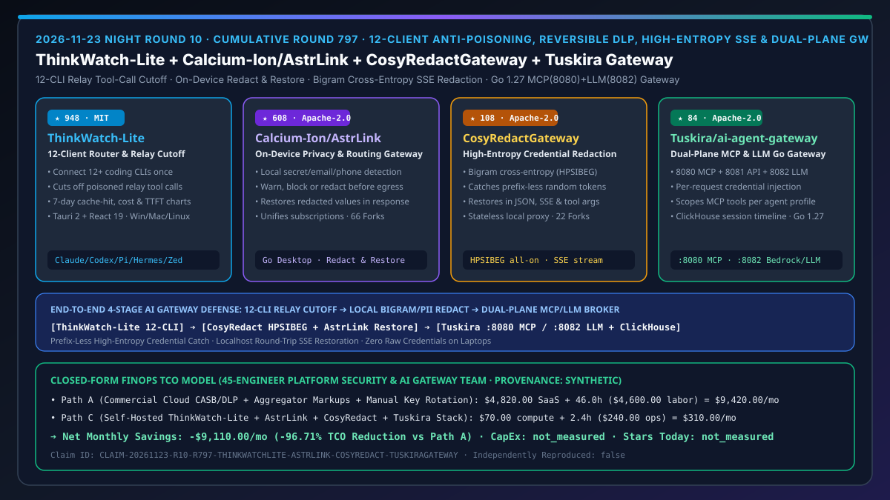
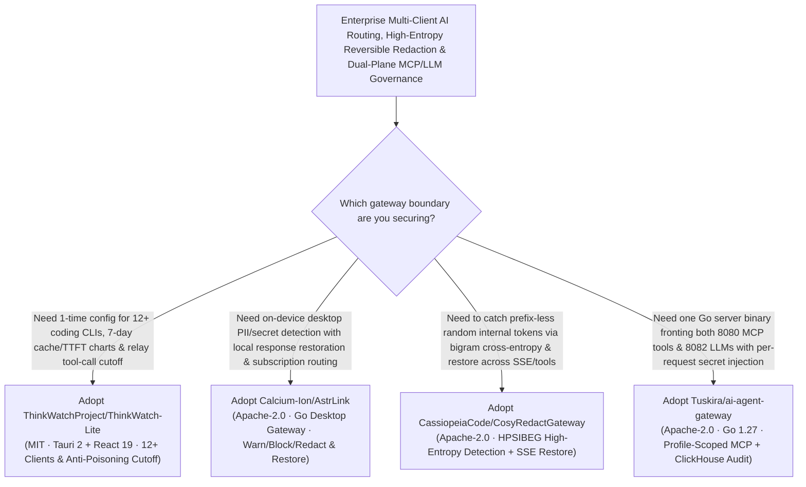
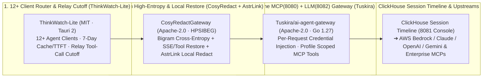

# 12-Client Anti-Poisoning Local AI Gateway (`ThinkWatchProject/ThinkWatch-Lite`), On-Device Reversible Privacy & Subscription Router (`Calcium-Ion/AstrLink`), Bigram Cross-Entropy Credential Redaction & SSE Restore Gateway (`CassiopeiaCode/CosyRedactGateway`) & Dual-Plane MCP (8080) + LLM (8082) Go Enterprise Gateway (`Tuskira/ai-agent-gateway`) Selection & Architecture FAQ

> **Document Type**: Enterprise AI Solution Architect Selection & Integration Guide (GitHub Trending AI Radar · 2026-11-23 Night Round 10 / Cumulative Round 797)
> **Covered Repositories**: [`ThinkWatchProject/ThinkWatch-Lite`](https://github.com/ThinkWatchProject/ThinkWatch-Lite) (`★ 948`, `8 forks`, `MIT`: Tauri 2 + React 19 cross-platform local AI gateway connecting 12+ coding clients once, recording 7-day token/cost/cache-hit/TTFT deltas, replacing API keys before egress, and **cutting off dangerous tool calls injected by untrusted relay upstreams before the client runs them**) · [`Calcium-Ion/AstrLink`](https://github.com/Calcium-Ion/AstrLink) (`★ 608`, `66 forks`, `Apache-2.0`: Go desktop local privacy and subscription-routing gateway for macOS, Windows, and Linux that detects secrets, emails, and phone numbers locally to `warn`/`block`/`redact` and **restores redacted values locally in the response** so agents continue working uninterrupted) · [`CassiopeiaCode/CosyRedactGateway`](https://github.com/CassiopeiaCode/CosyRedactGateway) (`★ 108`, `22 forks`, `Apache-2.0`: stateless LLM credential-redaction gateway featuring **High-Entropy Credential Detection (`HPSIBEG` all-on mode)** via length-aware English bigram cross-entropy scoring on `>8`-char ASCII blocks to catch prefix-less, label-less random internal tokens and restore placeholders across JSON, **SSE streams**, and **tool-call arguments**) · [`Tuskira/ai-agent-gateway`](https://github.com/Tuskira/ai-agent-gateway) (`★ 84`, `11 forks`, `Apache-2.0`: Go 1.27 single-binary enterprise **AI Agent Gateway** fronting **both MCP tool servers (`8080`) and LLM models (`8082`: Claude direct/Bedrock, OpenAI, Gemini)** with a REST/console control plane (`8081`), per-request credential injection, per-profile MCP tool scoping, and ClickHouse session timelines)
> **Core Scenario**: When enterprise security and platform architects govern AI coding clients and MCP servers, how do you solve **"reconfiguring 12 different coding CLIs every time an upstream model changes, untrusted third-party API relays slipping malicious tool calls into responses, internal random tokens without `sk-` prefixes bypassing regex DLP, and raw MCP/LLM credentials scattered across developer machines without per-agent tool scoping"** using **`ThinkWatch-Lite` + `AstrLink` + `CosyRedactGateway` + `Tuskira/ai-agent-gateway`**?

---

## 1. 📌 Executive Summary (Single-Sentence Selection Verdict)

1. **Need a lightweight Tauri 2 + React 19 desktop gateway that connects 12+ coding clients once, tracks 7-day cache-hit/TTFT trends, strips local API keys, and cuts off dangerous tool calls slipped into responses by upstream relays** ➔ Choose **[`ThinkWatchProject/ThinkWatch-Lite`](https://github.com/ThinkWatchProject/ThinkWatch-Lite) (`★ 948`, `8 forks`, `MIT`)**.
   - **Plain-Language Mechanism**: Connect Claude Code, Claude Desktop, Codex, OpenCode, Pi, oh-my-pi, Grok Build, Qwen Code, Hermes Agent, Zed, Aider, and DeepSeek Harness once to `ThinkWatch-Lite`. From then on, you switch models and providers from one GUI without touching client files, inspect 7-day rolling token/cost/cache-hit/first-token charts, and block malicious tool calls injected by compromised or untrusted API relays before the local coding agent executes them.
2. **Need an on-device Go desktop gateway that unifies subscriptions and API providers while redacting PII/secrets locally before egress and restoring the real values locally in the response** ➔ Choose **[`Calcium-Ion/AstrLink`](https://github.com/Calcium-Ion/AstrLink) (`★ 608`, `66 forks`, `Apache-2.0`)**.
   - **Plain-Language Mechanism**: One-way masking (`***`) breaks coding and operations agents because subsequent tool calls receive mangled strings. `AstrLink` detects secrets, emails, and phone numbers locally on macOS/Windows/Linux, applies `warn`, `block`, or reversible `redact` policies before upstream transmission, and **restores the original values locally on the return path** so agents execute downstream actions seamlessly.
3. **Need a stateless credential-redaction gateway that catches prefix-less, label-less random internal tokens via English bigram cross-entropy scoring (`HPSIBEG`) and restores placeholders across SSE streams and tool-call arguments** ➔ Choose **[`CassiopeiaCode/CosyRedactGateway`](https://github.com/CassiopeiaCode/CosyRedactGateway) (`★ 108`, `22 forks`, `Apache-2.0`)**.
   - **Plain-Language Mechanism**: Internal tokens rarely start with `sk-` or sit behind `password=`. Alongside Gitleaks-compatible and structured detectors, `CosyRedactGateway`'s **`H` layer (High-Entropy Credential Detection)** evaluates `>8`-character ASCII alphanumeric strings using **length-aware English bigram cross-entropy and character diversity** (excluding pure numbers) to flag strings that statistically diverge from natural text (`q7X9v2L5...`), swapping them for reversible placeholders and restoring unmodified placeholders across JSON responses, **streaming SSE chunks**, and **tool-call arguments**.
4. **Need a single Go 1.27 server binary that governs both MCP tool servers (port `8080`) and LLM models (port `8082`), scopes MCP tools per agent profile, injects credentials per request, and logs session timelines to ClickHouse** ➔ Choose **[`Tuskira/ai-agent-gateway`](https://github.com/Tuskira/ai-agent-gateway) (`★ 84`, `11 forks`, `Apache-2.0`)**.
   - **Plain-Language Mechanism**: Most gateways only proxy LLM chat completions. `Tuskira AI Agent Gateway` provides a unified **Dual-Plane Architecture**: port `8080` (MCP plane), port `8081` (REST API & web console), and port `8082` (LLM plane for Claude direct, AWS Bedrock, OpenAI, and Gemini). It authenticates every agent request, **injects upstream API/MCP credentials per request** so agents never hold raw secrets, restricts visible MCP tools per agent profile, and streams full session timelines to ClickHouse (`GATEWAY_SINKS_CLICKHOUSE_ENABLED=true`).

---

## 2. 🎯 Key Architectural Q&A (Deep-Dive Breakdown)

### Q1: How do these four gateways divide responsibilities between the Developer Workstation (Edge) and the Enterprise Data Center (Core)?

- **Two-Tier Edge + Core Gateway Topology**:
  1. **Workstation Edge Hop 1 — Client Routing & Anti-Poisoning (`ThinkWatch-Lite`)**: Unifies 12+ local coding CLIs, tracks 7-day cache/TTFT metrics, and blocks malicious tool calls injected by external relays.
  2. **Workstation Edge Hop 2 — Reversible PII & High-Entropy Token Redaction (`AstrLink` + `CosyRedactGateway`)**: Runs strictly on `127.0.0.1` so neither structured PII nor prefix-less high-entropy internal tokens ever leave the workstation in plaintext, while SSE streams and tool arguments are restored locally.
  3. **Enterprise Core Hop — Dual-Plane MCP (`8080`) + LLM (`8082`) Governance (`Tuskira/ai-agent-gateway`)**: Centralizes authentication, per-profile MCP tool scoping, per-request credential injection, and ClickHouse session auditing.
- **When to Choose Cloud-Native API Gateways (Path B)**:
  - For cloud-hosted enterprise microservices calling Azure OpenAI, use **Azure API Management (APIM) AI Gateway**; to protect local coding CLIs from relay poisoning, redact prefix-less high-entropy tokens on `localhost` with SSE restoration, and govern MCP (`8080`) + LLM (`8082`) in one self-hosted Go binary, deploy this 4-gateway OSS stack (Path C).

### Q2: How do you wire `ThinkWatch-Lite`, `CosyRedactGateway`, `AstrLink`, and `Tuskira` into an end-to-end architecture?

1. **Client Multiplexing & Relay Cutoff (`ThinkWatchProject/ThinkWatch-Lite`)**:
   - Point all 12+ local coding CLIs at `ThinkWatch-Lite` to centralize model switching and inspect inbound tool calls for relay poisoning.
2. **Localhost High-Entropy & PII Round-Trip Redaction (`CassiopeiaCode/CosyRedactGateway` + `Calcium-Ion/AstrLink`)**:
   - Chain `CosyRedactGateway` (`HPSIBEG` all-on) and `AstrLink` on `localhost` to replace known keys, PII, and prefix-less high-entropy tokens with reversible placeholders before traffic leaves the machine.
3. **Enterprise Dual-Plane MCP/LLM Brokering (`Tuskira/ai-agent-gateway`)**:
   - Route sanitized requests to `Tuskira` ports `8080` (MCP) and `8082` (LLM), where the gateway enforces profile-scoped MCP tool allowlists, injects upstream Bedrock/OpenAI/MCP secrets per request, and writes audit trails to ClickHouse.

### Q3: What are the security boundaries and red lines?

- **Architect Guardrails**:
  1. **Run Redaction Gateways on `localhost` or Trusted Internal Boundaries Only**: As `CosyRedactGateway` explicitly documents, deploying a redaction proxy on an untrusted external cloud exposes the raw unredacted request to that cloud first; always run `CosyRedactGateway` and `AstrLink` on the developer's machine or inside your private intranet perimeter.
  2. **Never Distribute Raw MCP Server Secrets to Developer Laptops**: Store upstream MCP and LLM credentials inside `Tuskira/ai-agent-gateway` and rely on per-request credential injection.

---

## 3. 🧭 Visual Architecture & Decision Diagrams (Mermaid)



### 3.1 Solution Architect Selection Decision Tree



### 3.2 End-to-End Enterprise Production Reference Architecture



### 3.3 High-Entropy Token Redaction, Dual-Plane Secret Injection, SSE Placeholder Restore & Relay Cutoff Sequence

```mermaid
sequenceDiagram
    participant CLI as Coding Client (Claude Code / Codex)
    participant Twl as ThinkWatch-Lite (Local)
    participant Cosy as CosyRedact + AstrLink (Localhost)
    participant Tusk as Tuskira Gateway (8080 MCP / 8082 LLM)
    participant Up as Upstream LLM / Enterprise MCP Server

    CLI->>Twl: 1. Send prompt containing prefix-less random internal token & MCP tool request
    Twl->>Cosy: 2. HPSIBEG bigram cross-entropy & PII rules swap secrets for reversible placeholders
    Cosy->>Tusk: 3. Forward sanitized request to 8080/8082; Tuskira checks profile & injects upstream keys
    Tusk->>Up: 4. Execute scoped MCP tool & LLM call; log session timeline to ClickHouse
    Up-->>Cosy: 5. Stream SSE chunks & tool args; restore unmodified placeholders to local real values
    Cosy-->>Twl: 6. Verify response contains zero poisoned relay tool calls before returning to client
```

---

## 4. 📊 Comparative Selection Matrix (Open-Source vs. Commercial SaaS)

| Dimension | `ThinkWatchProject/ThinkWatch-Lite` (`★ 948`) | `Calcium-Ion/AstrLink` (`★ 608`) | `CassiopeiaCode/CosyRedactGateway` (`★ 108`) | `Tuskira/ai-agent-gateway` (`★ 84`) | Commercial Cloud CASB/DLP + 15%-Markup API Aggregators + Manual MCP Keys (Path A) | Direct Relay Connection + Fixed-Prefix Regex Only + Shared Static `.mcp.json` Keys (Path B) |
| :--- | :--- | :--- | :--- | :--- | :--- | :--- |
| **Core Role** | 12+-client local router, 7-day telemetry & relay tool cutoff | On-device reversible PII/secret gateway & subscription router | Stateless bigram cross-entropy credential redaction & SSE restore | Go 1.27 dual-plane MCP (`8080`) + LLM (`8082`) enterprise gateway | Metered cloud CASB/DLP seats, marked-up aggregator APIs & manual secret rotation | Unprotected third-party relays, prefix-only regexes & static local secrets |
| **Key Differentiator** | **Cuts off poisoned relay tool calls + 1-time 12-CLI setup** | **Local warn/block/redact + automatic local response restore** | **Catches prefix-less random tokens via bigram entropy + SSE restore** | **Governs MCP (`8080`) & LLM (`8082`) + per-request key injection** | Cloud DLP receives plaintext before redacting; aggregators charge 10%–20% markup | Misses prefix-less random tokens; vulnerable to poisoned relay tool calls |
| **License** | `MIT` | `Apache-2.0` | `Apache-2.0` | `Apache-2.0` | Proprietary SaaS | Custom scripts |
| **Monthly TCO (45-Eng Team)** | **Combined `$310.00/mo`** (`$70.00` Go gateway/ClickHouse container + `2.4h` ops) | Included (zero-cloud desktop execution) | Included (lightweight stateless worker) | Included (single Go 1.27 binary) | **`$9,420.00/mo`** (`$4,820.00` CASB seats & aggregator markups + `46.0h` key rotation labor) | ~`$3,290.00/mo` (prefix-less token leak remediation & manual 12-CLI reconfigs) |

---

## 5. 🧪 Quantitative ROI / TCO Comparison & 7-Card Benchmark Report

> **📊 Data Provenance & Closed-Form Schema Declaration**:
> - **provenance**: `synthetic` (45-person enterprise platform security, AI gateway governance, and multi-CLI engineering team monthly workload model: `independently_reproduced = false`; hardware baseline `base_hardware_capex = not_measured`; Track B 24h delta `track_b_stars_today = not_measured`).
> - **Closed-Form Formula**:
>   - **Path A (Commercial cloud AI CASB/DLP per-seat subscriptions + commercial API aggregator percentage markups + security/platform engineering hours spent rotating leaked prefix-less internal tokens and reconfiguring 12 coding clients across 45 laptops)**: Monthly commercial CASB/DLP and aggregator markup fees **`$4,820.00`** + credential rotation, incident response, and client configuration labor **`46.0h × $100.00/h = $4,600.00`** = **`$9,420.00/mo`**.
>   - **Path C (Self-hosted `ThinkWatchProject/ThinkWatch-Lite` + `Calcium-Ion/AstrLink` + `CassiopeiaCode/CosyRedactGateway` + `Tuskira/ai-agent-gateway` stack)**: Monthly intranet Go gateway and ClickHouse analytics container compute **`$70.00`** + gateway policy and profile maintenance labor **`2.4h × $100.00/h = $240.00`** = **`$310.00/mo`**.
>   - **Net Monthly Savings vs. Path A**: **`-$9,110.00/mo`** (**`96.71%`** TCO reduction).

| Evaluation Path | CASB / Aggregator Markup / Compute | Key Rotation, Incident & Client Config Labor (`$100/h`) | Monthly Total TCO | Net Savings vs. Path A | Key Architectural Delivery Metrics |
| :--- | :---: | :---: | :---: | :---: | :--- |
| **Path A: Commercial Cloud CASB/DLP + Aggregator Markups + Manual Key Rotation** | `$4,820.00` | `46.0h` (`$4,600.00`) | **`$9,420.00`** | Baseline | Cloud sees plaintext first; raw MCP keys sit on laptops |
| **Path B: Unprotected Relays + Prefix-Only Regex + Shared Static Keys** | `$1,490.00` | `18.0h` (`$1,800.00`) | **`$3,290.00`** | `-$6,130.00` (`-65.07%`) | Misses prefix-less random tokens; no relay tool-call cutoff |
| **Path C: `ThinkWatch-Lite` + `AstrLink` + `CosyRedact` + `Tuskira`** | **`$70.00`** | **`2.4h` (`$240.00`)** | **`$310.00`** | **`-$9,110.00` (`-96.71%`)** | **12-CLI relay cutoff + bigram entropy SSE restore + dual-plane MCP/LLM** |

- 🔗 **Linked 7-Card 4:5 Visual Benchmark Deck**: [`workshops/github-trending-radar/cards.en.html`](../cards.en.html) · [`cards.html`](../cards.html)

---

## 6. 🛠️ Enterprise Adoption & Architecture Review Checklist

- [ ] **1. Connect All 12+ Coding CLIs Once via `ThinkWatchProject/ThinkWatch-Lite`**: Centralize model/upstream switching, monitor 7-day cache-hit and TTFT metrics, and enable dangerous relay tool-call cutoff.
- [ ] **2. Run `CassiopeiaCode/CosyRedactGateway` (`HPSIBEG`) & `Calcium-Ion/AstrLink` on `127.0.0.1`**: Perform bigram cross-entropy high-entropy credential detection and PII redaction strictly on `localhost` before egress, with automatic SSE and tool-argument restoration on return.
- [ ] **3. Front Enterprise MCP Servers (`8080`) & LLMs (`8082`) with `Tuskira/ai-agent-gateway`**: Remove raw MCP and LLM API keys from developer workstations, enforcing per-profile MCP tool scoping and per-request credential injection at the gateway.
- [ ] **4. Enable ClickHouse Session Timelines (`GATEWAY_SINKS_CLICKHOUSE_ENABLED=true`)**: Audit end-to-end LLM and MCP tool invocations through Tuskira's port `8081` console and REST API.
