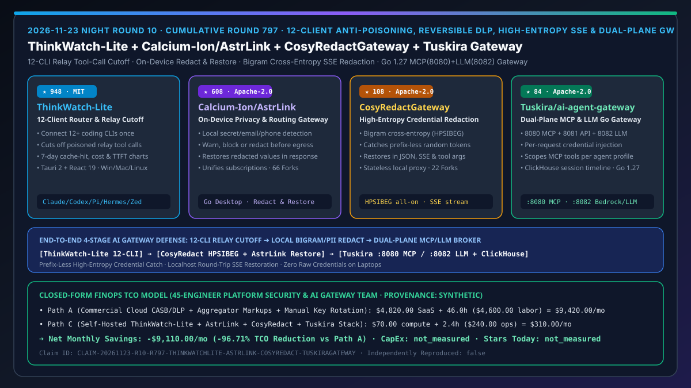
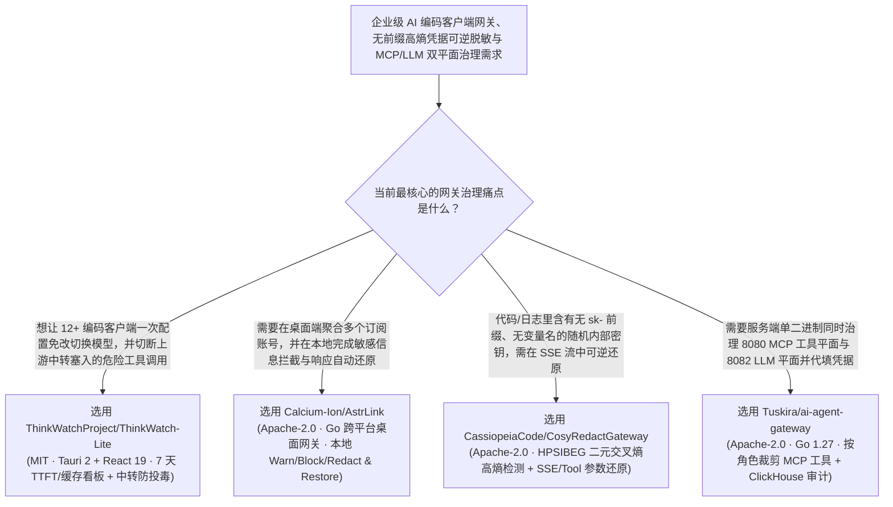
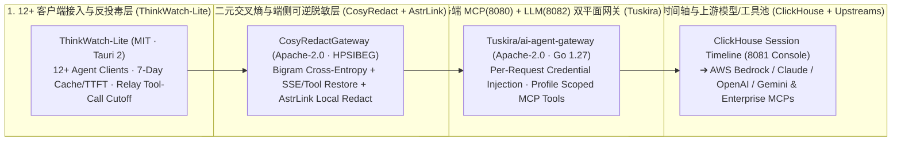
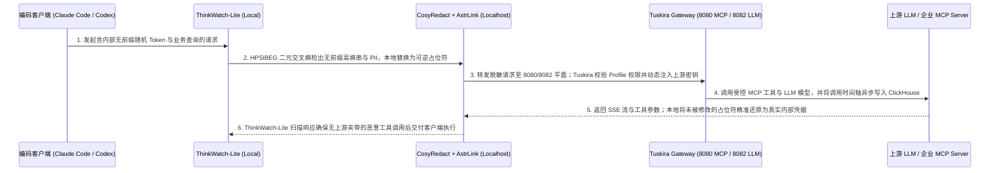

# 拦截恶意中转工具调用的 12 客户端本地 AI 网关（`ThinkWatchProject/ThinkWatch-Lite`）、端侧可逆脱敏与多订阅聚合网关（`Calcium-Ion/AstrLink`）、基于二元字符交叉熵捕捉无前缀随机密钥的 SSE 流式还原网关（`CassiopeiaCode/CosyRedactGateway`）与统一管控 MCP 工具面（8080）及 LLM 模型面（8082）的 Go 双平面网关（`Tuskira/ai-agent-gateway`）选型与集成架构 FAQ

> **文档类型**：企业 AI 解决方案架构师（AI Solution Architect）选型决策指南（GitHub Trending AI 雷达 2026-11-23 Night Round 10 / 累计第 797 轮）
> **覆盖项目**：[`ThinkWatchProject/ThinkWatch-Lite`](https://github.com/ThinkWatchProject/ThinkWatch-Lite)（`★ 948`、`8 forks`、`MIT`：基于 Tauri 2 + React 19 的跨平台本地 AI 网关，一次接入 Claude Code、Codex、OpenCode、Pi、Hermes、Zed、Aider 等 12+ 客户端即可免改配置热切上游、统计 7 天成本/缓存命中/TTFT，并**在本地拦截不可信中转商在响应中夹带的危险工具调用**）· [`Calcium-Ion/AstrLink`](https://github.com/Calcium-Ion/AstrLink)（`★ 608`、`66 forks`、`Apache-2.0`：Go 编写的端侧隐私网关与订阅聚合桌面端，在请求出站前本地检测密钥、邮箱、手机号并按策略 `warn/block/redact`，响应返回后**在本地自动还原被脱敏字段**以保证 Agent 工具链不断流）· [`CassiopeiaCode/CosyRedactGateway`](https://github.com/CassiopeiaCode/CosyRedactGateway)（`★ 108`、`22 forks`、`Apache-2.0`：主打**高熵凭据检测（High-Entropy Credential Detection，`HPSIBEG` 全开模式）**的无状态脱敏网关，利用长度感知英文二元字符交叉熵评分揪出无 `sk-` 前缀、无 `password=` 标签的内部随机令牌，并在 JSON、**SSE 流式输出与工具调用参数**中完成可逆占位符还原）· [`Tuskira/ai-agent-gateway`](https://github.com/Tuskira/ai-agent-gateway)（`★ 84`、`11 forks`、`Apache-2.0`：Go 1.27 单二进制企业级 **AI Agent 双平面网关**，同时前置代理 **`8080` MCP 工具平面、`8081` 控制台控制平面与 `8082` LLM 模型平面**（Claude/Bedrock/OpenAI/Gemini），按 Agent Profile 裁剪可用 MCP 工具、逐请求动态注入凭据并写入 ClickHouse 会话时间轴）
> **核心场景**：当企业架构师在规范研发终端与生产环境的大模型及 MCP 调用出入口时，面对**“每次切换模型提供商都要挨个改 10 款编码工具的配置文件、使用第三方便宜中转 API 时担心上游被投毒返回恶意 `bash` 工具调用反控开发者电脑、内部自定义随机密钥没有 `sk-` 固定前缀导致传统正则 DLP 漏检、以及 MCP Server 凭据散落在各 Agent 本地且缺乏按角色裁剪 MCP 工具的统一服务端网关”**四大核心痛点，如何构建一套**“终端中转投毒拦截（`ThinkWatch-Lite`）+ 端侧 PII 可逆往返（`AstrLink`）+ 二元交叉熵无前缀凭据 SSE 还原（`CosyRedactGateway`）+ 企业双平面 MCP/LLM 凭据代注与权限网关（`Tuskira`）”**的四层网关防线？

---

## 一、📌 核心结论速览（选型一句话结论）

1. **想让开发机上的 Claude Code、Codex、Pi、Hermes、Zed、Aider 等 12+ 款工具“一次配置、终身免改切换上游”，同时实时监控 7 天缓存命中率/首字延迟（TTFT），并防止劣质 API 中转站在返回包里塞入恶意工具调用指令攻击本机** ➔ 选 **[`ThinkWatchProject/ThinkWatch-Lite`](https://github.com/ThinkWatchProject/ThinkWatch-Lite)（`★ 948`，`8 forks`，`MIT`）**。
   - **通俗原理**：基于轻量级 Tauri 2 + React 19 构建，解决了开发者桌面的两大刚需：① **配置解耦与可观测**：所有编码客户端只需指向本地 ThinkWatch Lite 端口一次，后续切模型、换供应商、查看过去 7 天按模型的 Token 流向、缓存命中率、TTFT 与上游余额全在图形界面一键完成；② **防恶意中转投毒（Relay Tool-Call Cutoff）**：当使用外部中转 API 时，如果上游在模型响应中偷偷夹带了高危工具调用（如删库或窃密 Shell 命令），网关会在客户端真正执行该工具前直接将其切断！
2. **想在macOS/Windows/Linux 桌面端把多个订阅账号与 API 聚合成统一入口，并在请求发往任何云端大模型前在本地自动把手机号、邮箱与密钥替换为占位符，等模型答复后再在本地无感还原回真值** ➔ 选 **[`Calcium-Ion/AstrLink`](https://github.com/Calcium-Ion/AstrLink)（`★ 608`，`66 forks`，`Apache-2.0`）**。
   - **通俗原理**：如果只是把敏感词硬生生删掉或打成 `***`，编码 Agent 生成的代码或工具调用参数也会变成 `***`，导致后续步骤直接报错。`AstrLink` 在本地执行**双向可逆脱敏（Local Redact & Restore）**：出站前按策略告警、阻断或替换为本地映射表中的安全代号，模型基于代号完成逻辑推理并返回结果后，`AstrLink` 在进入 Agent 执行器前把代号精准还原为本地真实值，兼顾零泄密与业务连续性。
3. **想拦截代码、日志或工具返回结果里“既没有 `sk-`/`ghp_` 已知厂商前缀、前面也没有写 `api_key=` 赋值标签”的裸随机内部服务令牌，且要求在 SSE 流式打字与 Tool Call 参数中也能精准还原** ➔ 选 **[`CassiopeiaCode/CosyRedactGateway`](https://github.com/CassiopeiaCode/CosyRedactGateway)（`★ 108`，`22 forks`，`Apache-2.0`）**。
   - **通俗原理**：传统正则规则（如 Gitleaks）只能抓已知前缀或带 `password=` 的字符串；一旦程序员在 Prompt 里贴了一句 `检查这个值：q7X9v2L5m8N4r6T1w3Y0z5A8b2C9d7F4`，固定正则就会彻底漏放。`CosyRedactGateway` 默认开启 **`HPSIBEG` 全检测栈**，其中核心 **`H` 层（高熵凭据检测）**对超过 8 字符的 ASCII 字母数字块计算**长度感知的英文二元字符交叉熵（Bigram Cross-Entropy）与字符多样性评分**（自动排除纯数字块），识别“显著不像自然英文单词”的随机密钥并替换为可逆占位符，且完整支持 JSON、**SSE 流式分块响应**与**工具调用参数**的自动还原。
4. **想在企业服务端部署一个 Go 1.27 单二进制网关，把“Agent 调大模型（`8082` 端口）”和“Agent 调 MCP 工具（`8080` 端口）”全部收口，实现按 Agent 角色裁剪可见 MCP 工具、由网关代填上游密钥，并将全链路会话时间轴写入 ClickHouse** ➔ 选 **[`Tuskira/ai-agent-gateway`](https://github.com/Tuskira/ai-agent-gateway)（`★ 84`，`11 forks`，`Apache-2.0`）**。
   - **通俗原理**：大多数 AI 网关只管 `/v1/chat/completions`（LLM 平面），不管 MCP 工具调用。`Tuskira AI Agent Gateway` 提供了**三端口双数据平面架构**：`8080`（MCP Plane）、`8081`（Control Plane REST + Console）与 `8082`（LLM Plane，支持 Claude 直连、AWS Bedrock、OpenAI 与 Gemini）。Agent 只需持有一个网关身份，网关根据其 Profile 自动过滤允许看见和调用的 MCP 工具，在转发那刻**逐请求动态注入真实凭据（Per-Request Credential Injection）**，并可选开启 ClickHouse 分析底座记录完整 Session Timeline。

---

## 二、🎯 客户与架构师灵魂拷问 Q&A（深度架构拆解）

### Q1：这四款网关在企业“开发者本机端侧”与“团队/生产服务端”架构中如何选型与分层组合？

- **端侧 + 服务端双层网关架构**：
  1. **开发者本机第一跳（防中转投毒 + 12 客户端免改切换）➔ `ThinkWatch-Lite`**：适合研发个人管理多编码 CLI 路由、观测 7 天缓存命中率并阻断不可信中转下发的恶意 Tool Call。
  2. **开发者本机隐私与无前缀高熵密钥往返脱敏 ➔ `AstrLink` + `CosyRedactGateway`**：`AstrLink` 负责桌面可视化多订阅聚合与常规 PII 往返还原；`CosyRedactGateway` 专门补齐“无前缀裸随机字符串（二元交叉熵评分）”与 SSE 流式/工具参数可逆还原。
  3. **企业服务端统一 MCP + LLM 权限与凭据代注总闸门 ➔ `Tuskira/ai-agent-gateway`**：部署在部门或生产集群入口，统一鉴权、按角色裁剪 MCP 工具列表、代填 Bedrock/OpenAI/MCP 上游密钥并归档 ClickHouse 审计流。
- **何时直接选用云厂商托管网关（Path B）？**
  - 若企业所有模型与 MCP 服务均托管在 Azure 云端且无需本地桌面无前缀高熵 SSE 可逆还原，可直接使用 **Azure API Management (APIM) AI Gateway**；若需保护本机 Claude Code/Codex 免受中转投毒、拦截无前缀高熵内部 Token 外传或自建轻量 Go MCP+LLM 双平面网关，则采用本轮四合一开源网关栈（Path C）。

### Q2：典型企业级“本机高熵与中转防护 (`ThinkWatch-Lite` + `CosyRedact`) ➔ 端侧隐私往返 (`AstrLink`) ➔ 服务端双平面治理 (`Tuskira`)”参考架构怎么搭？

1. **研发终端接入与反投毒层（`ThinkWatchProject/ThinkWatch-Lite`）**：
   - 将本机 Claude Code、Codex、Pi、Hermes 等 12+ 客户端统一挂载至 ThinkWatch Lite，开启危险响应工具调用切断与 7 天缓存/TTFT 监控。
2. **本机高熵凭据与 PII 可逆脱敏层（`CassiopeiaCode/CosyRedactGateway` + `Calcium-Ion/AstrLink`）**：
   - 在本机回环地址串联 `CosyRedactGateway`（`HPSIBEG` 全开模式）与 `AstrLink`，将固定特征密钥、个人隐私及无前缀高熵随机串全部替换为本地可逆占位符，并在 SSE 流与 Tool Call 参数中实时还原。
3. **企业服务端 MCP (`8080`) + LLM (`8082`) 双平面治理层（`Tuskira/ai-agent-gateway`）**：
   - 终端脱敏后的流量进入企业内网 `Tuskira` 网关，由 `8080` 平面执行 Agent Profile 级 MCP 工具白名单过滤与凭据代注，由 `8082` 平面路由至 AWS Bedrock / Claude / OpenAI / Gemini，全量会话轨迹落盘 ClickHouse。

### Q3：这套四层网关架构的安全边界与落地红线是什么？

- **架构师落地红线**：
  1. **脱敏网关必须运行在可信本地或内网边界内**：正如 `CosyRedactGateway` 官方安全边界声明所强调——若将脱敏网关部署在不可信公有云端，云端网关本身就会先收到未脱敏的原始明文！高熵与 PII 可逆脱敏必须在**开发者本机（Localhost）或企业受控内网边界**内完成。
  2. **高熵检测阈值校准与白名单**：`CosyRedactGateway` 的二元交叉熵检测（`H` 层）属于统计评分，面对长 Base64 编码或特殊哈希常量时可能产生误命中的占位符替换，生产中应结合其 `docs/ENTROPY.md` 校准策略。

---

## 三、🧭 直观可视化图解（Mermaid 决策树 + 集成架构 + 时序图）

### 3.1 架构师选型决策树

### 3.2 企业端到端生产集成参考架构图

### 3.3 高熵无前缀凭据拦截、双平面凭据代注、SSE 流式还原与中转反投毒时序图

---

## 四、📊 同类开源与商业云服务横向选型决策矩阵

| 对比维度 | `ThinkWatchProject/ThinkWatch-Lite` (`★ 948`) | `Calcium-Ion/AstrLink` (`★ 608`) | `CassiopeiaCode/CosyRedactGateway` (`★ 108`) | `Tuskira/ai-agent-gateway` (`★ 84`) | 商业云端 CASB/DLP 网关 + 商业 API 聚合平台抽成 + 手工分发 MCP 密钥 (Path A) | 裸连外部中转站 + 仅配 `sk-` 固定正则过滤 + 全员共享管理员 MCP Key (Path B) |
| :--- | :--- | :--- | :--- | :--- | :--- | :--- |
| **核心能力定位** | 12+ 客户端免改配置路由与防中转投毒桌面网关 | 端侧敏感信息可逆脱敏与多订阅智能路由网关 | 二元字符交叉熵高熵凭据检测与 SSE 流式还原网关 | Go 1.27 MCP(`8080`)+LLM(`8082`) 双平面凭据代注网关 | 按流量/席位高价收费的云端 DLP 与加价抽成的商业 API 中转商 | 无本地防护直连第三方中转、固定前缀正则与硬编码在本地的共享密钥 |
| **核心技术突破** | **切断中转响应夹带的危险工具调用 + 7 天缓存/TTFT 视图** | **本地检出并替换 PII/密钥 + 响应回包本地自动还原** | **不依赖前缀的英文二元交叉熵评分 + SSE/工具参数还原** | **单二进制同时管 MCP 与 LLM + 按角色裁剪工具 + 逐请求代注凭据** | 云端 DLP 先收到明文存在合规瑕疵；商业聚合网关抽成 10%–20% | 固定正则抓不到无前缀随机密钥；中转站被黑可下发恶意命令控制开发机 |
| **开源协议** | `MIT` | `Apache-2.0` | `Apache-2.0` | `Apache-2.0` | 闭源商业 SaaS | 内部零散脚本 |
| **月度 TCO（45 人团队）** | **组合仅 `$310.00/月`**（`$70.00` 内网 Go 网关与 ClickHouse 容器 + `2.4h` 维护） | 同左（端侧桌面零服务器开销） | 同左（无状态本地轻量进程） | 同左（Go 1.27 单二进制极省资源） | **`$9,420.00/月`**（`$4,820.00` 商业 CASB/DLP 席位与中转抽成 + `46.0h` 密钥轮换与排障工时） | 约 `$3,290.00/月`（内部无前缀令牌泄露应急响应与多客户端改配工时） |

---

## 五、🧪 应用落地定量收益/TCO 对比与 7-Card 报告

> **📊 数据来源与闭式核算声明（Provenance & Closed-Form Schema）**：
> - **provenance**: `synthetic`（基于 45 人企业平台安全、AI 网关治理与多客户端研发团队月度工作负载模型：`independently_reproduced = false`；硬件采购基线 `base_hardware_capex = not_measured`；Track B 单日增量 `track_b_stars_today = not_measured`）。
> - **核算公式**：
>   - **Path A（采购商业云端 AI CASB/DLP 按席位订阅 + 支付商业 API 聚合平台加价抽成 + 安全与平台团队手工轮换散落在 45 人开发机 `.mcp.json` 中的明文凭据并逐台修改 12 款客户端配置）**：月度商业安全网关席位与平台抽成 **`$4,820.00`** + 凭据泄露排查、手动轮换 MCP 密钥与客户端配置维护人工 **`46.0h × $100.00/h = $4,600.00`** = **`$9,420.00/月`**。
>   - **Path C（自建 `ThinkWatchProject/ThinkWatch-Lite` + `Calcium-Ion/AstrLink` + `CassiopeiaCode/CosyRedactGateway` + `Tuskira/ai-agent-gateway` 四合一开源网关栈）**：内网 Go 双平面网关与 ClickHouse 日志容器分摊开销 **`$70.00`** + 网关策略与 Profile 维护人工 **`2.4h × $100.00/h = $240.00`** = **`$310.00/月`**。
>   - **净节省（Net Savings vs Path A）**：**`-$9,110.00/月`**（成本降低 **`96.71%`**）。

| 评估方案 | 安全网关席位 / 抽成 / 容器成本 | 密钥轮换、应急与客户端维护人工（`$100/h`） | 月度总 TCO | 相对 Path A 净节省 | 关键架构交付指标 |
| :--- | :---: | :---: | :---: | :---: | :--- |
| **Path A：商业云端 CASB/DLP + 商业聚合抽成 + 手动发密钥** | `$4,820.00` | `46.0h` (`$4,600.00`) | **`$9,420.00`** | Baseline | 云端先收明文；MCP 凭据仍散落在开发机本地 |
| **Path B：直连外部中转 + 仅配固定前缀正则 + 共享 MCP 密钥** | `$1,490.00` | `18.0h` (`$1,800.00`) | **`$3,290.00`** | `-$6,130.00` (`-65.07%`) | 漏检无前缀内部随机密钥；无法防上游中转投毒工具调用 |
| **Path C：`ThinkWatch-Lite` + `AstrLink` + `CosyRedact` + `Tuskira`** | **`$70.00`** | **`2.4h` (`$240.00`)** | **`$310.00`** | **`-$9,110.00` (`-96.71%`)** | **12 端反投毒 + 二元交叉熵 SSE 可逆还原 + MCP/LLM 双平面代注** |

- 🔗 **关联 7-Card 4:5 视觉评测报告**：[`workshops/github-trending-radar/cards.html`](../cards.html) · [`cards.en.html`](../cards.en.html)

---

## 六、🛠️ 企业引入与架构评审 Checklist

- [ ] **1. 在开发者终端部署 `ThinkWatchProject/ThinkWatch-Lite` 统一收口 12+ 客户端**：将 Claude Code、Codex、Pi、Hermes 等一次性挂载至本地网关，启用危险响应工具调用拦截并监控 7 天缓存命中率。
- [ ] **2. 在本机回环启用 `CassiopeiaCode/CosyRedactGateway` (`HPSIBEG`) 与 `Calcium-Ion/AstrLink`**：必须在本机（Localhost）完成二元字符交叉熵高熵凭据检测与 PII 可逆替换，确保 SSE 流式输出与工具调用参数在本地无缝还原。
- [ ] **3. 在企业内网出口部署 `Tuskira/ai-agent-gateway` 统一管控 `8080` (MCP) 与 `8082` (LLM)**：收回散落在开发者本机的上游 API Key 与 MCP Server 密钥，改由网关按 Agent Profile 裁剪可用工具并逐请求动态注入凭据。
- [ ] **4. 开启 `GATEWAY_SINKS_CLICKHOUSE_ENABLED=true` 归档全链路会话时间轴**：在 `8081` 控制台持续审计跨模型与跨 MCP 工具的访问日志、延迟分布与异常拒绝事件。
