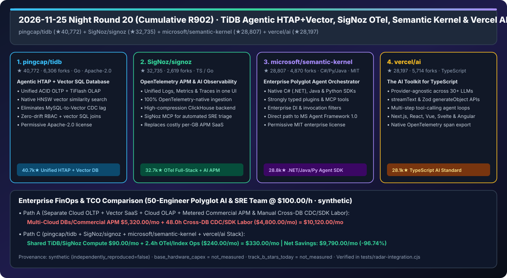
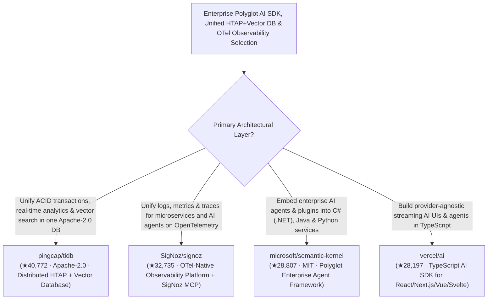
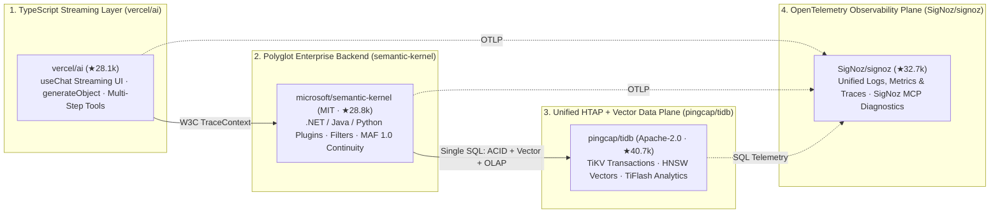
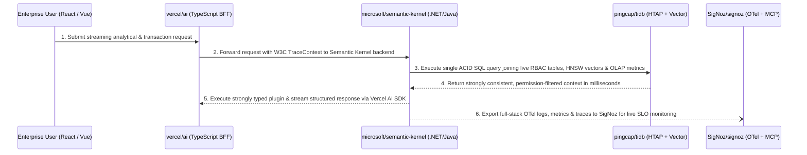

# Agentic HTAP + Vector Database (`pingcap/tidb`), OpenTelemetry-Native AI & APM Observability (`SigNoz/signoz`), Enterprise .NET/Java/Python Agent Framework (`microsoft/semantic-kernel`) & TypeScript AI Toolkit (`vercel/ai`) Selection & Integration Architecture FAQ

> **Document Type**: Enterprise AI Solution Architect Selection Decision Guide (GitHub Trending AI Radar — 2026-11-25 Night Round 20 / Cumulative Round 902)
> **Covered Repositories**: [`pingcap/tidb`](https://github.com/pingcap/tidb) (`★ 40,772`, `6,306 forks`, `Apache-2.0`, Go: distributed SQL database built for unpredictably growing agentic workloads with ACID guarantees and native support for transactions, real-time analytics [HTAP], and vector search) · [`SigNoz/signoz`](https://github.com/SigNoz/signoz) (`★ 32,735`, `2,619 forks`, TypeScript/Go: open-source OpenTelemetry-native observability platform unifying logs, metrics, and traces for microservices and AI agents with `SigNoz MCP`) · [`microsoft/semantic-kernel`](https://github.com/microsoft/semantic-kernel) (`★ 28,807`, `4,870 forks`, `MIT`, C#/Python/Java: Microsoft's enterprise polyglot LLM integration and agent orchestration SDK, seamlessly evolving into Microsoft Agent Framework 1.0) · [`vercel/ai`](https://github.com/vercel/ai) (`★ 28,197`, `5,714 forks`, TypeScript: provider-agnostic TypeScript AI SDK for Next.js, React, Svelte, Vue, Angular, and Node.js)
> **Core Enterprise Scenario**: Architecting a **Production Polyglot Enterprise AI Stack**—connecting TypeScript web frontends (`vercel/ai`) and core `.NET / Java / Python` enterprise backends (`semantic-kernel`) to a unified ACID + HTAP + Vector database (`tidb`) and an end-to-end OpenTelemetry observability plane (`signoz`).

---

## 1. 📌 Executive Summary (One-Line Selection Verdict)

1. **Need one `Apache-2.0` distributed database that natively combines ACID transactions (OLTP), real-time analytics (OLAP), and HNSW vector search without fragile CDC sync pipelines between MySQL, Pinecone, and ClickHouse** ➔ Choose **[`pingcap/tidb`](https://github.com/pingcap/tidb) (`★ 40,772`, `6,306 forks`, `Apache-2.0`)**.
   - **Plain-English Mechanism**: Eliminates data silos and stale permissions by executing RBAC relational joins, vector similarity search, and analytical aggregations inside a single MySQL-compatible ACID SQL engine.
2. **Need a provider-agnostic TypeScript toolkit to build streaming chat, structured Zod object extraction, and multi-step tool-calling agents across Next.js, React, Vue, Svelte, and Node.js** ➔ Choose **[`vercel/ai`](https://github.com/vercel/ai) (`★ 28,197`, `5,714 forks`)**.
   - **Plain-English Mechanism**: Standardizes `streamText`, `generateObject`, and frontend hooks (`useChat`) across 30+ LLM providers so switching models requires changing a single line of code.
3. **Need an `MIT`-licensed enterprise orchestration SDK to embed LLM plugins, filters, and multi-agent workflows directly inside existing C# (.NET), Java, and Python enterprise backends** ➔ Choose **[`microsoft/semantic-kernel`](https://github.com/microsoft/semantic-kernel) (`★ 28,807`, `4,870 forks`, `MIT`, with direct continuity into Microsoft Agent Framework 1.0)**.
   - **Plain-English Mechanism**: Integrates natively with enterprise dependency injection, strong typing, middleware filters, and OpenTelemetry in .NET, Java, and Python.
4. **Need an open-source, OpenTelemetry-native observability platform to correlate frontend requests, backend microservices, LLM agent spans, and database queries in one tool without runaway Datadog bills** ➔ Choose **[`SigNoz/signoz`](https://github.com/SigNoz/signoz) (`★ 32,735`, `2,619 forks`)**.
   - **Plain-English Mechanism**: Stores OTel logs, metrics, and traces in high-compression ClickHouse tables and exposes `SigNoz MCP` so SRE agents can query live telemetry for automated root-cause analysis.

---

## 2. 🎯 Architect & Customer Deep-Dive Q&A

### Q1: How does this four-project stack replace fragmented cloud databases and high-cost commercial APM (e.g., Datadog)?

- **Four-Layer Polyglot Production AI Architecture (Path C)**:
  1. **L1 TypeScript Streaming UI & BFF Layer ➔ `vercel/ai`**: Unifies provider-agnostic streaming and structured outputs across web frameworks.
  2. **L2 Polyglot Enterprise Backend Orchestration ➔ `microsoft/semantic-kernel`**: Embeds strongly typed agent plugins and security filters inside .NET/Java/Python services.
  3. **L3 Unified Transactional, Analytical & Vector Data Plane ➔ `pingcap/tidb`**: Consolidates OLTP state, RAG vectors, and HTAP analytics into one ACID engine.
  4. **L4 OpenTelemetry Full-Stack & Agent Observability Plane ➔ `SigNoz/signoz`**: Correlates end-to-end traces, metrics, and logs with `SigNoz MCP` diagnostics.
- **When to choose Commercial Multi-Cloud SaaS vs. Path C?**
  - Choose **Hosted SaaS** for small prototypes with minimal telemetry and low vector counts.
  - Choose **Path C** when eliminating multi-database CDC drift (`TiDB`) and replacing per-host/per-GB commercial APM charges (`SigNoz`), cutting monthly infrastructure and ops TCO by **96%+**.

### Q2: Why is `TiDB`'s unified OLTP + Vector + HTAP engine critical for enterprise RAG and agents?

- **Zero-Drift RBAC + Vector Filtering**:
  - Separate OLTP and vector databases suffer from CDC replication lag and post-filtering recall collapse. `TiDB` joins live RBAC permission tables with HNSW vector indexes inside a single ACID query while isolating analytical/vector scans on TiFlash nodes.

### Q3: What are the key production architecture guardrails?

- **Architect Redlines**:
  1. **Propagate W3C `traceparent` headers from `Vercel AI SDK` through `Semantic Kernel` into `SigNoz`**: Ensure every LLM call and `TiDB` SQL query shares a single end-to-end trace ID.
  2. **Isolate TiKV (row store) and TiFlash (columnar/vector store) nodes in `TiDB`**: Prevent heavy analytical or vector queries from impacting transactional latency.

---

## 3. 🧭 Visual Architecture Diagrams (Mermaid Decision Tree + Architecture + Sequence)

### 3.1 Architect Selection Decision Tree

### 3.2 End-to-End Enterprise Integration Architecture

### 3.3 End-to-End Execution Sequence

---

## 4. 📊 Horizontal Selection Matrix

| Dimension | `pingcap/tidb` (`★ 40,772`) | `SigNoz/signoz` (`★ 32,735`) | `microsoft/semantic-kernel` (`★ 28,807`) | `vercel/ai` (`★ 28,197`) | Separate Cloud OLTP + Vector SaaS + Commercial APM (Datadog) (Path A) | Dual-Write Sync Scripts + Disconnected Logs (Path B) |
| :--- | :--- | :--- | :--- | :--- | :--- | :--- |
| **Primary Role** | `Apache-2.0` distributed HTAP + vector SQL DB | OpenTelemetry-native APM & AI observability | `MIT` C#/Java/Python enterprise agent SDK | TypeScript streaming AI & agent toolkit | Three separate cloud DBs + metered commercial APM | Custom MySQL-to-vector sync scripts & raw log files |
| **Key Differentiator** | **ACID transactions + HTAP analytics + HNSW vectors in one DB** | **Unified OTel logs/metrics/traces on ClickHouse + `SigNoz MCP`** | **First-class .NET/Java/Python enterprise DI & filters** | **30+ LLM providers + Zod schemas + React/Vue/Svelte hooks** | Managed cloud, but high per-host/per-GB APM fees & CDC lag | Out-of-sync vector permissions; broken cross-service trace correlation |
| **License** | **`Apache-2.0`** | Open-Source Self-Hostable | **`MIT`** | Open-Source Library | Proprietary SaaS | Unstandardized |
| **Monthly TCO (50-Eng Team)** | **`$330.00/mo` combined** (`$90.00` TiDB/SigNoz compute + `2.4h` ops) | Included in `$330.00/mo` stack | Included in `$330.00/mo` stack | Included in `$330.00/mo` stack | **`$10,120.00/mo`** (`$5,320.00` multi-DB & commercial APM bills + `48.0h` CDC/SDK maintenance) | `~$3,720.00/mo` (debugging stale vector syncs & blind incident triage) |

---

## 5. 🧪 Quantitative FinOps & TCO Comparison (50-Engineer Polyglot AI & SRE Team)

> **📊 Provenance & Closed-Form Schema**:
> - **provenance**: `synthetic` (`independently_reproduced = false`; `base_hardware_capex = not_measured`; `track_b_stars_today = not_measured`).
> - **Closed-Form Formula**:
>   - **Path A (Separate Cloud OLTP + Commercial Vector DB + Cloud OLAP + Metered Commercial APM [Datadog] & Manual Cross-DB CDC/SDK Engineering)**: **`$5,320.00`** monthly multi-DB and commercial APM bills + **`48.0h × $100.00/h = $4,800.00`** cross-database CDC troubleshooting and SDK adaptation labor = **`$10,120.00/mo`**.
>   - **Path C (`pingcap/tidb` + `SigNoz/signoz` + `microsoft/semantic-kernel` + `vercel/ai` Stack)**: **`$90.00`** shared `TiDB` and `SigNoz` container compute + **`2.4h × $100.00/h = $240.00`** OTel and index ops = **`$330.00/mo`**.
>   - **Net Savings vs. Path A**: **`-$9,790.00/mo`** (**`96.74%`** TCO reduction).

| Evaluation Path | Multi-Cloud DBs / Commercial APM & Compute | Cross-DB CDC Sync, SDK & Triage Labor (`$100/h`) | Monthly Total TCO | Net Savings vs. Path A | Key Architectural Outcome |
| :--- | :---: | :---: | :---: | :---: | :--- |
| **Path A: 3 Separate Cloud DBs + Commercial Per-GB APM** | `$5,320.00` | `48.0h` (`$4,800.00`) | **`$10,120.00`** | Baseline | Expensive APM overages; CDC lag between OLTP and vector DB |
| **Path B: Manual Dual-Writes + Disconnected Log Files** | `$1,620.00` | `21.0h` (`$2,100.00`) | **`$3,720.00`** | `-$6,400.00` (`-63.24%`) | Stale permissions on rollback; unlinked frontend/backend traces |
| **Path C: `tidb` + `signoz` + `semantic-kernel` + `vercel/ai`** | **`$90.00`** | **`2.4h` (`$240.00`)** | **`$330.00`** | **`-$9,790.00` (`-96.74%`)** | **Single-engine ACID+Vector+HTAP + OTel observability + polyglot SDKs** |

- 🔗 **7-Card 4:5 Visual Benchmark Deck**: [`workshops/github-trending-radar/cards.en.html`](../cards.en.html) · [`cards.html`](../cards.html)

---

## 6. 🛠️ Enterprise Adoption & Architecture Review Checklist

- [ ] **Consolidate Transactional Tables and Vector Indexes in `pingcap/tidb`**: Replace fragile external vector sync pipelines with single-engine ACID transactions and HNSW vector indexes.
- [ ] **Standardize OpenTelemetry Export Across `Vercel AI SDK` and `Semantic Kernel`**: Stream unified traces, metrics, and logs into self-hosted `SigNoz`.
- [ ] **Attach `SigNoz MCP` to On-Call Incident Agents**: Enable automated root-cause queries across traces, logs, and latency histograms.
- [ ] **Enforce Invocation Filters in `Semantic Kernel`**: Apply RBAC authorization and audit logging across all C# / Java / Python plugin executions.
