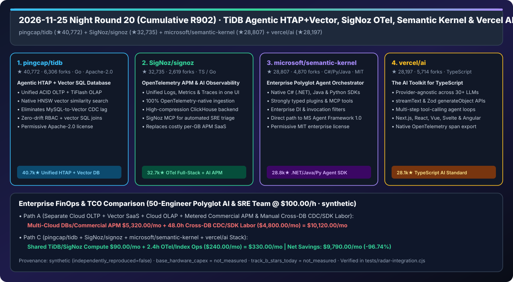
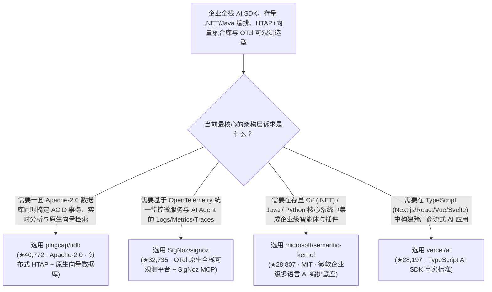
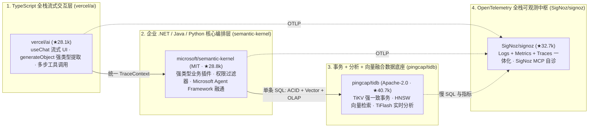
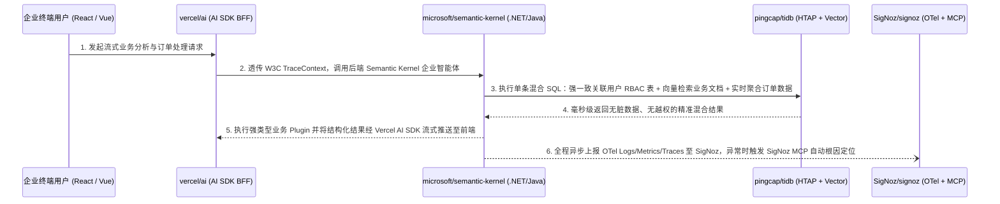

# 面向智能体工作负载的分布式 HTAP+向量数据库（`pingcap/tidb`）、OpenTelemetry 原生全栈与 AI 可观测平台（`SigNoz/signoz`）、企业级 .NET/Java/Python 智能体编排底座（`microsoft/semantic-kernel`）与 TypeScript 全栈流式 AI 开发套件（`vercel/ai`）选型与集成架构 FAQ

> **文档类型**：企业 AI 解决方案架构师（AI Solution Architect）选型决策指南（GitHub Trending AI 雷达 2026-11-25 Night Round 20 / 累计第 902 轮）
> **覆盖项目**：[`pingcap/tidb`](https://github.com/pingcap/tidb)（`★ 40,772`、`6,306 forks`、`Apache-2.0`：4.0 万星面向不可预测增长的 Agentic 工作负载的分布式数据库，单引擎原生融合 ACID 事务 [OLTP]、实时分析 [OLAP] 与向量检索 [Vector Search]，彻底消除数据孤岛）· [`SigNoz/signoz`](https://github.com/SigNoz/signoz)（`★ 32,735`、`2,619 forks`、TypeScript/Go：3.2 万星 OpenTelemetry 原生开源可观测平台，将微服务与 AI Agent 的 Logs、Metrics、Traces 统一在单一 ClickHouse 底座上，并提供 `SigNoz MCP` 供智能体自诊）· [`microsoft/semantic-kernel`](https://github.com/microsoft/semantic-kernel)（`★ 28,807`、`4,870 forks`、`MIT`：2.8 万星微软企业级多语言 AI 与智能体集成框架 [支持 C#/.NET、Python、Java，并平滑演进衔接 Microsoft Agent Framework 1.0]）· [`vercel/ai`](https://github.com/vercel/ai)（`★ 28,197`、`5,714 forks`、TypeScript：2.8 万星 TypeScript AI SDK，提供跨 30+ 模型供应商的统一流式文本/结构化对象生成、多步工具调用与 React/Vue/Svelte/Angular 前端流式状态同步）
> **核心场景**：当拥有大规模 `.NET / Java` 后端与 `React / Next.js` 前端的传统大中型企业将 AI Agent 推向核心生产环境时，架构师面临四个最关键的基础设施选型：**“前端 TypeScript 怎么用一套统一 SDK 对接任意大模型并实现丝滑的流式多步工具调用（`vercel/ai`）？存量 C# / Java 核心业务服务用哪套 `MIT` 框架就地嵌入企业级智能体能力（`semantic-kernel`）？Agent 运行产生的事务状态、业务主数据与 RAG 向量能不能合进一套 `Apache-2.0` 分布式数据库，省掉 MySQL + 独立向量库 + OLAP 之间脆弱的 CDC 同步（`tidb`）？传统微服务 APM 与 AI Agent 的 OpenTelemetry Trace 怎么合在同一个开源大盘里看（`signoz`）？”** 本文给出完整架构蓝图。

---

## 一、📌 核心结论速览（选型一句话结论）

1. **想彻底终结“业务订单存在 MySQL、RAG 向量存在独立向量库、实时报表又抽到 ClickHouse，结果三边数据永远不一致且 CDC 同步天天断”的数据孤岛噩梦** ➔ 选 **[`pingcap/tidb`](https://github.com/pingcap/tidb)（`★ 40,772`，`6,306 forks`，`Apache-2.0`）**。
   - **通俗原理**：一套高度兼容 MySQL 协议的 `Apache-2.0` 分布式数据库，原生同时支持高并发 ACID 事务（TiKV）、列存实时分析（TiFlash）与 HNSW 向量近似检索；一条 SQL 就能同时完成“按客户权限表做强一致 JOIN + 向量语义检索 + 实时聚合统计”。
2. **前端与全栈团队使用 TypeScript（Next.js / React / Vue / Svelte / Node.js）构建 AI 对话、结构化表单提取与多步 Agent，不想被单一模型厂商 SDK 绑死** ➔ 选 **[`vercel/ai`](https://github.com/vercel/ai)（`★ 28,197`，`5,714 forks`）**。
   - **通俗原理**：业界事实标准的 TypeScript AI 工具箱（AI SDK），只需改一行 Provider 配置即可在 OpenAI、Anthropic、Gemini 与私有网关间无缝切换，内置 Zod 强类型结构化输出（`generateObject`）与前后端自动同步的 `useChat` 流式状态管理。
3. **银行、政企、制造业客户的核心交易与 ERP 后端大量采用 C# (.NET) 或 Java 编写，不便为了写 AI 强行拆出一套独立 Python 栈** ➔ 选 **[`microsoft/semantic-kernel`](https://github.com/microsoft/semantic-kernel)（`★ 28,807`，`4,870 forks`，`MIT`，现已与 Microsoft Agent Framework 1.0 深度融通）**。
   - **通俗原理**：直接把存量 C# / Java 业务类的方法加上特性注解即可暴露为大模型可调用的强类型 Plugin/MCP 工具，支持企业级依赖注入、中间件过滤器与确定性流程编排。
4. **不想为传统微服务买一套商业 Datadog、又为 AI Agent 另建一套孤立的日志系统，希望基于标准 OpenTelemetry 在一个开源大盘里把“前端点击 → 网关 → C#/.NET 服务 → LLM 调用 → TiDB SQL 慢查询”全链路串起来** ➔ 选 **[`SigNoz/signoz`](https://github.com/SigNoz/signoz)（`★ 32,735`，`2,619 forks`）**。
   - **通俗原理**：原生基于 OpenTelemetry 和 ClickHouse 构建的开源 APM + LLM 可观测平台，单工具统管 Metrics、Logs、Traces 与异常堆栈，还自带 `SigNoz MCP` 让值班 Agent 自动查询线上报错根因。

---

## 二、🎯 客户与架构师灵魂拷问 Q&A（深度架构拆解）

### Q1：在企业生产架构中，这四个项目如何协同替代“多套割裂云数据库 + 商业天价 APM（如 Datadog）”？

- **四层企业生产级全栈 AI 架构（Path C）**：
  1. **L1 全栈 TypeScript 流式交互层 ➔ `vercel/ai`**：在 Next.js/React/Vue 前端与 BFF 层提供统一的流式文本、结构化 JSON 与工具调用体验。
  2. **L2 企业存量 .NET / Java / Python 编排层 ➔ `microsoft/semantic-kernel`**：在核心业务微服务内以强类型插件与企业级安全过滤器编排多智能体。
  3. **L3 统一事务 + 分析 + 向量数据底座 ➔ `pingcap/tidb`**：单库承载 Agent 会话状态（OLTP）、知识库向量（Vector）与实时业务指标（HTAP）。
  4. **L4 OpenTelemetry 全栈可观测与 MCP 自愈层 ➔ `SigNoz/signoz`**：端到端采集前后端、LLM 与数据库的全链路 OTel 遥测。
- **何时选云托管全套商业服务（Datadog Cloud + 独立商业向量云 + 独立云数仓） vs 自建本轮开源四件套（Path C）？**
  - 若团队规模极小且无数据出境与高并发成本顾虑，直接买全托管云服务最快。
  - **何时采用本轮开源四件套（Path C）？** 当企业面临**商业 APM 按 Host 和高基数 Custom Metrics/Ingested GB 计费的巨额账单**（自托管 `SigNoz` 可省 85%+）、以及**多套数据库之间 CDC 同步延迟导致 Agent 查到脏数据**（用 `TiDB` 一套库替代三套库）时，Path C 可节省 **96%+** 的多库运维与商业可观测成本。

### Q2：为什么说 `TiDB` 的“HTAP + 向量合一”对企业级 Agent 尤其关键？

- **消除权限过滤与向量检索的“两阶段割裂”**：
  - 在“MySQL + 独立向量库”架构下，当员工提问时，若先去向量库做 Top-K 检索再回 MySQL 过滤权限，往往过滤完只剩 0 条结果（Recall 暴跌）；若把权限同步到向量库 Metadata，一旦组织架构调整就会出现权限残留泄密。
  - 在 `pingcap/tidb` 中，业务权限表与文档向量表在同一个 ACID 事务引擎内，直接通过一条带 `VEC_COSINE_DISTANCE` 的标准 SQL 完成强一致的权限过滤与向量近邻检索，零同步延迟、零越权漏洞。

### Q3：生产落地的架构红线是什么？

- **架构师避坑红线**：
  1. **在 `Semantic Kernel` 与 `Vercel AI SDK` 中统一注入 OpenTelemetry TraceContext**：确保每一次大模型请求与工具调用都携带与上游业务请求相同的 `trace_id` 写入 `SigNoz`。
  2. **在 `TiDB` 中开启行列混合隔离（TiKV + TiFlash）**：将高频 Agent 会话写入路由至行存 TiKV，将重度分析与大批量向量扫描分流至 TiFlash 节点，彻底杜绝“Noisy Neighbor（邻居干扰）”。

---

## 三、🧭 直观可视化图解（Mermaid 决策树 + 集成架构 + 时序图）

### 3.1 架构师选型决策树

### 3.2 企业端到端生产集成参考架构图

### 3.3 全链路带权限向量混合查询、强类型业务执行与 OTel 追踪时序图

---

## 四、📊 同类开源与商业云服务横向选型决策矩阵

| 对比维度 | `pingcap/tidb` (`★ 40,772`) | `SigNoz/signoz` (`★ 32,735`) | `microsoft/semantic-kernel` (`★ 28,807`) | `vercel/ai` (`★ 28,197`) | 商业云 OLTP + 独立商业向量云 + 商业 APM (Datadog) (Path A) | MySQL + 开源向量库手写双写同步 + 散装日志排查 (Path B) |
| :--- | :--- | :--- | :--- | :--- | :--- | :--- |
| **核心能力定位** | `Apache-2.0` 分布式 HTAP + 原生向量数据库 | OpenTelemetry 原生 Logs/Metrics/Traces 平台 | `MIT` 多语言（C#/Java/Python）企业 AI 编排框架 | TypeScript 全栈流式 AI 应用与 Agent 工具包 | 三套独立计费云数据库 + 按 Host/GB 计费商业 APM | 多库手工双写/CDC 脚本 + 厂商绑定前端代码 |
| **核心技术突破** | **一套引擎同时提供 ACID 事务、实时分析与向量检索** | **100% OTel 原生 + ClickHouse 高压缩比 + `SigNoz MCP`** | **无缝嵌入存量 .NET/Java 核心工程，平滑演进至 MAF 1.0** | **跨 30+ 模型统一接口 + Zod 结构化生成 + 全前端框架流式 Hook** | 免自建，但多云库冗余计费且商业 APM 随日志/指标量指数级涨价 | 双写极易导致向量与主表权限不一致；线上慢请求无法跨层关联定位 |
| **开源协议** | **`Apache-2.0`** | 开源可自托管 | **`MIT`** | 开源免费库 | 闭源商业 SaaS | 脆弱拼凑 |
| **月度 TCO（50 人团队）** | **四件套合建仅 `$330.00/月`**（`$90.00` TiDB/SigNoz 节点算力分摊 + `2.4h` 维护） | 同左（ClickHouse 列存压缩比极高，免除天价商业 APM 账单） | 同左（`MIT` 协议复用现有 .NET/Java 工程师技能栈） | 同左（换模型仅改一行配置，零重构成本） | **`$10,120.00/月`**（`$5,320.00` 商业 APM 账单与多套云库订阅 + `48.0h` 跨库 CDC 同步排障与 SDK 适配） | 约 `$3,720.00/月`（大量修复向量/主库数据不一致与全链路盲人摸象排障工时） |

---

## 五、🧪 应用落地定量收益/TCO 对比与 7-Card 报告

> **📊 数据来源与闭式核算声明（Provenance & Closed-Form Schema）**：
> - **provenance**: `synthetic`（基于 50 人企业核心交易、.NET/Java + TypeScript 全栈 AI 应用与 SRE 可观测团队月度工作负载模型：`independently_reproduced = false`；硬件采购基线 `base_hardware_capex = not_measured`；Track B 单日增量 `track_b_stars_today = not_measured`）。
> - **核算公式**：
>   - **Path A（采购独立云关系库 + 独立商业向量云 + 独立 OLAP 数仓 + 按 Host/Ingested GB/Custom Metrics 计费的商业 APM 云服务 + 跨多库 CDC 同步管道维护与多厂商 SDK 重复适配人工）**：月度多套云库与商业 APM 账单 **`$5,320.00`** + 跨库数据一致性排障、CDC 管道维护与多语言接口重写人工 **`48.0h × $100.00/h = $4,800.00`** = **`$10,120.00/月`**。
>   - **Path C（自建 `pingcap/tidb` + `SigNoz/signoz` + `microsoft/semantic-kernel` + `vercel/ai` 企业生产级全栈 AI 与融合数据底座）**：内网 `TiDB` 与 `SigNoz` 集群容器算力分摊 **`$90.00`** + 统一 OTel 告警与索引日常巡检人工 **`2.4h × $100.00/h = $240.00`** = **`$330.00/月`**。
>   - **净节省（Net Savings vs Path A）**：**`-$9,790.00/月`**（成本降低 **`96.74%`**）。

| 评估方案 | 多云数据库 / 商业 APM 账单与算力成本 | 跨库 CDC 排障、SDK 适配与运维人工（`$100/h`） | 月度总 TCO | 相对 Path A 净节省 | 核心业务交付收益 |
| :--- | :---: | :---: | :---: | :--- | :--- |
| **Path A：三套独立云数据库 + 商业按量 APM (Datadog)** | `$5,320.00` | `48.0h` (`$4,800.00`) | **`$10,120.00`** | Baseline | 商业 APM 账单高昂；跨库 CDC 同步延迟引发权限脏读 |
| **Path B：MySQL + 独立向量库手工双写 + 分散日志排查** | `$1,620.00` | `21.0h` (`$2,100.00`) | **`$3,720.00`** | `-$6,400.00` (`-63.24%`) | 事务回滚时向量库残留脏数据；微服务与 LLM Trace 断裂 |
| **Path C：`tidb` + `signoz` + `semantic-kernel` + `vercel/ai`** | **`$90.00`** | **`2.4h` (`$240.00`)** | **`$330.00`** | **`-$9,790.00` (`-96.74%`)** | **HTAP+向量单库强一致 + OTel 全栈可观测 + .NET/TS 全栈融通** |

- 🔗 **关联 7-Card 4:5 视觉评测报告**：[`workshops/github-trending-radar/cards.html`](../cards.html) · [`cards.en.html`](../cards.en.html)

---

## 六、🛠️ 企业引入与架构评审 Checklist

- [ ] **使用 `pingcap/tidb` 合并 Agent 业务主表与向量索引**：通过单条事务保证业务文档增删改与向量索引更新的 ACID 强一致性，下线脆弱的外部向量双写脚本。
- [ ] **在 `Vercel AI SDK` 与 `Semantic Kernel` 中开启标准 OpenTelemetry 导出**：将 `OTEL_EXPORTER_OTLP_ENDPOINT` 统一指向内部 `SigNoz` 收集器。
- [ ] **为值班 SRE Agent 挂载 `SigNoz MCP`**：允许排障 Agent 直接通过自然语言查询 `SigNoz` 中的慢 Trace、错误日志与 P99 延迟激增指标。
- [ ] **在 `Semantic Kernel` 中注册企业级 `IFunctionInvocationFilter`**：对所有 C# / Java 业务插件调用执行统一的参数校验、权限拦截与审计落盘。
