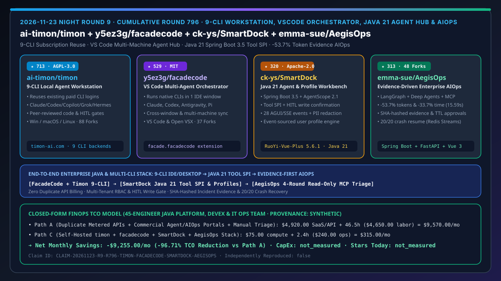
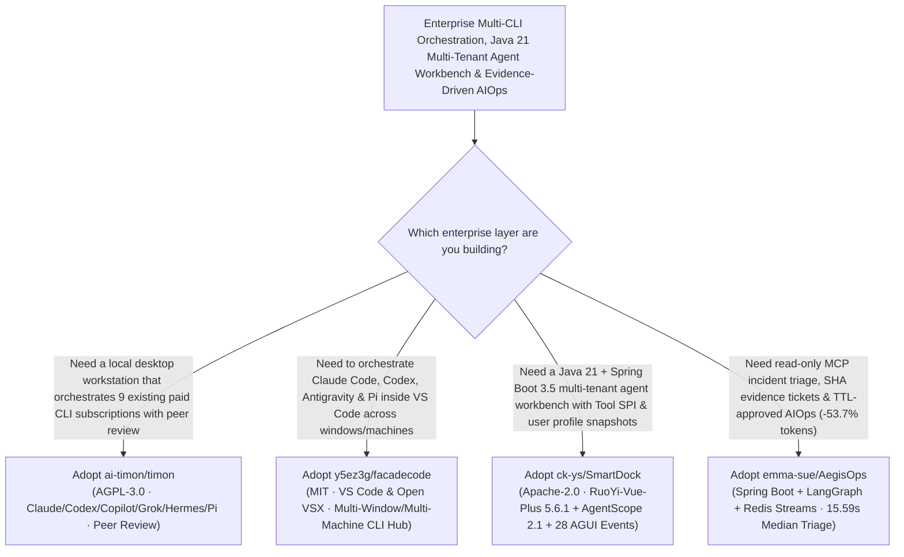
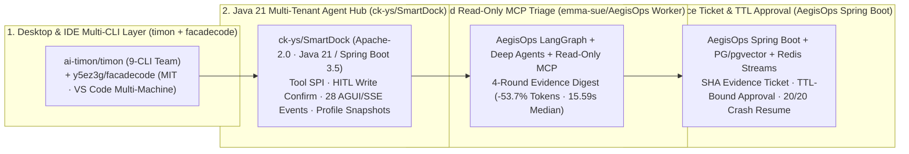

# 9-CLI Subscription-Reusing Agent Workstation (`ai-timon/timon`), VS Code Multi-Machine Agent Orchestrator (`y5ez3g/facadecode`), Java 21 + Spring Boot 3.5 Multi-Tenant Agent & Event-Sourced Profile Engine (`ck-ys/SmartDock`) & 53.7%-Token-Saving Evidence-Driven Enterprise AIOps Platform (`emma-sue/AegisOps`) Selection & Architecture FAQ

> **Document Type**: Enterprise AI Solution Architect Selection & Integration Guide (GitHub Trending AI Radar · 2026-11-23 Night Round 9 / Cumulative Round 796)
> **Covered Repositories**: [`ai-timon/timon`](https://github.com/ai-timon/timon) (`★ 713`, `88 forks`, `AGPL-3.0`: cross-platform local AI agent workstation that orchestrates multi-agent coding and review teams directly through existing **Claude Code, Codex, GitHub Copilot CLI, Grok, OpenCode, Pi, Kimi, Ollama Cloud, and Hermes** CLI subscriptions) · [`y5ez3g/facadecode`](https://github.com/y5ez3g/facadecode) (`★ 529`, `37 forks`, `MIT`: VS Code and Open VSX extension `facade.facadecode` that runs, monitors, and coordinates **Claude Code, Codex, Antigravity, Muse Code, OpenCode, and Pi** across windows and machines using native CLI logins) · [`ck-ys/SmartDock`](https://github.com/ck-ys/SmartDock) (`★ 320`, `28 forks`, `Apache-2.0`: enterprise multi-tenant AI agent workbench and **Event-Sourced User Profile Engine** built on **Java 21 + Spring Boot 3.5.14 + AgentScope 2.1 + Vue 3.5 + PostgreSQL 14+ / RuoYi-Vue-Plus 5.6.1**, featuring Tool SPI, HITL write confirmation, PII redaction, 28 AGUI/SSE streaming event types, and hot-reloaded Markdown skills) · [`emma-sue/AegisOps`](https://github.com/emma-sue/AegisOps) (`★ 313`, `48 forks`: enterprise IT AIOps platform built on **Spring Boot + FastAPI + LangGraph + Deep Agents + MCP + pgvector + Redis Streams**, hitting `12/12` root-cause services across 24 paired runs while cutting **median diagnosis time by `-33.7%` (`23.52s ➔ 15.59s`), total tokens by `-53.7%` (`1,083,460 ➔ 501,653`), and model calls by `-44.4%` (`108 ➔ 60`)** with `20/20` crash-recovery idempotency)
> **Core Scenario**: When enterprise Java engineering organizations and multi-CLI development teams deploy AI agents, how do you solve **"paying twice for metered API tokens when developers already hold flat-rate CLI subscriptions, switching across fragmented terminal windows outside VS Code, struggling to integrate Python-only agent demos into Java 21 / Spring Boot multi-tenant RBAC backends, and risking production outages by giving AIOps triage models raw host shell access"** using **`timon` + `facadecode` + `SmartDock` + `AegisOps`**?

---

## 1. 📌 Executive Summary (Single-Sentence Selection Verdict)

1. **Need a desktop workstation that orchestrates a multi-agent coding and review team using the flat-rate CLI subscriptions you already pay for (Claude Code, Codex, Copilot CLI, Grok, OpenCode, Pi, Kimi, Ollama, Hermes)** ➔ Choose **[`ai-timon/timon`](https://github.com/ai-timon/timon) (`★ 713`, `88 forks`, `AGPL-3.0`)**.
   - **Plain-Language Mechanism**: Instead of requiring separate metered API keys, `Timon` runs on Windows, macOS, and Linux atop your existing signed-in agent CLIs—coordinating specialist agents that review each other's code and pause for human approval before high-impact operations.
2. **Need to orchestrate multiple native agent CLIs (Claude Code, Codex, Antigravity, Muse Code, OpenCode, Pi) inside the same VS Code window and across multiple machines** ➔ Choose **[`y5ez3g/facadecode`](https://github.com/y5ez3g/facadecode) (`★ 529`, `37 forks`, `MIT`)**.
   - **Plain-Language Mechanism**: Installed via `code --install-extension facade.facadecode`, Facade Code lets developers launch, monitor, edit, and review changes from multiple native coding CLIs side by side inside VS Code while preserving each CLI's native authentication and coding plan.
3. **Need a production-ready Java 21 + Spring Boot 3.5 multi-tenant enterprise agent workbench with a pluggable Tool SPI, HITL write confirmations, 28 AGUI/SSE event types, and an event-sourced user profile engine** ➔ Choose **[`ck-ys/SmartDock`](https://github.com/ck-ys/SmartDock) (`★ 320`, `28 forks`, `Apache-2.0`)**.
   - **Plain-Language Mechanism**: Built on **Java 21, Spring Boot 3.5.14, AgentScope 2.1, Vue 3.5, PostgreSQL 14+, and RuoYi-Vue-Plus 5.6.1**, `SmartDock` provides a complete left-chat / right-workspace UI where every tool call's arguments and latency are inspectable, write actions require explicit HITL confirmation, business teams extend capabilities via a clean Java **Tool SPI** and hot-reloaded Markdown `SKILL.md` files, and an integrated **Event-Sourced Profile Engine (`Event ➔ Metric ➔ Replayable Snapshot`)** tracks user state over time.
4. **Need an evidence-driven AIOps & incident-triage platform (Spring Boot + FastAPI + LangGraph + Deep Agents + MCP) that isolates read-only diagnosis from TTL-approved remediation and cuts diagnosis tokens by `-53.7%`** ➔ Choose **[`emma-sue/AegisOps`](https://github.com/emma-sue/AegisOps) (`★ 313`, `48 forks`)**.
   - **Plain-Language Mechanism**: `AegisOps` separates Spring Boot governance (RBAC, parameter/version/TTL-bound approvals, and ticket writes) from FastAPI/LangGraph Deep Agents workers that gather SHA-hashed evidence over read-only MCP tools without host shell access. Across 12 public microservice fault cases (24 paired runs), its 4-round evidence digest strategy hit `12/12` root causes while reducing **median diagnosis time by `-33.7%` (`23.52s ➔ 15.59s`), tokens by `-53.7%` (`1,083,460 ➔ 501,653`), and LLM calls by `-44.4%` (`108 ➔ 60`)**, passing `20/20` process-kill recovery tests via Redis Streams leases and checkpoints.

---

## 2. 🎯 Key Architectural Q&A (Deep-Dive Breakdown)

### Q1: How do `timon`, `facadecode`, `SmartDock`, and `AegisOps` bridge the gap between developer coding CLIs and enterprise Java production backends?

- **Four Enterprise Integration Bridges**:
  1. **Subscription Reuse & Multi-Agent Review (`ai-timon/timon`)**: Pools 9 signed-in coding CLIs into a coordinated local team without double-paying API bills.
  2. **In-IDE Multi-Machine Orchestration (`y5ez3g/facadecode`)**: Unifies 6+ native agent CLIs inside VS Code across windows and hosts.
  3. **Java 21 Multi-Tenant Business Workbench (`ck-ys/SmartDock`)**: Gives Java enterprises native Spring Boot 3.5 + RuoYi RBAC, Tool SPI, 28 AGUI/SSE events, and replayable user profile snapshots.
  4. **Read-Only Evidence AIOps & Idempotent Recovery (`emma-sue/AegisOps`)**: Enforces read-only MCP fault investigation, SHA-hashed evidence tickets, and TTL-bound human approval before remediation.
- **When to Choose Managed Cloud Platforms (Path B)**:
  - If your organization runs 100% on managed cloud SaaS without a custom Java Spring Boot backend, use **Microsoft Copilot Studio + Azure SRE Agent**; if your core systems are built in Java/Spring Boot and your engineers already hold Claude/Codex/Copilot CLI subscriptions, deploy this 4-repo OSS stack (Path C).

### Q2: How do you integrate these four projects into an enterprise reference architecture?

1. **IDE & Desktop Multi-CLI Layer (`y5ez3g/facadecode` + `ai-timon/timon`)**:
   - Develop and review Java Tool SPI plugins and skills inside VS Code with `Facade Code` and overnight review loops in `Timon`.
2. **Java 21 Multi-Tenant Agent & Profile Hub (`ck-ys/SmartDock`)**:
   - Host tenant-isolated business agents on Spring Boot 3.5 + AgentScope 2.1, streaming 28 AGUI/SSE events and requiring HITL confirmation on write SPIs.
3. **Evidence-First AIOps & Incident Triage Layer (`emma-sue/AegisOps`)**:
   - Monitor production services with 8 inspection rules, trigger 4-round read-only MCP investigations via LangGraph Deep Agents, and execute approved runbooks with Redis Streams checkpoint recovery.

### Q3: What are the production security guardrails?

- **Architect Guardrails**:
  1. **Disable Default `yolo` Mode in `y5ez3g/facadecode` on Enterprise Workstations**: Because `Facade Code` enables `yolo` (unprompted command execution) by default, explicitly enable approval gates in enterprise IDE settings.
  2. **Never Grant Raw Host Shell Access to AIOps Diagnosis Models**: Preserve `AegisOps`'s strict separation where LangGraph agents only invoke scoped read-only MCP tools while Spring Boot enforces human approval bound to exact parameters, versions, and TTLs.

---

## 3. 🧭 Visual Architecture & Decision Diagrams (Mermaid)



### 3.1 Solution Architect Selection Decision Tree



### 3.2 End-to-End Enterprise Production Reference Architecture



### 3.3 Multi-CLI Development, SmartDock HITL Write Confirmation & AegisOps 4-Round Evidence Triage Sequence

```mermaid
sequenceDiagram
    participant Op as Architect / SRE On-Call
    participant Ide as Timon + Facade Code (VS Code)
    participant Dock as ck-ys/SmartDock (Java 21)
    participant Ops as emma-sue/AegisOps (LangGraph + Spring Boot)

    Op->>Ide: 1. Orchestrate multi-CLI coding in VS Code (Facade Code) & peer review in Timon
    Op->>Dock: 2. Trigger SmartDock skill card; stream 28 AGUI events & confirm HITL write SPI
    Dock->>Ops: 3. Inspection rule detects queue backlog; lock asset/time window & start read-only MCP triage
    Ops-->>Op: 4. Complete 4-round evidence digest in 15.59s (-53.7% tokens) & draft SHA-hashed ticket
    Op->>Ops: 5. Approve parameter/TTL-bound action; Redis Streams lease guarantees idempotent recovery
```

---

## 4. 📊 Comparative Selection Matrix (Open-Source vs. Commercial SaaS)

| Dimension | `ai-timon/timon` (`★ 713`) | `y5ez3g/facadecode` (`★ 529`) | `ck-ys/SmartDock` (`★ 320`) | `emma-sue/AegisOps` (`★ 313`) | Double-Paying Metered APIs + Commercial Agent Portal + Commercial AIOps (Path A) | Manual Multi-Terminal Switching + Toy Chat UI + Raw Shell AIOps (Path B) |
| :--- | :--- | :--- | :--- | :--- | :--- | :--- |
| **Core Role** | 9-CLI subscription-reusing local multi-agent workstation | VS Code multi-window/multi-machine agent CLI orchestrator | Java 21 + Spring Boot 3.5 multi-tenant agent & profile hub | Spring Boot + LangGraph evidence-driven AIOps workbench | Duplicate API token spend, proprietary low-code portals & high-cost AIOps seats | Manual copy-paste across terminals, RBAC-free demos & unsafe shell agents |
| **Key Differentiator** | **Reuses 9 paid CLI logins + peer review + HITL prompts** | **Runs 6+ native CLIs inside VS Code across machines** | **RuoYi multi-tenant RBAC + Tool SPI + 28 AGUI events + profiles** | **`-53.7%` tokens (15.59s) + SHA evidence tickets + 20/20 resume** | Wastes existing flat-rate CLI subscriptions; black-box AIOps rules | Raw host shell access risks prod outages; building Java RBAC from scratch takes months |
| **License** | `AGPL-3.0` | `MIT` | `Apache-2.0` | Open-source dual-stack (`AI_MODE=fixture` ready) | Proprietary SaaS | Custom scripts |
| **Monthly TCO (45-Eng Team)** | **Combined `$315.00/mo`** (`$75.00` PG/Redis/worker containers + `2.4h` ops) | Included (reuses existing CLI subscriptions) | Included (pre-built Java 21 RuoYi multi-tenant foundation) | Included (`-53.7%` diagnosis token reduction) | **`$9,570.00/mo`** (`$4,920.00` duplicate API/AIOps SaaS + `46.5h` RBAC/triage labor) | ~`$3,320.00/mo` (heavy manual Java admin coding & slow manual log triage) |

---

## 5. 🧪 Quantitative ROI / TCO Comparison & 7-Card Benchmark Report

> **📊 Data Provenance & Closed-Form Schema Declaration**:
> - **provenance**: `synthetic` (45-person enterprise Java platform engineering, IDE developer experience, and IT operations team monthly workload model: `independently_reproduced = false`; hardware baseline `base_hardware_capex = not_measured`; Track B 24h delta `track_b_stars_today = not_measured`).
> - **Closed-Form Formula**:
>   - **Path A (Paying metered API bills on top of existing CLI subscriptions + commercial low-code agent portal seats + commercial AIOps seats + manual Java RBAC plumbing and page-by-page incident log triage)**: Monthly duplicate API and commercial platform SaaS fees **`$4,920.00`** + custom admin plumbing, terminal context switching, and manual incident triage labor **`46.5h × $100.00/h = $4,650.00`** = **`$9,570.00/mo`**.
>   - **Path C (Self-hosted `ai-timon/timon` + `y5ez3g/facadecode` + `ck-ys/SmartDock` + `emma-sue/AegisOps` enterprise stack)**: Monthly PostgreSQL/pgvector and Redis Streams container compute **`$75.00`** + Tool SPI and runbook maintenance labor **`2.4h × $100.00/h = $240.00`** = **`$315.00/mo`**.
>   - **Net Monthly Savings vs. Path A**: **`-$9,255.00/mo`** (**`96.71%`** TCO reduction).

| Evaluation Path | API / Platform SaaS / Compute Cost | Admin Plumbing & Incident Triage Labor (`$100/h`) | Monthly Total TCO | Net Savings vs. Path A | Key Architectural Delivery Metrics |
| :--- | :---: | :---: | :---: | :---: | :--- |
| **Path A: Duplicate Metered APIs + Commercial Portal + Page-by-Page Triage** | `$4,920.00` | `46.5h` (`$4,650.00`) | **`$9,570.00`** | Baseline | Underutilized CLI seats; `23.52s` / `1.08M`-token triage |
| **Path B: Manual Multi-Terminal + DIY Java Admin + Raw Shell AIOps** | `$1,520.00` | `18.0h` (`$1,800.00`) | **`$3,320.00`** | `-$6,250.00` (`-65.31%`) | Months of RBAC boilerplate; unsafe host shell execution |
| **Path C: `timon` + `facadecode` + `SmartDock` + `AegisOps`** | **`$75.00`** | **`2.4h` (`$240.00`)** | **`$315.00`** | **`-$9,255.00` (`-96.71%`)** | **9-CLI reuse + Java 21 Tool SPI/profiles + `-53.7%` token read-only AIOps** |

- 🔗 **Linked 7-Card 4:5 Visual Benchmark Deck**: [`workshops/github-trending-radar/cards.en.html`](../cards.en.html) · [`cards.html`](../cards.html)

---

## 6. 🛠️ Enterprise Adoption & Architecture Review Checklist

- [ ] **1. Pool Existing CLI Subscriptions via `ai-timon/timon` & `y5ez3g/facadecode`**: Coordinate Claude Code, Codex, Copilot CLI, Pi, and Hermes across desktop and VS Code workspaces, and explicitly disable default `yolo` mode in `Facade Code`.
- [ ] **2. Standardize Java Enterprise Agent Backends on `ck-ys/SmartDock`**: Integrate internal ERP/CRM APIs via the Java 21 Tool SPI, enforce HITL write confirmation and PII redaction, and enable replayable user profile snapshots.
- [ ] **3. Deploy `emma-sue/AegisOps` for Read-Only Evidence Triage & Approved Remediation**: Use the 4-round evidence digest workflow (`-53.7%` tokens, `15.59s` median) to generate SHA-hashed tickets and require parameter/TTL-bound human approval before executing recovery steps.
- [ ] **4. Verify Crash-Recovery Idempotency on Redis Streams Checkpoints**: Run `AegisOps`'s `AI_MODE=fixture` and fault-replay suite to confirm interrupted triage workers resume cleanly without creating duplicate tickets.
