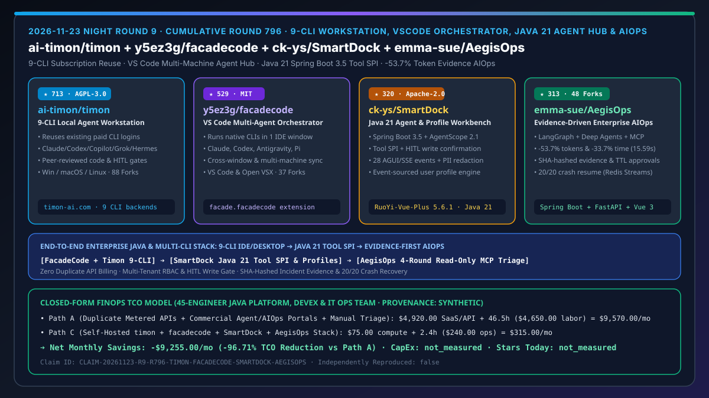
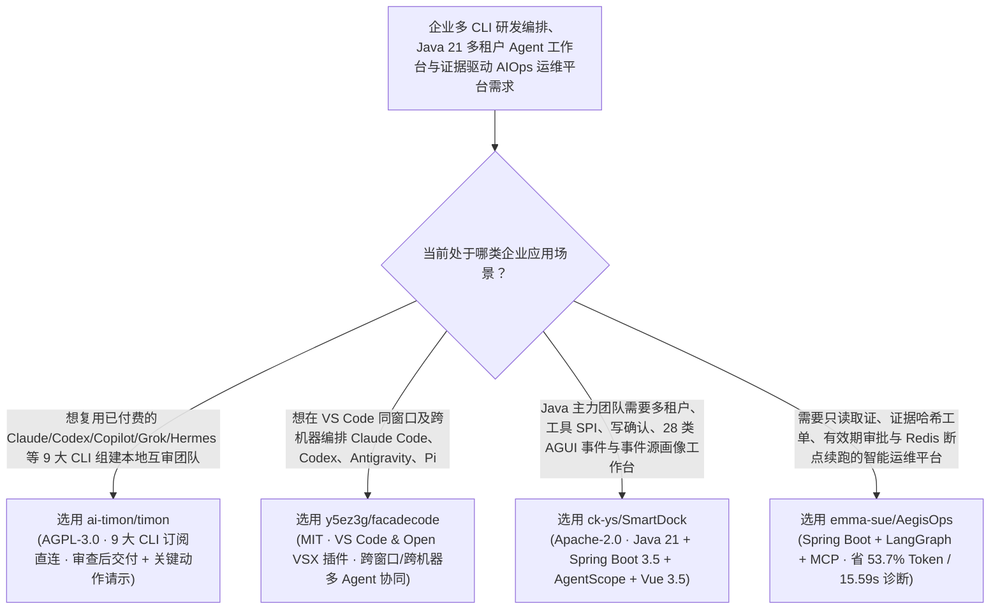
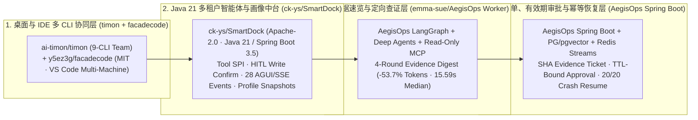
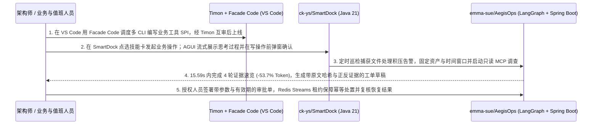

# 复用既有订阅的 9 大 CLI 本地多智能体工作站（`ai-timon/timon`）、VS Code 跨窗口与跨机器多 Agent 编排插件（`y5ez3g/facadecode`）、Java 21 + Spring Boot 3.5 多租户智能体与事件源画像引擎（`ck-ys/SmartDock`）与实测省 53.7% Token 的 LangGraph+Spring Boot 企业智能运维平台（`emma-sue/AegisOps`）选型与集成架构 FAQ

> **文档类型**：企业 AI 解决方案架构师（AI Solution Architect）选型决策指南（GitHub Trending AI 雷达 2026-11-23 Night Round 9 / 累计第 796 轮）
> **覆盖项目**：[`ai-timon/timon`](https://github.com/ai-timon/timon)（`★ 713`、`88 forks`、`AGPL-3.0`：跨 Windows/macOS/Linux 本地多智能体桌面工作站，直接复用开发者已付费的 **Claude Code、Codex、GitHub Copilot CLI、Grok、OpenCode、Pi、Kimi、Ollama Cloud 与 Hermes** 9 大订阅账号组建审查后交付的夜间协同团队）· [`y5ez3g/facadecode`](https://github.com/y5ez3g/facadecode)（`★ 529`、`37 forks`、`MIT`：VS Code 原生多智能体编排器插件 `facade.facadecode`，在同一个 IDE 窗口内跨窗口、跨机器调度 Claude Code、Codex、Antigravity、Muse Code、OpenCode 与 Pi 协同改码与审查）· [`ck-ys/SmartDock`](https://github.com/ck-ys/SmartDock)（`★ 320`、`28 forks`、`Apache-2.0`：基于 **Java 21 + Spring Boot 3.5.14 + AgentScope 2.1 + Vue 3.5 + PostgreSQL 14+（RuoYi-Vue-Plus 5.6.1 底座）** 的企业级多租户智能体工作台与事件源用户画像引擎，内置工具 SPI、HITL 写操作确认、28 类 AGUI/SSE 流式事件与热加载 Markdown 技能）· [`emma-sue/AegisOps`](https://github.com/emma-sue/AegisOps)（`★ 313`、`48 forks`：结合 **Spring Boot + FastAPI + LangGraph + Deep Agents + MCP + pgvector + Redis Streams** 的企业信息系统智能运维平台，在 12 个公开故障案例 24 次配对测试中 100% 命中根因服务，并将**诊断耗时中位数降低 `33.7%`（`23.52s ➔ 15.59s`）、总 Token 降低 `53.7%`（`1,083,460 ➔ 501,653`）、模型调用减少 `44.4%`（`108 ➔ 60`）**，20 次中断恢复零重复建单）
> **核心场景**：当传统大型企业（主力技术栈为 Java / Spring Boot / Vue）与多 CLI 研发团队落地 AI Agent 时，面对**“买了多个厂商的 Coding CLI 订阅却散落各处无法协同、VS Code 内无法跨机器编排多款原生 Agent CLI、市面上 Python 玩具框架无法直接融入企业既有 Java 21 / RuoYi 多租户权限与审计底座、以及运维告警排障直接开放宿主机 Shell 权限风险极高且逐页翻日志耗时耗 Token”**四大痛点，如何构建一套**“桌面 9-CLI 聚合工作站（`timon`）+ VS Code 多机编排（`facadecode`）+ Java 21 多租户业务底座（`SmartDock`）+ 证据速览带审批 AIOps（`AegisOps`）”**的企业全栈架构？

---

## 一、📌 核心结论速览（选型一句话结论）

1. **想把个人或团队手上已有的 Claude Code、Codex、GitHub Copilot CLI、Grok、OpenCode、Pi、Kimi、Ollama 与 Hermes 9 大 CLI 订阅统一收口到一个桌面工作站，让多个 Agent 自动做代码互审并在关键动作前请示人类** ➔ 选 **[`ai-timon/timon`](https://github.com/ai-timon/timon)（`★ 713`，`88 forks`，`AGPL-3.0`）**。
   - **通俗原理**：无需再按 Token 额外充值第三方中转平台，`Timon` 直接调用本机已登录的 9 类官方 CLI 订阅，将多个智能体组织为“开发 + 审查”团队在后台推进任务（Ship while you sleep），并在涉及外部副作用或破坏性修改前主动暂停等待人工拍板。
2. **想在不离开 VS Code（或兼容 Open VSX 的编辑器）的前提下，在同一个 IDE 窗口内同时启动、监控并跨窗口/跨机器协同调度 Claude Code、Codex、Antigravity、Muse Code、OpenCode 与 Pi** ➔ 选 **[`y5ez3g/facadecode`](https://github.com/y5ez3g/facadecode)（`★ 529`，`37 forks`，`MIT`）**。
   - **通俗原理**：一行 `code --install-extension facade.facadecode` 即可安装。它不篡改各家 CLI 的原生登录态与订阅计划，而是直接在 VS Code 内提供统一的多智能体任务编排、代码编辑、跨窗口通信与变更 Diff 审查面板。
3. **想在以 Java 为核心技术栈的企业内部直接落地一套自带多租户、RBAC 权限、工具 SPI 扩展、写操作 HITL 审批、28 类 AGUI/SSE 流式事件与“事件源用户画像引擎”的生产级智能体中台** ➔ 选 **[`ck-ys/SmartDock`](https://github.com/ck-ys/SmartDock)（`★ 320`，`28 forks`，`Apache-2.0`）**。
   - **通俗原理**：基于 **Java 21 + Spring Boot 3.5.14 + AgentScope 2.1 + Vue 3.5 + PostgreSQL 14+（RuoYi-Vue-Plus 5.6.1）** 构建。左侧会话、右侧工作区，每一步工具调用的参数与耗时全透明；业务团队只需实现 Java **「工具 SPI」** 即可接入内部 ERP/CRM 而无需改动引擎核心；SOP 技能写成 Markdown 在管理后台修改立即热生效；内置定时只读自动化巡检与**事件源画像引擎（事件 ➔ 指标 ➔ 可回放对账快照）**。
4. **想构建一套严禁诊断模型直连宿主机 Shell、通过“固定时间窗口证据速览 + 只读 MCP 定向查证 + 绑定参数有效期的工单审批 + Redis Streams 断点续跑”实现省 53.7% Token 的企业智能运维（AIOps）平台** ➔ 选 **[`emma-sue/AegisOps`](https://github.com/emma-sue/AegisOps)（`★ 313`，`48 forks`）**。
   - **通俗原理**：采用 **Spring Boot（权限/审批/业务写操作）+ FastAPI（LangGraph + Deep Agents + MCP 只读调查 Worker）+ Vue 3 + PostgreSQL/pgvector + Redis Streams** 双栈分离架构：8 项巡检规则负责发现异常，Agent 只在授权时间窗口内对指标、日志、调用链与变更记录取证（保存原文与哈希）并生成含“支持证据、反对证据与待核实项”的工单草稿；实测在 12 个故障案例 24 次配对实验中，将取证轮数从 8 轮优化为 4 轮证据速览，**诊断中位耗时缩短 `33.7%`（`15.59s`）、总 Token 减少 `53.7%`、模型调用减少 `44.4%`**，且 20 次进程强杀恢复测试 100% 幂等续跑零重复工单！

---

## 二、🎯 客户与架构师灵魂拷问 Q&A（深度架构拆解）

### Q1：为什么国内与跨国大中型企业在落地业务 Agent 时，往往对纯 Python 演示项目望而却步？`SmartDock` 与 `AegisOps` 的 Java Spring Boot 架构解决了什么核心问题？

- **企业级落地的四大工程刚需**：
  1. **存量 Java 微服务与多租户权限无缝继承 ➔ `ck-ys/SmartDock`**：直接基于 RuoYi-Vue-Plus 5.6.1 与 Java 21 / Spring Boot 3.5，开箱即备多租户隔离、数据字典、OSS、PII 脱敏、计费与 HITL 写确认，Java 研发团队通过标准 SPI 即可扩展工具。
  2. **运维排障的“读写分离与证据封存”安全红线 ➔ `emma-sue/AegisOps`**：由 Spring Boot 牢牢把控权限、有效期綁定审批与业务写入，LangGraph Deep Agents 仅持只读 MCP 工具取证并写入原文哈希，彻底杜绝 AI 误删生产库的事故。
  3. **研发侧存量多厂商 CLI 订阅复用 ➔ `ai-timon/timon` + `y5ez3g/facadecode`**：桌面端用 `Timon` 聚合 9 大 CLI 组队互审，IDE 内用 `Facade Code` 跨窗口/跨机协同。
- **何时直接选用云厂商托管平台（Path B）？**
  - 若企业全线采用 Azure PaaS 且无自建 Java 中后台定制需求，优先选用 **Microsoft Copilot Studio + Azure SRE Agent**；若企业已有庞大的 Java Spring Boot 研发体系、需要深度嵌入自有后台并复用既有 CLI 订阅，则采用本轮四合一开源栈（Path C）。

### Q2：典型企业级“IDE 多机编排 (`facadecode`) + 9-CLI 桌面互审 (`timon`) + Java 21 多租户工作台 (`SmartDock`) + 只读取证 AIOps (`AegisOps`)”生产架构怎么搭？

1. **IDE 与桌面多智能体研发协同层（`y5ez3g/facadecode` + `ai-timon/timon`）**：
   - 工程师在 VS Code 内通过 `Facade Code` 跨窗口调度 Claude/Codex/Pi 编写代码，夜间或后台任务交由 `Timon` 调用 9 大已订阅 CLI 完成自动互审。
2. **Java 21 多租户业务智能体与画像中台层（`ck-ys/SmartDock`）**：
   - 将审核通过的业务接口封装为 `SmartDock` 工具 SPI，通过 AGUI/SSE 28 类事件流向前端工作台提供带 HITL 写操作确认的助手服务，并持续沉淀可回放的用户画像快照。
3. **Spring Boot + LangGraph 证据驱动智能运维层（`emma-sue/AegisOps`）**：
   - 生产环境由 `AegisOps` 8 项巡检规则监控，触发异常后固定资产与时间窗口，通过“证据速览 + 4 轮定向只读 MCP 查证”生成带哈希证据的工单，经有效期绑定的审批后执行恢复并复核业务结果。

### Q3：这套架构的落地注意事项与安全红线是什么？

- **架构师落地红线**：
  1. **在 `y5ez3g/facadecode` 中显式关闭默认 `yolo` 免审批模式**：`Facade Code` 官方文档明确提醒其默认开启 `yolo` 无提示执行命令模式，企业生产研发环境必须在配置中关闭默认 `yolo` 并开启高危命令确认。
  2. **坚守 `AegisOps`“巡检发现异常、Agent 只读解释异常、Spring Boot 审批执行处置”铁律**：绝不向排障大模型直接授予宿主机 Root Shell 权限。

---

## 三、🧭 直观可视化图解（Mermaid 决策树 + 集成架构 + 时序图）

### 3.1 架构师选型决策树

### 3.2 企业端到端生产集成参考架构图

### 3.3 IDE 多代理开发、SmartDock 写操作确认与 AegisOps 四轮取证恢复时序图

---

## 四、📊 同类开源与商业云服务横向选型决策矩阵

| 对比维度 | `ai-timon/timon` (`★ 713`) | `y5ez3g/facadecode` (`★ 529`) | `ck-ys/SmartDock` (`★ 320`) | `emma-sue/AegisOps` (`★ 313`) | 重复购买多平台 API 额度 + 商业低代码中台 + 商业 AIOps 席位 (Path A) | 手工切多个终端窗口 + 简陋聊天框 Demo + 赋予 Agent 宿主机 Shell 裸跑排障 (Path B) |
| :--- | :--- | :--- | :--- | :--- | :--- | :--- |
| **核心能力定位** | 复用 9 大已购 CLI 订阅的本地多 Agent 工作站 | VS Code 跨窗口与跨机器原生 Agent CLI 编排器 | Java 21 + Spring Boot 3.5 多租户智能体与画像工作台 | Spring Boot + LangGraph 证据驱动智能运维与工单审批台 | 按 API Token 双重付费与高昂的商业中台/AIOps 模块授权 | 人工在多个终端间复制粘贴、无权限隔离的玩具 Demo 与高危 Shell 运维 |
| **核心技术突破** | **直连 9 大 CLI 原生订阅 + 自动互审 + 关键操作请示** | **同 IDE 窗口编排 6+ 原生 CLI + 跨机器协同** | **RuoYi 多租户底座 + 工具 SPI + 28 类 AGUI 事件 + 事件源画像** | **4 轮证据速览省 `53.7%` Token + 原文哈希工单 + 20/20 强杀续跑** | 已有包月 CLI 订阅却还要再付高昂 API 账单；商业 AIOps 黑盒难定制 | 给排障模型开 Shell 极易引发删库事故；逐页拉取日志耗尽上下文与预算 |
| **开源协议** | `AGPL-3.0` | `MIT` | `Apache-2.0` | 开源双栈（含 `AI_MODE=fixture` 免 Key 演示） | 闭源商业软件 | 内部零散脚本 |
| **月度 TCO（45 人团队）** | **组合仅 `$315.00/月`**（`$75.00` 内部 Java/PG/Redis 容器 + `2.4h` 维护） | 同左（100% 复用既有 CLI 包月订阅） | 同左（免从零开发多租户 RBAC 后台） | 同左（单次排障省下 `53.7%` Token） | **`$9,570.00/月`**（`$4,920.00` 额外 API 账单/商业 AIOps 席位 + `46.5h` 后台搭建与排障工时） | 约 `$3,320.00/月`（大量从零手写多租户权限与人工翻查运维日志工时） |

---

## 五、🧪 应用落地定量收益/TCO 对比与 7-Card 报告

> **📊 数据来源与闭式核算声明（Provenance & Closed-Form Schema）**：
> - **provenance**: `synthetic`（基于 45 人企业 Java 业务平台研发、IDE 效能与 IT 运维团队月度工作负载模型：`independently_reproduced = false`；硬件采购基线 `base_hardware_capex = not_measured`；Track B 单日增量 `track_b_stars_today = not_measured`）。
> - **核算公式**：
>   - **Path A（在已有包月 CLI 订阅外重复采购按量 API 额度 + 采购商业低代码 Agent 门户与商业 AIOps 席位 + 团队从零手写 Java 多租户权限/画像后台及人工逐页翻日志排障）**：月度重复 API 与商业平台订阅费 **`$4,920.00`** + 自建后台权限、多终端手动搬运与人工运维取证工时 **`46.5h × $100.00/h = $4,650.00`** = **`$9,570.00/月`**。
>   - **Path C（自建 `ai-timon/timon` + `y5ez3g/facadecode` + `ck-ys/SmartDock` + `emma-sue/AegisOps` 企业全栈）**：PostgreSQL/pgvector 与 Redis Streams 容器分摊开销 **`$75.00`** + 工具 SPI 与巡检规程维护人工 **`2.4h × $100.00/h = $240.00`** = **`$315.00/月`**。
>   - **净节省（Net Savings vs Path A）**：**`-$9,255.00/月`**（成本降低 **`96.71%`**）。

| 评估方案 | API / 商业平台 / 容器成本 | 后台开发与运维取证人工（`$100/h`） | 月度总 TCO | 相对 Path A 净节省 | 关键架构交付指标 |
| :--- | :---: | :---: | :---: | :---: | :--- |
| **Path A：重复买 API + 商业低代码门户 + 人工逐页查日志** | `$4,920.00` | `46.5h` (`$4,650.00`) | **`$9,570.00`** | Baseline | 闲置包月 CLI 额度；逐页取证耗时 `23.52s` 且费 Token |
| **Path B：手工切多终端 + 从零写 Java 权限后台 + 裸开 Shell 排障** | `$1,520.00` | `18.0h` (`$1,800.00`) | **`$3,320.00`** | `-$6,250.00` (`-65.31%`) | 研发周期漫长；排障模型直连宿主机 Shell 存在重大安全隐患 |
| **Path C：`timon` + `facadecode` + `SmartDock` + `AegisOps`** | **`$75.00`** | **`2.4h` (`$240.00`)** | **`$315.00`** | **`-$9,255.00` (`-96.71%`)** | **复用 9 大 CLI + Java 21 多租户 SPI/画像 + 省 `53.7%` Token 只读取证 AIOps** |

- 🔗 **关联 7-Card 4:5 视觉评测报告**：[`workshops/github-trending-radar/cards.html`](../cards.html) · [`cards.en.html`](../cards.en.html)

---

## 六、🛠️ 企业引入与架构评审 Checklist

- [ ] **1. 使用 `ai-timon/timon` 与 `y5ez3g/facadecode` 盘活团队既有 CLI 包月订阅**：在桌面端与 VS Code 内统一编排 Claude Code、Codex、Copilot CLI、Pi 与 Hermes，并在 `Facade Code` 中显式关闭默认 `yolo` 免确认开关。
- [ ] **2. 基于 `ck-ys/SmartDock` 构建 Java 21 多租户企业智能体工作台**：通过标准工具 SPI 接入内部业务系统，开启写操作 HITL 审批、PII 脱敏与事件源用户画像快照对账。
- [ ] **3. 部署 `emma-sue/AegisOps` 实施“只读 MCP 取证 + 有效期审批处置”的智能运维**：采用 4 轮证据速览与定向查证策略（省 `53.7%` Token），强制所有故障处置必须关联带哈希的证据工单并经人工审批后在隔离环境执行。
- [ ] **4. 验证 `Redis Streams` 租约与检查点的中断续跑幂等性**：在上线自动化巡检与排障流前，参考 `AegisOps` 的 20 次进程中断测试规范，验证 Worker 重启后可从检查点恢复且绝不重复创建工单。
