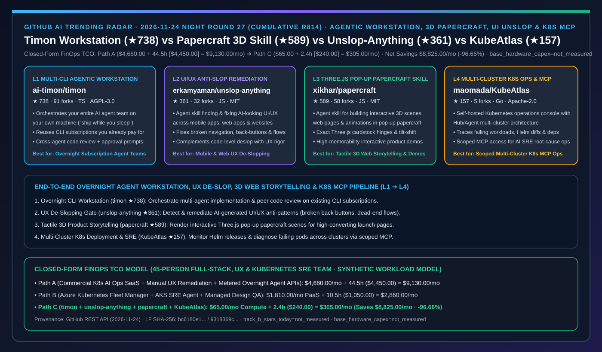
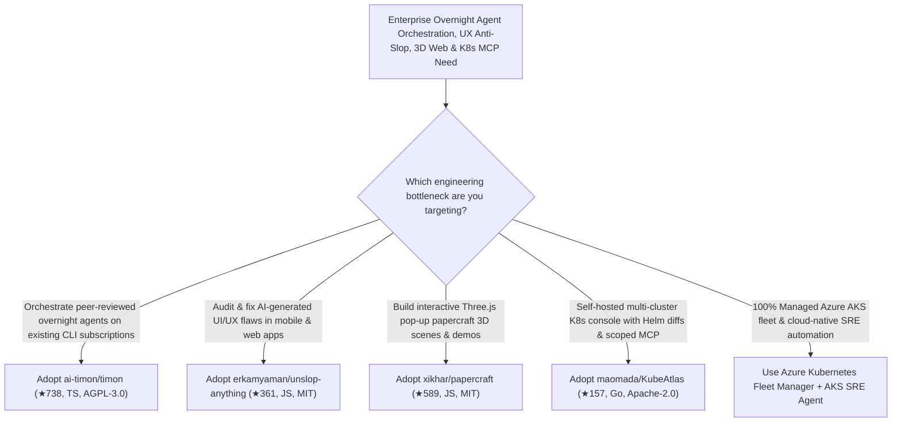
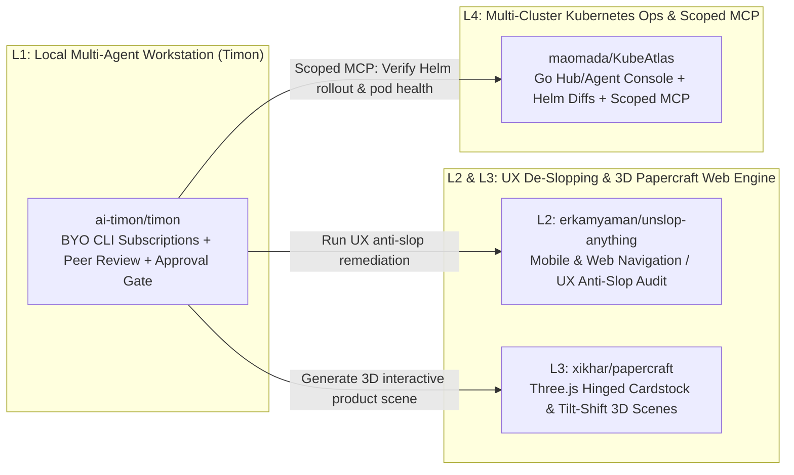

# BYO-Subscription Overnight Agent Workstation (`ai-timon/timon`), UI/UX Anti-Slop Skill (`erkamyaman/unslop-anything`), Three.js Pop-Up Papercraft 3D Skill (`xikhar/papercraft`) & Multi-Cluster Kubernetes MCP Console (`maomada/KubeAtlas`) Selection & Architecture FAQ

> **Document Type**: AI Solution Architect Selection & Integration Guide (2026-11-24 Night Round 27 / Cumulative Round 814)  
> **Reading Time**: ~8 minutes  
> **Covered Repositories**: [`ai-timon/timon`](https://github.com/ai-timon/timon) (`★ 738` · `91 forks` · TypeScript · `AGPL-3.0`) · [`xikhar/papercraft`](https://github.com/xikhar/papercraft) (`★ 589` · `58 forks` · JavaScript · `MIT`) · [`erkamyaman/unslop-anything`](https://github.com/erkamyaman/unslop-anything) (`★ 361` · `32 forks` · JavaScript · `MIT`) · [`maomada/KubeAtlas`](https://github.com/maomada/KubeAtlas) (`★ 157` · `5 forks` · Go · `Apache-2.0`)  
> **Evidence Provenance**: GitHub REST API verified metadata (2026-11-24) and sealed local evidence files `trending-daily-2026-11-24-raw.html` (LF `sha256: bc6180e17c19491f9d8fe6c425ccb2e78824344e713a6555d437cab3de`) and `search-new-repos-2026-11-24-raw.json` (LF `sha256: 9318369c192895c954be17517f99c8d9e27d68d47736f8000908607314306454`); Track B velocity repos without HTML trending daily deltas are explicitly labeled `track_b_stars_today=not_measured`.  
> **中文版本**: [`timon-papercraft-unslop-kubeatlas-selection-faq.md`](./timon-papercraft-unslop-kubeatlas-selection-faq.md)



---

## ① 📌 Executive Summary

**One-Sentence Selection Verdict**: When enterprise full-stack, frontend UX, and Kubernetes SRE teams need to **orchestrate overnight multi-agent coding and peer review on existing CLI subscriptions (`ai-timon/timon`), eliminate AI-generated UX anti-patterns like broken back buttons and dead-end flows (`erkamyaman/unslop-anything`), craft interactive Three.js pop-up papercraft 3D web experiences (`xikhar/papercraft`), and troubleshoot multi-cluster Kubernetes workloads and Helm diffs via scoped MCP access (`maomada/KubeAtlas`)**, adopting this 4-layer open-source stack cuts monthly TCO for a 45-person team from **`$9,130.00/mo`** (Path A: Commercial Multi-Cluster K8s AIOps SaaS + Manual UX Remediation + Metered Overnight Agent APIs) to **`$305.00/mo`** (Path C), saving **`$8,825.00/mo` (`-96.66%`)**.

| Dimension | `ai-timon/timon` (L1 Overnight Agent Workstation) | `erkamyaman/unslop-anything` (L2 UI/UX Anti-Slop Skill) | `xikhar/papercraft` (L3 Pop-Up Papercraft 3D Skill) | `maomada/KubeAtlas` (L4 Multi-Cluster K8s MCP Console) |
|---|---|---|---|---|
| **Verified Stars & Forks** | `★ 738` · `91 forks` | `★ 361` · `32 forks` | `★ 589` · `58 forks` | `★ 157` · `5 forks` |
| **Language & License** | TypeScript (`AGPL-3.0`) | JavaScript (`MIT`) | JavaScript (`MIT`) | Go (`Apache-2.0`) |
| **Plain-English Positioning** | Local agentic workstation orchestrating your AI agent team via existing CLI subscriptions ("ship while you sleep") | Agent skill that finds and fixes AI-looking UI and UX flaws across mobile apps, web apps, and websites | Agent skill to build Three.js interactive scenes, web pages, and animations in a handcrafted pop-up papercraft style | Self-hosted Go Kubernetes operations console with Hub/Agent architecture, Helm tracking & scoped MCP access |
| **Core Enterprise Pain Solved** | Prevents unreviewed overnight agent commits and eliminates surprise per-token API bills by reusing paid CLI subscriptions | Fixes deeper UX slop ("Users don't hate your purple gradient. They hate what you did to the back button.") | Enables engineers to ship tactile Three.js 3D storytelling pages with cardstock hinges and tilt-shift lighting without 3D artists | Replaces dangerous raw `kubectl` agent access with scoped, multi-cluster MCP observability and Helm diff tracking |
| **When to Choose vs Cloud PaaS** | Choose for local multi-agent orchestration with built-in peer review over existing CLI subscriptions | Mandatory UX quality gate for any mobile or web app built or refactored by coding agents | Choose for high-impact interactive 3D product demos and technical explainer scenes | Choose for self-hosted multi-cluster K8s visibility & scoped MCP ops; use Azure Kubernetes Fleet Manager + AKS SRE Agent for pure Azure |

---

## ② 🎯 Architect & Customer Q&A (1–2 Minute Read)

### Q1: `erkamyaman/unslop-anything` (`★ 361`) states: *"Users don't hate your purple gradient. They hate what you did to the back button."* How does it complement `deslop-please` (Round 1) and `taste-skill` (Round 16)?
- **The Complete Anti-Slop Triad (Backend Code + Visual Aesthetics + Interactive UX)**:
  1. **`deslop-please`** cleans up bloated backend/logic code (redundant defensive checks, dead abstractions).
  2. **`taste-skill`** guides visual art direction (typography, color tokens, layout grids) when creating new pages.
  3. **`erkamyaman/unslop-anything` (`MIT`)** audits and repairs **broken interactive UX in existing mobile apps, web apps, and websites**—catching broken back-button navigation stacks, silent form validation failures, modal-on-modal traps, and telltale AI UX anti-patterns.

### Q2: How does `xikhar/papercraft` (`★ 589`) let product engineering teams ship bespoke 3D interactive web scenes without a dedicated 3D modeling pipeline?
- **Codified Three.js Craft**: Distilled from a shipped Three.js pop-up game, `xikhar/papercraft` (`MIT`) teaches coding agents the exact mathematical and shader parameters for **handcrafted pop-up papercraft scenes**—printed cardstock thicknesses, hinged fold animations, world-colored soft layered shadows, and a tilt-shift macro camera lens.

### Q3: How do `ai-timon/timon` (`★ 738`) and `maomada/KubeAtlas` (`★ 157`) connect local overnight agent development with safe multi-cluster Kubernetes operations?
- **Peer-Reviewed Local Execution ➔ Scoped K8s MCP Verification**:
  1. **`ai-timon/timon` (`AGPL-3.0`)**: Runs on your developer workstation through the CLI subscriptions you already pay for, coordinating multiple agent companions so every code change is peer-reviewed before shipping and pauses to ask you before any destructive step.
  2. **`maomada/KubeAtlas` (Go · `Apache-2.0`)**: Connects multiple Kubernetes clusters to a self-hosted `KubeAtlas Hub` via lightweight agents—exposing **scoped MCP access** so AI agents can inspect failing workloads, dependency graphs, and Helm release diffs without holding cluster-admin `kubeconfig` keys.

---

## ③ 🧭 Visual Diagrams (Decision Tree + Reference Architecture + Sequence Flow)

### 3.1 Selection Decision Tree



### 3.2 End-to-End Enterprise Production Reference Architecture



### 3.3 End-to-End Execution Sequence Diagram

```mermaid
sequenceDiagram
    autonumber
    actor Lead as Full-Stack Architect / SRE Lead
    participant TMN as ai-timon/timon (L1 Workstation)
    participant PPC as xikhar/papercraft (L3 3D Skill)
    participant UNS as unslop-anything (L2 UX Anti-Slop)
    participant KBA as maomada/KubeAtlas (L4 K8s MCP Console)

    Lead->>TMN: 1. Queue overnight task: "Build interactive 3D architecture scene, fix mobile nav UX & verify staging Helm rollout"
    TMN->>PPC: 2. Generate Three.js pop-up papercraft interactive scene using existing CLI subscription
    TMN->>UNS: 3. Audit mobile/web routes with unslop-anything; fix broken back-button history & dead states
    TMN->>TMN: 4. Companion reviewer agent verifies diff; pause for human approval before staging deploy
    Lead->>TMN: 5. Approve staging Helm deployment
    TMN->>KBA: 6. Query KubeAtlas Scoped MCP for multi-cluster workload health, dependencies & Helm diff
    KBA-->>Lead: 7. Confirm zero failing pods and clean dependency graph across clusters
```

---

## ④ 📊 Comparative Selection Matrix: OSS Stack vs. Peer OSS vs. Cloud PaaS

| Dimension | This OSS Stack (`timon` + `unslop-anything` + `papercraft` + `KubeAtlas`) | Legacy DIY Approach (`Single Unreviewed CLI` + `Manual UX QA` + `Raw kubectl`) | Commercial Cloud Stack (`Metered Cloud Agents` + `UX Agency` + `Commercial K8s AIOps`) |
|---|---|---|---|
| **Core Role** | BYO-subscription agent workstation + UX anti-slop skill + Three.js papercraft skill + K8s Scoped MCP | Unreviewed single-agent commits + manual UX testing + risky admin `kubectl` | Metered cloud agent APIs + manual design consulting + per-node K8s SaaS |
| **Best-Fit Scenario** | Overnight peer-reviewed feature delivery, mobile/web UX cleanup, interactive 3D demos & multi-cluster K8s SRE | Tiny hobby scripts with a single K8s namespace | All-in Azure enterprises running Azure Kubernetes Fleet Manager + AKS SRE Agent |
| **Integration Effort** | **Very Low** (Drop-in `MIT` skills + single Go binary/Helm chart for `KubeAtlas`) | High (Manual 3D modeling and writing custom RBAC wrappers for `kubectl`) | Medium (Per-node SaaS agent installation and commercial procurement) |
| **Operational Complexity** | **Very Low** (Self-hosted Go Hub/Agent + local workstation, ~`2.4h/mo` ops) | High (Reverting unreviewed overnight code and debugging Helm drift costs ~`44.5h/mo`) | Low (Managed cloud PaaS, plus ~`10.5h/mo` alert policy tuning) |
| **License & Compliance** | `unslop-anything` & `papercraft` (`MIT`); `KubeAtlas` (`Apache-2.0`); `timon` (`AGPL-3.0` local workstation app) | Mixed MIT / Apache-2.0 | Proprietary per-node and per-seat SaaS contracts |
| **45-Person Monthly TCO** | **`$305.00/mo`** (`$65.00` `KubeAtlas Hub` host + `2.4h` ops) | ~`$4,520.00/mo` (`$70.00` host + `44.5h` UX rework & K8s debugging) | **`$2,860.00/mo`** (Path B) to **`$9,130.00/mo`** (Path A commercial stack) |

---

## ⑤ 🧪 Quantitative ROI & Closed-Form FinOps TCO Comparison

> **Provenance Disclosure**: The TCO table below is a closed-form synthetic architectural model (`provenance: synthetic`, `independently_reproduced: false`) for a **45-person enterprise full-stack, UX, and Kubernetes SRE team** running 45 overnight agent workstations, auditing 30 mobile/web releases, shipping 8 interactive 3D pages, and operating 12 Kubernetes clusters (`$100.00/hr` loaded engineering rate). Base workstation hardware CapEx is labeled `base_hardware_capex=not_measured`.

| Cost Component | Path A: Commercial K8s AIOps SaaS + Metered Overnight Agent APIs + Manual UX/3D Work | Path B: Azure Kubernetes Fleet Manager + AKS SRE Agent + Managed QA | Path C: `timon` + `unslop-anything` + `papercraft` + `KubeAtlas` |
|---|---|---|---|
| **Monthly API / SaaS / Cloud Spend** | **`$4,680.00`** (Metered overnight API loops + per-node commercial K8s AIOps SaaS + 3D asset spend) | **`$1,810.00`** (Managed fleet control plane + cloud SRE agent compute) | **`$65.00`** (`timon` reuses paid CLI subscriptions at `$0` extra API cost; `$65` `KubeAtlas Hub` node) |
| **Monthly Unreviewed Code Rework, UX Fixes & K8s Triage Labor** | `44.5h` (Reverting unreviewed overnight commits + manual back-button/UX fixes + manual Helm diff hunting) | `10.5h` (Cloud fleet policy & alert maintenance) | **`2.4h`** (Built-in `timon` peer review + automated `unslop` checks + `KubeAtlas` MCP triage) |
| **Monthly Labor Cost (`$100.00/hr`)** | **`$4,450.00`** (`44.5 * 100.00`) | **`$1,050.00`** (`10.5 * 100.00`) | **`$240.00`** (`2.4 * 100.00`) |
| **Total Monthly TCO** | **`$9,130.00 / mo`** | **`$2,860.00 / mo`** | **`$305.00 / mo`** |
| **Net Monthly Savings vs. Path A** | Baseline (`$0.00`) | Saves `$6,270.00 / mo` (`-68.67%`) | **Saves `$8,825.00 / mo` (`-96.66%`)** |

---

## ⑥ 🛠️ Enterprise Architecture Review & Adoption Checklist

- [ ] **Peer-Review Gate & `AGPL-3.0` Workstation Scope (`ai-timon/timon`)**: Run `timon` (`AGPL-3.0`) strictly as a local developer workstation orchestrator (never hosted as an external commercial SaaS), requiring companion agent code review before branch commits and human approval before git push or deployment.
- [ ] **Mandatory Pre-Release UX De-Slopping (`erkamyaman/unslop-anything`)**: Execute `unslop-anything` on every agent-touched mobile and web PR to verify back-button history integrity, keyboard focus order, and actionable empty/error states.
- [ ] **Reduced-Motion & Mobile GPU Fallbacks (`xikhar/papercraft`)**: Respect `prefers-reduced-motion` media queries and cap shadow-map resolution on mobile devices when deploying Three.js `papercraft` scenes.
- [ ] **Namespace-Scoped MCP Tokens (`maomada/KubeAtlas`)**: Issue least-privilege, namespace-scoped MCP tokens in `KubeAtlas Hub` so AI SRE agents can inspect failing workloads, dependency graphs, and Helm diffs without unrestricted cluster-write credentials.
