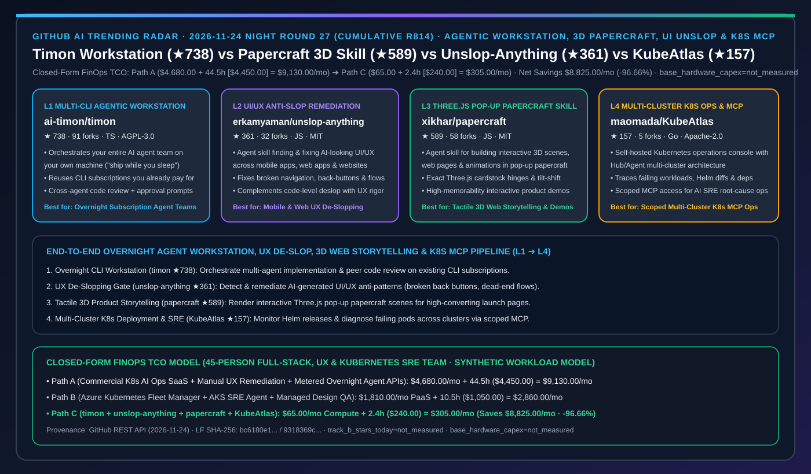
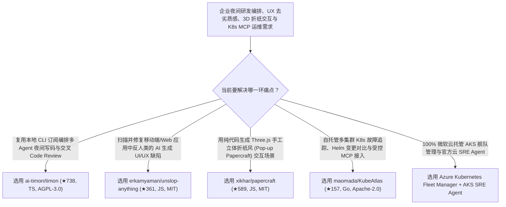
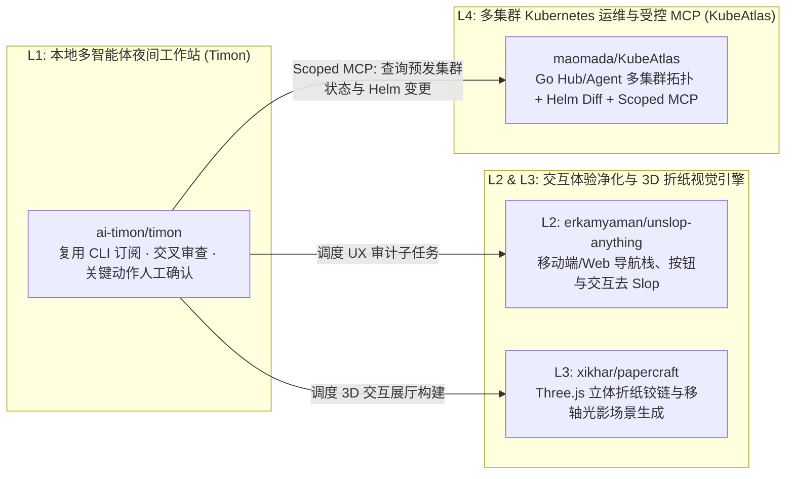
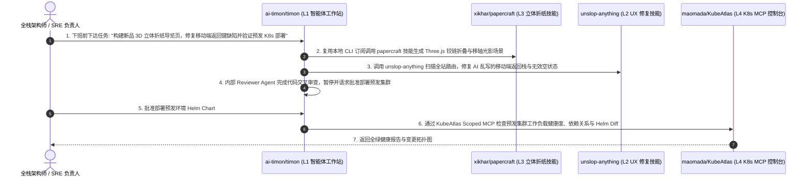

# 自有订阅夜间智能体工作站（`ai-timon/timon`）、移动端/Web AI 伪劣交互修复技能（`erkamyaman/unslop-anything`）、Three.js 立体折纸交互场景技能（`xikhar/papercraft`）与多集群 Kubernetes 运维 MCP 控制台（`maomada/KubeAtlas`）选型与集成 FAQ

> **文档类型**：AI 解决方案架构师（AI Solution Architect）选型决策指南（2026-11-24 Night Round 27 / 累计第 814 轮）  
> **阅读耗时**：约 8 分钟  
> **覆盖项目**：[`ai-timon/timon`](https://github.com/ai-timon/timon)（`★ 738` · `91 forks` · TypeScript · `AGPL-3.0`） · [`xikhar/papercraft`](https://github.com/xikhar/papercraft)（`★ 589` · `58 forks` · JavaScript · `MIT`） · [`erkamyaman/unslop-anything`](https://github.com/erkamyaman/unslop-anything)（`★ 361` · `32 forks` · JavaScript · `MIT`） · [`maomada/KubeAtlas`](https://github.com/maomada/KubeAtlas)（`★ 157` · `5 forks` · Go · `Apache-2.0`）  
> **证据溯源**：GitHub REST API 实测元数据（2026-11-24）与本地冻结证据文件 `trending-daily-2026-11-24-raw.html`（LF `sha256: bc6180e17c19491f9d8fe6c425ccb2e78824344e713a6555d437cab3de`）、`search-new-repos-2026-11-24-raw.json`（LF `sha256: 9318369c192895c954be17517f99c8d9e27d68d47736f8000908607314306454`）；Track B 仓库无 HTML 榜单对应的单日增量，统一标记为 `track_b_stars_today=not_measured`。  
> **English Version**: [`timon-papercraft-unslop-kubeatlas-selection-faq.en.md`](./timon-papercraft-unslop-kubeatlas-selection-faq.en.md)

---

## ① 📌 核心结论速览（Executive Summary）

**选型一句话结论**：当企业全栈研发、交互设计与云原生 SRE 团队希望实现**“复用现有 CLI 包月订阅在夜间自动推进多智能体写码与互审（`ai-timon/timon`）➔ 自动排查并修复移动端/Web 应用中一眼假、交互断头的 AI 劣质 UX（`erkamyaman/unslop-anything`）➔ 为核心产品页注入令人过目不忘的 Three.js 手工立体折纸风格 3D 交互场景（`xikhar/papercraft`）➔ 通过 Hub/Agent 架构与权限受控的 MCP 接口统一排障多集群 Kubernetes 与 Helm 变更（`maomada/KubeAtlas`）”**时，采用这套四层开源工具链可将 45 人团队的月度 TCO 从商业多集群 K8s AIOps 订阅 + 夜间按量 API 消耗 + 人工交互走查返工（Path A）的 **`$9,130.00/月`** 降至 **`$305.00/月`**（净省 **`$8,825.00/月`**，降幅 **`-96.66%`**）。

| 评估维度 | `ai-timon/timon` (L1 夜间多智能体工作站) | `erkamyaman/unslop-anything` (L2 UI/UX 去 AI 劣质感技能) | `xikhar/papercraft` (L3 立体折纸 3D 场景技能) | `maomada/KubeAtlas` (L4 多集群 K8s MCP 控制台) |
|---|---|---|---|---|
| **GitHub 实测热度** | `★ 738` · `91 forks` | `★ 361` · `32 forks` | `★ 589` · `58 forks` | `★ 157` · `5 forks` |
| **实现语言与开源协议** | TypeScript (`AGPL-3.0`) | JavaScript (`MIT`) | JavaScript (`MIT`) | Go (`Apache-2.0`) |
| **一句话通俗定位** | 在本机统一编排你的 AI 智能体团队、复用已有 CLI 订阅“边睡觉边交付已审查代码”的智能体工作站 | 专治移动 App、Web 应用与网站中“一眼看出是 AI 乱写的反人类交互与视觉 Slop”的修复技能 | 教会编码智能体用 Three.js 构建“手工立体折纸书（Pop-up Papercraft）”风格 3D 网页与动画的技能 | 基于 Go 构建、采用 Hub/Agent 架构并自带受控 MCP 接口的自托管多集群 Kubernetes 运维控制台 |
| **解决的核心业务痛点** | 解决单人夜间跑多 Agent 容易提交未经 Code Review 的脏代码、或者走按量 API 一觉醒来烧掉几百美金的痛点 | 解决大模型写出的页面“空有紫渐变外壳，但返回键失效、模态框套模态框、空状态死胡同”的 UX 灾难 | 让普通前端团队无需专业 3D 美术建模，即可用代码生成极具质感的多层折纸铰链与移轴光影 3D 交互展厅 | 解决让 AI Agent 直接拿高危 `kubeconfig` 调 `kubectl` 容易误操作生产集群且跨集群 Helm 依赖难以追踪的痛点 |
| **何时选它 vs 云托管** | 希望利用现有 Claude Code/Codex CLI 包月订阅在本机跑“先互审、关键动作再问人”的夜间研发团队时选它 | 所有经由 AI 生成或重构的移动端/Web 前端上线前的强制 UX 走查门禁 | 打造高辨识度产品发布页、交互式技术图解与数字展厅时选它 | 需要自托管多集群 K8s 故障定位、Helm 变更追踪并向 AI 暴露受控（Scoped）MCP 时选它；纯 Azure 选 AKS Fleet Manager |

---

## ② 🎯 客户与架构师灵魂拷问 Q&A（1–2 分钟速读）

### Q1：`erkamyaman/unslop-anything`（`★ 361`）里那句名言 *"Users don't hate your purple gradient. They hate what you did to the back button."* 戳中了无数团队的痛点——它和我们在 Round 1 讲的 `deslop-please` 以及 Round 16 讲的 `taste-skill` 有什么互补关系？
- **三剑客的完美分工（代码去冗余 vs 视觉定风格 vs 交互救体验）**：
  1. **`deslop-please` 管“后端与逻辑代码内部”**：清理大模型生成的防御性空判断、无脑 try-catch 与废话注释。
  2. **`taste-skill` 管“新建页面的视觉艺术指导”**：在从 0 到 1 写新页面时定好字体、色盘与网格。
  3. **`erkamyaman/unslop-anything`（`MIT`）管“存量移动 App 与 Web 应用的 UI/UX 反模式全量扫描与修复”**：大模型写 App 时最喜欢把导航栈搞乱（点返回键退回登录页）、把表单校验做成无提示禁用按钮、或者堆砌毫无意义的装饰徽章。`unslop-anything` 专门扫描并修复这些让真实用户抓狂的 **AI 交互伪劣品（UX Slop）**。

### Q2：为什么很多品牌官网与技术方案展示页都在引入 `xikhar/papercraft`（`★ 589`）？
- **核心收益**：传统的 3D 网页需要昂贵的 Blender 美术师建模导出庞大 `.glb` 资产，加载慢且无法由大模型直接修改。`xikhar/papercraft`（`MIT`）将其作者在一款已上线 Three.js 立体折纸游戏中沉淀的全部硬核渲染参数（带切割边缘的厚卡纸厚度、铰链折叠物理曲线、环境色染色软阴影、微距移轴镜头 Tilt-Shift Macro Lens 与轻柔纸张音效）封装为标准 Agent Skill——架构师只需一句话，编码 Agent 就能直接用纯代码生成温暖、精致、帧率稳定的立体折纸风交互式系统沙盘。

### Q3：夜间由 `ai-timon/timon`（`★ 738`）跑完代码重构与 UX 修复后，如何通过 `maomada/KubeAtlas`（`★ 157`）安全地做多集群 Kubernetes 验收与排障？
- **端到端闭环（本地订阅工作站 ➔ 多集群受控 K8s MCP）**：
  1. **`ai-timon/timon`（TypeScript · `AGPL-3.0`）**：主打 *"Ship while you sleep"*——在本机复用你已付费的 CLI 订阅编排多个角色 Agent（开发 Agent + 独立审查 Agent），代码必须先通过内部审查 Agent 验收，遇到高风险决策自动暂停向你发问。
  2. **`maomada/KubeAtlas`（Go · `Apache-2.0`）**：当代码部署至预发或生产 K8s 集群后，不要把管理员 `kubeconfig` 直接丢给大模型！部署 `KubeAtlas Hub` 并通过轻量级 `KubeAtlas Agent` 连接各集群，它不仅提供可视化多集群故障工作负载追踪、依赖拓扑与 Helm 版本变更对比（What Changed），还暴露了**权限严格受控的 Scoped MCP 接口**，让 AI SRE 智能体在安全边界内秒级定位 Pod CrashLoopBackOff 根因。

---

## ③ 🧭 直观可视化图解（Mermaid 决策树 + 集成架构 + 时序图）

### 3.1 技术选型决策树

### 3.2 企业端到端生产集成参考架构图

### 3.3 业务流全链路时序图

---

## ④ 📊 同类开源与商业云服务横向选型决策矩阵

| 对比维度 | 本轮开源组合 (`timon` + `unslop-anything` + `papercraft` + `KubeAtlas`) | 传统拼凑方案 (`裸跑单 Agent CLI` + `人工 UX 走查` + `外包 3D 美术` + `裸开 kubectl`) | 商业云与 SaaS 方案 (`按量云端 Agent API` + `商业设计审计` + `商业 K8s AIOps SaaS`) |
|---|---|---|---|
| **功能定位** | 自有订阅多 Agent 工作站 + UX 去 Slop 技能 + 3D 折纸生成技能 + 多集群 K8s Scoped MCP | 无交叉审查的单线程脚本 + 耗时人工点测 + 高成本建模 + 高风险全权限 CLI | 按 Token 计费云后台 + 商业 UX 顾问 + 按节点收费的商业 K8s 监控云 |
| **适用场景** | 夜间无人值守高质交付、AI 生成应用上线前交互净化、高质感 3D 产品页制作、多集群 K8s 安全排障 | 极小规模个人玩具项目 | 100% 运行在单一公有云且采购了全套商业 AIOps 席位的大型机构 |
| **集成成本** | **极低**（两个标准 `MIT` 技能即装即用，`KubeAtlas` Go 二进制/Helm 一键部署） | 高（3D 建模与多集群权限收敛需耗费大量跨团队沟通成本） | 中（需按 K8s 节点数与工程师席位数签署商业年度合同） |
| **运维复杂度** | **极低**（Go Hub/Agent 极简架构，月均维护仅 `2.4h`） | 高（夜间单 Agent 改崩代码、人工修补劣质 UX 与排查 Helm 事故耗费 `44.5h/月`） | 低（云端全托管，月均策略配置约 `10.5h`） |
| **开源协议与合规** | `unslop-anything`、`papercraft` 为 `MIT`；`KubeAtlas` 为 `Apache-2.0`；`timon` 为 `AGPL-3.0`（开发机本地运行不触发网络传染） | MIT / Apache-2.0 | 商业闭源按节点/按席位收费 |
| **45 人团队月度 TCO** | **`$305.00/月`**（含 `$65.00` `KubeAtlas Hub` 节点 + `2.4h` 运维） | 约 `$4,520.00/月`（含 `$70.00` 环境 + `44.5h` UX 返工与排障工时） | **`$2,860.00/月`**（Path B）至 **`$9,130.00/月`**（Path A 商业全栈） |

---

## ⑤ 🧪 应用落地定量收益 / TCO 对比（Closed-Form FinOps 模型）

> **数据性质声明（Provenance Metadata）**：以下 TCO 模型为面向 **45 人企业全栈研发、前端体验与 Kubernetes SRE 团队**（每晚运行 45 套本地多 Agent 协同编码任务、每月完成 30 次移动/Web 应用 UX 去 Slop 净化、制作 8 个交互式 3D 宣发页面并纳管 12 个 Kubernetes 集群，工程师折算时薪 `$100.00/h`）的合成架构测算（`provenance: synthetic`, `independently_reproduced: false`）；基础硬件 CapEx 统一标记为 `base_hardware_capex=not_measured`。

| 成本构成项 | Path A：商业多集群 K8s AIOps SaaS + 夜间按量 Agent API + 人工 UX 走查与 3D 外包 | Path B：Azure Kubernetes Fleet Manager + AKS SRE Agent + 托管测试 | Path C：`timon` + `unslop-anything` + `papercraft` + `KubeAtlas` |
|---|---|---|---|
| **API / SaaS / 云资源月费** | **`$4,680.00`**（夜间多 Agent 按量 API 账单 + 按 K8s 节点计费的商业 AIOps 平台 + 3D 资产采购） | **`$1,810.00`**（托管舰队管理 + 云端 SRE Agent 算力消耗） | **`$65.00`**（`timon` 复用现有 CLI 订阅 `$0` 额外 API 费；仅需单台 `$65` 容器跑 `KubeAtlas Hub`） |
| **月度修复夜间烂代码、人工修 UX 与排查 Helm 故障工时** | `44.5h`（清理无审查夜间代码 + 手工排查死胡同返回键 + 跨集群翻查 Helm 历史） | `10.5h`（云端告警规则与集群连接器维护） | **`2.4h`**（`timon` 内置交叉审查 + `unslop` 自动修复 + `KubeAtlas` 一键看变更） |
| **人工运维成本（`$100.00/h`）** | **`$4,450.00`** (`44.5 * 100.00`) | **`$1,050.00`** (`10.5 * 100.00`) | **`$240.00`** (`2.4 * 100.00`) |
| **月度总拥有成本（Total Monthly TCO）** | **`$9,130.00 / 月`** | **`$2,860.00 / 月`** | **`$305.00 / 月`** |
| **相对 Path A 净节省** | 基准线 (`$0.00`) | 节省 `$6,270.00 / 月` (`-68.67%`) | **净省 `$8,825.00 / 月` (`-96.66%`)** |

---

## ⑥ 🛠️ 企业引入与架构评审 Checklist

- [ ] **夜间工作站高危操作拦截与 `AGPL-3.0` 本地边界（`ai-timon/timon`）**：在开发者工作站本地运行 `timon`（遵循 `AGPL-3.0` 本地工具使用规范，不将其改造为对外公网 SaaS），开启强制的 Reviewer Agent 交叉代码审查，并将 `git push`、生产环境变量修改与外部消息发送设为“必须唤醒人类确认（Ask Before Anything That Matters）”。
- [ ] **前端 PR 强制 UX 反模式扫描（`erkamyaman/unslop-anything`）**：将 `unslop-anything` 纳入前端与移动端发布检查单，重点拦截“返回键破坏历史栈、假按钮/死链接、无意义AI渐变堆砌与表单报错吞没”四大高频 AI UX 缺陷。
- [ ] **3D 折纸场景移动端帧率与无障碍降级（`xikhar/papercraft`）**：在使用 `papercraft` 生成 Three.js 立体折纸网页时，检测用户系统的 `prefers-reduced-motion` 设置并在低端移动设备上自动降低阴影采样率以维持 60fps 流畅度。
- [ ] **Kubernetes Scoped MCP 最小命名空间授权（`maomada/KubeAtlas`）**：在部署 `KubeAtlas` 时，为 MCP 客户端分配按集群与 Namespace 隔离的只读/受限诊断令牌（Scoped MCP Access），允许 AI 自动查询失败 Pod 日志、依赖拓扑与 Helm 版本差异，但将 `helm rollback` / `kubectl delete` 置于人工审批门后。
