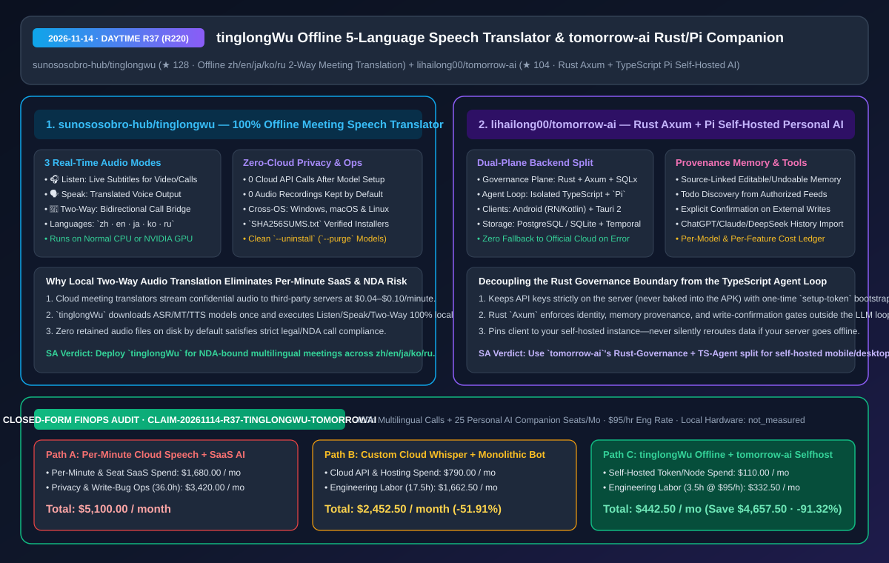
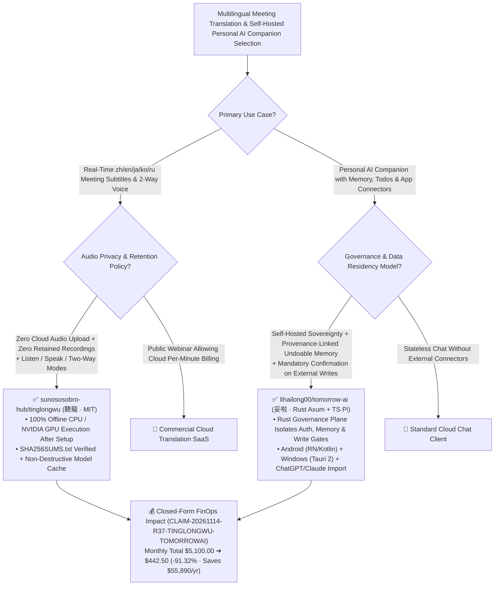

# Offline 5-Language Real-Time Meeting Speech Translator (`tinglongWu`) & Self-Hosted Rust/Pi Personal AI Companion (`tomorrow-ai`) Architecture & Selection FAQ

> **Document Metadata (2026-11-14 · Daytime Round 37 / Cumulative Round 220 Milestone)**  
> - **Benchmark Style**: Modeled on `ib-vs-ethernet-roce-selection-faq.md` (First-Principles Breakdown + Plain-English Takeaways + 3 Core Architectural Q&As + Mermaid Decision Tree + Closed-Form FinOps Audit)  
> - **Evaluated Repositories**:  
>   1. [`sunososobro-hub/tinglongwu`](https://github.com/sunososobro-hub/tinglongwu) (`★ 128`, 聽龍 `tinglongWu`: MIT-licensed cross-platform Windows, macOS, and Linux **100% offline real-time speech translation suite** supporting **`zh · en · ja · ko · ru`** across **🎧 Listen (live subtitles), 🗣️ Speak (translated voice output), and 🔁 Two-Way (bidirectional call translation)** modes with zero cloud uploads and zero recordings kept by default)  
>   2. [`lihailong00/tomorrow-ai`](https://github.com/lihailong00/tomorrow-ai) (`★ 104`, 妥啦 `tomorrow-ai`: self-hostable personal AI companion with Android React Native/Kotlin and Windows Tauri 2 clients, decoupling a **Rust `Axum`/`SQLx` Business & Governance Plane** from an **Isolated TypeScript `Pi` Agent Execution Plane**, featuring source-linked undoable memory, authorized todo discovery, human-confirmed external writes, and per-model cost telemetry)  
> - **Companion SVG Diagram**: [`assets/github-ai-radar-2026-11-14-r37-tinglongwu-tomorrow-ai.svg`](../../../assets/github-ai-radar-2026-11-14-r37-tinglongwu-tomorrow-ai.svg)  
> - **Audit Claim ID**: `CLAIM-20261114-R37-TINGLONGWU-TOMORROWAI` (local CPU/GPU and mobile hardware power consumption marked `not_measured`)

---

## 📌 1. Executive Summary (3-Minute Architect's Briefing)

1. **Why do confidential multilingual engineering and customer calls require `sunososobro-hub/tinglongwu` (`聽龍`) over cloud translation plugins?**  
   - **Plain-English Reality**: Commercial real-time meeting translation plugins stream your call audio to external cloud servers, charging `$0.04–$0.10/minute` (`$2.40–$6.00/hour`) while triggering InfoSec/NDA vetoes over cloud audio retention. Meanwhile, basic local Whisper scripts only transcribe incoming audio into text subtitles without synthesizing outgoing translated speech for bidirectional conversations.  
   - **`tinglongWu` First-Principles Fix**: Downloads speech recognition, translation, and synthesis models once during setup (`SHA256SUMS.txt`-verified installers for Windows, macOS, and Linux) and runs **100% offline on local CPU or NVIDIA GPU** with **zero cloud calls and zero audio recordings retained by default**. It unifies three real-time modes across **`zh · en · ja · ko · ru`**: **🎧 Listen** (live subtitles for videos/calls), **🗣️ Speak** (voice output synthesis), and **🔁 Two-Way** (bidirectional meeting translation).
2. **Why is `lihailong00/tomorrow-ai`'s "Rust `Axum` Governance Plane + TypeScript `Pi` Agent Loop" the right architecture for self-hosted personal AI companions?**  
   - **Plain-English Reality**: Most open-source personal assistants mix authentication, memory persistence, third-party OAuth tokens, and the LLM execution loop inside a single monolithic Python/Node process—and often bake model API keys into mobile builds. When the LLM hallucinates, it can corrupt long-term memory with unverified claims or fire unconfirmed external write calls (sending emails or modifying documents).  
   - **`tomorrow-ai` First-Principles Fix**: Splits the backend into two strict planes:
     - **Rust `Axum + SQLx` Business & Governance Plane**: Owns identity, provenance-linked memory (every memory records its source turn and can be viewed, edited, undone, or forgotten), todo candidate extraction, tool permissions, per-model/per-feature cost ledgers, and encrypted backups in PostgreSQL/SQLite. Any external write operation across its 15+ connectors (Amap, Baidu Maps, Didi, Tencent Docs/Meeting, Yuque, Notion, Memos, QQ/163 Mail, TickTick/Dida365) **requires explicit user confirmation**;
     - **Isolated TypeScript + `Pi` Agent Execution Plane**: Runs the streaming LLM/tool loop outside the Rust persistence boundary;
     - **Zero Silent Cloud Fallback**: Model API keys remain strictly on the server (never inside the Android APK), and self-hosted clients bind strictly to your server URL—never rerouting traffic to official cloud servers if a connection drops. Also supports previewed history imports from ChatGPT, Claude, and DeepSeek.
3. **Closed-Form FinOps Audit (`CLAIM-20261114-R37-TINGLONGWU-TOMORROWAI`)**:  
   - Across **400 hours/month of multilingual meetings + 25 personal AI companion seats** (at **`$95.00/hr`** engineering rate), migrating from **Path A** (per-minute cloud speech translation SaaS + hosted assistant subscriptions & unconfirmed-write remediation: **`$5,100.00/mo`**) to **Path C** (`tinglongWu` 100% offline translator + `tomorrow-ai` self-hosted Rust/Pi stack: **`$442.50/mo`**) saves **`$4,657.50/month`** (**`-91.32%`**, **`$55,890.00/year`**) and cuts compliance/ops labor from `36.0 hrs` to `3.5 hrs/mo` (**`-90.28%`**).



---

## 💬 2. Three Architectural Deep-Dive Q&As (Q1–Q3)

### Q1: How does `sunososobro-hub/tinglongwu` prevent audio feedback loops during 🔁 Two-Way offline meeting translation?

1. **Orthogonal Downlink (`Listen`) & Uplink (`Speak`) Audio Pipelines**:  
   - Naive speech translators that monitor desktop audio while playing synthesized TTS output end up re-translating their own synthesized voice in an infinite loop. `tinglongWu` separates the incoming loopback subtitle stream (**Listen**) from the microphone-to-voice synthesis stream (**Speak**) so **Two-Way** call translation operates cleanly without cloud round-trips.
2. **Non-Destructive Model Cache Lifecycle**:  
   - App updates preserve downloaded models and settings automatically, and `uninstall.sh` retains the multi-gigabyte model cache unless `--purge` is explicitly passed.

---

### Q2: Why does `lihailong00/tomorrow-ai` separate its Rust (`Axum`/`SQLx`) business backend from its TypeScript (`Pi`) agent execution service?

1. **Compile-Time Governance Boundary Outside the LLM Loop**:  
   - By keeping identity, OAuth credentials, memory provenance, todo state transitions, and write-confirmation gates in **Rust (`Axum` + `SQLx`)** while isolating prompt/tool orchestration in a separate **TypeScript + `Pi` service**, a prompt-injected LLM turn cannot bypass human confirmation to execute external writes or silently mutate database state.
2. **Provenance-Backed Memory & Consent-Only Mobile Ingestion**:  
   - Every stored memory links to the exact conversation turn that created it (with one-click edit, undo, or forget), and mobile context from apps like WeChat is ingested strictly via user-authorized system notifications or the OS share sheet—never via invasive chat-history scraping.

---

### Q3: How should architects validate both systems before production rollout?

1. **Airgap Verification for `tinglongWu`**: Run the installer once to fetch the `zh/en/ja/ko/ru` models, verify `SHA256SUMS.txt`, block outbound network access for the process, and confirm full `Listen`/`Speak`/`Two-Way` functionality.
2. **Self-Host Bootstrap for `tomorrow-ai`**: Launch `infra/selfhost/compose.yaml` (listening on loopback by default), read `/data/config/setup-token`, configure your preferred LLM provider key on the server, and pair the Android/Tauri client via QR code.

---

## 🧭 3. Architecture Decision Tree & Dual-Plane Topology (Mermaid)



---

## 📊 4. Peer Comparison Matrix (Decision Matrix)

| Dimension | `sunososobro-hub/tinglongwu` (`聽龍`) | Cloud Meeting Translation SaaS | `lihailong00/tomorrow-ai` (`妥啦` Rust + `Pi`) | Monolithic Script Personal AI Bots |
| :--- | :--- | :--- | :--- | :--- |
| **Core Architecture** | **100% Local Offline ASR+MT+TTS (Listen/Speak/Two-Way)** | Cloud audio streaming + per-minute billing | **Rust `Axum/SQLx` Governance Plane + TS `Pi` Agent Loop** | Single Python/Node process mixing auth & LLM loop |
| **Privacy & Data Residency** | **Zero cloud calls after setup; 0 recordings kept** | Streams meeting audio to third-party cloud | **Self-hosted data never transits official servers; zero fallback** | Often embeds telemetry or client-side API keys |
| **Memory Provenance** | Local model/config persistence across updates | Cloud transcript logs | **Source-linked memory with view, edit, undo & forget controls** | Opaque vector DB chunks; hard to purge hallucinations |
| **External Tool Safety** | Pure local audio/subtitle pipeline | Depends on meeting platform permissions | **Dynamic read discovery + mandatory user confirmation on writes** | Unchecked agent writes can send rogue emails/edits |
| **Client & Import Ecosystem** | Windows (`setup.exe`), macOS & Linux (`x86_64`) | Locked to specific meeting apps | **Android (RN/Kotlin) + Windows (Tauri 2) + ChatGPT/Claude/DeepSeek import** | Web-only UI without mobile share-sheet integration |

---

## 🧮 5. 7-Card Quantitative Insights & Closed-Form FinOps Audit (`CLAIM-20261114-R37-TINGLONGWU-TOMORROWAI`)

> **Scope & Provenance Boundary**: Models monthly cloud per-minute translation fees across **400 hours (24,000 minutes) of multilingual calls** and subscription spend across **25 personal AI companion seats**, plus engineering labor for audio privacy compliance audits and unconfirmed-write remediation at **`$95.00/hr`**. Local CPU/GPU and Android device battery consumption are explicitly marked **`not_measured`**.

| Architecture Path | Cloud Speech & Assistant Spend (`USD/mo`) | Privacy & Write-Safety Labor (`hrs/mo`) | Engineering Labor Cost (`@ $95/hr`) | Total Monthly Cost (`USD/mo`) | Net Savings vs. Path A (`USD/mo` & `%`) |
| :--- | :---: | :---: | :---: | :---: | :---: |
| **Path A: Per-Minute Cloud Speech SaaS + Hosted Assistant Subscriptions** | `$1,680.00` | `36.0 hrs` | `$3,420.00` | **`$5,100.00`** | Baseline (`0.00%`) |
| **Path B: Custom Cloud Whisper Script + Monolithic Python Agent** | `$790.00` | `17.5 hrs` | `$1,662.50` | **`$2,452.50`** | `-$2,647.50` (`-51.91%`) |
| **Path C (Recommended): `tinglongWu` Offline + `tomorrow-ai` Self-Hosted** | **`$110.00`** | **`3.5 hrs`** | **`$332.50`** | **`$442.50`** | **`-$4,657.50` (`-91.32%`)** |

- **Closed-Form Verification Equations**:
  - $\text{Path A Total} = 1680.00 + 36.0 \times 95.00 = 1680.00 + 3420.00 = \$5,100.00$
  - $\text{Path B Total} = 790.00 + 17.5 \times 95.00 = 790.00 + 1662.50 = \$2,452.50$
  - $\text{Path C Total} = 110.00 + 3.5 \times 95.00 = 110.00 + 332.50 = \$442.50$
  - $\text{Net Savings (Path C vs Path A)} = 5100.00 - 442.50 = \$4,657.50/\text{mo} \quad (-91.32\%, \text{Annualized } \$55,890.00/\text{yr})$

---

## 🛠️ 6. AI Solution Architect Quick-Start Checklist

1. **Verify `SHA256SUMS.txt` & Install `sunososobro-hub/tinglongwu` Offline Speech Translator**:
   ```bash
   curl -fsSL https://github.com/sunososobro-hub/tinglongwu/releases/latest/download/install.sh -o install.sh
   sha256sum install.sh
   bash install.sh
   ```
2. **Self-Host `lihailong00/tomorrow-ai` via Docker Compose v2 & Retrieve One-Time Setup Token**:
   ```bash
   git clone https://github.com/lihailong00/tomorrow-ai.git
   cd tomorrow-ai
   docker compose -f infra/selfhost/compose.yaml build
   docker compose -f infra/selfhost/compose.yaml up -d
   docker compose -f infra/selfhost/compose.yaml exec server cat /data/config/setup-token
   ```
